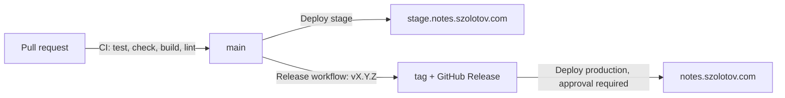

# Notes

Source of [notes.szolotov.com](https://notes.szolotov.com): architecture decisions,
platform patterns, tool comparisons and operational notes, written in Markdown
(Obsidian-friendly) and published as a static site.

| | |
| --- | --- |
| Generator | [Astro](https://astro.build) + [Starlight](https://starlight.astro.build), pinned in `package-lock.json` |
| Hosting | Cloudflare Workers static assets (no Worker script, no backend) |
| Production | `https://notes.szolotov.com` — Worker `notes`, deployed from `vX.Y.Z` tags only |
| Stage | `https://stage.notes.szolotov.com` — Worker `notes-stage`, deployed on every merge to `main`, `noindex` |

## Features

- `[[wikilinks]]`, `[[note|alias]]`, `[[note#heading]]` — resolved at build time; broken links fail CI
- Obsidian callouts (`> [!warning] Title`) rendered as Starlight asides
- Mermaid diagrams (` ```mermaid `), themed for light and dark mode
- Full-text search (Pagefind), table of contents, dark/light mode
- Syntax highlighting with copy button (Expressive Code)
- Tags in frontmatter, indexed on [`/tags/`](https://notes.szolotov.com/tags/)

Not included: backlinks and the graph view. They need a site-wide link index;
add them later if the note count makes them worthwhile.

## Local development

Requires Node.js `22.12+` (the exact version CI uses is in `.nvmrc`).

```sh
nvm use                 # or: fnm use / asdf / mise
npm ci
npm run dev             # http://localhost:4321, live reload
```

Checks that CI runs:

```sh
npm test                                   # plugin and build-config unit tests
npm run check                              # astro check (types, content schema)
STRICT_LINKS=1 npm run build               # production build, fails on broken wikilinks
DEPLOY_ENV=stage STRICT_LINKS=1 npm run build
```

Preview a build with Cloudflare's own asset serving (honours `_headers`, 404 page):

```sh
DEPLOY_ENV=stage npm run build
npx wrangler dev --env stage
SMOKE_BASE_URL=http://localhost:8787 scripts/smoke-test.sh stage local
```

## Writing notes

Notes live in `src/content/docs/`:

```text
src/content/docs/
├── index.md        # home page
├── adr/            # architecture decision records, NNNN-short-title.md
├── patterns/       # reusable platform patterns
├── tools/          # comparisons and evaluations
└── standards/      # conventions
```

Frontmatter:

```yaml
---
title: GKE Workload Identity          # required
description: One-sentence summary     # used for SEO and link previews
tags: [gcp, gke, security]            # listed on the page and on /tags/
status: accepted                      # ADRs only: proposed | accepted | superseded | deprecated
draft: true                           # optional: only visible in `npm run dev`, never deployed
---
```

A new file in an existing folder appears in the sidebar automatically.
A new top-level folder needs a sidebar entry in `astro.config.mjs`.

### Obsidian

**Option A — open the content folder as a vault (recommended).**
In Obsidian, *Open folder as vault* → select `src/content/docs`. Then in
*Settings → Files and links*:

- *Use [[Wikilinks]]*: on
- *New link format*: *Shortest path when possible*
- *Default location for new attachments*: *Same folder as current file*, so
  relative image links work both in Obsidian and in the built site

Commit and push from a terminal or the Obsidian Git plugin, on a branch, and
open a pull request. `.obsidian/workspace*.json` and `.trash/` are ignored.

**Option B — a separate vault with selective publishing.**
Keep your private vault elsewhere and copy only the notes to publish into
`src/content/docs/` (manually, or with a sync plugin that writes into a Git
checkout). Every published note still needs `title` in its frontmatter, and
wikilinks must point at notes that are also published, or CI fails.

## Delivery flow



| Workflow | Trigger | What it does |
| --- | --- | --- |
| `ci.yml` | PR into `main`, push to `main` | unit tests, `astro check`, strict build for both envs, `wrangler deploy --dry-run`, actionlint, shellcheck |
| `deploy-stage.yml` | push to `main`, manual | build for stage → deploy `notes-stage` → smoke test → roll back on failure |
| `release.yml` | manual, from `main` | creates `vX.Y.Z` tag + GitHub Release at the tip of `main`, then calls the production deploy |
| `deploy-production.yml` | `v*` tag push, called by Release, manual | checks the tag is `vX.Y.Z` and on `main` → **waits for approval** → build → deploy `notes` → smoke test → roll back on failure |

Every deploy writes `/build-info.json` (`env`, `commit`, `ref`). The smoke test
waits until the new commit is live before checking pages, 404 handling,
security headers and indexing rules, so a stale cache can't produce a false pass.

### Release to production

```sh
# Preferred: Actions → Release → Run workflow (branch: main) → version 1.2.0
# CLI equivalent:
gh workflow run release.yml --ref main -f version=1.2.0

# Or push a tag yourself (must point at a commit on main):
git switch main && git pull --ff-only
git tag -a v1.2.0 -m "v1.2.0"
git push origin v1.2.0
```

Then approve the `production` deployment in the Actions run.

### Rollback

- **Automatic:** if the post-deploy smoke test fails, `scripts/deploy.sh` runs
  `wrangler rollback` to the version that was live before, re-checks it, and
  fails the job.
- **Manual, through Git:** Actions → Deploy production → Run workflow → enter the
  previous tag (e.g. `v1.1.0`). It goes through the same approval and smoke test.
- **Manual, fastest (bypasses CI):**

  ```sh
  npx wrangler deployments list --env production    # find the previous version id
  npx wrangler rollback <version-id> --env production --message "reason"
  ```

  Follow up with a tag that matches what is live, so Git and production agree.

## One-time setup

Done once by a repository admin; none of this is in code.

### Cloudflare

1. The zone `szolotov.com` must be on Cloudflare.
2. Create an API token (*Account API tokens → Create token → Edit Cloudflare
   Workers* template), scoped to this account and the `szolotov.com` zone. It
   needs Workers edit access and *Zone → Workers Routes → Write*, because the
   deploy manages the custom domains. Creating a Worker the first time may need
   a broader role than updating it; if the first deploy fails with an
   authorization error, run it once locally with `npx wrangler login` and
   `npx wrangler deploy --env <env>`. Check the current permission names in
   [Cloudflare's Workers authorization docs](https://developers.cloudflare.com/workers/authorization/).
3. No DNS records need to be created by hand: deploying a Worker with
   `custom_domain: true` creates the DNS record and certificate. If a record for
   `notes` or `stage.notes` already exists, remove it first or the deploy fails.

### GitHub

1. **Environments** (*Settings → Environments*):

   | Environment | Protection | Secrets / variables |
   | --- | --- | --- |
   | `stage` | Deployment branches: `main` only | secret `CLOUDFLARE_API_TOKEN`, variable `CLOUDFLARE_ACCOUNT_ID` |
   | `production` | Required reviewers: you; deployment tags: `v*` only; optionally *prevent self-review* off for a solo repo | secret `CLOUDFLARE_API_TOKEN`, variable `CLOUDFLARE_ACCOUNT_ID` |

   Use a separate token per environment if you want to revoke them independently.
   Do **not** add the token as a repository secret: then only the gated
   environments can read it.

2. **Branch ruleset for `main`:** require a pull request, require the `CI`
   checks (*Test and build*, *Lint workflows and scripts*), block force pushes
   and deletion.
3. **Tag ruleset for `v*`:** restrict creation, update and deletion to admins,
   so nobody else can trigger a production deploy by pushing a tag. If the
   Release workflow is then refused when it creates the tag, add the GitHub
   Actions app to the ruleset's bypass list.
4. *Settings → Actions → General → Workflow permissions*: *Read repository
   contents*. Only `release.yml` asks for `contents: write`, for its own job.

## Troubleshooting

| Symptom | Cause | Fix |
| --- | --- | --- |
| `Unresolved wikilink [[x]] in …` | link target doesn't exist, or the bare name matches two notes | fix the name, or link by path: `[[patterns/x]]` |
| Smoke test: `new version never became live` | custom domain not attached yet, or deploy hit a different Worker | check `npx wrangler deployments status --env <env>` and the domain under *Workers → notes → Settings → Domains* |
| Deploy: authentication error `10000` | token missing permissions or scoped to the wrong zone | see Cloudflare step 2 |
| Stage appears in search results | `X-Robots-Tag` missing | `curl -sI https://stage.notes.szolotov.com/ \| grep -i robots`, then check the stage build log for `noindex=true` |
| Production run waits forever | nobody approved the `production` deployment | approve it in the run, or cancel it |

## Dependencies

Versions are pinned exactly and updated by Dependabot weekly (`npm` and GitHub
Actions, which are pinned by commit SHA). `npm audit` currently reports
moderate/low advisories in build-time-only transitive dependencies
(`postcss-selector-parser` via Expressive Code, `katex` via Mermaid). Nothing in
them runs on the deployed site's server, because there is no server. Recheck
these when Dependabot raises their parents.

## License

[Apache-2.0](LICENSE)
