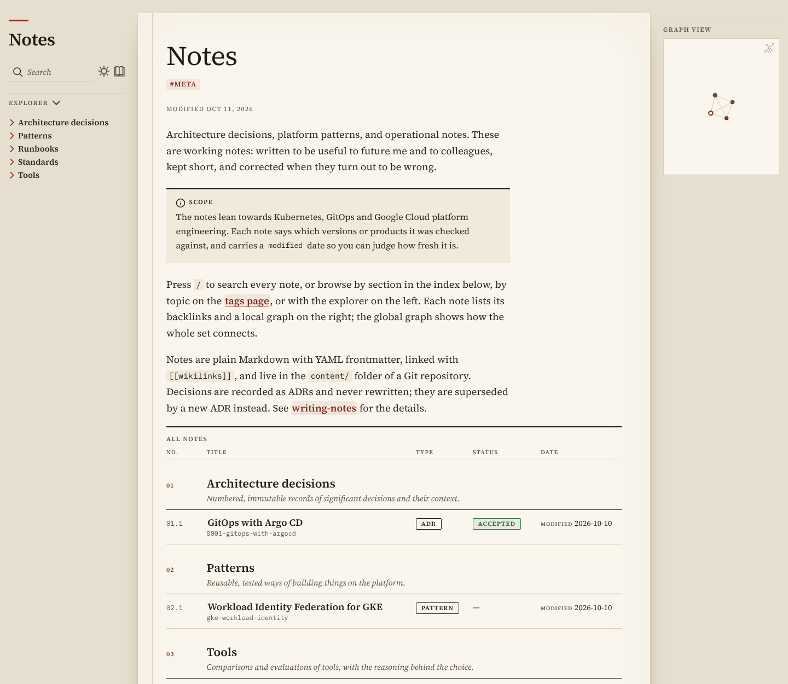
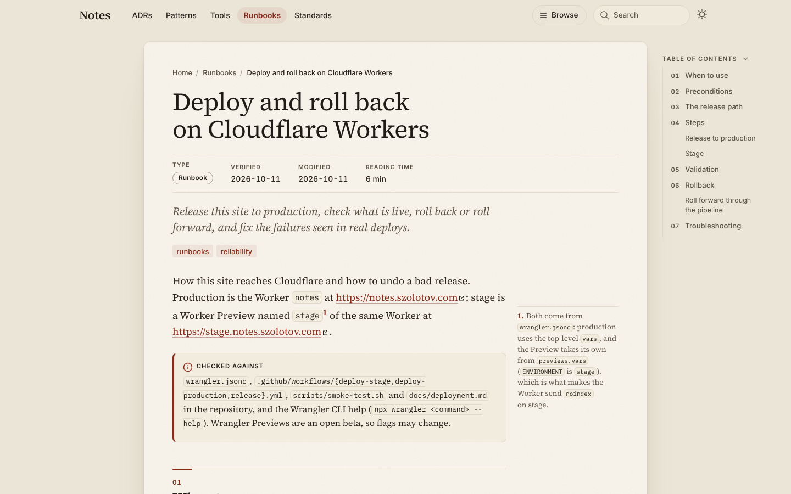
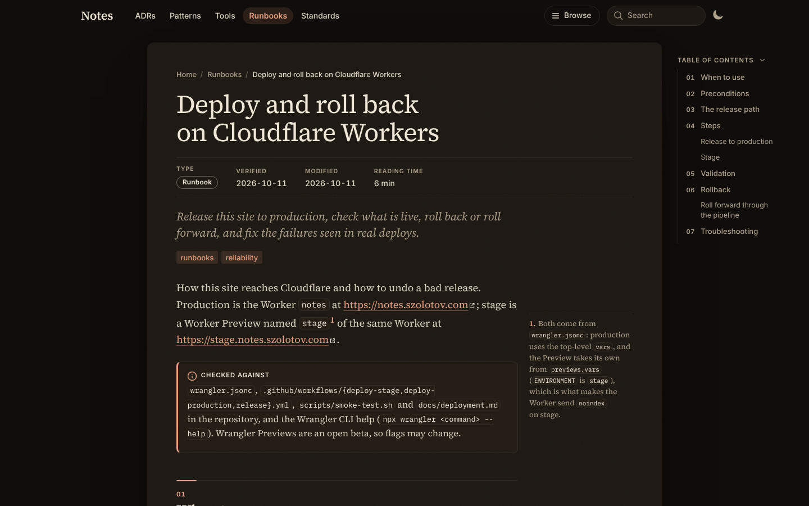
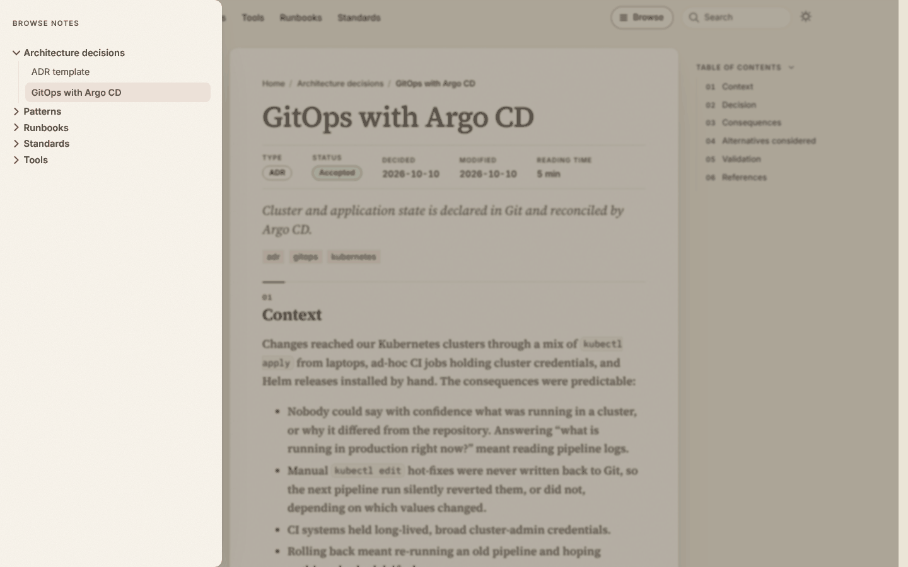
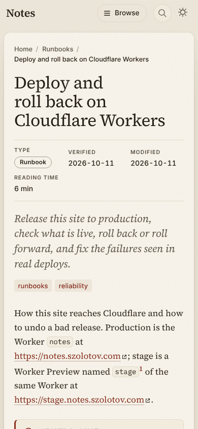
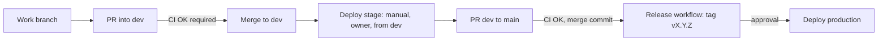

# Notes

Architecture decision records, platform patterns, tool notes and engineering standards, published as a static site at <https://notes.szolotov.com> and a pre-production site at <https://stage.notes.szolotov.com> (a Preview of the same Worker behind Cloudflare Access, deployed by hand from the `dev` branch).

The site is built with [Quartz](https://quartz.jzhao.xyz/) and served by a Cloudflare Worker. The Markdown is Obsidian-friendly (wikilinks, frontmatter, callouts), see [docs/obsidian.md](docs/obsidian.md).

## Repository layout

| Path                           | Contents                                                                                                      |
| ------------------------------ | ------------------------------------------------------------------------------------------------------------- |
| `content/`                     | The notes: `adr/`, `patterns/`, `tools/`, `standards/`, `index.md`                                            |
| `quartz/`                      | Vendored Quartz engine (do not edit; see "Quartz" below)                                                      |
| `quartz.config.*`, `quartz.ts` | Site configuration and layout (our customisations)                                                            |
| `local-plugins/`               | Local Quartz plugins: top bar, section row, metadata sheet, note index, linked-from, content-start, sidenotes |
| `worker/`, `wrangler.jsonc`    | Cloudflare Worker (headers, robots) and its configuration                                                     |
| `scripts/`                     | Build helpers, `smoke-test.sh`, `update-quartz.sh`                                                            |
| `.github/`                     | Workflows, Dependabot, CODEOWNERS                                                                             |
| `docs/`                        | [deployment.md](docs/deployment.md), [obsidian.md](docs/obsidian.md)                                          |
| `docs/screenshots/`            | Screenshots shown in this README                                                                              |

## Local development

```sh
nvm use          # Node 22, from .nvmrc
npm ci
npm run dev      # live-reloading dev server
npm run build    # production build into public/ (also writes public/version.txt)
npm run preview  # serve public/ through the Worker locally (wrangler dev, port 8787)
```

`npm run preview:stage` previews the stage variant (`ENVIRONMENT=preview`: noindex headers, `Disallow: /`). `wrangler dev` presents requests with the route's host (`notes.szolotov.com`), so `npm run preview` shows the indexable production behaviour; add `--local-upstream localhost:8787` to see the non-canonical (noindex) behaviour. Only production on `notes.szolotov.com` is indexable.

Checks (the same ones CI runs):

```sh
npm run check            # TypeScript
npm run check:links      # broken internal links (needs a build)
npm run format:check     # Prettier (npm run format to fix)
npm run test:scripts     # unit tests for scripts/ and the Worker's indexing policy
npm run deploy:dry-run   # wrangler deploy --dry-run (the single Worker `notes`)
```

Also `npm run check:contrast`: WCAG AA contrast of the palette in both themes (CI runs it after the build; run it after changing a colour).

`npm run dev` skips `scripts/postprocess-build.mjs`, so the dev server has no self-hosted fonts and follows the system theme. Use `npm run build` and `npm run preview` to see the site as deployed.

Build-time variables: `NOTES_BASE_URL` (default `notes.szolotov.com`), `NOTES_VERSION` (`X.Y.Z`, `main` or `stage`), `NOTES_SHA`.

## Writing notes

Keep notes short and link generously. Put a note in the section it belongs to (`content/adr`, `content/patterns`, `content/tools`, `content/standards`); the conventions, frontmatter and templates are described in `content/standards`. Use `[[wikilinks]]` for internal links and add tags in frontmatter.

Obsidian workflow: open `content/` as a vault, or publish selected notes with the Quartz Syncer plugin. Details and recommended settings: [docs/obsidian.md](docs/obsidian.md).

## Design

A calm sheet of paper on a desk, light by default, whatever the OS theme (a saved toggle choice wins). One centred 68rem sheet, the same on every page, sits on the desk as warm paper with rounded corners, a faint grain (an SVG `feTurbulence` noise tile as a data URI, so no image file; it uses the CSP's existing `img-src data:`) and a soft, diffuse shadow; rules are thin and light. The dark theme is the same page at night: a warm charcoal sheet with off-white ink and a salmon accent, never pure black or white.

Source Serif 4 sets the reading text and headings (400, 600 and italic; old-style numerals in prose, lining and tabular ones in tables and dates), Inter the interface (top bar, labels, chips, table of contents, metadata, table headers) and IBM Plex Mono the code. All are self-hosted: the woff2 files come from the `@fontsource` and `@fontsource-variable` devDependencies and are copied to `public/static/fonts/` by `scripts/postprocess-build.mjs`, so the Worker's CSP needs no extra origin. Inter is the variable font, so one file per subset covers every weight; a Latin page fetches about 48 KB of Inter plus the serif files it uses.

The structure:

- A sticky top bar in two rows: the wordmark, Browse, search and the theme toggle, and under them links to the ten sections (the current one highlighted), which scroll sideways when they do not fit, with the current one scrolled into view. On short landscape screens the bar scrolls away. Its background turns into a translucent, blurred band as the page scrolls and a thin line under it shows the reading progress, both CSS scroll-driven animations (older browsers just keep the band and no line). The **Browse** button opens the full tree (Quartz's Explorer) as a drawer from the right edge at every width; Escape, a click outside or a link closes it. The bar is the page frame's left sidebar, and `local-plugins/top-bar` supplies the wordmark and a small script for the drawer's focus handling (a closed drawer is inert; opening the search closes it), the current heading in the table of contents, the `main` landmark and a second scroll to a `#hash` once the layout has settled; `local-plugins/section-row` supplies the second row. "Skip to content" targets the page title (`local-plugins/content-start`) and works without JavaScript.
- The home page has a short intro, a card per section (description, note count, last update), then a table of every note grouped by section (number, title and file name, type, status, verified or modified date), which becomes a stack of cards on a phone. It is built from the notes' frontmatter by `local-plugins/note-index`, so a new note appears there without any edit to the home page.
- Notes show a spec sheet under the title (`type`, `status`, `decided`, `verified`, modified date, reading time; `local-plugins/note-meta`), tags as light chips, numbered `##` sections (01, 02, ...) that the sticky table of contents beside the sheet repeats, and sidenotes in the margin of the sheet from 1280px up. A note ends with "Linked from" (`local-plugins/linked-from`) and its local graph (`local-plugins/note-graph`, drawn with Canvas 2D), whose depth runs live from 1 to 5 or All and which has a Tags toggle.
- The full graph of all notes opens from the toolbar button or with Ctrl/Cmd+G on every page (`local-plugins/graph-launcher`): search, depth, tags and orphans toggles, and a legend of section colours that hides sections. Settings are remembered in this browser, and a list view is the text alternative.
- Printing gives plain paper: no bar, drawer, graph, graph dialog or "Linked from" list, external links with their address, sidenotes as footnotes.
- Motion is gentle and all of it is off under `prefers-reduced-motion`. Durations and easing curves are tokens at the top of `quartz/styles/custom.scss`; only opacity, transform, colours and shadows are animated. Pages fade in and rise a few pixels after a navigation (the top-bar script marks the moment, the CSS does the rest), the Browse drawer slides in on a spring-like curve, the section cards lift, the table of contents indicator slides, and toggling the theme cross-fades the colours (never on load).

All custom CSS is in `quartz/styles/custom.scss` and the colour keys are in `quartz.config.yaml`; `npm run check:contrast` checks both themes. The frontmatter fields are described in `content/standards/writing-notes.md`.











## Delivery flow



1. Branch `<type>/<kebab>` from `dev` and open a pull request into `dev`. CI must pass (`CI OK`).
2. Merging deploys nothing. The owner runs **Deploy stage** (Actions, branch `dev`) to update https://stage.notes.szolotov.com (behind Cloudflare Access; about 15 minutes; `/version.txt` shows `stage+<sha>`) ([Stage Preview](docs/deployment.md#stage-preview)). Production traffic is untouched.
3. When stage looks good, open a pull request `dev` to `main` and merge it with a merge commit (`CI OK` required). Back-merges `main` into `dev` also go by pull request with a merge commit, never squash or rebase, so `dev` keeps every commit of `main` (`dev` stays a descendant of `main`).
4. To release: Actions, **Release**, **Run workflow** on `main`, enter the version as `X.Y.Z`. The workflow checks that CI passed for that commit and that the version is higher than the latest tag, creates the tag and GitHub Release, and starts the production deployment.
5. Approve the deployment in the `production` environment. A smoke test runs against the Worker's workers.dev URL after the deploy; on failure the previous version is restored automatically.

Production only ever deploys from a `vX.Y.Z` tag. Deploy workflows build in a job without secrets and deploy from a second job, because `npm run build` fetches and builds third-party Quartz plugins (pinned in `quartz.lock.json`, whose changes deserve review). Deploy builds are cold and take about 15 minutes; CI caches the plugins. Builds need access to github.com and npm. Details: [docs/deployment.md](docs/deployment.md#build-and-deploy-are-separate-jobs). Setup (Cloudflare token, GitHub environments) is in [docs/deployment.md](docs/deployment.md); the branch rulesets and environment policies are applied by the **Repository settings** workflow ([docs/deployment.md](docs/deployment.md#repository-settings)).

## Rolling back

- Re-deploy an older release: Actions, **Deploy production**, Run workflow with an older **tag** selected as the ref, then approve. This rebuilds and deploys that tag.
- Fast path: `npx wrangler rollback <version-id> --message "reason"` (list ids with `npx wrangler deployments list`). Production only: stage is a Preview and has no rollback, so merge a fix into `dev` and run Deploy stage again. See [docs/deployment.md](docs/deployment.md#rollback).

## Quartz

The Quartz engine is vendored (no upstream history). The pinned release is recorded in `QUARTZ_VERSION` (tag, commit, upstream URL). To upgrade:

```sh
scripts/update-quartz.sh <tag>   # re-imports the engine and updates QUARTZ_VERSION
npm install && npm run build && npm run check
```

Then open a pull request. Dependabot does not manage the vendored engine. Customise through the configuration and layout files rather than editing `quartz/`. The one local patch (`quartz/cli/plugin-git-handlers.js` exits non-zero when a plugin fails to restore or build) is overwritten by the script: re-apply it from the git history if the script's final message says it is gone. Quartz is MIT licensed; its license text is kept in `LICENSE-QUARTZ`.

## License

Apache-2.0, see [LICENSE](LICENSE). Quartz (vendored) is MIT, see [LICENSE-QUARTZ](LICENSE-QUARTZ).
