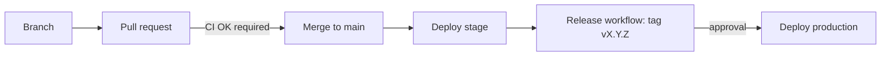

# Notes

Architecture decision records, platform patterns, tool notes and engineering standards, published as a static site at <https://notes.szolotov.com> (staging: <https://stage.notes.szolotov.com>).

The site is built with [Quartz](https://quartz.jzhao.xyz/) and served by a Cloudflare Worker. The Markdown is Obsidian-friendly (wikilinks, frontmatter, callouts), see [docs/obsidian.md](docs/obsidian.md).

## Repository layout

| Path                           | Contents                                                             |
| ------------------------------ | -------------------------------------------------------------------- |
| `content/`                     | The notes: `adr/`, `patterns/`, `tools/`, `standards/`, `index.md`   |
| `quartz/`                      | Vendored Quartz engine (do not edit; see "Quartz" below)             |
| `quartz.config.*`, `quartz.ts` | Site configuration and layout (our customisations)                   |
| `worker/`, `wrangler.jsonc`    | Cloudflare Worker (headers, robots) and its configuration            |
| `scripts/`                     | Build helpers, `smoke-test.sh`, `update-quartz.sh`                   |
| `.github/`                     | Workflows, Dependabot, CODEOWNERS                                    |
| `docs/`                        | [deployment.md](docs/deployment.md), [obsidian.md](docs/obsidian.md) |

## Local development

```sh
nvm use          # Node 22, from .nvmrc
npm ci
npm run dev      # live-reloading dev server
npm run build    # production build into public/ (also writes public/version.txt)
npm run preview  # serve public/ through the Worker locally (wrangler dev, port 8787)
```

`npm run preview:stage` previews the stage variant (noindex headers, `Disallow: /`).

Checks (the same ones CI runs):

```sh
npm run check            # TypeScript
npm run check:links      # broken internal links (needs a build)
npm run format:check     # Prettier (npm run format to fix)
npm run deploy:dry-run   # wrangler deploy --dry-run for production and stage
```

Build-time variables: `NOTES_BASE_URL` (default `notes.szolotov.com`), `NOTES_VERSION` (`X.Y.Z`), `NOTES_SHA`.

## Writing notes

Keep notes short and link generously. Put a note in the section it belongs to (`content/adr`, `content/patterns`, `content/tools`, `content/standards`); the conventions, frontmatter and templates are described in `content/standards`. Use `[[wikilinks]]` for internal links and add tags in frontmatter.

Obsidian workflow: open `content/` as a vault, or publish selected notes with the Quartz Syncer plugin. Details and recommended settings: [docs/obsidian.md](docs/obsidian.md).

## Delivery flow



1. Work on a branch and open a pull request. CI must pass (`CI OK`).
2. Merging to `main` deploys to staging automatically.
3. To release: Actions, **Release**, **Run workflow** on `main`, enter the version as `X.Y.Z`. The workflow checks that CI passed for that commit and that the version is higher than the latest tag, creates the tag and GitHub Release, and starts the production deployment.
4. Approve the deployment in the `production` environment. A smoke test runs after the deploy; on failure the previous version is restored automatically.

Production only ever deploys from a `vX.Y.Z` tag. Deploy workflows build in a job without secrets and deploy from a second job, because `npm run build` fetches and builds third-party Quartz plugins (pinned in `quartz.lock.json`, whose changes deserve review). Deploy builds are cold and take about 15 minutes; CI caches the plugins. Builds need access to github.com and npm. Details: [docs/deployment.md](docs/deployment.md#build-and-deploy-are-separate-jobs). Setup (Cloudflare token, GitHub environments, rulesets) is in [docs/deployment.md](docs/deployment.md).

## Rolling back

- Re-deploy an older release: Actions, **Deploy production**, Run workflow with an older **tag** selected as the ref, then approve. This rebuilds and deploys that tag.
- Fast path: `npx wrangler rollback <version-id> --message "reason"` (list ids with `npx wrangler deployments list`). See [docs/deployment.md](docs/deployment.md#rollback).

## Quartz

The Quartz engine is vendored (no upstream history). The pinned release is recorded in `QUARTZ_VERSION` (tag, commit, upstream URL). To upgrade:

```sh
scripts/update-quartz.sh <tag>   # re-imports the engine and updates QUARTZ_VERSION
npm install && npm run build && npm run check
```

Then open a pull request. Dependabot does not manage the vendored engine. Customise through the configuration and layout files rather than editing `quartz/`. Quartz is MIT licensed; its license text is kept in `LICENSE-QUARTZ`.

## License

Apache-2.0, see [LICENSE](LICENSE). Quartz (vendored) is MIT, see [LICENSE-QUARTZ](LICENSE-QUARTZ).
