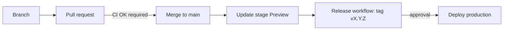

# Notes

Architecture decision records, platform patterns, tool notes and engineering standards, published as a static site at <https://notes.szolotov.com> (staging: <https://stage.notes.szolotov.com>, a Preview of the same Worker).

The site is built with [Quartz](https://quartz.jzhao.xyz/) and served by a Cloudflare Worker. The Markdown is Obsidian-friendly (wikilinks, frontmatter, callouts), see [docs/obsidian.md](docs/obsidian.md).

## Repository layout

| Path                           | Contents                                                             |
| ------------------------------ | -------------------------------------------------------------------- |
| `content/`                     | The notes: `adr/`, `patterns/`, `tools/`, `standards/`, `index.md`   |
| `quartz/`                      | Vendored Quartz engine (do not edit; see "Quartz" below)             |
| `quartz.config.*`, `quartz.ts` | Site configuration and layout (our customisations)                   |
| `local-plugins/`               | Local Quartz plugins: metadata sheet, note index, sidenotes          |
| `worker/`, `wrangler.jsonc`    | Cloudflare Worker (headers, robots) and its configuration            |
| `scripts/`                     | Build helpers, `smoke-test.sh`, `update-quartz.sh`                   |
| `.github/`                     | Workflows, Dependabot, CODEOWNERS                                    |
| `docs/`                        | [deployment.md](docs/deployment.md), [obsidian.md](docs/obsidian.md) |
| `docs/screenshots/`            | Screenshots shown in this README                                     |

## Local development

```sh
nvm use          # Node 22, from .nvmrc
npm ci
npm run dev      # live-reloading dev server
npm run build    # production build into public/ (also writes public/version.txt)
npm run preview  # serve public/ through the Worker locally (wrangler dev, port 8787)
```

`npm run preview:stage` previews the stage variant (`ENVIRONMENT=stage`: noindex headers, `Disallow: /`). `wrangler dev` presents requests with the route's host (`notes.szolotov.com`), so `npm run preview` shows the indexable production behaviour; add `--local-upstream localhost:8787` to see the non-canonical (noindex) behaviour. Only production on `notes.szolotov.com` is indexable.

Checks (the same ones CI runs):

```sh
npm run check            # TypeScript
npm run check:links      # broken internal links (needs a build)
npm run format:check     # Prettier (npm run format to fix)
npm run test:scripts     # unit tests for scripts/ and the Worker's indexing policy
npm run deploy:dry-run   # wrangler deploy --dry-run (the single Worker `notes`)
```

Also `npm run check:contrast`: WCAG AA contrast of the palette in both themes (CI runs it after the build; run it after changing a colour).

`npm run dev` skips `scripts/postprocess-build.mjs`, so the dev server has no self-hosted fonts and follows the system theme. Use `npm run build` and `npm run preview` to see the site as deployed.

Build-time variables: `NOTES_BASE_URL` (default `notes.szolotov.com`), `NOTES_VERSION` (`X.Y.Z`), `NOTES_SHA`.

## Writing notes

Keep notes short and link generously. Put a note in the section it belongs to (`content/adr`, `content/patterns`, `content/tools`, `content/standards`); the conventions, frontmatter and templates are described in `content/standards`. Use `[[wikilinks]]` for internal links and add tags in frontmatter.

Obsidian workflow: open `content/` as a vault, or publish selected notes with the Quartz Syncer plugin. Details and recommended settings: [docs/obsidian.md](docs/obsidian.md).

## Design

A sheet of paper on a desk, light by default, whatever the OS theme (a saved toggle choice wins). The article sits on a warm paper sheet with a faint grain (an SVG `feTurbulence` noise tile as a data URI, so no image file; it uses the CSP's existing `img-src data:`), a soft layered shadow and a hairline margin rule; the sidebars sit on the desk like the margin of a notebook, with no panels. The dark theme is the same page at night: a warm charcoal sheet with off-white ink and a salmon accent, never pure black or white.

Source Serif 4 sets all text (400, 600 and italic; old-style numerals in prose, lining and tabular ones in tables, dates and labels) and IBM Plex Mono the code. Both are self-hosted: the woff2 files come from the `@fontsource` devDependencies and are copied to `public/static/fonts/` by `scripts/postprocess-build.mjs`, so the Worker's CSP needs no extra origin. Small labels are letter-spaced capitals in the same serif.

The structure comes from an index:

- The home page lists every note in a table grouped by section (number, title and file name, type, status, verified or modified date), which becomes a stack of cards on a phone. It is built from the notes' frontmatter by `local-plugins/note-index`, so a new note appears there without any edit to the home page.
- Notes show a spec sheet under the title (`type`, `status`, `decided`, `verified`, modified date, reading time; `local-plugins/note-meta`), numbered `##` sections (01, 02, ...) that the table of contents on the right repeats, and sidenotes in the margin of the sheet from 1200px up.
- Printing gives plain paper: no sidebars, external links with their address, sidenotes as footnotes.

All custom CSS is in `quartz/styles/custom.scss` and the colour keys are in `quartz.config.yaml`; `npm run check:contrast` checks both themes. The frontmatter fields are described in `content/standards/writing-notes.md`.


## Delivery flow



1. Work on a branch and open a pull request. CI must pass (`CI OK`).
2. Merging to `main` updates the Preview `stage` of the Worker `notes` automatically (served at https://stage.notes.szolotov.com; production traffic is untouched).
3. To release: Actions, **Release**, **Run workflow** on `main`, enter the version as `X.Y.Z`. The workflow checks that CI passed for that commit and that the version is higher than the latest tag, creates the tag and GitHub Release, and starts the production deployment.
4. Approve the deployment in the `production` environment. A smoke test runs against the Worker's workers.dev URL after the deploy; on failure the previous version is restored automatically.

Production only ever deploys from a `vX.Y.Z` tag. Deploy workflows build in a job without secrets and deploy from a second job, because `npm run build` fetches and builds third-party Quartz plugins (pinned in `quartz.lock.json`, whose changes deserve review). Deploy builds are cold and take about 15 minutes; CI caches the plugins. Builds need access to github.com and npm. Details: [docs/deployment.md](docs/deployment.md#build-and-deploy-are-separate-jobs). Setup (Cloudflare token, GitHub environments, rulesets) and the one-time migration from the former separate stage Worker are in [docs/deployment.md](docs/deployment.md).

## Rolling back

- Re-deploy an older release: Actions, **Deploy production**, Run workflow with an older **tag** selected as the ref, then approve. This rebuilds and deploys that tag.
- Fast path: `npx wrangler rollback <version-id> --message "reason"` (list ids with `npx wrangler deployments list`). Production only: stage is a Preview and has no rollback, so merge or re-run **Deploy stage** instead. See [docs/deployment.md](docs/deployment.md#rollback).

## Quartz

The Quartz engine is vendored (no upstream history). The pinned release is recorded in `QUARTZ_VERSION` (tag, commit, upstream URL). To upgrade:

```sh
scripts/update-quartz.sh <tag>   # re-imports the engine and updates QUARTZ_VERSION
npm install && npm run build && npm run check
```

Then open a pull request. Dependabot does not manage the vendored engine. Customise through the configuration and layout files rather than editing `quartz/`. The one local patch (`quartz/cli/plugin-git-handlers.js` exits non-zero when a plugin fails to restore or build) is overwritten by the script: re-apply it from the git history if the script's final message says it is gone. Quartz is MIT licensed; its license text is kept in `LICENSE-QUARTZ`.

## License

Apache-2.0, see [LICENSE](LICENSE). Quartz (vendored) is MIT, see [LICENSE-QUARTZ](LICENSE-QUARTZ).
