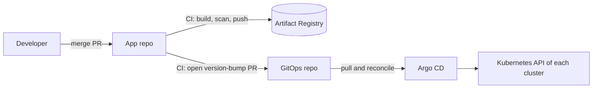

## Context

Changes reached our Kubernetes clusters through a mix of `kubectl apply` from laptops, ad-hoc CI jobs holding cluster credentials, and Helm releases installed by hand. The consequences were predictable:

- Nobody could say with confidence what was running in a cluster, or why it differed from the repository. Answering "what is running in production right now?" meant reading pipeline logs.
- Manual `kubectl edit` hot-fixes were never written back to Git, so the next pipeline run silently reverted them, or did not, depending on which values changed.
- CI systems held long-lived, broad cluster-admin credentials.
- Rolling back meant re-running an old pipeline and hoping nothing else had drifted.
- Reviewing a change to a cluster meant reviewing a pipeline run, not a diff.

We want every cluster change to be a reviewed commit, applied by something running inside the trust boundary of the cluster, with drift detected and visible. We also need several clusters (per environment and per region) managed from one place, and a UI that application teams can use to see the state of their own deployments without cluster credentials.

## Decision

We will use **GitOps with Argo CD** as the only way to deliver workloads to clusters.

- Desired state lives in Git, as plain manifests, Kustomize overlays or Helm charts. Git is the source of truth; the cluster is a cache of it.
- A central Argo CD instance reconciles `Application` and `ApplicationSet` resources against registered clusters. Automated sync with pruning and self-heal is on for non-production and requires a reviewed merge for production.
- Workload clusters never receive credentials from CI. CI builds, scans and pushes images, then opens a pull request that bumps the image reference. A merge is the deployment.
- Access to the Argo CD UI and API uses single sign-on, with project-scoped RBAC so teams only see their own applications. The built-in `admin` account is disabled.
- Secrets are not stored in plain text in Git. They are referenced from an external secret store and materialised in-cluster by an operator.



> [!warning] Stateful workloads
> Pruning deletes any resource that disappears from Git. For apps that own data, for example a PersistentVolumeClaim or Namespace declared in Git, removing a manifest by mistake can delete that data. Either turn off automated pruning for the app (`syncPolicy.automated.prune: false`, so pruning happens only when someone syncs with prune), or annotate the resources that must survive with `argocd.argoproj.io/sync-options: Prune=false,Delete=false`. Argo CD then never deletes them; they show as needing pruning and must be removed by hand.

## Consequences

Easier:

- Every change is a reviewed, attributable commit; rollback is `git revert`.
- Drift is detected continuously and shown in the UI instead of discovered during incidents.
- CI no longer needs cluster credentials, shrinking the blast radius of a compromised pipeline.
- Onboarding a cluster is registering it once and pointing an `ApplicationSet` at it.

Harder or newly required:

- The Argo CD control plane becomes critical infrastructure: it needs backups of its own configuration (which is itself in Git), upgrades, and monitoring.
- Credentials to every managed cluster are held by the Argo CD instance, so it must be locked down and its network exposure minimised.
- Image promotion needs an explicit, automated "bump the tag" step; Argo CD does not build or promote images.
- Secret handling needs a separate decision and tooling.
- A second repository and a promotion pull request per release add latency, typically minutes rather than hours.
- Teams must learn sync waves, hooks and health checks to model ordering between resources.

## Alternatives considered

- **Flux.** Equally capable and also CNCF graduated; its controller-per-concern design and pull-only model are attractive, but it has no first-party UI and our application teams rely on one. See [[argocd-vs-flux]] for the full comparison.
- **Push-based CI/CD (pipelines running `kubectl` or `helm`).** Familiar, but requires cluster credentials in CI, does not detect drift, and makes rollback a pipeline concern. Rejected.
- **Terraform for Kubernetes resources.** Good for cluster infrastructure, awkward for fast-moving application manifests, and its plan/apply model does not continuously reconcile.

## Validation

Check these after rollout and again after major Argo CD upgrades.

```bash
set -o pipefail
PROJECT_ID="example-project"

# Every Application is Synced and Healthy (prints offenders only; no output and exit status 0 is good)
argocd app list -o json \
  | jq -r '.[] | select(.status.sync.status != "Synced" or .status.health.status != "Healthy") | .metadata.name'

# The built-in admin account is disabled (expected output: false)
kubectl --namespace argocd get configmap argocd-cm -o jsonpath='{.data.admin\.enabled}'

# Who holds GKE roles? Review the list: no CI service account should appear
gcloud projects get-iam-policy "${PROJECT_ID}" \
  --flatten="bindings[].members" \
  --filter='bindings.role ~ "^roles/container\."' \
  --format="table(bindings.role, bindings.members)"
```

The basic roles `roles/owner` and `roles/editor` also carry `container.*` permissions, so review who holds them too.

## References

- [[argocd-vs-flux]]
- [[gke-workload-identity]] for how workloads, rather than the delivery system, obtain Google Cloud access.
- Argo CD documentation: https://argo-cd.readthedocs.io/
