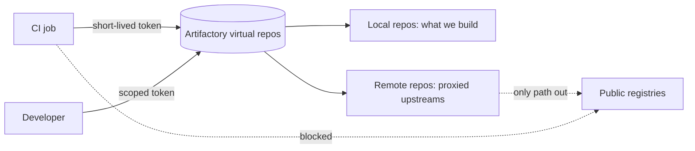

## Context

Artifacts were spread over several tools. Build outputs sat on a file share, some images were in a cloud registry, some libraries came straight from public package indexes, and a few CI jobs pulled base images from Docker Hub at build time. The consequences:

- There was no single place to scan artifacts, apply retention or answer "which build produced this file?".
- A public registry outage, a rate limit or a yanked upstream package could stop every pipeline at once.
- Each tool had its own credentials, usually a long-lived password stored as a CI variable.
- Auditors and incident responders had to query five systems to reconstruct what shipped.

We want one governed place where every artifact the company builds or consumes is stored, scanned, retained and promoted, and one authentication story for CI.

## Decision

We will use **Artifactory as the single artifact store** for build outputs and for everything CI consumes from outside.

- Consumers (CI jobs, developer machines, build tools) read only from Artifactory **virtual repositories**. Layout and naming are in [[0003-artifactory-repository-layout]].
- Upstream registries (npm, PyPI, Maven Central, Docker Hub and similar) are reached only through **remote repositories** inside Artifactory, so caching, scanning and blocking happen in one place. Language package managers are covered in [[0007-language-packages-resolve-through-artifactory]].
- The store is where scanning, retention and promotion are enforced: see [[0005-xray-scanning-gates-promotion]], [[0006-artifact-retention-by-cleanup-policies]] and [[0004-build-once-promote-between-repositories]].
- CI authenticates with **short-lived tokens**: an OIDC-based token exchange where the platform and the Artifactory version support it, otherwise a scoped access token with an expiry and one repository permission target per pipeline. A static admin password or an API key with admin rights is never used by automation.
- Runners have no network path to public registries (see [[private-gke-and-controlled-egress]]), so a job that tries a direct pull fails loudly instead of silently bypassing the store.



> [!info] Not checked against current docs
> Not verified for this record: the exact OIDC integration options and token lifetimes available in the Artifactory version and subscription we run, and the CLI syntax in the validation block. Check the JFrog documentation for your version before relying on them.

## Consequences

Easier:

- One place to scan, apply retention, audit access and report on what is stored.
- Builds survive upstream outages and yanked packages for anything already cached.
- One credential model to rotate and review instead of one per tool.

Harder or newly required:

- Artifactory becomes a tier-1 dependency: if it is down, builds and possibly deployments stop. Hosting, backup and DR are decided in [[0011-artifactory-hosting-saas-or-self-managed]].
- Every new package ecosystem needs a remote and a virtual repository before teams can use it, so onboarding has a small platform step.
- Cache and storage cost grows with usage and needs the retention policy in [[0006-artifact-retention-by-cleanup-policies]].
- Egress blocking will break any job that was quietly pulling from the internet; expect a short list of fixes on rollout.

## Alternatives considered

- **One store per tool (separate image registry, package index and file share).** What we had. Rejected because scanning, retention and access control are then implemented several times and never consistently.
- **Artifact Registry only.** A good fit for container images on Google Cloud and for GKE pulls without a pull secret. It does not give us the same build info and promotion model for non-image artifacts. The image question is kept separate in [[0009-container-images-artifactory-or-artifact-registry]]. See also [[artifactory-vs-nexus-vs-artifact-registry]].
- **Nexus.** Capable and widely used, but we already run the Artifactory-centred promotion pattern in [[artifact-promotion-artifactory]], and switching would cost more than it returns.

## Validation

The commands below prove the decision is in force. Set the variables first; the `jf` syntax is a starting point, so confirm it with `jf --help` on the version your runners use.

```bash title="validate-0002.sh"
set -o pipefail
AF_URL="https://artifactory.example.com"
AF_TOKEN="${AF_TOKEN:?set a short-lived read token}"

# 1. The server answers (expected output: OK)
curl -fsS "${AF_URL}/artifactory/api/system/ping"; echo

# 2. The CLI can reach it with the configured token
jf rt ping --url "${AF_URL}/artifactory"

# 3. List repositories and check that consumers only see virtual ones
curl -fsS -H "Authorization: Bearer ${AF_TOKEN}" \
  "${AF_URL}/artifactory/api/repositories?type=virtual" | jq -r '.[].key'
```

Egress test, run from inside a CI runner pod. A direct pull from a public registry should fail:

```bash title="runner-egress-test.sh"
# Expected: timeout or connection refused, never HTTP 200
curl -sS --max-time 10 -o /dev/null -w '%{http_code}\n' \
  https://registry-1.docker.io/v2/ || echo "blocked as intended"
```

## References

- JFrog Artifactory documentation: https://jfrog.com/help/r/jfrog-artifactory-documentation

Related notes:

- [[artifact-promotion-artifactory]]
- [[gitlab-ci-pipeline-structure]]
- [[artifact-retention-policy]]
- [[0003-artifactory-repository-layout]]
- [[0007-language-packages-resolve-through-artifactory]]
- [[0011-artifactory-hosting-saas-or-self-managed]]
