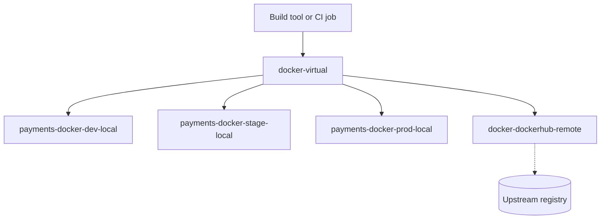

## Context

With [[0002-artifactory-as-single-artifact-store]] accepted, we need a repository layout that scales from a handful of teams to many without a rename every year. Experience with ad hoc layouts shows the same failure modes:

- Repository names that encode a team reorganisation, so every reorg breaks build files in hundreds of projects.
- Consumers pointing at a specific local or remote repository, so adding a second upstream or moving an artifact means editing every client.
- Anyone with deploy rights able to overwrite a release, because dev and prod artifacts share a repository.
- Repositories created by hand in the UI, with settings that differ in ways nobody remembers.

## Decision

We will use **three repository kinds with fixed roles and a strict naming scheme**, and consumers will use only virtual repositories.

| Kind    | Holds                          | Who writes                                                       | Naming                        |
| ------- | ------------------------------ | ---------------------------------------------------------------- | ----------------------------- |
| Local   | What we build, per stage       | CI identity of the owning team; prod only from the promotion job | `<team>-<type>-<stage>-local` |
| Remote  | Cached proxy of one upstream   | Nobody (read-through only)                                       | `<type>-<upstream>-remote`    |
| Virtual | Aggregation consumers point at | Deploy target only, see below                                    | `<type>-virtual`              |

Examples: `payments-docker-dev-local`, `payments-docker-prod-local`, `npm-npmjs-remote`, `npm-virtual`. Stages are `dev`, `stage` and `prod`, matching [[0004-build-once-promote-between-repositories]].

Rules:

- **One virtual repository per package type per consumer group.** Clients are configured with the virtual URL only. Adding an upstream or moving an artifact never changes a client.
- **Resolution order in a virtual repository: locals first, then remotes.** Our own artifacts always win over an upstream package with the same name, which blocks dependency-confusion style substitution. Package-type specifics, such as excluding internal namespaces from remotes, belong in the remote repository's include and exclude patterns (check the current docs for the exact fields).
- **The default deploy target of each virtual repository is the dev local repository.** A plain `deploy` through the virtual URL can never land in stage or prod. Writes to `stage` and `prod` locals come from the promotion job only.
- **Repositories are created as code**, through the JFrog Terraform provider or the REST API from a reviewed repository, never by hand in the UI. The naming scheme is enforced by review and by the validation below.



> [!info] Not checked against current docs
> Not verified for this record: the exact repository-layout and resolution-order settings per package type, the Terraform provider resource names, and the include/exclude pattern fields. Check the Artifactory repository management documentation for the version in use.

## Consequences

Easier:

- Client configuration is stable: one URL per package type.
- A repository tells you the stage of an artifact, which makes the promotion model visible and auditable.
- Permissions map cleanly: teams write to their dev local, only the promotion job writes to prod.

Harder or newly required:

- Onboarding a team means creating a set of repositories and permission targets through a merge request, which adds a short wait compared with clicking in the UI.
- Virtual repositories can hide where a package came from. When debugging, query the individual repositories rather than the virtual one.
- The naming scheme must be kept in a short reference, otherwise it drifts. Review enforces it; the validation below catches the rest.

## Alternatives considered

- **One repository per team with everything inside.** Simple to start, but stage separation and per-stage permissions become property conventions that nobody enforces. Rejected.
- **A flat repository per package type, with properties for stage and owner.** Fewer repositories, but permissions cannot be expressed per stage and a mistaken property silently makes a dev build look like prod. Rejected.
- **Repositories named after the organisation chart.** Rejected because reorganisations would force renames; the team label moves to a property or the permission target instead.

For a longer discussion of repository design see [[artifactory-repository-design]].

## Validation

List all repositories and flag names that do not match the scheme. Set the variables first.

```bash title="validate-0003.sh"
set -o pipefail
AF_URL="https://artifactory.example.com"
AF_TOKEN="${AF_TOKEN:?set a read token}"

curl -fsS -H "Authorization: Bearer ${AF_TOKEN}" \
  "${AF_URL}/artifactory/api/repositories" \
  | jq -r '.[] | [.key, .type] | @tsv' \
  | while IFS=$'\t' read -r key type; do
      case "$type" in
        LOCAL)   re='^[a-z0-9]+-[a-z0-9]+-(dev|stage|prod)-local$' ;;
        REMOTE)  re='^[a-z0-9]+-[a-z0-9]+-remote$' ;;
        VIRTUAL) re='^[a-z0-9]+-virtual$' ;;
        *)       re='^$' ;;
      esac
      [[ "$key" =~ $re ]] || echo "NAME VIOLATION: $key ($type)"
    done
```

No output and exit status 0 is good. Also inspect one virtual repository and confirm the order and the default deploy target:

```bash title="check-virtual-repo.sh"
curl -fsS -H "Authorization: Bearer ${AF_TOKEN}" \
  "${AF_URL}/artifactory/api/repositories/docker-virtual" \
  | jq '{repositories, defaultDeploymentRepo}'
```

## References

- JFrog Artifactory documentation, repository management: https://jfrog.com/help/r/jfrog-artifactory-documentation (find the repository management pages for your version)

Related notes:

- [[artifact-promotion-artifactory]]
- [[artifactory-repository-design]]
- [[0002-artifactory-as-single-artifact-store]]
- [[0004-build-once-promote-between-repositories]]
