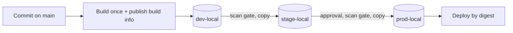

## Context

Some pipelines rebuilt the application for each environment: one build on the dev branch, another on the stage branch, another for the production tag. Each build resolved dependencies and base images again, so the artifact that was tested in stage was not byte-for-byte the one deployed to production. When production misbehaved, "it passed in stage" proved nothing.

Rebuilding per environment also made evidence weak. A scan, a signature or an approval attached to one build says nothing about the next one, and auditors cannot follow a single artifact from commit to production. See [[separation-of-duties-in-deployments]] and [[slsa-build-provenance]] for what that evidence has to show.

## Decision

We will **build each artifact once and promote the same artifact between stage repositories**. Environment differences are applied at deploy time, never at build time.

- Every pipeline publishes **build info** to Artifactory, linking the artifact to its commit, pipeline run, dependencies and checksums.
- Promotion is a **copy**, not a move, from `dev-local` to `stage-local` to `prod-local` (layout in [[0003-artifactory-repository-layout]]). The source stays, so the history of what existed at each stage is kept until retention removes it ([[0006-artifact-retention-by-cleanup-policies]]).
- Each promotion records a **status and the approver** (a user or the protected pipeline identity) on the build, so the audit trail lives with the artifact.
- **Only the promotion job's identity can write to `prod-local`.** Developers and ordinary build jobs have no write permission there, so `prod-local` is effectively immutable.
- Promotion to stage and prod is gated by scanning: see [[0005-xray-scanning-gates-promotion]].
- The deployed reference is the digest, not a tag: see [[0010-deploy-images-by-digest]].
- Configuration, feature flags and secrets references are injected at deploy time. An artifact that only works in one environment is a defect.



> [!info] Not checked against current docs
> Not verified for this record: the JFrog CLI command names and flags (`jf rt build-publish`, `jf rt build-promote`, `jf rt docker-promote`), whether promotion of Docker images preserves every property we rely on, and the properties available on the current subscription tier. The pattern note [[artifact-promotion-artifactory]] carries the same caveat. Run `--help` on the CLI version your runners use.

## Consequences

Easier:

- The thing that was tested is the thing that ships; checksums match in every repository.
- Evidence (scan results, signatures, approvals) attaches to one artifact and follows it.
- Rollback is redeploying an earlier promoted artifact ([[0048-rollback-by-redeploying-previous-digest]]).
- Release time shrinks: promotion takes seconds, a rebuild takes minutes and can fail for unrelated reasons.

Harder or newly required:

- Any build that embeds environment-specific values must be reworked to read configuration at start-up or deploy time.
- A hotfix still goes through the pipeline once, then through promotion. There is no "build directly in prod" shortcut, and the break-glass path must be written down and logged.
- Teams must keep build info complete (publish it from every job that produces an artifact), otherwise promotion has nothing to act on.
- Copying keeps storage in two or three repositories; retention has to be tuned accordingly.

## Alternatives considered

- **Rebuild per environment.** Simple to reason about per branch, but breaks the tested-equals-shipped guarantee and multiplies scanning. Rejected.
- **A single repository with properties for the stage (`stage=prod`).** One copy in storage, but permissions cannot differ per stage and a property edit is a silent promotion. Acceptable only as an extra label on top of separate repositories. Rejected as the primary mechanism.
- **Promotion by moving.** Loses the record of what was in the earlier stage and makes a rollback of the promotion itself awkward. Rejected in favour of copy.

## Validation

Compare the checksum and digest of the same build in each stage repository. Set the variables first; the paths assume a Docker repository layout, so adjust for your package type.

```bash title="validate-0004.sh"
set -o pipefail
AF_URL="https://artifactory.example.com"
AF_TOKEN="${AF_TOKEN:?set a read token}"
IMAGE_PATH="payments/api/1.4.2/manifest.json"

for stage in dev stage prod; do
  repo="payments-docker-${stage}-local"
  printf '%s ' "$repo"
  curl -fsS -H "Authorization: Bearer ${AF_TOKEN}" \
    "${AF_URL}/artifactory/api/storage/${repo}/${IMAGE_PATH}" \
    | jq -r '.checksums.sha256'
done
```

The three hashes must be identical. Then confirm that ordinary identities cannot write to prod:

```bash title="check-prod-permissions.sh"
# Expected: a 403 for a developer token
curl -sS -o /dev/null -w '%{http_code}\n' -X PUT \
  -H "Authorization: Bearer ${DEV_TOKEN:?set a developer token}" \
  -T /dev/null "${AF_URL}/artifactory/payments-docker-prod-local/test.txt"
```

## References

- JFrog documentation on build integration and promotion: https://jfrog.com/help/r/jfrog-artifactory-documentation (locate the build integration pages for your version)

Related notes:

- [[artifact-promotion-artifactory]]
- [[separation-of-duties-in-deployments]]
- [[slsa-build-provenance]]
- [[0003-artifactory-repository-layout]]
- [[0005-xray-scanning-gates-promotion]]
- [[0010-deploy-images-by-digest]]
