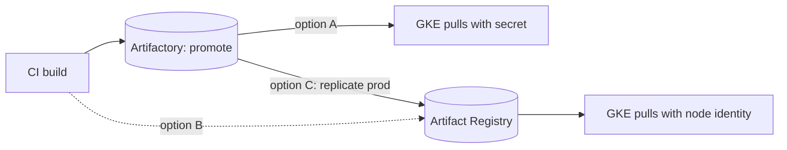

## Context

[[0002-artifactory-as-single-artifact-store]] says Artifactory holds everything we build, but container images are a special case. Two facts pull in opposite directions:

- GKE pulls from Artifact Registry using the node or Workload Identity service account, with no pull secret to create, rotate or leak. The registry sits in the same cloud as the clusters.
- Our promotion, scanning and audit model ([[0004-build-once-promote-between-repositories]], [[0005-xray-scanning-gates-promotion]]) is built on Artifactory, and splitting images away from it would fork that model.

External pressures also matter. Docker Hub applies anonymous pull limits (check the current Docker documentation for what they are today), so CI pulling base images from it is fragile. Artifact Registry remote repositories can cache Docker Hub, and Container Registry (gcr.io) is being replaced by Artifact Registry, so any gcr.io use must be moved (check the deprecation page for the current status).

The choice is not yet made, because the cost and outage trade-offs below have not been measured on our workloads.

## Decision

**Proposed:** decide where production images are pulled from, between three options. The decision owner is the platform team lead. This record closes when the criteria below are measured, targeted for the next quarterly platform review.

| Option | Description                                                                                                    |
| ------ | -------------------------------------------------------------------------------------------------------------- |
| A      | Artifactory only. GKE pulls from Artifactory using a pull secret or a credential helper.                       |
| B      | Artifact Registry only. CI builds, scans and signs there. Artifactory is used for non-image artifacts.         |
| C      | Build and promote in Artifactory, then replicate production images to Artifact Registry. GKE pulls from there. |

Whatever is chosen, the following do not change:

- Images are referenced by digest ([[0010-deploy-images-by-digest]]) and signed ([[0037-keyless-cosign-image-signing]]).
- CI never pulls base images straight from Docker Hub.
- Nodes pull with identities, not long-lived passwords ([[gke-workload-identity]]).

**Decision criteria** (to be measured):

- **Outage blast radius.** If Artifactory is down, can running clusters still pull images for new pods and node scale-up? Option C isolates pulls from the build store.
- **Pull latency and egress cost** from GKE to the registry, per region. Same-region Artifact Registry is likely cheaper and faster; measure it, and check current pricing rather than assuming.
- **Promotion audit trail.** Option B needs an equivalent of build info and promotion status; option C keeps Artifactory as the system of record.
- **Operating effort.** Option A needs pull-secret distribution or a credential helper; C needs a replication job to run and monitor.
- **Scanning coverage.** One scanner, or two with a defined primary.



> [!info] Not checked against current docs
> Not verified for this record: Docker Hub's current anonymous and authenticated pull limits, the current status and shutdown timeline of Container Registry, Artifact Registry remote repository behaviour and pricing, and egress and storage prices. Check the linked Google Cloud and Docker pages before closing the record.

## Consequences

If A is chosen: one system and one promotion model, but a pull secret or credential helper on every cluster, and an Artifactory outage can stop pod scheduling.

If B is chosen: the simplest GKE integration and no pull secrets, but the promotion and audit model must be rebuilt for images, and two stores exist for different artifact types.

If C is chosen: the best isolation and the native pull path, at the cost of a replication step, double storage for production images and one more thing that can fail during a release.

In every case, the gcr.io references still in use must be inventoried and moved.

## Alternatives considered

- **Keep everything as-is** (some images in each). Rejected: that is the status quo this record is meant to end.
- **Docker Hub as a source for production images.** Rate limits, ownership and availability risks make it unsuitable for production pulls.
- **A self-hosted registry (for example Harbor).** A capable open-source option, but another service to operate and secure. Not pursued unless both Artifactory and Artifact Registry fail the criteria. See [[artifactory-vs-nexus-vs-artifact-registry]].

## Validation

Until this is accepted, these commands inventory the current state and give the numbers for the criteria. Set the variables first.

```bash title="inventory-image-sources.sh"
set -o pipefail
# Registries of every running image in the cluster (counts per registry host)
kubectl get pods -A -o jsonpath='{range .items[*]}{range .spec.containers[*]}{.image}{"\n"}{end}{end}' \
  | awk -F/ '{print $1}' | sort | uniq -c | sort -rn

# Any use of the old gcr.io hostnames in manifests
grep -rIn --include='*.yaml' -E '(^|[^a-z])gcr\.io/' gitops/ || echo "no gcr.io references"

# Pull test timing from a node pool: pull a known digest and time it
time crictl pull artifactory.example.com/payments-docker-prod-local/api@sha256:<digest>
```

Replace `<digest>` with a real digest from your registry before running the last command; it is a value only you can supply.

## References

- Artifact Registry documentation: https://cloud.google.com/artifact-registry/docs
- Docker Hub usage and limits: https://docs.docker.com/docker-hub/usage/
- Container Registry deprecations: https://cloud.google.com/container-registry/docs/deprecations

Related notes:

- [[gke-workload-identity]]
- [[image-signing-and-admission-verification]]
- [[dockerfile-hardening]]
- [[0002-artifactory-as-single-artifact-store]]
- [[0010-deploy-images-by-digest]]
- [[0011-artifactory-hosting-saas-or-self-managed]]
