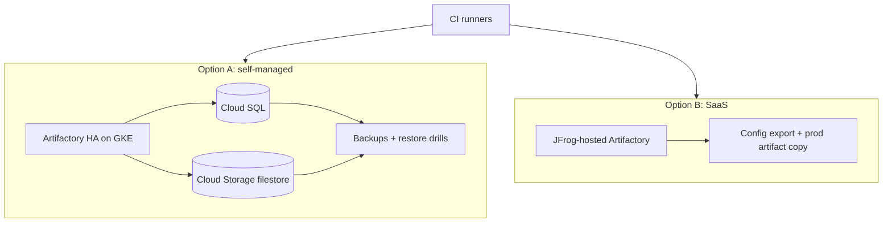

## Context

Artifactory is a tier-1 dependency: [[0002-artifactory-as-single-artifact-store]] and [[0007-language-packages-resolve-through-artifactory]] mean builds stop when it is down, and promotion and deployment depend on it. How and where it runs therefore decides our worst day, not just our monthly bill.

Two realistic models exist, and they trade control for operating effort. The decision has been deferred because it depends on numbers we have not gathered: how much data we store, what recovery time the business accepts for the build system, and what the two models actually cost.

## Decision

**Proposed:** choose between two hosting models. The decision owner is the platform team lead, with the security lead consulted on data residency. The record closes when the criteria below have values, targeted before the next Artifactory major upgrade or the next contract renewal, whichever comes first.

**Option A: self-managed on GKE.**

- High availability with several Artifactory nodes (the node count is a sizing decision, not fixed here).
- A managed database (Cloud SQL, see [[0027-cloud-sql-for-production-postgres]]) and an object-storage filestore on Cloud Storage.
- Backups of both the database and the filestore, with restore tested ([[backup-architecture-gke-cloud-sql-gcs]], [[0051-backups-proven-by-quarterly-restore-drills]]).
- We own upgrades, scaling, certificates and monitoring. Stateful guidance is in [[stateful-workloads-gke]].

**Option B: JFrog-hosted SaaS.**

- Region choice at provisioning; the vendor owns availability, upgrades and storage operations under its SLA.
- Network path and an IP allowlist from runners; private connectivity options depend on the plan.
- We still own repository configuration, permissions, retention and the backup of what matters to us (export of configuration, a copy of prod artifacts if our DR tier requires it).

**Criteria to measure:**

| Criterion                | Question to answer with data                                                       |
| ------------------------ | ---------------------------------------------------------------------------------- |
| Availability             | What is the contractual SLA vs. the availability we can run ourselves?             |
| RTO and RPO              | Which tier from [[disaster-recovery-tiers-rpo-rto]] applies to the build store?    |
| Data residency           | Does artifact content or metadata have a residency constraint? Needs legal input.  |
| Operating cost           | Engineer time per quarter for self-managed vs. the SaaS subscription difference.   |
| Compute and storage cost | Current GCP pricing for the cluster, database, bucket and egress vs. vendor price. |
| Network path             | Latency and egress cost from GKE runners; allowlisting and private access options. |

Pricing is deliberately not stated here: check current JFrog and Google Cloud pricing when scoring.



> [!info] Not checked against current docs
> Not verified for this record: JFrog SaaS SLA terms, regions and private connectivity options, the supported self-managed topology and sizing for our version, and all prices. Check the JFrog installation and setup documentation and the vendor's current terms.

## Consequences

If A is chosen: full control over network placement, data location and upgrade timing, and no extra vendor path. We carry on-call for the store, database and filestore, upgrade work, and capacity planning.

If B is chosen: less operational toil and a contractual availability figure, in exchange for a vendor dependency, an external network path, and less control over upgrade timing. DR still needs a plan for vendor-level outages.

In both cases the build store needs a documented degraded mode: which pipelines can still run on cached dependencies, and who can promote an emergency fix if the store is unreachable.

## Alternatives considered

- **Run Artifactory on VMs instead of GKE.** Simpler for a single node, but loses the cluster's rollout and health tooling, and HA is harder. Considered only if GKE runs into a platform-level problem.
- **Replace Artifactory with Artifact Registry plus other services.** Reduces the hosting question, but gives up the promotion and scanning model. Covered by [[0009-container-images-artifactory-or-artifact-registry]] and [[artifactory-vs-nexus-vs-artifact-registry]].
- **Use SaaS now and revisit.** Possible and reasonable as an interim step; this record exists to make the revisit explicit.

## Validation

While the decision is open, these checks measure the inputs for the criteria. Set the variables first.

```bash title="measure-inputs.sh"
set -o pipefail
AF_URL="https://artifactory.example.com"
AF_TOKEN="${AF_TOKEN:?set an admin read token}"

# Current storage in use (JSON: binaries size, filestore, repositories)
curl -fsS -H "Authorization: Bearer ${AF_TOKEN}" \
  "${AF_URL}/artifactory/api/storageinfo" | jq '.binariesSummary, .fileStoreSummary'

# Request latency from a runner namespace (repeat from each region)
curl -fsS -o /dev/null -w 'connect=%{time_connect}s total=%{time_total}s\n' \
  "${AF_URL}/artifactory/api/system/ping"

# Last successful backup restore date: read from the drill register
grep -E 'artifactory' restore-drills.csv | tail -1
```

After the decision, add an availability probe and an alert on the ping endpoint to the platform dashboards ([[observability-signals-and-dashboards]]).

## References

- JFrog installation and setup documentation: https://jfrog.com/help/r/jfrog-installation-setup-documentation (verify the HA and sizing pages)
- Cloud Storage documentation: https://cloud.google.com/storage/docs

Related notes:

- [[disaster-recovery-tiers-rpo-rto]]
- [[backup-architecture-gke-cloud-sql-gcs]]
- [[stateful-workloads-gke]]
- [[0002-artifactory-as-single-artifact-store]]
- [[0027-cloud-sql-for-production-postgres]]
