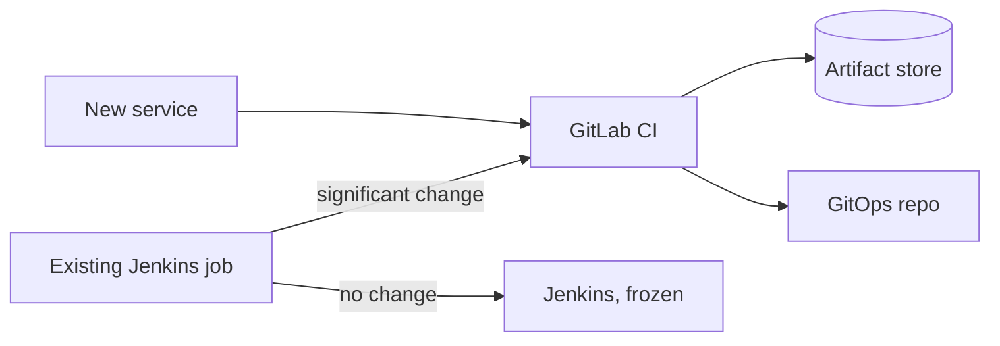

## Context

We run two CI systems. Jenkins hosts the older jobs, most of them driven by shared-library code that only a few people understand. GitLab CI hosts the newer repositories. The split costs us in predictable ways:

- Two sets of credentials, two permission models, and two places to audit when someone asks "who can deploy this service?".
- Pipeline logic that lives partly in a Jenkins controller's job configuration and partly in a repository, so a change is not always a reviewed diff.
- A Jenkins controller is a long-lived, plugin-heavy server that needs patching, backup and hardening. Every plugin is supply-chain surface.
- New services have no stated default, so each team picks a tool on first use and the split grows.

We want one default for new work, a cheap path off Jenkins, and no big-bang migration that stops delivery for months.

## Decision

We will write **all new delivery pipelines in GitLab CI**. Jenkins stays only for jobs that already run there, and a job migrates when it next needs a significant change.

- Pipeline definitions live in the repository (`.gitlab-ci.yml` plus included templates), reviewed like code. See [[0013-versioned-central-ci-templates]] for how shared jobs are included.
- Jenkins is **frozen for new jobs**. The controller stays on a supported LTS line and keeps the hardening described in [[jenkins-controller-and-agent-hardening]] until the last job leaves.
- **Migration trigger:** a significant change to a Jenkins job (a new stage, a new deploy target, a credential change, a plugin that must be upgraded). Cosmetic edits and parameter tweaks do not trigger migration. There is no migration deadline and no project plan that moves everything at once.
- Every GitLab pipeline follows a short baseline:
  - Job images are pinned (by digest where the registry allows it), not `latest`.
  - Secrets are protected and masked CI/CD variables, or short-lived tokens obtained at runtime (see [[0026-keyless-ci-auth-with-workload-identity-federation]]). Nothing secret is printed to the job log.
  - `CI_JOB_TOKEN` is scoped to the projects that a job needs to reach, using the project's job token allowlist (check the current docs for the setting name in your GitLab version).
  - Deploy jobs run only on protected branches or protected tags, on runners that are separate from merge request jobs (see [[0014-gitlab-runners-kubernetes-executor-on-gke]]).
  - Pipelines build once and do not deploy to clusters directly; delivery is a Git change reconciled by Argo CD ([[0001-gitops-with-argocd]]).



A minimal pipeline skeleton that satisfies the baseline:

```yaml title=".gitlab-ci.yml"
include:
  - project: platform/ci-templates
    ref: v2.3.0
    file: /templates/build-and-scan.yml

stages: [build, scan, promote]

variables:
  # Example only: replace with your own registry host
  IMAGE_REPO: artifactory.example.com/payments-docker-dev-local/api

build:
  stage: build
  image: registry.example.com/platform/builder@sha256:<digest-of-your-pinned-builder>
  script:
    - ./ci/build.sh
  rules:
    - if: $CI_COMMIT_BRANCH == $CI_DEFAULT_BRANCH
    - if: $CI_PIPELINE_SOURCE == "merge_request_event"
```

Replace the `<digest-of-your-pinned-builder>` value with the digest of the builder image you actually use; the point is that the reference is immutable, not which image it is.

## Consequences

Easier:

- One default tool for new work, so teams stop choosing and onboarding is one set of docs.
- Pipeline changes are merge requests with a diff, reviewers and history.
- Over time the Jenkins controller, its plugins and its credentials shrink, which reduces the surface we have to patch.
- Shared logic moves from Groovy libraries to versioned YAML templates that can be tested.

Harder or newly required:

- For an unknown period we run two systems. Shared-library logic in Jenkins ([[jenkins-shared-libraries]]) is duplicated in GitLab templates during the overlap, and the two can drift.
- Migration effort is real and lands on teams at the moment they wanted to ship something else. Platform must provide ready templates so the cost is small.
- Jenkins jobs with exotic plugin dependencies may have no direct GitLab equivalent and need a redesign, not a port.
- GitLab runners and GitLab itself become tier-1 dependencies. Their availability, upgrades and runner capacity need ownership.
- "Significant change" is a judgement call. The platform team arbitrates when a team disagrees, and we record the outcome rather than debate each time.

## Alternatives considered

- **Jenkins for everything.** Maximum flexibility and no migration, but it keeps the plugin and controller burden and an opaque job configuration model. Rejected as the default for new work.
- **GitHub Actions.** Strong ecosystem, but our source of truth, runners and permission model are already GitLab. Adding a third system would not remove the second. Rejected.
- **Tekton.** Kubernetes-native and flexible, but it is a toolkit rather than a product: we would build the UI, the templates and the permission model ourselves. Rejected for now.
- **Big-bang migration.** Predictable end date, but it stops feature work and migrates jobs nobody touches. Rejected in favour of the trigger above.

See [[gitlab-ci-vs-jenkins]] for the full comparison.

> [!info] Claims not checked against current docs
> The name and location of the `CI_JOB_TOKEN` allowlist setting, the GitLab and Jenkins versions in use, and the behaviour of pinned image digests with your runner's image pull policy were not verified for this record. Check the current GitLab and Jenkins documentation before copying settings.

## Validation

```bash
set -o pipefail
GITLAB_URL="https://gitlab.example.com"
GITLAB_TOKEN="${GITLAB_TOKEN:?set a read-only API token}"
GROUP_ID="42" # example: the numeric ID of your group

# Projects in the group that still have no .gitlab-ci.yml (candidates to review)
curl -fsS --header "PRIVATE-TOKEN: ${GITLAB_TOKEN}" \
  "${GITLAB_URL}/api/v4/groups/${GROUP_ID}/projects?per_page=100&include_subgroups=true" \
  | jq -r '.[].id' \
  | while read -r id; do
      curl -fsS -o /dev/null -w "%{http_code} ${id}\n" \
        --header "PRIVATE-TOKEN: ${GITLAB_TOKEN}" \
        "${GITLAB_URL}/api/v4/projects/${id}/repository/files/.gitlab-ci.yml?ref=main" || true
    done | grep -v '^200'

# Jenkins: list jobs and review that the count only goes down over time
curl -fsS --user "${JENKINS_USER}:${JENKINS_TOKEN}" \
  "https://jenkins.example.com/api/json?tree=jobs[name]" | jq '.jobs | length'
```

Record the Jenkins job count each quarter. A count that grows means the freeze is not holding.

## References

- GitLab CI/CD: https://docs.gitlab.com/ci/
- GitLab CI job token: https://docs.gitlab.com/ci/jobs/ci_job_token/
- Jenkins user documentation: https://www.jenkins.io/doc/book/
- Related notes: [[gitlab-ci-vs-jenkins]], [[jenkins-controller-and-agent-hardening]], [[jenkins-shared-libraries]], [[gitlab-ci-pipeline-structure]]
- Related ADRs: [[0001-gitops-with-argocd]], [[0013-versioned-central-ci-templates]], [[0014-gitlab-runners-kubernetes-executor-on-gke]], [[0026-keyless-ci-auth-with-workload-identity-federation]]
