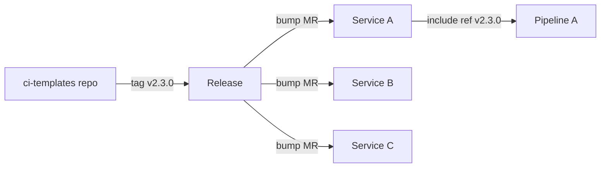

## Context

As more repositories moved to GitLab CI ([[0012-gitlab-ci-for-new-pipelines]]), the same build, scan and release jobs were copy-pasted into each `.gitlab-ci.yml`. Copies drift. When a security fix to a scan job is needed, we have to open a merge request in every repository and cannot tell which ones still run the old version.

The obvious fix is a shared templates project that repositories `include`. But a shared include has its own failure mode: if consumers include `ref: main`, a change merged to the templates project changes the pipeline of every consumer at once, without a commit in any of those repositories. A bad merge then breaks every pipeline in the company, and nobody can bisect it from the consumer side.

We want sharing without the blast radius: one place to fix a job, and every consumer upgrading deliberately.

## Decision

We will keep shared CI jobs in **one central templates project and include them by pinned release tag**, never by branch.

- The project is `platform/ci-templates` on `gitlab.example.com`. It contains reusable jobs and hidden jobs (`.job-name`) and small, composable files rather than one large file.
- Consumers include a tag:

```yaml title=".gitlab-ci.yml"
include:
  - project: platform/ci-templates
    ref: v2.3.0
    file:
      - /templates/build.yml
      - /templates/scan.yml
```

- Releases follow **SemVer**. A change to a job's inputs, names, stages or default behaviour that can break a consumer is a new **major** version. Backwards-compatible additions are minor. Fixes are patch.
- The project has a **changelog**, generated from commit messages (see [[release-versioning-and-changelog-automation]]), and every release states what consumers must do, if anything.
- The templates have **their own pipeline tests**: a set of fixture projects or a lint job that runs each template against a sample project, so a template is exercised before a tag is cut.
- Consumers receive **automated bump merge requests** when a new tag exists, using the dependency update tooling described in [[automated-dependency-updates]]. A bump is reviewed like any other change.
- **CI/CD components and the CI/CD catalog** are the evolution path: they give typed inputs and versioned publishing. Check the current GitLab docs for availability and limits on your edition and version before migrating templates to components. Until then, plain `include: project` with tags is the standard.
- The same pinning principle applies outside GitLab: infrastructure modules are pinned by tag in [[0034-terraform-modules-versioned-by-git-tag]].



## Consequences

Easier:

- A fix to a shared job is made once, tested once, and rolled out through reviewable bump merge requests.
- Every consumer's pipeline is reproducible from its own repository history, because the include is pinned. Bisecting a pipeline regression is a diff of two tags.
- We can see which consumers are behind: a single search for the `ref:` lines lists them.
- A breaking change is announced by a major version and cannot reach a consumer by surprise.

Harder or newly required:

- Rolling out an urgent security fix takes longer than a push to `main`. We accept that, and keep an expedited path: cut a patch tag and trigger the bump merge requests immediately.
- The templates project is critical infrastructure. It needs owners, a review rule (two reviewers for changes that touch default jobs), and release discipline.
- Old major versions linger. We support the current and the previous major, and publish an end-of-support date with each new major.
- Consumers who ignore bump merge requests fall behind. We track the oldest pinned tag as a metric and chase it.
- Tag protection matters: if anyone can move or delete a tag, pinning is meaningless. Tags in the templates project are protected and immutable by convention.

## Alternatives considered

- **Copy and paste into each repository.** Simple and fully isolated, but fixes do not propagate and drift is guaranteed. Rejected.
- **Include `ref: main`.** Everyone gets fixes immediately, and everyone gets breakage immediately. A single bad merge becomes an organisation-wide outage with no change in the affected repositories. Rejected.
- **Per-team templates.** Gives teams autonomy but recreates the duplication one level up and splits the security baseline. Rejected, though teams can layer their own jobs on top of the shared ones.
- **A single large template file.** Easy to include, but any change touches everything and consumers cannot take only what they need. Rejected in favour of small files.

> [!info] Claims not checked against current docs
> The availability, input limits and publishing rules of CI/CD components and the catalog, the exact `include` keywords supported by your GitLab version, and tag protection behaviour were not verified for this record. Check the current GitLab documentation.

## Validation

```bash
set -o pipefail
GITLAB_URL="https://gitlab.example.com"
GROUP_ID="42" # example: numeric ID of your group
GITLAB_TOKEN="${GITLAB_TOKEN:?set a read-only API token}"

# 1. Find consumers that include the templates project without a version-tag ref.
#    Review the output: any line that is not a vX.Y.Z tag is a violation.
curl -fsS --header "PRIVATE-TOKEN: ${GITLAB_TOKEN}" \
  "${GITLAB_URL}/api/v4/groups/${GROUP_ID}/search?scope=blobs&search=ci-templates" \
  | jq -r '.[] | select(.filename == ".gitlab-ci.yml") | "\(.project_id) \(.data)"'

# 2. In a local checkout of a repository, flag any include pinned to a branch.
grep -nE 'ref:\s*(main|master|develop)\b' .gitlab-ci.yml && echo "branch-pinned include found" || echo "ok"

# 3. Confirm tags in the templates project are protected.
curl -fsS --header "PRIVATE-TOKEN: ${GITLAB_TOKEN}" \
  "${GITLAB_URL}/api/v4/projects/platform%2Fci-templates/protected_tags" | jq -r '.[].name'
```

## References

- GitLab CI `include`: https://docs.gitlab.com/ci/yaml/includes/
- GitLab CI/CD components: https://docs.gitlab.com/ci/components/
- Semantic Versioning: https://semver.org/
- Related notes: [[gitlab-ci-pipeline-structure]], [[release-versioning-and-changelog-automation]], [[automated-dependency-updates]]
- Related ADRs: [[0012-gitlab-ci-for-new-pipelines]], [[0034-terraform-modules-versioned-by-git-tag]]
