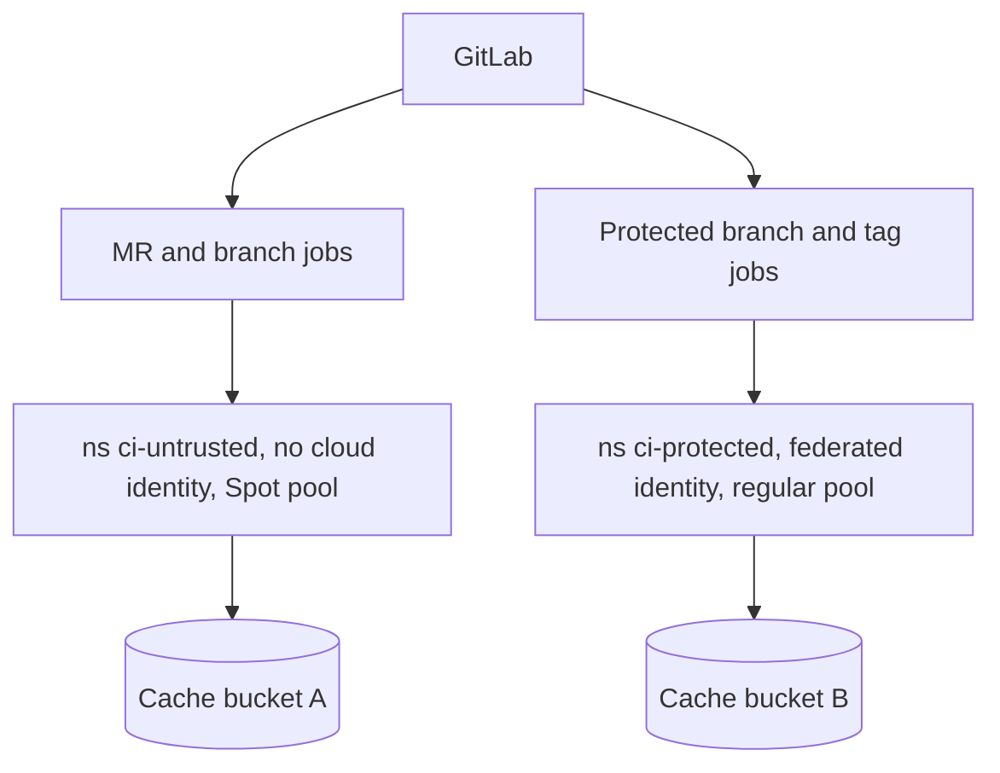

## Context

CI jobs used to run on a small fleet of long-lived VMs with the shell or Docker executor. That model has problems we keep paying for:

- Jobs from different projects share a host, a Docker daemon and a filesystem. Leftover state, cached credentials and noisy neighbours make failures hard to reproduce and a compromised job a threat to every other job on the host.
- Capacity is either idle (cost) or exhausted (queues). Scaling needs custom automation.
- Merge request pipelines can come from contributors with write access to a branch but not to production. They must not run on the same machine, with the same credentials, as the job that deploys.
- The host's service account is reachable from every job, so the least-privileged job inherits the most-privileged identity on the machine.

We already operate GKE ([[gke-platform-topology-and-tenancy]]) and have a runner design in [[gitlab-runners-on-gke]]. We need to decide whether that becomes the standard.

## Decision

We will run GitLab CI jobs with the **Kubernetes executor on GKE**, each job a short-lived pod, installed with the official runner Helm chart.

- **Trust separation.** Two runner groups in separate namespaces:
  - `ci-untrusted`: runs merge request and unprotected-branch jobs. No Workload Identity binding to Google Cloud, no deploy credentials, restrictive network policy, egress through the controlled path in [[private-gke-and-controlled-egress]].
  - `ci-protected`: runs only jobs on protected branches and tags (runners are configured "protected"). This is the only place deploy jobs run.
- **Identity.** Only the protected runner's pods use a Kubernetes service account bound through Workload Identity ([[gke-workload-identity]]) to a Google service account. Even then we prefer per-job federation with the job's own OIDC token ([[0026-keyless-ci-auth-with-workload-identity-federation]]) over a standing runner identity. The untrusted runner has no Google identity at all.
- **Compute.** Build jobs run on a Spot node pool with a taint and matching toleration, so a preemption fails a retried job rather than a deployment. Deploy jobs run on regular nodes.
- **Cache and artifacts.** The distributed cache lives in a Cloud Storage bucket per runner group, with a lifecycle rule to expire old objects. Cache is never shared between the trusted and untrusted groups, so an untrusted job cannot poison a protected build.
- **Resource requests.** Every build pod sets CPU and memory requests (through the runner's `cpu_request` and `memory_request` settings and per-job overrides within an allowed ceiling). Without requests the autoscaler cannot size nodes and one job can starve others. See [[0021-mandatory-resource-requests]].
- **No Docker socket.** Jobs never mount the host Docker socket and runner pods are not privileged. Image builds follow [[0015-no-privileged-image-builds-in-ci]].

```yaml title="values.yaml (runner Helm chart, excerpt)"
# Example only. Check the chart's current schema and your GitLab version.
gitlabUrl: https://gitlab.example.com/
runners:
  config: |
    # inside the runner section of config.toml
      [runners.kubernetes]
        namespace = "ci-untrusted"
        privileged = false
        cpu_request = "500m"
        memory_request = "1Gi"
        memory_limit = "2Gi"
        [runners.kubernetes.node_selector]
          "cloud.google.com/gke-spot" = "true"
        [runners.kubernetes.node_tolerations]
          "cloud.google.com/gke-spot=true" = "NoSchedule"
rbac:
  create: true
```



## Consequences

Easier:

- Each job gets a clean pod, so state does not leak between jobs and runs are reproducible.
- Capacity follows demand through the cluster autoscaler. Spot nodes cut the cost of bursty builds.
- The blast radius of a hostile merge request job is the untrusted namespace, which has no cloud identity and a deny-by-default network policy.
- Runner configuration is a Helm release in Git and is delivered like any other workload.

Harder or newly required:

- Spot preemption kills jobs mid-run. Pipelines need `retry: { max: 2, when: runner_system_failure }` on build jobs, and long jobs need checkpoints or a regular pool.
- Pod start time (scheduling, image pull, sometimes node scale-up) adds latency to every job. Pre-pulling common images or keeping a small warm pool trades cost for speed.
- Autoscaler behaviour with bare pods needs attention: the autoscaler does not evict pods it cannot reschedule, and jobs without controller ownership can block scale-down. Check the current GKE autoscaler docs for the safe-to-evict annotation and set it where appropriate.
- The runner cluster is a CI dependency. Upgrades of GKE and of the runner chart need a window, and the runner manager pod needs monitoring and alerting like any production service.
- Rootless and unprivileged builds are slower or need different tooling than Docker-in-Docker.

## Alternatives considered

- **Shared VM runners (shell or Docker executor).** Simple, and fast for cached builds, but no job isolation and a shared identity. Rejected.
- **GitLab-hosted runners.** Removes runner operations, but our jobs need private network reach and controlled egress, and hosted pricing and limits need review. Rejected for protected jobs; may be reconsidered for public or open-source repositories. Check current GitLab terms and pricing.
- **Docker Machine autoscaling.** The older autoscaling approach on VMs. GitLab has indicated it is being replaced; check the current docs on its support status before relying on it. Rejected.
- **One runner pool for everything.** Fewest moving parts, but it puts deploy credentials one pipeline edit away from untrusted code. Rejected.

> [!info] Claims not checked against current docs
> Runner Helm chart values and `config.toml` keys, Docker Machine support status, GitLab-hosted runner pricing and limits, Spot preemption behaviour, and autoscaler eviction annotations were not verified for this record. Check the current GitLab Runner and GKE documentation.

## Validation

```bash
set -o pipefail
PROJECT_ID="example-prod"
CLUSTER="ci-cluster"
LOCATION="europe-west1"

gcloud container clusters get-credentials "${CLUSTER}" --location "${LOCATION}" --project "${PROJECT_ID}"

# Untrusted namespace has no Workload Identity-bound service accounts (expect no output)
kubectl get serviceaccounts -n ci-untrusted -o json \
  | jq -r '.items[] | select(.metadata.annotations["iam.gke.io/gcp-service-account"] != null) | .metadata.name'

# No privileged runner configuration in either namespace (expect "ok: <ns>" twice)
for ns in ci-untrusted ci-protected; do
  kubectl get configmap -n "$ns" -o yaml | grep -q 'privileged = true' && echo "VIOLATION: $ns" || echo "ok: $ns"
done

# Pods in runner namespaces have requests set (expect no output)
kubectl get pods -A -o json \
  | jq -r '.items[] | select(.metadata.namespace | startswith("ci-")) | select(.spec.containers[].resources.requests == null) | .metadata.name'
```

## References

- GitLab Runner Kubernetes executor: https://docs.gitlab.com/runner/executors/kubernetes/
- GitLab Runner on Kubernetes: https://docs.gitlab.com/runner/install/kubernetes/
- Related notes: [[gitlab-runners-on-gke]], [[private-gke-and-controlled-egress]], [[gke-workload-identity]]
- Related ADRs: [[0015-no-privileged-image-builds-in-ci]], [[0021-mandatory-resource-requests]], [[0026-keyless-ci-auth-with-workload-identity-federation]]
