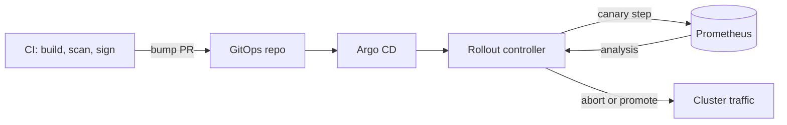

## Context

[[0001-gitops-with-argocd]] decided that Argo CD is the only way workloads reach clusters. That decision covers reconciliation, but not progressive delivery: how a new version is exposed gradually, measured, and rolled back when it misbehaves. A plain Kubernetes `Deployment` offers rolling updates with no traffic weighting and no automated judgement about health.

Spinnaker is the other well-known option for deployment orchestration. It has strong multi-cloud and VM deployment support, pipelines with manual judgement stages, and built-in canary analysis. It is also a large system (many microservices, its own database and cache, its own authentication and authorisation model) that would sit beside Argo CD and compete with it for the role of "what deploys".

We need a single answer for progressive delivery on Kubernetes that fits the GitOps model, does not need cluster credentials in CI, and does not add a second control plane to run. The detailed comparison is in [[argo-rollouts-vs-spinnaker]].

## Decision

We will use **Argo CD for delivery and Argo Rollouts for progressive delivery on Kubernetes**, and we will not adopt Spinnaker.

- **Rollouts replace Deployments** for services that need gradual exposure. A `Rollout` resource lives in the GitOps repository like any other manifest and is reconciled by Argo CD. See [[progressive-delivery-argo-rollouts]] for the how-to.
- **Canary with automated analysis.** The default strategy is a canary with steps that shift traffic and pause, and an `AnalysisTemplate` that queries Prometheus (success rate and latency of the canary against thresholds). A failed analysis aborts the rollout and returns traffic to the stable version without a human in the loop. Metrics come from the stack in [[0042-managed-prometheus-for-application-metrics]] and the thresholds relate to the SLOs behind [[0045-page-only-on-slo-burn-rate]].
- **CI never deploys directly.** CI builds, scans, signs and opens the version-bump change; the merge is the deployment. There is no pipeline stage that holds cluster credentials, which is the point of ADR 0001.
- **Traffic management** uses the supported router for our ingress path (Gateway API or the mesh, see [[0023-gateway-api-for-north-south-traffic]]). Check the current Argo Rollouts documentation for which traffic providers are supported and how, as support differs by provider.
- **Spinnaker is reconsidered only for** deployments that Argo CD cannot model: multi-cloud estates, VM or instance-group targets, or orchestration that spans systems outside Kubernetes. Without such a requirement it stays out.

```yaml title="rollout-canary.yaml (excerpt)"
# Example only. Check the Argo Rollouts docs for the current API version and fields.
apiVersion: argoproj.io/v1alpha1
kind: Rollout
metadata:
  name: payments-api
  namespace: payments
spec:
  replicas: 4
  selector:
    matchLabels:
      app: payments-api
  strategy:
    canary:
      steps:
        - setWeight: 10
        - pause: { duration: 5m }
        - analysis:
            templates:
              - templateName: success-rate
        - setWeight: 50
        - pause: { duration: 10m }
  template:
    metadata:
      labels:
        app: payments-api
    spec:
      containers:
        - name: api
          image: artifactory.example.com/payments-docker-prod-local/api@sha256:<digest-of-the-promoted-image>
```

Replace the digest with the one produced by your promotion step; deploying by digest is covered in [[0010-deploy-images-by-digest]].



> [!info] Spinnaker status
> Check the current state of the Spinnaker project (release cadence, maintainers, supported versions) on its official site before relying on or citing it. This record does not assert its maintenance status.

## Consequences

Easier:

- One delivery system and one place where state lives (Git), with one UI and one permission model.
- Canary and rollback behaviour is declared next to the application manifests and reviewed with them.
- Automated abort reduces the time to roll back a bad release from "when a human notices" to the length of an analysis step.
- No second control plane to run, patch, back up and secure.

Harder or newly required:

- Rollouts is a controller we must run and upgrade, and a `Rollout` is not a `Deployment`: tooling that expects Deployments (some dashboards, HPA targets, policies) must be checked and configured for it.
- Good analysis needs good metrics. A canary judged on poor or sparse metrics passes bad releases or aborts good ones; low-traffic services may need synthetic load or a longer pause.
- There is no built-in manual-judgement pipeline stage like Spinnaker's. Human approval happens in the pull request, or through a `pause` that is resumed, and that is a conscious trade.
- VM-based and non-Kubernetes workloads are not covered by this decision and need another path.
- Argo CD plus Rollouts has less out-of-the-box multi-cloud orchestration, which we accept because we are on one cloud.

## Alternatives considered

- **Spinnaker.** Powerful, with first-class multi-cloud and canary analysis, but heavy to operate and a second control plane that conflicts with the GitOps rule that CI and orchestrators do not push to clusters. Rejected for Kubernetes workloads.
- **Flagger.** A similar progressive delivery controller that works with Flux and several meshes and ingresses. Reasonable, but it is the better fit if we had chosen Flux, and it duplicates what Rollouts gives us with Argo CD. Not chosen.
- **Plain Deployments with rolling updates.** Simplest, no extra controller, but no traffic weighting and no automated health judgement. Kept for low-risk internal services.
- **Feature flags only.** Decouples release from deploy and complements canaries, but does not replace infrastructure-level rollout. See [[0049-feature-flags-with-openfeature]].

> [!info] Claims not checked against current docs
> Argo Rollouts API versions and traffic provider support, Spinnaker's maintenance status, and Flagger's current integrations were not verified for this record. Check the official documentation for each.

## Validation

```bash
set -o pipefail
NAMESPACE="payments"

# Rollouts exist and none are degraded (expect no output from the second command)
kubectl get rollouts.argoproj.io -n "${NAMESPACE}"
kubectl get rollouts.argoproj.io -A -o json \
  | jq -r '.items[] | select(.status.phase == "Degraded") | "\(.metadata.namespace)/\(.metadata.name)"'

# An AnalysisTemplate exists for each canary service (review the list)
kubectl get analysistemplates.argoproj.io -A

# Nothing in CI holds cluster credentials: search pipelines for kubectl/helm deploys (expect no matches)
grep -RInE 'kubectl (apply|set image)|helm (upgrade|install)' ./*/.gitlab-ci.yml || echo "ok"
```

## References

- Argo Rollouts: https://argo-rollouts.readthedocs.io/
- Spinnaker: https://spinnaker.io/docs/
- Related notes: [[argo-rollouts-vs-spinnaker]], [[progressive-delivery-argo-rollouts]], [[argocd-vs-flux]]
- Related ADRs: [[0001-gitops-with-argocd]], [[0010-deploy-images-by-digest]], [[0023-gateway-api-for-north-south-traffic]], [[0042-managed-prometheus-for-application-metrics]], [[0045-page-only-on-slo-burn-rate]], [[0049-feature-flags-with-openfeature]]
