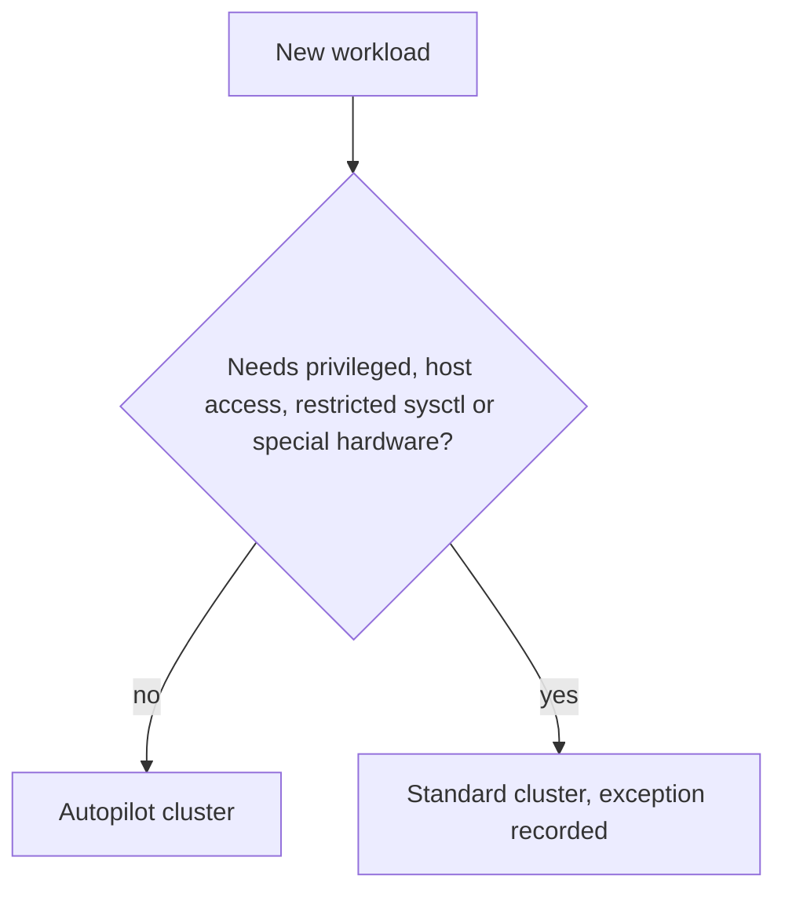

## Context

Every new workload cluster forces the same choice between GKE Standard, where we manage node pools, and GKE Autopilot, where Google manages nodes and we declare only pods. [[gke-platform-topology-and-tenancy]] already recommends Autopilot as a good default when the workloads fit it. This record turns that recommendation into a default with explicit exceptions, but it is still **proposed** because the decision depends on a workload inventory we have not completed.

What differs in practice:

- **Operations.** Standard leaves node pool sizing, machine types, node upgrades and OS patch cadence to us ([[gke-cluster-upgrade]]). Autopilot removes most of that.
- **Billing.** Autopilot bills for the resources your pods **request**, not for the nodes underneath. Unused node capacity is not our cost, but over-requesting is. Standard bills for nodes whether pods fill them or not. Check the current GKE pricing page for the exact model and rates; this record states no prices.
- **Restrictions.** Autopilot limits what workloads can do: privileged containers, host access, some sysctls and some node-level customisation are restricted or unavailable. Check the current Autopilot documentation for the list, which changes over time. The sysctl work in [[kubernetes-node-sysctls]] is a typical thing that does not carry over.
- **Autoscaling.** Autopilot provisions capacity from pod requests, so node-level autoscaler tuning in [[kubernetes-autoscaling]] largely disappears, and pod-level settings (requests, HPA, VPA) become the only levers.

## Decision

**Proposed:** new workload clusters are created in **Autopilot mode**, and a workload that is on the exceptions list runs in a separate Standard cluster.

- **Default:** `gcloud container clusters create-auto`, in a region from the environment's region plan, with private nodes and the project settings from our landing zone.
- **Exceptions list (needs GKE Standard):**
  - GPU or accelerator workloads where the needed type or configuration is not available on Autopilot (check current support).
  - Privileged agents and DaemonSets that need host access, such as some security and storage agents.
  - Workloads that need unusual machine shapes, local SSD configurations or specific node-level kernel settings.
  - Anything that depends on a restricted sysctl or host path.
- **Every exception is recorded** with the reason in the cluster's repository, so we can revisit it when Autopilot capabilities change.
- **Requests are mandatory.** Because Autopilot cost follows requests, [[0021-mandatory-resource-requests]] applies without exception.

```bash title="Create an Autopilot cluster (example values)"
PROJECT_ID="example-prod"
REGION="europe-west1"
CLUSTER="apps-prod-01"

gcloud container clusters create-auto "${CLUSTER}" \
  --project "${PROJECT_ID}" \
  --region "${REGION}" \
  --enable-private-nodes \
  --release-channel regular
```

Check the current `gcloud container clusters create-auto` reference for flags; options such as network, subnetwork and control plane access are set from your own VPC plan and are not shown here. Clusters are normally created from Terraform ([[0030-terraform-manages-gcp-infrastructure]]); the command is for evaluation.

**Decision owner:** the platform lead.

**What closes this record (moves it to accepted or rejected):**

1. A workload inventory classifying every planned workload as fits Autopilot or needs an exception.
2. A cost comparison for two representative services, run on each mode for at least one billing period, using current prices from the pricing pages.
3. A test that the current cluster add-ons and security tooling (admission, network policy, agents) run on Autopilot.
4. A decision date: the next quarterly platform review.



## Consequences

Easier, if accepted:

- No node pool design, machine type selection or node image patching for most clusters.
- Capacity follows pods, so there is no idle node pool to pay for or right-size.
- A stronger default security posture, since the platform restricts risky pod settings.

Harder or newly required:

- Cost becomes sensitive to requests. A generous request on a large deployment is a direct cost, so request review ([[kubernetes-resource-requests-and-limits]]) matters more.
- Some tools will not run. Each exception adds a Standard cluster to operate, which is the cost we are trying to avoid; if the exceptions list grows long the default is wrong.
- Less control over scheduling and node placement, and fewer knobs when debugging node-level issues ([[node-resource-pressure-triage]] is mostly the provider's problem on Autopilot).
- Two cluster modes mean two sets of runbooks and Terraform modules.
- Autopilot behaviour and restrictions change over time. Re-check them at each review.

## Alternatives considered

- **Standard everywhere.** Full control and the broadest compatibility, at the cost of node operations for every cluster. Remains the choice for the exceptions.
- **Autopilot only, with no exceptions.** Simplest to run, but blocks workloads that genuinely need host access or special hardware.
- **Decide per team.** Fast, but leads to mixed fleets with no standard operations. Rejected.

> [!info] Claims not checked against current docs
> The current Autopilot restriction list, GPU and accelerator support, billing details, supported `create-auto` flags and release channel behaviour were not verified for this record. Check the Autopilot overview and pricing pages before deciding.

## Validation

Run these once the record is accepted and a cluster exists.

```bash
set -o pipefail
PROJECT_ID="example-prod"
REGION="europe-west1"

# Which clusters are Autopilot? (expect true for default clusters)
gcloud container clusters list --project "${PROJECT_ID}" \
  --format="table(name, location, autopilot.enabled)"

# Pods with no CPU or memory requests (expect no output)
kubectl get pods -A -o json | jq -r '
  .items[]
  | select(any(.spec.containers[]; .resources.requests.cpu == null or .resources.requests.memory == null))
  | "\(.metadata.namespace)/\(.metadata.name)"'
```

## References

- Autopilot overview: https://cloud.google.com/kubernetes-engine/docs/concepts/autopilot-overview
- Related notes: [[gke-platform-topology-and-tenancy]], [[kubernetes-autoscaling]], [[gke-cluster-upgrade]], [[kubernetes-node-sysctls]]
- Related ADRs: [[0021-mandatory-resource-requests]], [[0030-terraform-manages-gcp-infrastructure]]
