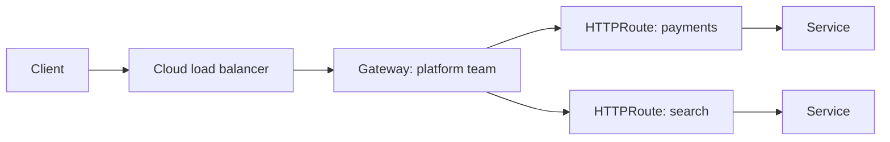

## Context

External and internal HTTP traffic enters our clusters through Ingress resources. Each team writes its own Ingress, annotations differ by controller, and the platform team has no clean way to own the load balancer while letting teams own routing. TLS, timeouts, header rewrites and traffic splitting are all expressed as controller-specific annotations that do not carry over between implementations.

Gateway API is the Kubernetes successor to Ingress. It splits responsibilities into roles: an infrastructure provider supplies a `GatewayClass`, the platform team owns `Gateway` objects, and application teams own `HTTPRoute` objects. GKE ships a Gateway controller backed by Google Cloud load balancers.

There is also external pressure: the Kubernetes project announced the retirement of the ingress-nginx controller. Anyone running it must choose a replacement, which makes this decision unavoidable rather than optional (verify the date and scope on the project announcement).

## Decision

Proposed: new external and internal HTTP entry points use the GKE Gateway controller with `HTTPRoute`, not `Ingress`.

- **Owner:** the platform team decides; the application teams are consulted.
- **Trigger to close:** the pilot on one non-production cluster passes the criteria below, and the ingress-nginx retirement timeline is confirmed. Target review is at the next platform planning cycle.

Proposed shape:

- The platform team owns the `Gateway` in an infrastructure namespace and restricts which namespaces may attach routes through `allowedRoutes`.
- Application teams own `HTTPRoute` objects in their own namespaces.
- Certificates are managed centrally (see [[tls-certificate-renewal]]).
- Existing Ingress resources migrate when a service next changes significantly; there is no big-bang cutover.

```yaml title="gateway.yaml"
apiVersion: gateway.networking.k8s.io/v1
kind: Gateway
metadata:
  name: external-http
  namespace: infra-gateway
spec:
  gatewayClassName: gke-l7-global-external-managed
  listeners:
    - name: https
      protocol: HTTPS
      port: 443
      hostname: "*.example.com"
      tls:
        mode: Terminate
        certificateRefs:
          - name: wildcard-example-com
      allowedRoutes:
        namespaces:
          from: Selector
          selector:
            matchLabels:
              gateway-access: external
```

```yaml title="httproute.yaml"
apiVersion: gateway.networking.k8s.io/v1
kind: HTTPRoute
metadata:
  name: checkout
  namespace: payments-prod
spec:
  parentRefs:
    - name: external-http
      namespace: infra-gateway
  hostnames: ["checkout.example.com"]
  rules:
    - backendRefs:
        - name: checkout
          port: 8080
```



> [!info] Claims not checked against current docs
> The GatewayClass names (`gke-l7-global-external-managed` and the regional and internal variants), which Gateway API features GKE supports in the version we run, certificate options on the GKE controller, and the ingress-nginx retirement date. Check the GKE Gateway documentation.

Pilot criteria:

1. A route can be added by an application team without platform changes.
2. Zero-downtime deploys still work with the health check and connection draining settings (see [[zero-downtime-deployments-kubernetes]]).
3. Latency and cost of the managed load balancer are acceptable against the current Ingress path.
4. Troubleshooting is documented ([[network-troubleshooting-dns-mtu-tls-load-balancers]]).

## Consequences

If accepted:

- Routing becomes portable YAML with a clear ownership split, and the platform team controls TLS and exposure in one place.
- Teams learn a new set of resources, and tooling that reads Ingress (dashboards, scanners) needs updating.
- Cross-namespace attachment adds a policy surface (`allowedRoutes`) that must be reviewed.

Open questions that keep this proposed:

- Whether a service mesh gateway should replace it for east-west plus north-south traffic ([[service-mesh-on-gke]]).
- Migration timeline for the services currently on ingress-nginx.

## Alternatives considered

- **Stay on Ingress with the GKE Ingress controller.** Works today, but annotation-driven and not the direction of the project.
- **Self-managed ingress controller (another one).** Adds an operated component and a new retirement risk.
- **Service mesh ingress gateway.** Attractive if a mesh is adopted anyway; open question, see above.

## Validation

If the pilot proceeds, these checks show the Gateway is healthy and routes attached.

```bash
set -o pipefail
GW_NS="infra-gateway"
GW="external-http"

# Gateway accepted and programmed (expect True for both)
kubectl --namespace "${GW_NS}" get gateway "${GW}" \
  -o jsonpath='{range .status.conditions[*]}{.type}={.status}{"\n"}{end}'

# Routes attached to the Gateway
kubectl get httproutes -A -o wide

# End-to-end check
curl -sS -o /dev/null -w '%{http_code}\n' https://checkout.example.com/healthz
```

## References

- GKE Gateway API: https://cloud.google.com/kubernetes-engine/docs/concepts/gateway-api
- Gateway API project: https://gateway-api.sigs.k8s.io/
- Related notes: [[network-troubleshooting-dns-mtu-tls-load-balancers]], [[service-mesh-on-gke]], [[zero-downtime-deployments-kubernetes]], [[tls-certificate-renewal]]
- Related ADRs: [[0020-default-deny-network-policies]]
