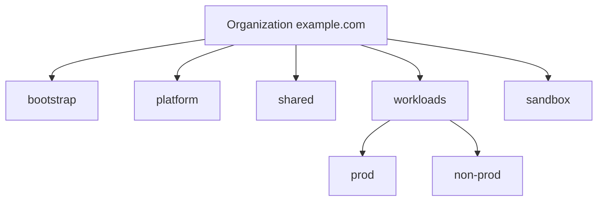

## Context

The organisation hierarchy was grown project by project. Folders mirrored teams, so a reorganisation meant moving projects, and the IAM and organization policies attached to those folders moved with them or were lost. Production and non-production projects of the same team lived side by side and inherited the same permissions, which meant a developer role granted for testing also applied to production.

Folders are the unit of inheritance in Google Cloud: IAM bindings and organization policy constraints set on a folder apply to everything below it. The hierarchy should therefore express where policy differs, not who reports to whom.

> [!warning] Not legal or audit advice
> This record describes an engineering control. It does not establish compliance with any regulation or standard. Have your compliance function decide what your obligations require.

## Decision

Folders follow **policy boundaries**. A folder exists only when the projects below it share IAM and organization policy that differs from its siblings.



- `bootstrap`: the projects that hold Terraform state and the CI identities that manage the hierarchy. Tightest access.
- `platform`: networking host projects, DNS, logging and security tooling.
- `shared`: shared services such as the artifact store.
- `workloads/prod` and `workloads/non-prod`: application projects. Production has stricter organization policy and fewer human grants.
- `sandbox`: experiments with budget limits and automatic clean-up.

Rules:

1. **A folder is the unit of inheritance.** Organization policy and group-based IAM are set on folders, not repeated on projects.
2. **Team ownership goes in labels**, not folders: `owner`, `cost-center`, `env`. A reorganisation changes labels, not the hierarchy.
3. **Project IDs are global and cannot be changed**, so the naming convention is fixed up front, for example `example-prod-payments`. Project display names can change; IDs cannot.
4. Folder depth stays small. Check the current documented limit on nesting before adding levels.
5. The hierarchy itself is managed in Terraform ([[0030-terraform-manages-gcp-infrastructure]]); nobody creates folders in the console.

> [!info] Claims not checked against current docs
> The maximum folder nesting depth, quotas on folders and projects, and the exact names of any predefined roles used for folder administration. Check the Resource Manager documentation.

## Consequences

Easier:

- Production guardrails are applied once on `workloads/prod` and inherited by every new project.
- Team moves do not touch the hierarchy or its policies.
- Auditors can read the hierarchy as a statement of where policy differs.

Harder or newly required:

- Moving a project between folders changes its inherited IAM and policy immediately; the move is a reviewed change, and effects must be previewed first.
- Cross-team views (cost, ownership) depend on consistent labels, which need enforcement.
- A few projects will not fit the model neatly; they get an explicit exception, not a new folder.

## Alternatives considered

- **A folder per team.** Familiar, but couples policy to the org chart and breaks on reorganisation. Rejected.
- **A flat organisation with labels only.** Simple, but loses inheritance: every guardrail must be set per project. Rejected.
- **A folder per environment per team.** Combinatorial growth with little policy difference. Rejected.

## Validation

```bash
set -o pipefail
ORG_ID="123456789012"

# List top-level folders
gcloud resource-manager folders list --organization="${ORG_ID}" \
  --format="table(displayName, name)"

# Projects without the required labels (review the output; none is good)
gcloud projects list --format=json \
  | jq -r '.[] | select(.labels.owner == null or .labels.env == null) | .projectId'

# Effective organization policy on the production folder
FOLDER_ID="345678901234"
gcloud org-policies list --folder="${FOLDER_ID}"
```

## References

- Creating and managing folders: https://cloud.google.com/resource-manager/docs/creating-managing-folders
- Landing zone design: https://cloud.google.com/architecture/landing-zones
- Related notes: [[gcp-resource-hierarchy-and-landing-zone]], [[environment-separation-on-gcp]], [[gcp-organization-policy-guardrails]]
- Related ADRs: [[0025-shared-vpc-host-project-no-default-networks]], [[0030-terraform-manages-gcp-infrastructure]]
