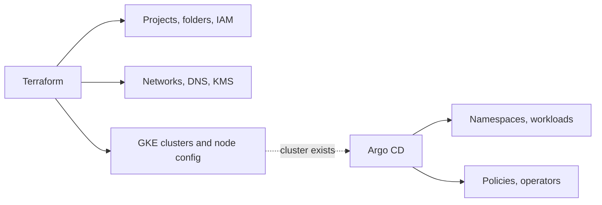

## Context

Google Cloud resources were created in several ways: console clicks, `gcloud` scripts, and Terraform for some of them. Production projects existed that nobody could recreate. IAM grants accumulated through ad hoc commands. At the same time, [[0001-gitops-with-argocd]] made Argo CD the way workloads reach clusters, which raised the boundary question: which tool owns which resources?

Without a clear line, both tools try to own the same objects (namespaces, service accounts, IAM bindings) and fight over them.

## Decision

**Terraform manages Google Cloud resources, including every project. Argo CD manages Kubernetes objects.**



- **Terraform:** organization hierarchy ([[0024-gcp-folders-by-policy-boundary]]), projects, networks, DNS, KMS keys, service accounts and their IAM, GKE clusters, Cloud SQL instances, buckets.
- **Argo CD:** everything inside a cluster: namespaces, RBAC, Deployments, policies, operators, and the Helm releases that install them.
- **The seam:** Terraform creates the cluster and the Google service accounts; GitOps creates the Kubernetes service accounts that bind to them through Workload Identity. Neither tool manages the other's half of a binding.
- **Project factory.** A single module creates a project with the required labels (`owner`, `env`, `cost-center`), enabled APIs, billing link, baseline IAM and budget alert. New projects are a merge request against that module. The pattern is described in [[gcp-resource-hierarchy-and-landing-zone]].
- **The factory identity is separate from the organization-policy identity.** The identity that creates projects cannot change organization policy, so a bug in a project request cannot weaken guardrails.
- **No console-created production projects.** Console changes are drift; detected resources are imported into Terraform or removed.
- State layout and module structure follow [[terraform-module-and-state-layout]].

```hcl title="projects/payments-prod.tf"
module "project_payments_prod" {
  source = "git::https://gitlab.example.com/platform/tf-modules.git//project?ref=v1.4.0"

  project_id      = "example-prod-payments"
  folder_id       = "345678901234"
  billing_account = "000000-000000-000000"
  labels = {
    owner       = "payments"
    env         = "prod"
    cost-center = "cc-1234"
  }
  activate_apis = ["container.googleapis.com", "sqladmin.googleapis.com"]
}
```

The IaC tool binary (Terraform or OpenTofu) is a separate decision: [[0031-terraform-or-opentofu]].

> [!info] Claims not checked against current docs
> The current status and feature set of Config Connector, the provider arguments used above, and the billing and project creation quotas. Check the provider and Config Connector documentation.

## Consequences

Easier:

- Any project or cluster can be recreated from code, and reviewed changes replace console edits.
- Production guardrails are applied at creation time by the factory instead of retrofitted.
- A clear ownership line removes tool conflicts.

Harder or newly required:

- The factory module is critical and versioned carefully ([[0034-terraform-modules-versioned-by-git-tag]]).
- State is sensitive and needs its own protections ([[0032-terraform-state-in-gcs-per-environment]]).
- Break-glass console changes are still needed during incidents and must be reconciled afterwards.
- Teams must request projects through merge requests, which is slower than clicking.

## Alternatives considered

- **Config Connector (Kubernetes-native management of Google Cloud resources).** Lets Argo CD own everything, but ties cloud resource lifecycle to a cluster and has a weaker plan and review story. Check its current status before reconsidering.
- **Crossplane.** Similar trade-off with another control plane to operate.
- **`gcloud` scripts.** Imperative, not reviewable as a diff, and no drift detection. Rejected.

## Validation

```bash
set -o pipefail
ORG_ID="123456789012"

# Projects without the factory's required labels (review; none is good)
gcloud projects list --format=json \
  | jq -r '.[] | select(.labels.owner == null or .labels["cost-center"] == null) | .projectId'

# Terraform sees no drift on a root module (exit code 0 = no changes, 2 = drift)
cd environments/prod && terraform plan -detailed-exitcode -lock=false -input=false
```

## References

- Terraform documentation: https://developer.hashicorp.com/terraform/docs
- Google provider: https://registry.terraform.io/providers/hashicorp/google/latest/docs
- Config Connector overview: https://cloud.google.com/config-connector/docs/overview
- Related notes: [[gcp-resource-hierarchy-and-landing-zone]], [[terraform-module-and-state-layout]]
- Related ADRs: [[0001-gitops-with-argocd]], [[0024-gcp-folders-by-policy-boundary]], [[0031-terraform-or-opentofu]]
