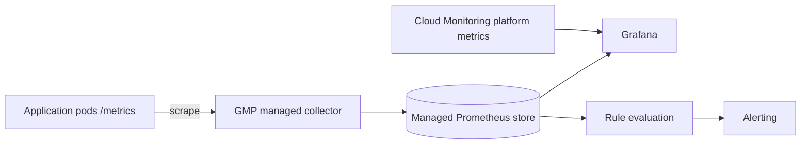

## Context

Teams need application metrics, alerts and dashboards on GKE. Today the options in use are uneven: some teams run their own Prometheus with local disk, some rely only on the metrics Google Cloud produces for the platform, and a few have no application metrics at all.

Running Prometheus ourselves brings real costs: storage sizing, retention, high availability, upgrades, sharding when one server is no longer enough, and the on-call burden of a monitoring system that must be up when everything else is down. Using only Cloud Monitoring system metrics gives no insight into request rates, error ratios or business counters. The comparison of the two models is in [[prometheus-vs-cloud-monitoring]]; this record fixes the choice for application metrics.

Forces at play:

- Developers already think in PromQL, exporters and `/metrics` endpoints, and we do not want to retrain them.
- We want little operational work for the metrics store itself.
- Cost scales with the number of samples ingested, so label discipline matters whichever product we use.
- Alerting must feed the SLO-based paging model in [[0045-page-only-on-slo-burn-rate]].

## Decision

We will use **Google Cloud Managed Service for Prometheus (GMP)** with managed collection for application metrics on GKE, and keep **Cloud Monitoring** for platform and infrastructure metrics.

- Applications expose Prometheus-format metrics on a `/metrics` endpoint. Scrape targets are declared with `PodMonitoring` (namespaced) resources in the application's own GitOps path.
- Queries, recording rules and alert rules are written in PromQL. Rules are GMP `Rules` resources, evaluated by the managed rule evaluator.
- Grafana is the dashboard layer and reads through the GMP query interface, with Cloud Monitoring as a second data source for platform panels.
- Self-managed Prometheus is allowed only for a listed exception, recorded in the service's repository: for example a need for a feature the managed service does not support, or a workload outside GKE.
- Each service has a series budget. A monthly review looks at the highest-cardinality metrics and removes unbounded labels such as user IDs, request paths with IDs, or raw error strings.

```yaml title="podmonitoring.yaml"
apiVersion: monitoring.googleapis.com/v1
kind: PodMonitoring
metadata:
  name: checkout
  namespace: payments
spec:
  selector:
    matchLabels:
      app.kubernetes.io/name: checkout
  endpoints:
    - port: metrics
      interval: 30s
```



> [!info] Claims not checked against current docs
> Ingestion pricing, retention periods, query limits, the exact `PodMonitoring` and `Rules` API versions, and which Prometheus features the managed service supports were not verified. Check the Managed Service for Prometheus documentation before relying on any of them.

## Consequences

Easier:

- No Prometheus servers, disks or sharding to operate for application metrics.
- Existing PromQL knowledge, exporters and client libraries carry over unchanged.
- One place to query across clusters in a project, useful for multi-cluster services.
- Platform and application metrics sit side by side in the same dashboards.

Harder or newly required:

- We depend on Google Cloud for the monitoring backend, so metrics from non-GCP workloads need a separate path.
- Cost follows ingested samples, so high-cardinality labels become a budget problem and not only a performance one. The cardinality review is part of the decision, not an optional extra.
- The managed collection model differs from a standard Prometheus operator, so teams used to `ServiceMonitor` resources need to learn `PodMonitoring`. Charts that ship `ServiceMonitor` objects need an adapter or an override.
- Some Prometheus features and configuration options are unavailable or different in managed collection. Verify a needed feature before committing a service to it.
- Metrics leave the cluster, so project-level IAM decides who can read them. Review that access like any other data access.

## Alternatives considered

- **kube-prometheus-stack, self-managed.** Maximum control and the widest ecosystem, but we own storage, upgrades and availability. Kept as the listed exception path only.
- **Mimir or Thanos for long-term storage.** Strong for very large or multi-cloud estates, but a significant system to run. Not justified for our size.
- **Cloud Monitoring only.** Lowest effort, but no PromQL-native workflow and awkward for custom application metrics. Used for the platform layer only.

## Validation

```bash
set -o pipefail
PROJECT_ID="example-prod"
NAMESPACE="payments"

# PodMonitoring resources exist for the namespace
kubectl --namespace "${NAMESPACE}" get podmonitoring

# The managed collector pods are running (namespace may differ: check the current docs)
kubectl --namespace gmp-system get pods

# No self-managed Prometheus servers outside the documented exceptions
kubectl get statefulsets --all-namespaces -o json \
  | jq -r '.items[] | select(.metadata.name | test("prometheus")) | "\(.metadata.namespace)/\(.metadata.name)"'

# A sample query returns data through the Prometheus HTTP API (requires a token and the GMP frontend)
echo "Query up{namespace=\"${NAMESPACE}\"} in Grafana and confirm the targets report 1"
```

## References

- Managed Service for Prometheus: https://cloud.google.com/stackdriver/docs/managed-prometheus
- Prometheus metric and label naming: https://prometheus.io/docs/practices/naming/
- Related notes: [[prometheus-vs-cloud-monitoring]], [[first-prometheus-alert]], [[finops-cost-allocation-and-guardrails]]
- Related ADRs: [[0043-opentelemetry-collector-gateway]], [[0046-dashboards-and-alert-rules-as-code]], [[0045-page-only-on-slo-burn-rate]]
