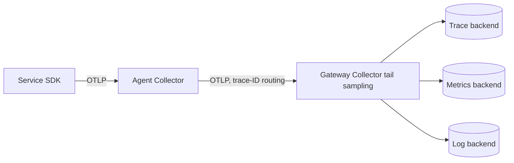

## Context

Services emit traces, metrics and logs through a mix of vendor agents and SDK exporters pointed straight at backends. Each service carries backend endpoints and credentials, changing a backend means redeploying every service, and nothing controls how much trace data we pay to store.

Head sampling (deciding at the start of a request) is cheap but throws away exactly the traces we need: the rare failures and the slow requests are decided before anyone knows they will be interesting. Keeping everything is expensive and mostly noise.

We want application code to know one thing only: where the local OTLP endpoint is. Everything else, including credentials, batching, filtering, sampling and the choice of backend, should be platform configuration. The design of the pipeline is in [[observability-pipeline-opentelemetry]]; this record fixes the topology and the sampling approach.

## Decision

We will route telemetry through **OpenTelemetry Collectors in an agent plus gateway topology**, and use **tail sampling at the gateway**.

- Applications use OpenTelemetry SDKs and export OTLP (gRPC or HTTP) to a node-local or namespace-local agent Collector. They hold no backend credentials.
- Agents add resource attributes (cluster, namespace, pod, service version), batch, and forward to a gateway Collector deployment.
- The gateway holds the backend credentials, applies the `tail_sampling` processor and exports to the backends. Credentials reach it through Workload Identity, not keys.
- Tail sampling policies keep 100% of traces with an error status, 100% of traces slower than the agreed latency threshold for the service, and a small probabilistic share of the rest. Thresholds are set per service tier and recorded in the service's repository.
- All spans of a trace must reach the same gateway instance for tail sampling to work. Use load-balancing exporters keyed on trace ID between the agent and the gateway tier.
- Trace and span IDs are written into JSON logs as defined in [[structured-logging-conventions]], so logs and traces correlate.
- The gateway is on the critical path for telemetry (not for user requests), so it runs with several replicas, a PodDisruptionBudget, resource requests and its own metrics and alerts. Applications must not block on it: SDK exporters use bounded queues and drop on overflow.



```yaml title="gateway-tail-sampling.yaml"
processors:
  tail_sampling:
    decision_wait: 10s
    policies:
      - name: errors
        type: status_code
        status_code:
          status_codes: [ERROR]
      - name: slow
        type: latency
        latency:
          threshold_ms: 1000
      - name: baseline
        type: probabilistic
        probabilistic:
          sampling_percentage: 5
```

> [!info] Claims not checked against current docs
> The processor configuration keys above, the Collector distribution to deploy on Google Cloud (upstream contrib or a Google-built distribution), the maturity of each component and the load-balancing exporter options were not verified. Check the OpenTelemetry Collector documentation and the component READMEs for the version you run.

## Consequences

Easier:

- Backend changes and credential rotation happen in one place, without redeploying services.
- Cost control is central: sampling, filtering and attribute scrubbing are policy, not per-team code.
- Errors and slow requests are kept, which is what incident debugging needs.
- A consistent set of resource attributes makes traces comparable across services.

Harder or newly required:

- Tail sampling holds spans in memory until a decision is made, so the gateway needs memory sized for peak trace volume and `decision_wait`. An undersized gateway drops data silently unless its metrics are watched.
- Trace-ID-aware routing between tiers adds a component and a failure mode: if routing is wrong, traces are split and sampled incorrectly.
- The gateway must be monitored like production infrastructure, including exporter failure and queue metrics.
- Sampled traces cannot be used to compute exact request counts. Counts and rates come from metrics ([[0042-managed-prometheus-for-application-metrics]]), not from traces.
- Sensitive data in span attributes must be scrubbed in the pipeline; the Collector is a good place for it but only if someone owns the configuration.

## Alternatives considered

- **SDK exporters straight to the backend.** Simplest, but spreads credentials and backend knowledge across every service and gives no central sampling. Rejected.
- **Vendor agents.** Fast to start, but couple code and deployment to one vendor. Rejected in favour of the open standard.
- **Head sampling only.** Cheap and stateless, but loses rare failures. Acceptable as the baseline share inside the policy above, not as the whole strategy.

## Validation

```bash
set -o pipefail
NAMESPACE="observability"

# Gateway replicas are running and the PDB exists
kubectl --namespace "${NAMESPACE}" get deployment otel-gateway
kubectl --namespace "${NAMESPACE}" get pdb

# No application workload carries a backend credential or exporter endpoint other than the local agent
kubectl get pods --all-namespaces -o json \
  | jq -r '.items[] | select([.spec.containers[].env[]? | select(.name=="OTEL_EXPORTER_OTLP_ENDPOINT") | .value] | any(test("example-agent") | not)) | "\(.metadata.namespace)/\(.metadata.name)"'

# Gateway self-metrics: confirm no sustained dropped spans (query in your metrics backend)
echo "Check otelcol_processor_dropped_spans and otelcol_exporter_send_failed_spans stay at zero"
```

The metric names above depend on the Collector version; check the current docs.

## References

- OpenTelemetry Collector: https://opentelemetry.io/docs/collector/
- Sampling concepts: https://opentelemetry.io/docs/concepts/sampling/
- Related notes: [[observability-pipeline-opentelemetry]], [[structured-logging-conventions]], [[timeouts-retries-load-shedding]]
- Related ADRs: [[0042-managed-prometheus-for-application-metrics]], [[0044-central-log-sinks-and-retention-tiers]]
