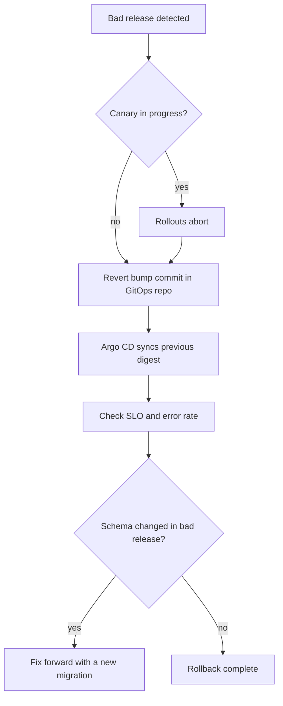

## Context

During an incident, "roll back" can mean five different things: re-run an old pipeline, `helm rollback`, `argocd app rollback`, redeploy an older tag, or restore a database. Each behaves differently, and under pressure people pick whichever they remember.

Specific traps we have either hit or can see coming:

- Re-running an old pipeline rebuilds from source with today's dependencies, so it is not the old artifact.
- A mutable tag may now point at different bytes than it did at the previous release ([[0010-deploy-images-by-digest]]).
- With automated sync enabled, a manual rollback in the Argo CD UI is reverted by the next reconcile, because Git still says the new version.
- A database migration that dropped or rewrote data cannot be undone by deploying older code.

We need one rollback method that is fast, boring, auditable and consistent with how we deploy ([[0001-gitops-with-argocd]]).

## Decision

We will **roll back by reverting the GitOps commit so that manifests point to the previous known-good image digest**, and we will **never roll database schemas back; they only move forward** through expand and contract.

- Rollback is `git revert` of the version-bump commit in the GitOps repository, merged through the normal fast path for incidents. Argo CD reconciles to the previous digest. Git history records who rolled back, when and why.
- Because manifests reference digests, the previous version is exactly the bytes that ran before, already scanned and signed.
- `argocd app rollback` and `helm rollback` are diagnostic or emergency tools only. If used on an application with automated sync, sync is paused first, and the Git revert follows immediately so Git and the cluster agree again. The state "cluster differs from Git" is closed within the incident, not left for later.
- For canary releases, the first action is a Rollouts abort ([[progressive-delivery-argo-rollouts]]), which returns traffic to the stable ReplicaSet in seconds. The Git revert follows.
- Each service has a rollback time budget in its runbook (for example "revert merged and synced in under N minutes"), measured in game days.
- Schema changes follow expand and contract ([[postgres-expand-contract-migrations]]): add new structures first, deploy code that works with both, migrate data, and remove old structures in a later release. Every release must run against the schema of the release before it, which is what makes the code rollback safe.
- Down migrations are not written or used in production. If a migration was wrong, the fix is a new forward migration.
- Feature flags ([[0049-feature-flags-with-openfeature]]) are the first line for behaviour changes: turning a flag off is faster than any deployment.

```bash title="rollback.sh"
set -euo pipefail
GITOPS_DIR="./gitops"
BAD_COMMIT="3f2a9c1"   # the version-bump commit to undo

cd "${GITOPS_DIR}"
git switch main
git pull --ff-only
git switch --create "revert-${BAD_COMMIT}"
git revert --no-edit "${BAD_COMMIT}"
git push origin "revert-${BAD_COMMIT}"
echo "Open a merge request for revert-${BAD_COMMIT} and merge it through the incident path"
```



> [!info] Claims not checked against current docs
> The behaviour of `argocd app rollback` with automated sync enabled, the Rollouts abort semantics, and the CLI flags above should be checked against the current Argo CD and Argo Rollouts documentation for the versions you run.

## Consequences

Easier:

- One method, one audit trail, one thing to practise.
- The rolled-back version is bit-for-bit what ran before.
- No conflict between the reconciler and a human, because Git is changed, not the cluster.

Harder or newly required:

- A Git revert needs a merge, so the incident path must allow a fast review or a pre-approved merge for rollbacks. A slow rollback pipeline defeats the purpose.
- Expand and contract takes more releases and discipline than a single breaking migration. Teams that skip it cannot use this rollback safely, and the review checklist must catch it.
- Forward-only schemas mean some bad data changes need a forward repair script, planned and tested, not a quick undo. Backups ([[0051-backups-proven-by-quarterly-restore-drills]]) are the last resort, not the rollback plan.
- Rolling back configuration that lives outside Git (secrets, external systems) needs its own procedure.

## Alternatives considered

- **`helm rollback`.** Fast, but changes cluster state without Git and is overwritten by sync. Emergency only.
- **Re-running an old pipeline.** Rebuilds and may produce different bytes. Rejected.
- **Down migrations.** Look safe on paper, but often lose data or fail on real volumes. Rejected for production.

## Validation

```bash
set -o pipefail
GITOPS_DIR="./gitops"

# The previous release's digest is recoverable from Git history
git -C "${GITOPS_DIR}" log --oneline -n 5 -- apps/checkout/values.yaml

# Applications with automated sync (rollback via the UI would be reverted)
argocd app list -o json \
  | jq -r '.[] | select(.spec.syncPolicy.automated != null) | .metadata.name'

# No migration directory contains a down migration (adapt the path to your tool)
find ./db/migrations -iname '*down*' -print
```

Practise the revert in staging at least once per quarter and record the measured time.

## References

- Argo CD rollback command: https://argo-cd.readthedocs.io/en/stable/user-guide/commands/argocd_app_rollback/
- PostgreSQL ALTER TABLE: https://www.postgresql.org/docs/current/sql-altertable.html
- Related notes: [[postgres-expand-contract-migrations]], [[helm-release-rollback]], [[argocd-sync-failure-and-drift]]
- Related ADRs: [[0010-deploy-images-by-digest]], [[0017-argo-cd-and-rollouts-not-spinnaker]], [[0047-semver-release-tags-and-protected-production-deploys]]
