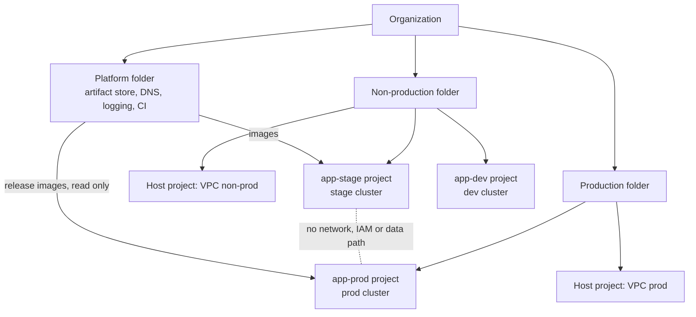

## Context

[[environment-separation-on-gcp]] recommends separating environments, and [[0019-namespace-per-team-tenancy|ADR-0019]] decides how teams share a cluster. ADR-0019 is explicit that namespaces are **soft** tenancy: they separate teams that trust each other and share an owner, not workloads with different risk. Nothing yet forbids the cheaper shortcut that keeps coming back in planning: "put staging in a `-staging` namespace of the production cluster" or "one project per service, with all its environments inside".

What goes wrong when environments share a cluster:

- **Cluster-scoped objects are shared.** CRDs, admission webhooks, `ClusterRole`s, storage classes and the control plane version are one per cluster. Testing a new CRD version or an admission policy in "staging" changes it for production at the same moment.
- **Upgrades have no canary.** A control plane upgrade hits both environments together, so the non-prod soak that [[0054-gke-release-channels-and-maintenance-policy|ADR-0054]] relies on disappears.
- **Capacity and quotas are shared.** A load test, a runaway Job or a node pool exhausted by a test can starve production Pods, and project quotas (IP addresses, CPUs, API rate limits) are consumed by both.
- **Identity leaks between environments.** A project-level IAM grant, a node service account or a workload identity pool covers every namespace in the cluster. One mistaken `roles/...` binding meant for staging is a production grant.
- **Data paths open up.** Once staging and production run in the same project or VPC, a staging job can reach a production database, bucket or secret with nothing but a configuration error.

Sharing a **project** across environments has the same IAM problem without any cluster involved: IAM, organization policy, quotas, audit logs and billing are scoped to the project and inherited from its folder, so a mixed project can only have the loosest policy any of its environments needs.

## Decision

**Production and non-production never share a Google Cloud project or a GKE cluster. Each workload has one project per environment, and each environment's clusters live in that environment's projects under that environment's folder.**

- **Projects:** one project per workload per environment (`app-dev`, `app-stage`, `app-prod`), created by the project factory under the environment folder ([[0024-gcp-folders-by-policy-boundary]]). A project's `env` label matches its folder. The label key is our convention.
- **Clusters:** a cluster belongs to exactly one environment. Shared **platform** clusters (for example one cluster that hosts several teams' services, per [[0019-namespace-per-team-tenancy]]) are allowed **inside** an environment, never across environments. The same holds for regions: the DR region of [[0028-primary-and-dr-regions-per-environment]] gets its own clusters per environment.
- **Networks:** each environment has its own Shared VPC host project ([[0025-shared-vpc-host-project-no-default-networks]]). There is no peering, VPN or shared subnet between the production network and a non-production network.
- **Identities:** service accounts, workload identity pools ([[0052-workload-identity-for-gke-pods]]) and CI deploy identities ([[0026-keyless-ci-auth-with-workload-identity-federation]]) are per environment. A non-prod identity never holds a role on a prod resource, and a prod identity holds roles in non-prod only where the table below allows it.
- **Data:** there is no path from non-prod to prod data. Production data reaches lower environments only through an approved, masked export run by a prod identity, never by a non-prod job reading prod.

What may be shared, and what must never cross:

| Resource                              | Shared across environments? | Rule                                                                                                                                                                                     |
| ------------------------------------- | --------------------------- | ---------------------------------------------------------------------------------------------------------------------------------------------------------------------------------------- |
| Artifact store (images, charts)       | Yes                         | One store, with promotion between repositories ([[0004-build-once-promote-between-repositories]]). Prod clusters read only from the release repositories; non-prod cannot write to them. |
| CI identity pool and runners          | Partly                      | One CI system, but a separate WIF provider and deploy identity per environment, and production deploys only on protected runners ([[0014-gitlab-runners-kubernetes-executor-on-gke]]).   |
| DNS                                   | Yes, by zone                | Zones live in the platform project ([[0029-cloud-dns-zones-in-a-platform-project]]); each environment's identity may change only its own zone.                                           |
| Logging and monitoring backends       | Yes                         | Central sinks ([[0044-central-log-sinks-and-retention-tiers]]); environments write, only the platform and security teams read across them.                                               |
| VPC networks, subnets, Cloud NAT      | No                          | One Shared VPC host per environment.                                                                                                                                                     |
| GKE clusters, node pools              | No                          | One environment per cluster.                                                                                                                                                             |
| Service accounts and workload pools   | No                          | Per project, so per environment.                                                                                                                                                         |
| Databases, buckets, secrets, KMS keys | No                          | Per environment. A non-prod identity holding any role on these in prod is an incident.                                                                                                   |
| Terraform state                       | No                          | Per environment ([[0032-terraform-state-in-gcs-per-environment]]).                                                                                                                       |



> [!info] Claims not checked against current docs
> This record was not checked against Google's documentation pages; verify there. The `gcloud` flags below were read from the `gcloud --help` text; output and filter field names (`parent.id`, `resourceLabels`, `policy.bindings`) are API names that were not confirmed and should be checked once with `--format=json`. The soft and hard tenancy wording here is ours, from [[0019-namespace-per-team-tenancy]], and was not checked against the GKE enterprise multi-tenancy best practices page. Per-project cluster limits and the GKE cluster management fee are not stated; see the pricing page.

## Consequences

Easier:

- A mistake in non-prod (a bad CRD, an admission policy, a load test, a broad IAM grant) cannot reach production, and every folder can carry the policy its environment needs.
- Upgrades, policy changes and new add-ons get a real canary: they run in non-prod clusters first ([[0054-gke-release-channels-and-maintenance-policy]]).
- Billing, quotas and audit logs are naturally split by environment, which also makes access reviews ([[access-reviews-gcp-and-gke]]) and evidence collection simpler.

Harder or newly required:

- **More clusters.** Each cluster has a management fee (check the current GKE pricing page) and its own upgrade, add-on and policy lifecycle. Clusters are therefore defined from one Terraform module and one set of fleet-wide policies, not hand-tuned per cluster; Autopilot ([[0018-gke-autopilot-for-new-clusters]]) keeps the per-cluster overhead lower.
- **Small services pay a fixed cost** for their own projects in each environment. They share an environment's platform cluster as namespaces rather than getting a cluster each.
- **Environment parity needs effort.** Separate clusters drift unless versions, add-ons and policies come from the same code with per-environment values only.
- **Prod data in lower environments** needs a masked-export process, which is slower than reading prod directly. That is intended.

## Alternatives considered

- **A namespace per environment in one cluster.** Cheapest, and the most common shortcut. Fails on every point in Context: shared CRDs, webhooks, upgrades, nodes, quotas and IAM. Rejected; namespaces stay the tenancy unit **inside** an environment only.
- **One project per workload, with a cluster per environment inside it.** Separates the Kubernetes layer, but IAM, organization policy, quotas and audit scope stay shared, and the project's policy must satisfy its loosest environment. Rejected.
- **Separate clusters, shared VPC network across environments.** Keeps cluster boundaries but leaves a routable path from staging Pods to production databases, controlled only by firewall rules. Rejected in favour of one Shared VPC host per environment.
- **Hard multi-tenancy tooling (virtual clusters, sandboxed runtimes) in one shared cluster.** Adds a layer to operate and still shares nodes, quotas and the control plane version. Not justified when separate projects are cheap to create from the project factory.

## Validation

Run these from an identity with read access to the folders. The IAM search needs the permission `cloudasset.assets.searchAllIamPolicies` on the scope you search; check which predefined role grants it in the Cloud Asset Inventory docs.

```bash title="validate-environment-separation.sh"
set -o pipefail
PROD_FOLDER="123456789012"     # folder number of the production folder
NONPROD_FOLDER="210987654321"  # folder number of the non-production folder

# 1. Project labels match the folder. Expected: every project under the prod folder has
#    env=prod; any other value or a missing label is a finding.
#    "env" is our label convention, not a Google default.
gcloud projects list --filter="parent.id=${PROD_FOLDER}" \
  --format='table(projectId, labels.env)'

# 2. A single project's place in the hierarchy (folder chain up to the organization).
gcloud projects get-ancestors app-prod

# 3. Clusters in each prod project carry the prod label.
#    Field name: check once with --format=json if the column is empty.
for p in $(gcloud projects list --filter="parent.id=${PROD_FOLDER}" --format='value(projectId)'); do
  gcloud container clusters list --project "${p}" \
    --format="table[no-heading](name, location, resourceLabels.env)" 2>/dev/null \
    | sed "s|^|${p}  |"
done

# 4. Production identities holding roles in non-prod. Expected: only the rows the table
#    above allows (for example a prod export identity writing to a masked-data bucket).
#    Prod service accounts end in -prod.iam.gserviceaccount.com and prod workload pools in
#    -prod.svc.id.goog in our naming; adjust the pattern to your naming convention.
gcloud asset search-all-iam-policies --scope="folders/${NONPROD_FOLDER}" --format=json \
  | jq -r '.[] | .resource as $r | (.policy.bindings // [])[] | .role as $role
      | .members[] | select(test("-prod\\.(iam\\.gserviceaccount\\.com|svc\\.id\\.goog)"))
      | "\($r)\t\($role)\t\(.)"'

# 5. The reverse: non-prod identities holding any role under the prod folder.
#    Expected: no output.
gcloud asset search-all-iam-policies --scope="folders/${PROD_FOLDER}" --format=json \
  | jq -r '.[] | .resource as $r | (.policy.bindings // [])[] | .role as $role
      | .members[] | select(test("-(dev|stage)\\.(iam\\.gserviceaccount\\.com|svc\\.id\\.goog)"))
      | "\($r)\t\($role)\t\(.)"'
```

`--filter="parent.id=..."` lists projects whose direct parent is that folder; repeat it for subfolders or use the asset inventory if your folders are nested. The IAM search runs on the server and returns only bindings, so it does not show inherited access through groups: a group that contains both prod and non-prod members needs a separate group membership review ([[access-reviews-gcp-and-gke]]).

Troubleshooting: an empty result from check 4 or 5 can also mean the caller lacks the search permission on that folder. Run `gcloud asset search-all-iam-policies --scope="folders/${PROD_FOLDER}" --limit=1` first; an error there is a permission problem, not a clean result.

## References

- GKE enterprise multi-tenancy best practices: https://docs.cloud.google.com/kubernetes-engine/docs/best-practices/enterprise-multitenancy
- Cloud Asset Inventory, searching IAM policies: https://cloud.google.com/asset-inventory/docs/searching-iam-policies
- Cloud Asset Inventory supported asset types: https://cloud.google.com/asset-inventory/docs/supported-asset-types
- GKE pricing (cluster management fee): https://cloud.google.com/kubernetes-engine/pricing
- Google's Terraform example foundation (environment folders and organization policies): https://github.com/terraform-google-modules/terraform-example-foundation

Related notes: [[environment-separation-on-gcp]], [[gcp-resource-hierarchy-and-landing-zone]], [[gke-platform-topology-and-tenancy]], [[shared-vpc-hub-and-spoke]]

Related ADRs: [[0019-namespace-per-team-tenancy]], [[0024-gcp-folders-by-policy-boundary]], [[0025-shared-vpc-host-project-no-default-networks]], [[0028-primary-and-dr-regions-per-environment]], [[0052-workload-identity-for-gke-pods]], [[0054-gke-release-channels-and-maintenance-policy]], [[0057-just-in-time-production-access]]
