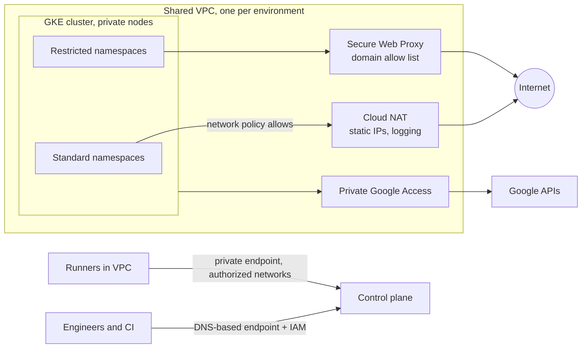

## Context

[[0018-gke-autopilot-for-new-clusters|ADR-0018]] creates clusters with `--enable-private-nodes` in passing, and [[0020-default-deny-network-policies|ADR-0020]] assumes "a controlled egress path" that no record defines. Nothing records how people and CI reach the Kubernetes API. The architecture is described in [[private-gke-and-controlled-egress]]; this record fixes the choices.

The forces:

- **Public endpoints are scanned constantly.** A control plane reachable from `0.0.0.0/0` depends entirely on authentication being correct and unpatched. GKE's own `gcloud` help states that with authorized networks disabled, the public internet is allowed to connect to the control plane over HTTPS.
- **Nodes with external IPs are reachable and can reach anything.** By default GKE nodes get external IP addresses unless private nodes are enabled.
- **Unbounded egress is an exfiltration path** and a command-and-control channel for a compromised Pod. Default-deny network policy controls traffic inside the cluster, but once traffic is allowed to the internet it can go anywhere.
- **Cloud NAT ports run out.** With static allocation each VM gets a small fixed number of source ports by default (64 per the `gcloud` help), and busy nodes with many Pods calling the same destination exhaust them, which looks like random connection timeouts.
- **Access paths must still work.** Laptops, CI runners (in our VPC and SaaS), Terraform and Google-managed services all need the API.

GKE now offers two kinds of control-plane endpoint: a **DNS-based endpoint**, authorised by IAM on every request, and the **IP-based endpoints** (public and private), restricted by authorized networks. The `gcloud` help and the GKE hardening guide both recommend the DNS-based endpoint.

## Decision

**Nodes have no external IP addresses. The control plane is reached through the DNS-based endpoint with IAM, or through a private IP endpoint limited to listed networks; there is no public IP endpoint open to the internet. All egress to the internet leaves through Cloud NAT with logging, and namespaces that handle restricted data reach the internet only through an egress proxy with an allow list.**

### Nodes

- Every cluster and node pool is created with **private nodes**. On Standard clusters the flag on an existing cluster changes only the default for new node pools, so existing pools are replaced, not updated in place. On Autopilot, enabling it on an existing cluster reschedules workloads.
- Nodes reach Google APIs through Private Google Access on the subnet, not through NAT.
- Organization policy `compute.vmExternalIpAccess` (deny all) on the environment folders backs this up for every VM, see [[0056-vm-access-through-os-login-and-iap]].

### Control plane

- **DNS-based endpoint enabled** (`--enable-dns-access`). Humans and CI authenticate with their Google identity and IAM decides; Kubernetes RBAC still applies after that.
- **No public IP endpoint.** The IP-based endpoint, where it stays enabled, is **private only** (`--enable-private-endpoint`) with **authorized networks enforced on it** (`--enable-authorized-networks-on-private-endpoint`), listing only the CI runner subnets and the admin network ranges. `0.0.0.0/0` never appears in an authorized network list.
- **`--enable-google-cloud-access` is not used.** It lets any public IP owned by Google Cloud reach the public endpoint, which includes other customers' workloads. A Google-managed service that needs the API is handled by its own documented integration.
- **Global access to the private endpoint** (`--enable-master-global-access`) only where a CI runner or the on-premises network reaches the cluster from another region.
- **Kubernetes ServiceAccount tokens and client certificates over the DNS endpoint** stay disabled unless a named tool needs them; Google identities are the default.

Who reaches the API from where:

| Caller                              | Path                                                                 | Control                                                                                                         |
| ----------------------------------- | -------------------------------------------------------------------- | --------------------------------------------------------------------------------------------------------------- |
| Engineers on laptops                | DNS-based endpoint                                                   | IAM on the cluster, Google groups in RBAC, JIT for writes ([[0057-just-in-time-production-access]])             |
| CI runners in our VPC               | Private endpoint, or the DNS-based endpoint                          | Runner subnet in authorized networks; WIF identity ([[0026-keyless-ci-auth-with-workload-identity-federation]]) |
| SaaS or external CI runners         | DNS-based endpoint, or Connect Gateway for fleet-registered clusters | IAM only; no runner IPs in authorized networks                                                                  |
| On-premises via VPN or Interconnect | Private endpoint (global access if cross-region)                     | On-premises ranges in authorized networks                                                                       |
| Google-managed services             | Their own documented integration                                     | No blanket Google Cloud access                                                                                  |

Production deploys still run from the protected runners of [[0014-gitlab-runners-kubernetes-executor-on-gke]]; this table is about network reachability, not about who may deploy.

### Egress

- **Cloud NAT per region in the environment's Shared VPC host project** ([[0025-shared-vpc-host-project-no-default-networks]]), covering the node subnets with **all** their ranges (primary and secondary, so Pod ranges are included).
- **Reserved, static NAT IP addresses**, not auto-allocated, so partners can allow-list them and the addresses are inventoried.
- **Dynamic port allocation on**, with a minimum and maximum sized from measured connection counts, and **NAT logging on** (`ERRORS_ONLY` at least, so port exhaustion and dropped connections are visible).
- **Restricted namespaces** (those holding the data classes of [[0059-cmek-where-data-classification-requires-it]]) have no direct route to the internet in their network policy; their only allowed egress is the egress proxy, which permits a reviewed list of destination domains. The proxy is Secure Web Proxy; in-cluster FQDN network policies are an additional layer where the cluster supports them.
- Other namespaces get internet egress through NAT only where their network policy allows it ([[0020-default-deny-network-policies]]).



### Configuration sketch

```bash title="private-cluster.sh"
set -o pipefail
PROJECT_ID="app-prod"
HOST_PROJECT="net-prod-host"
REGION="europe-west1"
CLUSTER="apps-prod-01"
NETWORK="projects/${HOST_PROJECT}/global/networks/vpc-prod"
SUBNET="projects/${HOST_PROJECT}/regions/${REGION}/subnetworks/gke-apps-prod-euw1"
RUNNER_RANGE="192.0.2.0/24"     # CI runner subnet (documentation range in this example)
ADMIN_RANGE="198.51.100.0/24"   # admin network reaching the private endpoint over VPN

gcloud container clusters create-auto "${CLUSTER}" \
  --project "${PROJECT_ID}" --region "${REGION}" \
  --network "${NETWORK}" --subnetwork "${SUBNET}" \
  --enable-private-nodes \
  --enable-dns-access \
  --enable-private-endpoint \
  --enable-master-authorized-networks \
  --master-authorized-networks "${RUNNER_RANGE},${ADMIN_RANGE}" \
  --enable-authorized-networks-on-private-endpoint \
  --release-channel stable

# Cloud NAT in the host project: static IPs, all ranges of the node subnet, logging on.
gcloud compute addresses create nat-euw1-a nat-euw1-b --region "${REGION}" --project "${HOST_PROJECT}"

gcloud compute routers create rtr-euw1 \
  --project "${HOST_PROJECT}" --region "${REGION}" --network vpc-prod

gcloud compute routers nats create nat-euw1 \
  --project "${HOST_PROJECT}" --region "${REGION}" --router rtr-euw1 \
  --nat-external-ip-pool nat-euw1-a,nat-euw1-b \
  --nat-custom-subnet-ip-ranges "gke-apps-prod-euw1:ALL" \
  --enable-dynamic-port-allocation --min-ports-per-vm 64 --max-ports-per-vm 4096 \
  --enable-logging --log-filter ERRORS_ONLY
```

Production clusters and NAT are created from Terraform ([[0030-terraform-manages-gcp-infrastructure]]); the commands show the settings, not the delivery path. The port numbers are a starting point: both must be powers of 2, and the right values come from NAT metrics and logs, not from this record. Secure Web Proxy configuration (gateway, policy, URL lists) is defined per environment by the platform team and is not shown here.

> [!info] Claims not checked against current docs
> The `gcloud` flags above were read from `gcloud --help` (Google Cloud SDK 570.0.0); the record was not checked against Google's online documentation, so verify there. Check before relying on: whether new clusters use a Private Service Connect based control plane and which settings that changes; the IAM permission needed to use the DNS-based endpoint and whether VPC Service Controls apply to it; the effect of disabling the IP-based endpoint entirely on Terraform and other tooling; Connect Gateway's IAM roles and fleet registration requirements; whether the authorized network limits in the help text (100 for private, 50 for public clusters) are current; how `get-credentials` selects the DNS-based endpoint; Cloud NAT quotas, the behaviour of NAT logs and their resource type (`nat_gateway` in Validation); the availability, tier and price of FQDN objects in network firewall policies (`--dest-fqdns` exists in the CLI) and of FQDN network policies in GKE; and Secure Web Proxy capabilities and pricing (the CLI and API use "gateway" naming for it).

## Consequences

Easier:

- Scanning the internet finds no Kubernetes API and no node to attack.
- Every outbound connection leaves from a known address with a log entry, and restricted data has a narrow, reviewed way out.
- API access is tied to Google identities and audit logs rather than to IP ranges alone.

Harder or newly required:

- **Laptops need the DNS endpoint set up** (a `gcloud container clusters get-credentials` that targets it) and an IAM grant; engineers who relied on a public endpoint need a short migration guide.
- **NAT capacity needs planning.** Port allocation, the number of NAT IPs and endpoint-independent mapping affect each other; NAT error logs and metrics are watched, and port exhaustion is a known cause in [[network-troubleshooting-dns-mtu-tls-load-balancers]].
- **The proxy becomes a dependency** for restricted namespaces: its availability, its allow list workflow and its latency belong to the platform team, and a new destination needs a reviewed change.
- **Partners must allow-list the NAT IPs**, so changing them is a coordinated change.
- **Recovering access** when the control plane seems unreachable starts with the access path, not the cluster ([[gke-control-plane-unavailable]]).

### Rollback

Each part is reversible on its own: authorized network lists can be widened in an emergency through a reviewed change, DNS access can be enabled alongside the IP endpoints, and a namespace can be moved back from proxy-only to NAT egress by its network policy. Making existing Standard node pools private requires replacing the pools, so plan that as a migration with surge capacity, not as a flag flip.

## Alternatives considered

- **Public endpoint with authorized networks.** Common and simple, but the endpoint stays on the internet, and SaaS runner IP ranges are wide and change. Rejected for new clusters; existing ones move to the DNS-based endpoint.
- **Cloud NAT only, no proxy.** Logs every flow but allows every destination. Kept for standard namespaces, not enough for restricted data.
- **FQDN rules in network firewall policies instead of a proxy.** Applies at the VPC level without a proxy hop, but matches on DNS names rather than on the request, and availability and tier need checking. A candidate to replace or complement the proxy once checked.
- **A self-managed proxy (Squid or Envoy) in the cluster.** Full control, but one more critical component to patch, scale and secure. Rejected in favour of a managed proxy.
- **A bastion host for kubectl.** Another VM with SSH to secure and audit, replaced by the DNS-based endpoint and IAM.

## Validation

```bash title="validate-private-gke.sh"
set -o pipefail
PROJECT_ID="app-prod"
HOST_PROJECT="net-prod-host"
CLUSTER="apps-prod-01"
REGION="europe-west1"

# 1. No VM in the project has an external IP. Expected: no output.
gcloud compute instances list --project "${PROJECT_ID}" --format=json \
  | jq -r '.[] | select([.networkInterfaces[]?.accessConfigs[]?.natIP] | map(select(. != null)) | length > 0)
      | "\(.name)\t\(.zone | split("/") | last)"'

# 2. Control-plane access configuration. Read the endpoint and authorized-network blocks:
#    DNS access enabled, no public endpoint, no 0.0.0.0/0, no Google Cloud access.
#    Field names vary by GKE version, so list the top-level keys first.
gcloud container clusters describe "${CLUSTER}" --location "${REGION}" --project "${PROJECT_ID}" \
  --format=json | jq 'keys'
gcloud container clusters describe "${CLUSTER}" --location "${REGION}" --project "${PROJECT_ID}" \
  --format=json | jq '{controlPlaneEndpointsConfig, masterAuthorizedNetworksConfig, privateClusterConfig}'

# 3. NAT logging and port settings.
gcloud compute routers nats describe nat-euw1 --router rtr-euw1 \
  --region "${REGION}" --project "${HOST_PROJECT}"

# 4. NAT errors in the last day (dropped connections, port exhaustion).
gcloud logging read 'resource.type="nat_gateway"' \
  --project "${HOST_PROJECT}" --freshness=1d --limit=20
```

Egress test from a restricted namespace: a Pod there must fail to reach an arbitrary site directly and succeed only through the proxy to an allowed domain.

```bash
NAMESPACE="payments"   # a restricted namespace
kubectl run egress-check --namespace "${NAMESPACE}" --rm -it --restart=Never \
  --image=curlimages/curl:latest -- \
  sh -c 'curl -s -m 5 -o /dev/null -w "direct: %{http_code}\n" https://example.com || echo "direct: blocked (expected)"'
```

Pin the image by digest in real use. A `200` on the direct call means the network policy or firewall still allows internet egress from that namespace; check the namespace's policies ([[0020-default-deny-network-policies]]) before anything else.

## References

- Harden your cluster's security (control plane access, private nodes): https://docs.cloud.google.com/kubernetes-engine/docs/how-to/hardening-your-cluster
- Network isolation and control plane access: https://docs.cloud.google.com/kubernetes-engine/docs/concepts/network-isolation
- Private clusters: https://cloud.google.com/kubernetes-engine/docs/how-to/private-clusters
- Cloud NAT overview: https://cloud.google.com/nat/docs/overview
- Secure Web Proxy overview: https://cloud.google.com/secure-web-proxy/docs/overview
- Connect Gateway: https://cloud.google.com/kubernetes-engine/enterprise/multicluster-management/gateway
- Terraform `google_container_cluster`: https://registry.terraform.io/providers/hashicorp/google/latest/docs/resources/container_cluster

Related notes: [[private-gke-and-controlled-egress]], [[shared-vpc-hub-and-spoke]], [[network-troubleshooting-dns-mtu-tls-load-balancers]], [[gke-control-plane-unavailable]], [[zero-trust-access-iap-and-vpc-service-controls]]

Related ADRs: [[0014-gitlab-runners-kubernetes-executor-on-gke]], [[0018-gke-autopilot-for-new-clusters]], [[0020-default-deny-network-policies]], [[0025-shared-vpc-host-project-no-default-networks]], [[0053-production-and-non-production-never-share-a-cluster]], [[0056-vm-access-through-os-login-and-iap]]
