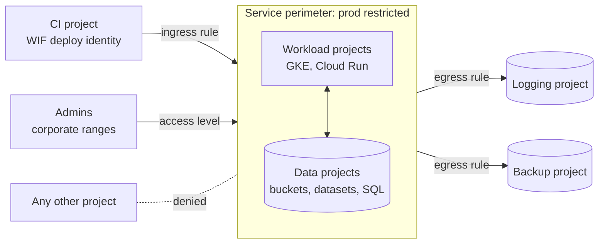

## Context

IAM decides **who** may call a Google API. It does not decide **where the data may go** once that caller is authenticated. A service account key leaked from a laptop, a stolen OAuth token or a compromised CI job that holds `storage.objects.get` on a production bucket can copy every object into a bucket in a project the attacker owns. Both ends of that copy are allowed by IAM, and nothing in the organisation stops it.

The same gap applies to BigQuery datasets (an export or a query into a dataset outside the organisation), to Cloud SQL exports to a bucket, and to anything else that moves data through Google-managed APIs rather than through our network. Firewalls and Cloud NAT do not see these calls, because the copy happens between Google services.

What we already have:

- Folders by policy boundary ([[0024-gcp-folders-by-policy-boundary]]), with production and non-production in separate projects and clusters ([[0053-production-and-non-production-never-share-a-cluster]]).
- Organisation policy guardrails ([[gcp-organization-policy-guardrails]]): no default networks, no public buckets, no service account key creation.
- Keyless CI ([[0026-keyless-ci-auth-with-workload-identity-federation]]), which removes most long-lived keys but not stolen short-lived tokens.

VPC Service Controls (VPC-SC) adds the missing control: a **service perimeter** around a set of projects, inside which the protected services can exchange data freely, and across which requests are denied unless an ingress or egress rule allows them. Google's overview describes it as reducing exfiltration risk from clients that use stolen credentials, and as blocking both reads from and writes to resources outside the perimeter.[^overview] The architecture is described in [[zero-trust-access-iap-and-vpc-service-controls]].

VPC-SC is also known for breaking things in ways that are hard to diagnose: a denied call returns a 403 that many tools report as a generic permission error. That is why this record is a proposal with a dry-run phase, not a switch we flip.

## Decision

Proposed: **every production project that holds restricted data is placed in one regular service perimeter per environment, rolled out in dry-run mode first and enforced only after the dry-run logs are clean.**

"Restricted" means the highest data class in [[0059-cmek-where-data-classification-requires-it|the data class table of ADR-0059]]: payment data, personal data in regulatory scope ([[pci-dss-and-gdpr-for-devops-logs-and-data]]), credentials and Terraform state.

- **Owner:** the platform security lead, with the platform team implementing and the owning service teams consulted.
- **Trigger to close:** the dry-run perimeter has run through one full business cycle with no unexplained violations, and the owners of the CI, backup and logging projects have signed off the ingress and egress rules. "A full business cycle" is our own policy, not a Google recommendation: at least one month-end close, one quarterly restore drill ([[0051-backups-proven-by-quarterly-restore-drills]]) and one planned release. Google's guidance is to analyse, fix and then enforce, without a fixed duration.[^rollout] If the trigger is not met within two quarters, the record is reviewed rather than left open.

### Proposed shape

- **Scope.** The perimeter holds the production data projects (database, bucket and analytics projects) and the production workload projects that read them. It does not hold CI, logging, backup, KMS or network host projects; those reach in or are reached through rules.
- **Restricted services.** The perimeter restricts every service we use that VPC-SC supports at GA, taken from `gcloud access-context-manager supported-services list` and reviewed at each change. Services listed as preview or with known limitations are evaluated one by one. Following the enablement guide's "for maximum security" advice, the perimeter's VPC accessible services setting limits in-perimeter networks to supported services (check the setting in the current docs before enforcing it).[^rollout]
- **Dry-run first.** The perimeter is created with an **explicit dry-run spec** and no enforced resources. Violations are logged and nothing is denied. A perimeter without an explicit dry-run spec uses its enforced config as the dry-run config and produces no dry-run logs, so the explicit spec is not optional.[^dryrun-config]
- **Enforcement is a Terraform change.** Moving from dry-run to enforced copies the reviewed spec into the enforced `status` block in a merge request. We do not use `gcloud ... perimeters dry-run enforce` against Terraform-managed perimeters, because the change would happen outside state and the next plan would try to undo it.
- **Ingress rules** for named identities only, never `ANY_IDENTITY`:
  - the CI deploy identities of [[0026-keyless-ci-auth-with-workload-identity-federation]], for the services and projects they deploy to;
  - the backup project's service accounts, for the read and write paths of [[backup-architecture-gke-cloud-sql-gcs]];
  - break-glass and admin groups, combined with the admin-path access level below.
- **Egress rules** for the flows that leave on purpose: log sinks to the central logging project ([[0044-central-log-sinks-and-retention-tiers]]), backups to the backup project, and key use in the KMS project where that service is outside the perimeter. Each rule names its identities, services and target projects.
- **Access levels** for the human admin path: an IP-based basic access level for the corporate egress ranges, plus device conditions where our identity setup supports them. IP-based access levels do not work for Docker connections or for private-IP `kubectl` to private clusters, so those paths use ingress rules or run from inside the perimeter.[^levels]
- **Terraform owns the perimeter**, in the platform security root module, applied only from CI ([[0035-terraform-plan-policy-gate-and-ci-only-apply]]). Console edits are treated as drift and reverted.
- **Exceptions** (a vendor tool that needs a new egress rule, a one-off migration) follow [[policy-exception-and-waiver-process]] with an expiry, and the rule carries the waiver reference in its title or a Terraform comment.



### Terraform sketch

The sketch shows the dry-run phase: an explicit `spec`, `use_explicit_dry_run_spec = true`, and no enforced `status` yet. Attribute names follow the Access Context Manager API (`spec` is the dry-run config, `status` the enforced one)[^api]; check them against the Google provider's resource page before use.

```hcl title="vpc-sc.tf"
variable "access_policy_id" {
  type        = string
  description = "Numeric ID of the organisation's access policy (gcloud access-context-manager policies list)."
}

variable "protected_project_numbers" {
  type        = list(string)
  description = "Project NUMBERS (not IDs) of the production data and workload projects."
}

variable "restricted_services" {
  type        = list(string)
  description = "Reviewed output of: gcloud access-context-manager supported-services list (GA entries we use)."
}

variable "ci_deployer" {
  type        = string
  description = "Principal of the CI deploy identity, for example serviceAccount:deployer@app-ci.iam.gserviceaccount.com."
}

variable "logging_project_number" {
  type = string
}

resource "google_access_context_manager_access_level" "admin_path" {
  parent = "accessPolicies/${var.access_policy_id}"
  name   = "accessPolicies/${var.access_policy_id}/accessLevels/prod_admin_path"
  title  = "prod_admin_path"

  basic {
    conditions {
      # Example documentation range; use the corporate egress ranges.
      ip_subnetworks = ["203.0.113.0/24"]
    }
  }
}

resource "google_access_context_manager_service_perimeter" "prod_restricted" {
  parent         = "accessPolicies/${var.access_policy_id}"
  name           = "accessPolicies/${var.access_policy_id}/servicePerimeters/prod_restricted"
  title          = "prod_restricted"
  perimeter_type = "PERIMETER_TYPE_REGULAR"

  # Phase 1: dry-run only. No status block yet, so nothing is enforced.
  # Without an explicit spec, no dry-run violations are logged at all.
  use_explicit_dry_run_spec = true

  spec {
    resources           = [for n in var.protected_project_numbers : "projects/${n}"]
    restricted_services = var.restricted_services
    access_levels       = [google_access_context_manager_access_level.admin_path.name]

    ingress_policies {
      ingress_from {
        identities = [var.ci_deployer]
        sources {
          access_level = "*" # check: narrow to a source project or access level where the docs allow it
        }
      }
      ingress_to {
        resources = ["*"]
        operations {
          service_name = "storage.googleapis.com" # example; confirm it is in the supported list
          method_selectors {
            method = "*"
          }
        }
      }
    }

    egress_policies {
      egress_from {
        identity_type = "ANY_SERVICE_ACCOUNT" # check: prefer the sink writer identities when known
      }
      egress_to {
        resources = ["projects/${var.logging_project_number}"]
        operations {
          service_name = "logging.googleapis.com" # example; confirm against the supported list
          method_selectors {
            method = "*"
          }
        }
      }
    }
  }
}
```

Phase 2 (enforce) adds a `status` block with the same content as `spec` in one reviewed merge request. Keep `spec` in place afterwards so that the next change can be dry-run again before it is enforced.

> [!warning] Enforcement can take production down
> An enforced perimeter that misses one flow (a log sink, a backup job, a monitoring scraper in another project) breaks that flow immediately, with a 403 that the calling tool may report as an ordinary permission error. Changes can take time to propagate, and Google documents a window in which a perimeter may return "prohibited by organization's policy" errors while a change settles. Enforce in a change window, with the rollback below ready.

## Consequences

If accepted, easier:

- Stolen credentials stop being enough: a valid token for a production bucket cannot copy its objects into a project outside the perimeter.
- Every intentional cross-boundary data flow is written down as a named ingress or egress rule, which is also audit evidence ([[audit-evidence-collection-and-retention]]).
- Denials and dry-run findings land in audit logs, so the security team can see attempted exfiltration, not only successful access ([[gcp-audit-logs-siem]]).

If accepted, harder or newly required:

- **Unclear 403s.** Engineers will see permission errors that IAM troubleshooting cannot explain. The on-call runbook gains a step: read the error's unique identifier and look it up in the violation analyzer before touching IAM.[^troubleshooter]
- **Cross-project tools break.** Anything that reads production data from outside the perimeter needs a rule: BI tools in another project, a vendor's SaaS connector, Cloud Build default pools (whose workers run outside the perimeter, according to the Cloud Build VPC-SC page), and scripts run from developer laptops.
- **Each new service needs work.** Adopting a new Google service in production means checking its VPC-SC support, adding it to `restricted_services`, and adding rules for its service agents. Platform must review these requests quickly, or teams will route around the perimeter.
- **Quotas.** Perimeter configurations have attribute quotas, counted separately for dry-run and enforced configs. Keep rules grouped by purpose instead of one rule per identity, and watch usage on the quotas page.
- **Another control-plane dependency.** A bad perimeter change is an outage for every project in it, so the Terraform module gets the same review and plan gate as network changes.

### Rollback

- **Before enforcement:** nothing is enforced; deleting or editing the dry-run spec has no effect on traffic.
- **After enforcement, one broken flow:** add a narrow ingress or egress rule through an expedited merge request. This is the preferred fix, because it keeps the rest of the perimeter in force.
- **After enforcement, widespread breakage:** revert the merge request that added or changed the `status` block, so the enforced config returns to its previous state. Expect a propagation delay before traffic recovers. The revert is recorded in the incident ([[0050-incident-severity-levels-and-roles]]) and the record gains a follow-up rule before enforcement is retried.

## Alternatives considered

- **IAM and organisation policy only.** Least privilege, no service account keys, domain-restricted sharing and uniform bucket access are already in place and stay. They limit **who** holds access, but a holder of valid access can still copy data to any project. Not enough on its own for restricted data.
- **Per-resource controls** (bucket-level IAM conditions, BigQuery authorised views, signed URLs). Useful for narrowing access, but they have to be repeated per resource and per service, and none of them blocks a legitimate reader from writing the data elsewhere.
- **Data loss prevention tooling** (content inspection, classification scans). Finds where sensitive data is and can alert on it, but it does not block an API-level copy. A complement for discovery, not a replacement for a boundary.
- **One perimeter around the whole organisation.** Simpler to describe, but every project, including sandboxes and CI, would need rules, and a mistake would affect everything. Rejected in favour of a perimeter around restricted production data only.

> [!info] Claims not checked against current docs
> The research behind this record used search summaries of Google's pages, not the pages themselves. Not verified, check before relying on them: which of the services we use are supported by VPC-SC and at what level (no service is named as supported here); the exact Terraform attribute names inside `spec`, `ingress_policies` and `egress_policies`, and whether `sources { access_level = "*" }` is accepted; the name and values of the VPC accessible services setting; whether a separate dry-run resource exists in the current Google provider; the exact audit log field names (`protoPayload.metadata.dryRun`, `violationReason`) and the unique-ID field; the propagation delay; the attribute quotas; and the Cloud Build behaviour inside a perimeter.

## Validation

Run these during dry-run and again after enforcement. The variables at the top are examples.

```bash title="validate-vpc-sc.sh"
set -o pipefail
POLICY_ID="123456789012"        # gcloud access-context-manager policies list --organization=ORG_ID
PERIMETER="prod_restricted"
PROJECT_ID="app-prod-data"       # one project inside the perimeter
SINK_DATASET="vpcsc_violations"  # BigQuery dataset fed by the policy audit log sink
SINK_PROJECT="app-logging"

# 1. The dry-run spec exists and lists the expected projects and services.
#    Expected: a spec with resources and restrictedServices. An empty result means
#    no explicit dry-run spec, and therefore no dry-run logs.
gcloud access-context-manager perimeters dry-run describe "${PERIMETER}" --policy="${POLICY_ID}"

# 2. Dry-run violations in the last 7 days, newest first.
#    Expected before enforcement: only flows you have already turned into rules.
gcloud logging read \
  "logName=\"projects/${PROJECT_ID}/logs/cloudaudit.googleapis.com%2Fpolicy\" AND protoPayload.metadata.dryRun=true" \
  --project="${PROJECT_ID}" --freshness=7d --limit=50 \
  --format='table(timestamp, protoPayload.serviceName, protoPayload.methodName, protoPayload.authenticationInfo.principalEmail, protoPayload.metadata.violationReason)'

# 3. Aggregated view from the BigQuery sink: violations by service and principal.
#    Expected: the list shrinks to zero unexplained rows before enforcement.
bq query --project_id="${SINK_PROJECT}" --use_legacy_sql=false "
SELECT
  protopayload_auditlog.serviceName AS service,
  protopayload_auditlog.authenticationInfo.principalEmail AS principal,
  COUNT(*) AS violations
FROM \`${SINK_PROJECT}.${SINK_DATASET}.cloudaudit_googleapis_com_policy\`
WHERE JSON_EXTRACT(protopayload_auditlog.metadataJson, '$.dryRun') = 'true'
  AND timestamp > TIMESTAMP_SUB(CURRENT_TIMESTAMP(), INTERVAL 30 DAY)
GROUP BY service, principal
ORDER BY violations DESC"
```

The exfiltration test uses a canary object with no real data and a test identity that has read access inside and write access outside. Run it from a workload inside the perimeter.

```bash title="exfiltration-canary.sh"
set -o pipefail
INSIDE_BUCKET="app-prod-data-canary"   # bucket in a project inside the perimeter
OUTSIDE_BUCKET="app-sandbox-canary"    # bucket in a project outside the perimeter

# Dry-run phase: the copy SUCCEEDS and a dry-run violation appears in check 2 above.
# Enforced phase: the copy FAILS with a 403 that mentions VPC Service Controls
# and carries a unique identifier for the violation analyzer.
gcloud storage cp "gs://${INSIDE_BUCKET}/canary.txt" "gs://${OUTSIDE_BUCKET}/canary-$(date +%s).txt" \
  && echo "copy allowed: perimeter not enforced for this path" \
  || echo "copy denied: expected once enforced"
```

The overview's own examples of blocked actions are a `gcloud storage cp` to a bucket outside the perimeter and a `bq mk` that creates a permanent external BigQuery table; add the second as a test if BigQuery is in scope.

Troubleshooting a denial: take the unique identifier from the error message, open the violation analyzer (it needs the VPC Service Controls Troubleshooter Viewer role at organisation level, which is read-only), and check whether the fix is a missing ingress rule, a missing egress rule or an access level. Never fix a VPC-SC denial by widening IAM; the IAM binding was not the problem.

## References

- VPC Service Controls overview: https://docs.cloud.google.com/vpc-service-controls/docs/overview
- Supported products and limitations: https://docs.cloud.google.com/vpc-service-controls/docs/supported-products
- Dry-run mode: https://docs.cloud.google.com/vpc-service-controls/docs/dry-run-mode
- Manage dry-run configurations: https://docs.cloud.google.com/vpc-service-controls/docs/manage-dry-run-configurations
- Enable VPC Service Controls (rollout guidance and violation sinks): https://docs.cloud.google.com/vpc-service-controls/docs/enable
- Ingress and egress rules: https://docs.cloud.google.com/vpc-service-controls/docs/ingress-egress-rules
- Access levels in perimeters: https://docs.cloud.google.com/vpc-service-controls/docs/use-access-levels
- Audit logging: https://docs.cloud.google.com/vpc-service-controls/docs/audit-logging
- Violation analyzer: https://docs.cloud.google.com/vpc-service-controls/docs/troubleshooter
- Quotas: https://docs.cloud.google.com/vpc-service-controls/quotas
- gcloud dry-run commands: https://docs.cloud.google.com/sdk/gcloud/reference/access-context-manager/perimeters/dry-run
- Terraform resource `google_access_context_manager_service_perimeter`: https://registry.terraform.io/providers/hashicorp/google/latest/docs/resources/access_context_manager_service_perimeter

Related notes:

- [[zero-trust-access-iap-and-vpc-service-controls]]
- [[gcp-resource-hierarchy-and-landing-zone]]
- [[gcp-organization-policy-guardrails]]
- [[pci-dss-and-gdpr-for-devops-logs-and-data]]
- [[policy-exception-and-waiver-process]]
- [[policy-rollout-audit-to-enforce]]
- [[gcp-audit-logs-siem]]
- [[private-gke-and-controlled-egress]]

Related ADRs:

- [[0024-gcp-folders-by-policy-boundary]]
- [[0026-keyless-ci-auth-with-workload-identity-federation]]
- [[0027-cloud-sql-for-production-postgres]]
- [[0044-central-log-sinks-and-retention-tiers]]
- [[0051-backups-proven-by-quarterly-restore-drills]]
- [[0053-production-and-non-production-never-share-a-cluster]]
- [[0059-cmek-where-data-classification-requires-it]]

[^overview]: Per the VPC Service Controls overview page; it gives copying to a public bucket and creating a permanent external BigQuery table as examples of blocked actions.

[^rollout]: The enablement guide recommends starting in dry-run with all relevant projects and having the workload stable before enforcing; it sets no minimum duration.

[^dryrun-config]: Stated on the "Manage dry-run configurations" page; the `gcloud ... dry-run enforce` command also fails when no explicit dry-run config exists.

[^levels]: Per the "Use access levels" page; scoped access levels cannot be used in perimeters either.

[^api]: In the API, `use_explicit_dry_run_spec` stops the dry-run config being an implicit mirror of `status`, and `spec` can only be set when it is true.

[^troubleshooter]: The denial error carries a unique identifier that keys the audit log entry; the analyzer also evaluates dry-run perimeters.
