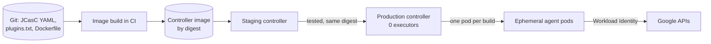

## Context

[[0012-gitlab-ci-for-new-pipelines]] freezes Jenkins for new work and migrates jobs when they next change significantly. It deliberately sets no deadline, so Jenkins will run for years. That record says the controllers keep the hardening in [[jenkins-controller-and-agent-hardening]], but it does not decide how the estate is operated. Today that estate has the usual problems:

- **Snowflake controllers.** Security settings, clouds, credentials and tool installers were configured through the UI over years. Nobody can say what a controller's configuration is without clicking through it, and a rebuild would be guesswork ([[jenkins-controller-down-and-queue-stuck]]).
- **Plugin drift.** Plugins are updated from the UI when someone remembers, on production controllers, without a record of versions. Each plugin is supply-chain surface, and an update can break jobs with no tested way back.
- **Static agents with stale toolchains.** Long-lived VM agents carry years of installed tools, shared workspaces and cached credentials. Builds influence each other, and a compromised build can persist on the agent.
- **Builds on the controller.** Some jobs still run on the built-in node, where a build has the same access to the controller's file system as the Jenkins process itself.[^isolation]

Shrinking Jenkins is the goal; running what is left badly in the meantime is the risk.

## Decision

**Every remaining Jenkins controller runs on GKE from a pinned image with a pinned plugin set, is configured only through Jenkins Configuration as Code (JCasC) from Git, runs no builds itself, and builds on ephemeral Kubernetes pod agents, one pod per build.**

### Controller

- **Image.** Built in CI from the official Jenkins LTS image, referenced by digest ([[0010-deploy-images-by-digest]]), with plugins baked in by `jenkins-plugin-cli`, the plugin installation manager shipped in the official image (the older `install-plugins.sh` was removed from the images). No plugin is installed or updated from the UI.
- **Pinned plugin set.** `plugins.txt` lists every installed plugin, including dependencies, as `name:version`, so the installed set can be compared with Git exactly. The file is generated from the staging controller after testing, not edited by hand.
- **JCasC is the only configuration path.** The controller reads its YAML from a Git-managed location through `CASC_JENKINS_CONFIG` (a folder, a file or a URL; folders are read recursively).[^casc] Security realm, authorisation, clouds, global libraries and tool settings are all in that YAML. UI changes are not forbidden by Jenkins, so they are treated as drift: the next reload overwrites them, and the validation below finds them first.
- **Zero executors on the built-in node.** The controller schedules; agents build. Agent to controller access control stays enabled: zero executors does not by itself protect the controller from a compromised agent.[^isolation]
- **Runs on GKE** in its own namespace, with a persistent volume for `JENKINS_HOME`, resource requests per [[0021-mandatory-resource-requests]], and a Workload Identity binding for the Google APIs it needs ([[0052-workload-identity-for-gke-pods]]). The architecture follows [[ci-platform-gitlab-runners-and-jenkins-agents-on-gke]].

### Agents

- **One ephemeral pod per build**, from the Kubernetes plugin, with `idleMinutes` left at 0 so a pod is never reused, and pod retention set to never.[^k8s-plugin] Static VM agents are retired as their jobs move to pod templates.
- **Pod templates live in JCasC**, with a small set of shared base templates (`inheritFrom`) per toolchain. Tool images are pinned by digest and come from the golden image pipeline ([[0040-golden-base-images-owned-by-platform]]).
- **No privileged pods and no Docker socket.** Image builds follow [[0015-no-privileged-image-builds-in-ci]]. Agent pods run as non-root with the restricted Pod Security profile. The plugin adds its own agent container (`jnlp`) unless the template defines one, so the template defines it explicitly, with the inbound agent image mirrored by digest and the same container security settings; otherwise the restricted profile rejects the pod (check the plugin docs for how the container is merged).
- **Agents run in their own namespace**, on a node pool or cluster separate from production workloads, with default-deny network policies ([[0020-default-deny-network-policies]]) that allow the controller, the artifact store and the Git server.

### Credentials and logic

- **No long-lived cloud keys in Jenkins.** Google APIs are reached through Workload Identity on the agent's Kubernetes service account, and external CI-style access follows [[0026-keyless-ci-auth-with-workload-identity-federation]]. Other secrets (Artifactory, GitLab tokens) live in Secret Manager ([[0036-secret-manager-as-secrets-system-of-record]]) and reach JCasC through variable interpolation or a credentials provider, never as values in Git.
- **Pipeline logic lives in versioned shared libraries** ([[jenkins-shared-libraries]]), loaded by tag, with tests. Jobs are defined by Jenkinsfiles in their repositories (multibranch or organisation folders), not by UI-created freestyle jobs.

### Operations

- **Backups and restore drills.** `JENKINS_HOME` is backed up with the method of [[backup-architecture-gke-cloud-sql-gcs]], and the restore is drilled quarterly ([[0051-backups-proven-by-quarterly-restore-drills]]). Because configuration is code, the backup mainly protects build history, job state and the encrypted credential store; the restore must bring back the controller's secret keys together with the credentials, or stored credentials will not decrypt (check the Jenkins backup guidance for the exact paths).
- **Monthly plugin and core updates**, on a staging controller first: build the new image, run a set of representative jobs, regenerate `plugins.txt`, then promote the same image digest to production. Security advisories with a fix go out of cycle, still through staging. Renovate proposes the controller image digest, tool image digests and shared library tags as merge requests ([[0060-renovate-for-automated-dependency-updates]]); those changes follow the same staging path.
- **Rebuild instead of repair.** A broken controller is replaced from image and JCasC, with `JENKINS_HOME` restored from backup when history matters.



### Snippets

Controller image:

```dockerfile title="controller/Dockerfile"
# Pin the LTS image you tested, by digest.
FROM registry.example.com/mirror/jenkins@sha256:<digest-of-the-tested-lts-image>

COPY --chown=jenkins:jenkins plugins.txt /usr/share/jenkins/ref/plugins.txt
RUN jenkins-plugin-cli --plugin-file /usr/share/jenkins/ref/plugins.txt

ENV CASC_JENKINS_CONFIG=/var/jenkins_home/casc_configs
```

Replace the digest placeholder with the digest of the LTS image you tested on staging. `plugins.txt` has one `name:version` line per plugin, generated as shown in Validation.

JCasC for the controller and the Kubernetes cloud. The top-level `jenkins:` key is documented; the keys below it, especially for the Kubernetes cloud, depend on the plugin versions installed. Treat them as a sketch and check them against the instance's generated reference at `<jenkins_url>/configuration-as-code/`.

```yaml title="casc_configs/jenkins.yaml"
jenkins:
  systemMessage: "Configured from Git. Changes made in the UI are overwritten."
  numExecutors: 0
  clouds:
    - kubernetes:
        name: "gke"
        namespace: "jenkins-agents"
        jenkinsUrl: "http://jenkins.jenkins.svc.cluster.local:8080/"
        templates:
          - name: "base"
            label: "k8s-base"
            idleMinutes: 0
            podRetention: "never"
            yaml: |
              apiVersion: v1
              kind: Pod
              spec:
                serviceAccountName: jenkins-agent
                securityContext:
                  runAsNonRoot: true
                  seccompProfile:
                    type: RuntimeDefault
                containers:
                  # Defined here so the plugin does not inject a jnlp container
                  # without these security settings (restricted profile).
                  - name: jnlp
                    image: registry.example.com/mirror/inbound-agent@sha256:<digest-of-the-inbound-agent-image>
                    securityContext:
                      allowPrivilegeEscalation: false
                      capabilities:
                        drop: ["ALL"]
                    resources:
                      requests:
                        cpu: 250m
                        memory: 512Mi
                      limits:
                        memory: 512Mi
                  - name: build
                    image: registry.example.com/platform/build-tools@sha256:<digest-of-the-build-tools-image>
                    command: ["sleep"]
                    args: ["infinity"]
                    securityContext:
                      allowPrivilegeEscalation: false
                      capabilities:
                        drop: ["ALL"]
                    resources:
                      requests:
                        cpu: "1"
                        memory: 2Gi
                      limits:
                        memory: 2Gi
```

A job selects the template by label:

```groovy title="Jenkinsfile"
@Library('platform-pipeline@v3.2.0') _

pipeline {
  agent { label 'k8s-base' }
  options { timeout(time: 30, unit: 'MINUTES') }
  stages {
    stage('Build') {
      steps {
        container('build') {
          sh './ci/build.sh'
        }
      }
    }
  }
}
```

The library tag `v3.2.0` is an example of our own library's release tag, not a Jenkins version.

## Consequences

Easier:

- A controller can be rebuilt from Git and a backup in a predictable time, and its configuration is reviewable as a diff.
- Plugin and core updates are tested once on staging and promoted as one image digest, with a known way back (the previous digest).
- Builds start from a clean pod every time: no leftover workspaces, no cross-build contamination, no long-lived agent for an attacker to persist on.
- Agent capacity scales with the queue instead of with a fleet of idle VMs.

Harder or newly required:

- **The controller is still a single point of failure.** One controller process serves each instance. A restart interrupts the controller side of running builds; how pipelines resume depends on their durability settings (check the Jenkins docs for the version you run). Upgrades and restarts go in a maintenance window, announced to the teams that still use Jenkins.
- **Plugin testing is a duty.** Someone owns the monthly update, the staging run and `plugins.txt`. Without that owner the pinned set ages and security fixes are missed.
- **JCasC coverage is uneven.** Some plugins expose few or awkward JCasC keys, and the exported configuration usually needs editing before reuse. Exotic plugins that cannot be configured as code are candidates for removal or for migrating the jobs that need them.
- **Pod start-up time** adds latency to every build, and caches must be explicit (a cache volume or a remote cache), not a warm agent disk.
- **Migration stays the goal.** This record makes Jenkins cheaper and safer to run while it shrinks; it does not make Jenkins a target for new work ([[jenkins-to-gitlab-migration-programme]], [[gitlab-ci-vs-jenkins]]).

### Rollback

- A bad plugin or core update is rolled back by redeploying the previous controller image digest and its JCasC revision, then restoring `JENKINS_HOME` from the backup taken before the update if the new version migrated on-disk data.
- A bad JCasC change is reverted in Git and reloaded.
- A pod template that breaks builds is reverted in Git; static VM agents are not reintroduced as a fix.

## Alternatives considered

- **Keep static VM agents.** Familiar and with warm caches, but long-lived, hard to patch, shared between builds and a persistent foothold if compromised. Rejected for new templates; existing ones are retired as their jobs move.
- **CloudBees CI.** A commercial Jenkins distribution with its own configuration management and support. It would not remove the plugin and controller model we are moving away from, and it adds licence cost for a platform we plan to shrink. Not adopted; product capabilities were not evaluated for this record.
- **Migrate everything off Jenkins now.** Removes the problem, but [[0012-gitlab-ci-for-new-pipelines]] already rejected a big-bang migration because it stops feature work and moves jobs nobody touches. Rejected again for the same reason.
- **Leave the estate as it is until migration finishes.** No effort now, but the remaining controllers are the least maintained part of CI and keep their full attack surface for years. Rejected.

> [!info] Claims not checked against current docs
> The Jenkins documentation was read through search summaries, not directly. Not verified, check before relying on them: the JCasC keys for the Kubernetes cloud and pod templates (`namespace`, `jenkinsUrl`, `templates`, `podRetention` values) and whether `numExecutors` under `jenkins:` sets the built-in node's executors (the documented path is the built-in node's configuration page); how JCasC reads secrets from environment variables, files or Kubernetes secrets; whether a Secret Manager credentials provider plugin fits our needs; WebSocket versus TCP agent connection defaults; `jenkins-plugin-cli` options beyond `--plugin-file`, `--plugins`, `--war`, `--plugin-download-directory`, `--no-download` and `--skip-failed-plugins`; how the tool resolves plugin dependencies; which `JENKINS_HOME` paths a backup must include; the configuration-as-code export endpoint used in Validation; and when `install-plugins.sh` was removed from the official images (check the image README and the Jenkins changelog). No Jenkins, plugin or Java version is stated on purpose.

## Validation

```bash title="validate-jenkins-controller.sh"
set -o pipefail
JENKINS_URL="https://jenkins.example.com"
JENKINS_USER="${JENKINS_USER:?set a read-only user}"
JENKINS_TOKEN="${JENKINS_TOKEN:?set the API token of that user}"
PLUGINS_FILE="controller/plugins.txt"
AGENT_NAMESPACE="jenkins-agents"
MAX_POD_AGE_SECONDS=7200   # longer than the longest build timeout

# Keep the credentials out of the process list.
CURL_CFG="$(mktemp)"; trap 'rm -f "${CURL_CFG}"' EXIT
printf 'user = "%s:%s"\n' "${JENKINS_USER}" "${JENKINS_TOKEN}" > "${CURL_CFG}"

# 1. Executors per node. Expected: the built-in node shows 0; agents appear only while builds run.
curl -fsS -K "${CURL_CFG}" "${JENKINS_URL}/computer/api/json?tree=computer[displayName,numExecutors]" \
  | jq -r '.computer[] | "\(.displayName)\t\(.numExecutors)"'

# 2. Installed plugins compared with the pinned list. Expected: no diff output.
curl -fsS -K "${CURL_CFG}" "${JENKINS_URL}/pluginManager/api/json?depth=1&tree=plugins[shortName,version]" \
  | jq -r '.plugins[] | "\(.shortName):\(.version)"' | sort > installed.txt
diff <(grep -v '^#' "${PLUGINS_FILE}" | sed '/^$/d' | sort) installed.txt \
  && echo "plugins match ${PLUGINS_FILE}"

# 3. Agent pods do not outlive their builds. Expected: no output.
kubectl get pods -n "${AGENT_NAMESPACE}" -o json \
  | jq -r --argjson max "${MAX_POD_AGE_SECONDS}" '
      .items[]
      | select((now - (.metadata.creationTimestamp | fromdateiso8601)) > $max)
      | "\(.metadata.name)\t\(.metadata.creationTimestamp)\t\(.status.phase)"'

# 4. No privileged agent pods. Expected: no output.
kubectl get pods -n "${AGENT_NAMESPACE}" -o json \
  | jq -r '.items[] | select(any(.spec.containers[]; .securityContext.privileged == true)) | .metadata.name'
```

To generate `plugins.txt` on the staging controller after a tested update, run step 2's first command and commit `installed.txt` as `controller/plugins.txt`.

Configuration drift: export the live configuration (Manage Jenkins > Configuration as Code > View Configuration, or the plugin's export endpoint; check its path for your version) and diff it against the YAML in Git. Expected differences are only values that the export always adds or redacts. Anything else is a UI change to revert or to move into Git.

## References

- Configuration as Code plugin: https://plugins.jenkins.io/configuration-as-code/
- Managing Jenkins with JCasC: https://www.jenkins.io/doc/book/managing/casc
- Controller isolation and the built-in node: https://www.jenkins.io/doc/book/security/controller-isolation
- Managing nodes: https://www.jenkins.io/doc/book/managing/nodes
- Kubernetes plugin pipeline steps and pod template fields: https://www.jenkins.io/doc/pipeline/steps/kubernetes
- Kubernetes plugin: https://plugins.jenkins.io/kubernetes/
- Plugin installation manager tool: https://github.com/jenkinsci/plugin-installation-manager-tool
- Official Jenkins container images (README, including plugin installation with `jenkins-plugin-cli`): https://github.com/jenkinsci/docker

Related notes:

- [[jenkins-controller-and-agent-hardening]]
- [[jenkins-shared-libraries]]
- [[jenkins-agents-configuration-as-code-and-shared-libraries]]
- [[ci-platform-gitlab-runners-and-jenkins-agents-on-gke]]
- [[jenkins-controller-down-and-queue-stuck]]
- [[jenkins-core-and-plugin-upgrade-rollback]]
- [[jenkins-to-gitlab-migration-programme]]
- [[gitlab-ci-vs-jenkins]]
- [[gke-workload-identity]]

Related ADRs:

- [[0012-gitlab-ci-for-new-pipelines]]
- [[0014-gitlab-runners-kubernetes-executor-on-gke]]
- [[0015-no-privileged-image-builds-in-ci]]
- [[0026-keyless-ci-auth-with-workload-identity-federation]]
- [[0036-secret-manager-as-secrets-system-of-record]]
- [[0051-backups-proven-by-quarterly-restore-drills]]
- [[0052-workload-identity-for-gke-pods]]
- [[0060-renovate-for-automated-dependency-updates]]

[^isolation]: Per the Jenkins controller isolation page, which discourages builds on the built-in node and asks for its executors to be set to 0 once agents or clouds exist.

[^casc]: Per the Configuration as Code plugin page; files discovered in a folder cannot overwrite each other's values.

[^k8s-plugin]: Per the Kubernetes plugin's pipeline step reference, which lists `podRetention`, `idleMinutes`, `inheritFrom` and `yaml` among the pod template fields.
