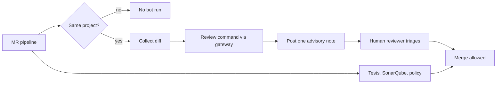

This note describes how to add an AI reviewer to merge requests (GitLab) or pull requests (GitHub) so that it helps humans without replacing the checks that gate a merge. It is written for senior DevOps engineers who own the pipeline. The general review practice is in [[standards/code-review]]; the credential and isolation rules for the bot are in [[ai/securing-ai-agents-in-ci-and-cloud]].

> [!info] Scope and sources
> Written for GitLab CI merge request pipelines, with the same ideas applying to GitHub pull requests. Products are named generically (built-in assistants of the platform, third-party review apps, or a script calling a model gateway). Based on the GitLab merge request and CI documentation at https://docs.gitlab.com.

> [!note] Not verified
> The claims below were written from documentation knowledge and were not checked against a running system or the current docs: any product's tier, rule-file name or ability to block merges, and the GitLab API endpoints used in the examples (diffs and notes). Check them before relying on them.

## What AI review is good and bad at

Good at:

- spotting typos, dead code, missing error handling and inconsistent naming;
- noticing that a change and its documentation or tests disagree;
- summarising a large diff so the human reviewer starts with context;
- asking questions a tired reviewer would skip, such as "what happens when this list is empty".

Bad at:

- knowing your system: ownership, traffic, past incidents, why a hack exists;
- judging design trade-offs, security boundaries and operational risk;
- being consistent: the same diff can get different comments on two runs;
- staying quiet: too many low-value comments train people to ignore the bot.

So the bot is a second pair of eyes, not a gate.

## Rules

1. The bot comments only. It never approves, never merges, never pushes commits and never resolves threads.
2. Humans approve. Approval rules are the same with or without the bot ([[standards/code-review]]).
3. Required checks stay deterministic: tests, linters, the SonarQube quality gate ([[patterns/sonarqube-quality-gates]]) and policy checks. A bot's opinion is never a required check.
4. The bot job is advisory in the pipeline: `allow_failure: true`, so an outage or a timeout cannot block delivery.
5. It does not run on fork merge requests, and it holds a read-only token with no deploy or cloud credentials (see [[ai/securing-ai-agents-in-ci-and-cloud]]).
6. It posts one summary note per push, updated in place, not a stream of inline comments.
7. Its output is labelled as automated so nobody mistakes it for a teammate.



## Wiring it into the pipeline

Add one advisory job to the merge request pipeline, next to the deterministic jobs described in [[patterns/gitlab-ci-pipeline-structure]]. The job collects the diff, runs a review command and posts a note. [The owner's AI skills catalogue](https://ai.szolotov.com) is one place to look for reusable review skills and prompts, and the review command can wrap any of them.

```yaml title=".gitlab-ci.yml"
ai-review:
  stage: test
  image: python:3.12-slim # change: pin by digest; use an image that contains your review tool
  rules:
    - if: '$CI_PIPELINE_SOURCE == "merge_request_event" && $CI_MERGE_REQUEST_SOURCE_PROJECT_ID == $CI_PROJECT_ID'
  allow_failure: true
  timeout: 10 minutes
  tags:
    - ephemeral-agent # change: runner pool with an egress allowlist
  variables:
    REVIEW_COMMAND: "review-tool --stdin" # change: your integration point
    MAX_DIFF_CHARS: "60000"
  script:
    # REVIEW_BOT_TOKEN: masked, not protected, project access token, Reporter role.
    # The endpoint for posting notes needs a scope that allows comments: check your version.
    - python3 scripts/ai_review.py
```

The script is a skeleton. The review command is a placeholder you replace with your integration; no vendor API is called here.

```python title="scripts/ai_review.py"
#!/usr/bin/env python3
"""Collect the MR diff, run a review command, post or update one advisory note."""
import json
import os
import shlex
import subprocess
import sys
import urllib.request

API = os.environ["CI_API_V4_URL"]
PROJECT_ID = os.environ["CI_PROJECT_ID"]
MR_IID = os.environ["CI_MERGE_REQUEST_IID"]
TOKEN = os.environ["REVIEW_BOT_TOKEN"]
REVIEW_COMMAND = shlex.split(os.environ["REVIEW_COMMAND"])  # integration point
MAX_DIFF_CHARS = int(os.environ.get("MAX_DIFF_CHARS", "60000"))
MARKER = "<!-- ai-review-summary -->"
BASE = f"{API}/projects/{PROJECT_ID}/merge_requests/{MR_IID}"


def call(method, url, payload=None):
    data = json.dumps(payload).encode() if payload is not None else None
    request = urllib.request.Request(
        url,
        data=data,
        method=method,
        headers={"PRIVATE-TOKEN": TOKEN, "Content-Type": "application/json"},
    )
    with urllib.request.urlopen(request, timeout=30) as response:
        return json.load(response)


def collect_diff():
    # Endpoint and pagination: check against your GitLab version (diffs vs changes).
    files = call("GET", f"{BASE}/diffs?per_page=100")
    parts = []
    for item in files:
        parts.append(f"--- {item['old_path']}\n+++ {item['new_path']}\n{item['diff']}")
    return "\n".join(parts)[:MAX_DIFF_CHARS]


def run_review(diff):
    # Integration point: replace REVIEW_COMMAND with your tool or gateway client.
    # It reads the diff on stdin and prints plain-text findings on stdout.
    result = subprocess.run(
        REVIEW_COMMAND,
        input=diff,
        capture_output=True,
        text=True,
        timeout=300,
        check=True,
    )
    return result.stdout.strip()


def post_note(body):
    text = f"{MARKER}\n**Automated advisory review.** A human reviewer decides.\n\n{body}"
    notes = call("GET", f"{BASE}/notes?per_page=100")
    existing = next((n for n in notes if MARKER in n.get("body", "")), None)
    if existing:
        call("PUT", f"{BASE}/notes/{existing['id']}", {"body": text})
    else:
        call("POST", f"{BASE}/notes", {"body": text})


def main():
    diff = collect_diff()
    if not diff:
        print("empty diff; nothing to review")
        return 0
    findings = run_review(diff)
    post_note(findings or "No findings.")
    return 0


if __name__ == "__main__":
    sys.exit(main())
```

Notes on the skeleton: it reads the diff through the API instead of checking out untrusted code, it truncates input so cost is bounded, and it updates one note instead of adding a new one per push. Pagination of notes and diffs is simplified; handle more than 100 items if your merge requests are large.

On GitHub the same shape works with a `pull_request` workflow with `permissions: contents: read` and `pull-requests: write` only on the step that posts, never with `pull_request_target`. See the example in [[ai/securing-ai-agents-in-ci-and-cloud]].

## Triage

Decide in advance what happens to a finding, so nobody argues with the bot.

| Category                              | Action                                   | Who                |
| ------------------------------------- | ---------------------------------------- | ------------------ |
| Correct and important (bug, security) | Fix in the MR; add a test                | Author             |
| Correct, minor (style, naming)        | Fix if cheap, otherwise ignore           | Author             |
| Correct but out of scope              | Open a ticket, link it                   | Author             |
| Plausible, unclear                    | Ask the reviewer; do not guess           | Reviewer           |
| Wrong (false positive)                | Ignore; log it in the triage log         | Author or reviewer |
| Wrong and harmful (bad advice)        | Log it; consider a prompt or rule change | Platform owner     |

Keep a small triage log, one line per finding, to feed the metrics below:

```text title="ai-review-triage-log.txt"
date        mr     category            verdict          note
2026-10-17  !482   bug                 accepted         missing nil check in retry loop
2026-10-17  !482   style               ignored          naming matches existing module
2026-10-18  !490   security            false-positive   value is already validated upstream
2026-10-18  !493   out-of-scope        ticket           flaky test in unrelated package
```

## Measuring usefulness

Measure whether the bot earns its cost, with a few numbers per month:

- **False-positive rate:** findings marked wrong divided by all findings triaged. If it stays high, tighten the prompt or reduce the scope of files it reviews.
- **Accepted suggestions:** findings that led to a code change, as a share of all findings.
- **Review turnaround:** time from merge request open to first human review and to merge. The bot should shorten the first without lengthening the second.
- **Cost per merge request:** model spend and runner time.

Be careful when relating this to the delivery measures in [[management/dora-metrics]]. Lead time and change failure rate depend on many things, and a bot alone rarely explains a movement. Use the review numbers above to judge the bot, and watch the DORA metrics only to check that nothing got worse. Do not turn any of this into a per-person target.

## Data handling

- Treat the diff as code sent to a third party. Use only providers approved for your data classes, preferably through an internal gateway that logs and rate-limits.
- Exclude secrets, generated files, vendored code and customer data from the diff. Run secret scanning before the bot step.
- Skip repositories or paths that hold regulated or customer data unless the provider is approved for it.
- Store bot comments like other review comments; they may contain code excerpts.
- Write down which repositories have the bot enabled and who owns the configuration.

## Pitfalls

- **Making the bot required.** Once a branch rule needs its pass, outages and false positives block work. Keep it advisory.
- **Comment floods.** One note per push, a cap on findings and a minimum severity keep the noise down.
- **Bot instructions inside the diff.** A comment in the code can try to steer the reviewer. The bot's token is read-only and its output only a comment, so the damage stays small; do not give it more.
- **Reviewers relaxing.** "The bot looked at it" is not a review. Keep the human approval rule.
- **Drift.** Models and prompts change; sample the output every month and re-check the false-positive rate.

## Related

- [[standards/code-review]]: human review rules the bot supports.
- [[patterns/sonarqube-quality-gates]]: the deterministic quality gate that stays required.
- [[ai/securing-ai-agents-in-ci-and-cloud]]: tokens, isolation and egress for the bot job.
- [[management/dora-metrics]]: delivery metrics to watch alongside review numbers.
- [[patterns/gitlab-ci-pipeline-structure]]: where the advisory job fits in the pipeline.
- [The owner's AI skills catalogue](https://ai.szolotov.com): reusable agent skills and workflows.
