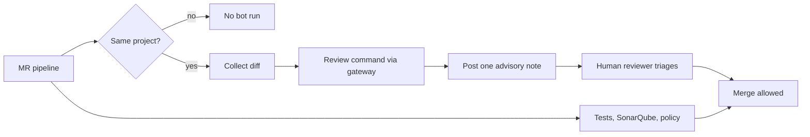

This note describes how to add an AI reviewer to merge requests (GitLab) or pull requests (GitHub) so that it helps humans without replacing the checks that gate a merge. It is written for senior DevOps engineers who own the pipeline. The general review practice is in [[standards/code-review]]; the credential and isolation rules for the bot are in [[ai/securing-ai-agents-in-ci-and-cloud]].

> [!info] Scope and sources
> Written for GitLab CI merge request pipelines, with the same ideas applying to GitHub pull requests. Products are named generically (built-in assistants of the platform, third-party review apps, or a script calling a model gateway). The GitLab API, token and role statements were checked against the GitLab docs; see the Evidence section for what was and was not verified.

## What AI review is good and bad at

Good at:

- spotting typos, dead code, missing error handling and inconsistent naming;
- noticing that a change and its documentation or tests disagree;
- summarising a large diff so the human reviewer starts with context;
- asking questions a tired reviewer would skip, such as "what happens when this list is empty".

Bad at:

- knowing your system: ownership, traffic, past incidents, why a hack exists;
- judging design trade-offs, security boundaries and operational risk;
- being consistent: the same diff can get different comments on two runs;
- staying quiet: too many low-value comments train people to ignore the bot.

So the bot is a second pair of eyes, not a gate.

## Rules

1. The bot comments only. It never approves, never merges, never pushes commits and never resolves threads.
2. Humans approve. Approval rules are the same with or without the bot ([[standards/code-review]]).
3. Required checks stay deterministic: tests, linters, the SonarQube quality gate ([[patterns/sonarqube-quality-gates]]) and policy checks. A bot's opinion is never a required check.
4. The bot job is advisory in the pipeline: `allow_failure: true`, so an outage or a timeout cannot block delivery.
5. It is configured not to run on fork merge requests (a `rules:` expression in CI config is not a guarantee: if the project runs parent-project pipelines for fork merge requests, all variables, including the unprotected bot token, become available to them), and it holds a token with no write access to code and no deploy or cloud credentials: a GitLab bot token with the `api` scope at the Reporter role, which can comment but cannot push code (see [[ai/securing-ai-agents-in-ci-and-cloud]]). Reporters can approve merge requests only if the project enables approval permissions for additional users, so keep that setting off for the bot's role.
6. It posts one summary note per push, updated in place, not a stream of inline comments.
7. Its output is labelled as automated so nobody mistakes it for a teammate.



## Wiring it into the pipeline

Add one advisory job to the merge request pipeline, next to the deterministic jobs described in [[patterns/gitlab-ci-pipeline-structure]]. The job collects the diff, runs a review command and posts a note. [The owner's AI skills catalogue](https://ai.szolotov.com) is one place to look for reusable review skills and prompts, and the review command can wrap any of them.

```yaml title=".gitlab-ci.yml"
ai-review:
  stage: test
  image: python:3.12-slim # change: pin by digest; use an image that contains your review tool
  rules:
    - if: '$CI_PIPELINE_SOURCE == "merge_request_event" && $CI_MERGE_REQUEST_SOURCE_PROJECT_ID == $CI_PROJECT_ID'
  allow_failure: true
  timeout: 10 minutes
  tags:
    - ephemeral-agent # change: runner pool with an egress allowlist
  variables:
    GIT_STRATEGY: "none" # do not check out the MR branch: its code would run with the bot token
    REVIEW_COMMAND: "review-tool --stdin" # change: your integration point
    MAX_DIFF_CHARS: "60000"
  script:
    # REVIEW_BOT_TOKEN: masked, not protected, project access token, Reporter role.
    # Creating and updating notes needs the api scope (read_api is not enough). At the Reporter
    # role the bot can comment but cannot push code.
    # Do not run this job for fork MRs in the parent project: that exposes this unprotected token.
    # The script ships in the pinned image, not in the repository, so the MR cannot change it.
    - python3 /opt/ai-review/ai_review.py
```

The script is a skeleton. The review command is a placeholder you replace with your integration; no vendor API is called here.

```python title="ai_review.py (built into the review image at /opt/ai-review/)"
#!/usr/bin/env python3
"""Collect the MR diff, run a review command, post or update one advisory note."""
import json
import os
import shlex
import subprocess
import sys
import urllib.request

API = os.environ["CI_API_V4_URL"]
PROJECT_ID = os.environ["CI_PROJECT_ID"]
MR_IID = os.environ["CI_MERGE_REQUEST_IID"]
TOKEN = os.environ["REVIEW_BOT_TOKEN"]
REVIEW_COMMAND = shlex.split(os.environ["REVIEW_COMMAND"])  # integration point
MAX_DIFF_CHARS = int(os.environ.get("MAX_DIFF_CHARS", "60000"))
MARKER = "<!-- ai-review-summary -->"
BASE = f"{API}/projects/{PROJECT_ID}/merge_requests/{MR_IID}"


def call(method, url, payload=None):
    data = json.dumps(payload).encode() if payload is not None else None
    request = urllib.request.Request(
        url,
        data=data,
        method=method,
        headers={"PRIVATE-TOKEN": TOKEN, "Content-Type": "application/json"},
    )
    with urllib.request.urlopen(request, timeout=30) as response:
        return json.load(response)


def collect_diff():
    # /diffs replaces the deprecated /changes endpoint. Files can come back collapsed or
    # too_large with their diff excluded; this skeleton does not handle that.
    files = call("GET", f"{BASE}/diffs?per_page=100")
    parts = []
    for item in files:
        parts.append(f"--- {item['old_path']}\n+++ {item['new_path']}\n{item['diff']}")
    text = "\n".join(parts)[:MAX_DIFF_CHARS]
    if len(files) >= 100:
        # Only the first page is read; say so rather than dropping files silently.
        text += "\n[truncated: only the first 100 files were reviewed]"
    return text


def run_review(diff):
    # Integration point: replace REVIEW_COMMAND with your tool or gateway client.
    # It reads the diff on stdin and prints plain-text findings on stdout.
    result = subprocess.run(
        REVIEW_COMMAND,
        input=diff,
        capture_output=True,
        text=True,
        timeout=300,
        check=True,
    )
    return result.stdout.strip()


def post_note(body):
    text = f"{MARKER}\n**Automated advisory review.** A human reviewer decides.\n\n{body}"
    bot_id = call("GET", f"{API}/user")["id"]  # the bot token's own user
    notes = call("GET", f"{BASE}/notes?per_page=100")
    # The marker alone is not enough: anyone can paste it into a comment.
    existing = next(
        (
            n
            for n in notes
            if MARKER in n.get("body", "") and n.get("author", {}).get("id") == bot_id
        ),
        None,
    )
    if existing:
        call("PUT", f"{BASE}/notes/{existing['id']}", {"body": text})
    else:
        call("POST", f"{BASE}/notes", {"body": text})


def main():
    diff = collect_diff()
    if not diff:
        print("empty diff; nothing to review")
        return 0
    findings = run_review(diff)
    post_note(findings or "No findings.")
    return 0


if __name__ == "__main__":
    sys.exit(main())
```

Notes on the skeleton: it takes its diff input from the API and sets `GIT_STRATEGY: none`, so the job does not check out the merge request's branch, and it runs the script from the pinned image rather than from the repository. Without both, the author's own code would run with `REVIEW_BOT_TOKEN` in the environment. With `none`, the runner can still leave an old working copy in the build directory, so never run anything from it. The job definition itself still comes from the merge request's `.gitlab-ci.yml`, which the author can edit; if the bot token must be out of the author's reach, run the job from pipeline configuration the merge request cannot change, as in [[ai-generated-code-policy-and-provenance]]. It truncates input so cost is bounded, and it updates one note instead of adding a new one per push. Pagination of notes and diffs is simplified: the script says so in the note when 100 files are returned, and you can follow the `x-next-page` response header if your merge requests are large. It edits only a note written by the bot's own user, so a pasted marker cannot hijack it.

On GitHub the same shape uses two jobs in a `pull_request` workflow, never `pull_request_target`. GitHub Actions permissions are set per workflow or per job, not per step. A review job with `contents: read` uploads the findings as an artifact; a second job with `pull-requests: write` downloads it and comments, and it runs no agent. See the example in [[ai/securing-ai-agents-in-ci-and-cloud]].

## Triage

Decide in advance what happens to a finding, so nobody argues with the bot.

| Category                              | Action                                   | Who                |
| ------------------------------------- | ---------------------------------------- | ------------------ |
| Correct and important (bug, security) | Fix in the MR; add a test                | Author             |
| Correct, minor (style, naming)        | Fix if cheap, otherwise ignore           | Author             |
| Correct but out of scope              | Open a ticket, link it                   | Author             |
| Plausible, unclear                    | Ask the reviewer; do not guess           | Reviewer           |
| Wrong (false positive)                | Ignore; log it in the triage log         | Author or reviewer |
| Wrong and harmful (bad advice)        | Log it; consider a prompt or rule change | Platform owner     |

Keep a small triage log, one line per finding, to feed the metrics below:

```text title="ai-review-triage-log.txt"
date        mr     category            verdict          note
2026-10-17  !482   bug                 accepted         missing nil check in retry loop
2026-10-17  !482   style               ignored          naming matches existing module
2026-10-18  !490   security            false-positive   value is already validated upstream
2026-10-18  !493   out-of-scope        ticket           flaky test in unrelated package
```

## Measuring usefulness

Measure whether the bot earns its cost, with a few numbers per month:

- **False-positive rate:** findings marked wrong divided by all findings triaged. If it stays high, tighten the prompt or reduce the scope of files it reviews.
- **Accepted suggestions:** findings that led to a code change, as a share of all findings.
- **Review turnaround:** time from merge request open to first human review and to merge. The bot should shorten the first without lengthening the second.
- **Cost per merge request:** model spend and runner time.

Be careful when relating this to the delivery measures in [[management/dora-metrics]]. Lead time and change failure rate depend on many things, and a bot alone rarely explains a movement. Use the review numbers above to judge the bot, and watch the DORA metrics only to check that nothing got worse. Do not turn any of this into a per-person target.

## Data handling

- Treat the diff as code sent to a third party. Use only providers approved for your data classes, preferably through an internal gateway that logs and rate-limits.
- Exclude secrets, generated files, vendored code and customer data from the diff. Run secret scanning before the bot step.
- Skip repositories or paths that hold regulated or customer data unless the provider is approved for it.
- Store bot comments like other review comments; they may contain code excerpts.
- Write down which repositories have the bot enabled and who owns the configuration.

## Pitfalls

- **Making the bot required.** Once a branch rule needs its pass, outages and false positives block work. Keep it advisory.
- **Comment floods.** One note per push, a cap on findings and a minimum severity keep the noise down.
- **Bot instructions inside the diff.** A comment in the code can try to steer the reviewer. The bot's token has no write access to code, no deploy and no cloud credentials, and its output is only a comment, so the damage stays small; do not give it more.
- **Reviewers relaxing.** "The bot looked at it" is not a review. Keep the human approval rule.
- **Drift.** Models and prompts change; sample the output every month and re-check the false-positive rate.

## Related

- [[standards/code-review]]: human review rules the bot supports.
- [[patterns/sonarqube-quality-gates]]: the deterministic quality gate that stays required.
- [[ai/securing-ai-agents-in-ci-and-cloud]]: tokens, isolation and egress for the bot job.
- [[management/dora-metrics]]: delivery metrics to watch alongside review numbers.
- [[patterns/gitlab-ci-pipeline-structure]]: where the advisory job fits in the pipeline.
- [The owner's AI skills catalogue](https://ai.szolotov.com): reusable agent skills and workflows.

## Evidence

Source-reviewed on 2026-11-02. Nothing was run. The scope is the GitLab API, token and role statements; the pipeline keywords and GitHub parts could not be checked locally.

### Sources checked

- [Merge requests API](https://docs.gitlab.com/api/merge_requests/): `GET /projects/:id/merge_requests/:merge_request_iid/diffs` lists changed-file diffs with `old_path`, `new_path` and `diff`; `per_page` defaults to 20; files can be `collapsed` or `too_large` with diffs excluded; the older `/changes` endpoint is deprecated in favour of `/diffs`. Checked 2026-11-02 against gitlabhq/gitlabhq commit d7b9a61 (api/merge_requests.md:2196-2400).
- [Notes API](https://docs.gitlab.com/api/notes/): merge request notes are listed, created (`POST`) and updated (`PUT .../notes/:note_id`) with a `body` parameter; results are paginated at 20 by default. Checked 2026-11-02 against gitlabhq/gitlabhq commit d7b9a61 (api/notes.md:45-50, 379-500).
- [REST API](https://docs.gitlab.com/api/rest/): `per_page` default 20, max 100; pagination headers include `x-next-page`. Checked 2026-11-02 against gitlabhq/gitlabhq commit d7b9a61 (api/rest/_index.md:318, 355-377).
- [Users API](https://docs.gitlab.com/api/users/): `GET /user` returns the current user. Checked 2026-11-02 against gitlabhq/gitlabhq commit d7b9a61 (api/users.md:583, 657).
- [REST API authentication](https://docs.gitlab.com/api/rest/authentication/): the `PRIVATE-TOKEN` header is the recommended way to pass a token. Checked 2026-11-02 against gitlabhq/gitlabhq commit d7b9a61 (api/rest/authentication.md:119).
- [Token scopes](https://docs.gitlab.com/security/tokens/access_token_scopes/): `api` grants complete read and write API access; `read_api` is read-only, so it cannot create or update notes. Checked 2026-11-02 against gitlabhq/gitlabhq commit d7b9a61 (security/tokens/access_token_scopes.md:41-42).
- [Project access tokens](https://docs.gitlab.com/user/project/settings/project_access_tokens/): a role and scopes are chosen when the token is created. Checked 2026-11-02 against gitlabhq/gitlabhq commit d7b9a61 (user/project/settings/project_access_tokens.md:55-65).
- [Roles and permissions](https://docs.gitlab.com/user/permissions/): the Reporter role cannot push code and can comment on merge requests; creating merge requests needs Developer; Reporter approval exists only if enabled for the project. Checked 2026-11-02 against gitlabhq/gitlabhq commit d7b9a61 (user/permissions.md:62, 602-606, footnote on approvals).
- [Predefined CI/CD variables](https://docs.gitlab.com/ci/variables/predefined_variables/): `CI_API_V4_URL`, `CI_PROJECT_ID`, `CI_MERGE_REQUEST_IID` and `CI_MERGE_REQUEST_SOURCE_PROJECT_ID` exist with the meanings used here. Checked 2026-11-02 against gitlabhq/gitlabhq commit d7b9a61 (ci/variables/predefined_variables.md:46, 123, 206, 216).
- [CI/CD variables](https://docs.gitlab.com/ci/variables/): the Protect variable option limits a variable to protected branches and tags, so an unprotected variable is available in merge request pipelines on other branches; visibility Masked is available (default since 18.3); pipelines from forks cannot access the parent project's variables by default, but if you run a merge request pipeline in the parent project for a merge request from a fork, all variables become available to the pipeline. Checked 2026-11-02 against gitlabhq/gitlabhq commit d7b9a61 (ci/variables/_index.md:119-121, 150-152).
- [Git strategy](https://docs.gitlab.com/ci/runners/configure_runners/#git-strategy): `GIT_STRATEGY` takes `clone`, `fetch`, `none` or `empty`; without a value, jobs use the project's pipeline setting; `none` skips Git operations but re-uses the local working copy, and repository data may be present but out of date. Checked 2026-11-02 against gitlabhq/gitlabhq commit d7b9a61 (ci/runners/configure_runners.md:496-506, 522-530).

### Not verified

- The `.gitlab-ci.yml` keywords `rules`, `allow_failure`, `timeout` and `tags` and the rule expression syntax: the CI YAML reference is not in the local copy. Only the general behaviour of `allow_failure` was seen (ci/jobs/job_control.md:41-48).
- That `$CI_MERGE_REQUEST_SOURCE_PROJECT_ID == $CI_PROJECT_ID` is a sufficient fork check, and how fork merge request pipelines behave: the merge request pipelines page is not in the local copy.
- GitHub Actions statements (`pull_request` versus `pull_request_target`, permissions set per workflow or per job, two-job artifact hand-off): GitHub documentation was not available.
- SonarQube quality gates, any specific review product's tier, rule files or ability to block merges, and the model gateway: no local source.
- Engineering guidance, not a documented claim: bot scope and noise rules, triage categories, usefulness metrics, data-handling advice and the pitfalls list.
- Nothing was run, including the skeleton script and pipeline job.
