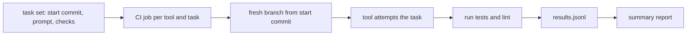

Vendor benchmarks measure public tasks you do not have. A better question is: which of the tools that pass our security review fix our kind of change, in our repositories, at what cost? This guide gives a two-stage method: a scorecard that can reject a tool outright, then a bake-off that replays real past changes and measures outcomes in CI. It covers the measurement method only. The pilot, rollout and go or no-go decision are in [[rolling-out-ai-tools-in-a-team]].

> [!warning] Not legal or audit advice
> The scorecard touches data processing terms and subprocessors. Legal, privacy and audit people decide whether a tool's terms are acceptable; engineering supplies the evidence.

> [!info] Scope
> Written for a platform team evaluating coding assistants and review bots against GitLab-hosted infrastructure and service repositories. It is tool-neutral and quotes no vendor terms, prices or limits. Check current vendor documentation for every row you score.

> [!note] Not verified
> The method has not been run. The sample sizes and thresholds below are starting points to adjust, and the statistics section is a practical summary, not a substitute for advice from someone who does experimental design.

## Security and data scorecard

Score each candidate on the same rows, with a link to the evidence for every score. "The sales deck said so" is not evidence; the admin documentation, trust page, contract or a test is.

| Row                    | Question                                                                                    | Must-pass |
| ---------------------- | ------------------------------------------------------------------------------------------- | --------- |
| Data classes allowed   | Can we exclude secrets and customer data, and enforce it?                                   | Yes       |
| Retention and training | Is retention documented, and can training on our data be turned off?                        | Yes       |
| SSO and SCIM           | Does it support our identity provider and automatic deprovisioning?                         | Yes       |
| Admin controls         | Managed settings, file deny rules, tool allowlists ([[ai-coding-assistant-admin-controls]]) | Yes       |
| Audit log export       | Can admin and usage events be exported to our SIEM?                                         | No        |
| Regions, subprocessors | Where is data processed, and is the subprocessor list published?                            | Yes       |
| Network model          | Can traffic go through our gateway or a documented set of hosts?                            | No        |
| Agent safety           | Can we restrict commands and credentials ([[securing-ai-agents-in-ci-and-cloud]])?          | Yes       |
| Exit                   | Can we delete data and export our configuration?                                            | No        |

## Scoring and the gate to the bake-off

Give each row 0 (absent), 1 (partial) or 2 (meets our need), with evidence. A **must-pass row that scores 0 fails the tool outright**; do not average it away with good scores elsewhere. Record why, because the same tool may pass a year later.

Only tools that clear the gate enter the bake-off. This keeps you from spending engineer time comparing something you could never roll out, and from putting your repositories into a tool whose terms you have not read. If few tools survive, say so and stop; a bake-off of one is a demo.

## Building the task set

The task set is the asset. Build it from your own history:

- **20 to 30 past changes** where the right answer is known: a merged merge request with a diff and tests, such as a Helm values fix, a Terraform module change, a CI template change or a small service bug.
- Each task has a **starting commit** (the parent of the original change), a **task description** written once, **tests or checks** that pass only when the change is right, and the **known-good diff** kept for reviewers.
- Mix sizes and kinds, including a few "no change needed" tasks to see whether the tool invents work.
- **Hide the known-good diffs** from the people operating the tools, so nobody nudges a tool towards the answer.
- **Fixed prompts per task.** The same text goes to every tool. Tool-specific tuning is a separate, labelled experiment.

Contamination matters. If the repositories are public, the original change may be in a model's training data and the result tells you about memory, not skill. Prefer private repositories, and add a few tasks written after the model's data cut-off (check what the vendor says about it).

## Harness: replaying tasks in isolated branches

Run the replay as a CI job so every tool gets identical conditions.



Conditions that keep the result honest:

- A fresh branch or clean clone per tool and task, never reused.
- **No production credentials** in the job, and egress only to the gateway or the tool's documented hosts. The tool must not be able to see the known-good diff or the other tools' branches.
- Tool version and model pinned and recorded in the result.
- The same time limit and the same cap on tokens or requests for each run, set at the gateway ([[llm-api-cost-control]]).
- Pipeline structure follows your normal templates ([[gitlab-ci-pipeline-structure]]) so the checks are the same ones real changes face.

```bash title="run-task.sh"
set -euo pipefail

TOOL="$1"      # change: the tool identifier from your registry
TASK_ID="$2"   # change: the task directory name, for example 0007-fix-values

# Clone the target repo named by the task, not the harness repo, so no job token lands in work/.git/config.
git clone --quiet "$(cat "tasks/${TASK_ID}/repo-url")" work && cd work
git checkout --quiet "$(cat "../tasks/${TASK_ID}/start-commit")"
git switch --quiet -c "bakeoff/${TOOL}/${TASK_ID}"

started=$(date +%s)
timeout 900 "../adapters/${TOOL}.sh" "../tasks/${TASK_ID}/prompt.txt" || echo "tool exited non-zero"
tool_seconds=$(( $(date +%s) - started ))

if ../tasks/"${TASK_ID}"/check.sh; then tests=pass; else tests=fail; fi
echo "{\"tool\":\"${TOOL}\",\"task\":\"${TASK_ID}\",\"tests\":\"${tests}\",\"tool_seconds\":${tool_seconds},\"seconds_to_check_done\":$(( $(date +%s) - started ))}" >> ../results.jsonl
```

Keep known-good diffs and check scripts out of the job workspace (fetch the check only after the tool step), and run the adapter with the working directory limited to `work/`. If the target repository is private, use a read-only credential that is not stored in the clone's remote URL.

Each adapter is a thin script that feeds the prompt to the tool non-interactively; write them once and review them like production code.

## Scoring outcomes

Measure outcomes a CI system can verify, plus a human check for what it cannot:

- **Tests pass** for the task's checks.
- **Lint pass** with the repository's normal linters and policy gates.
- **Reviewer findings:** a reviewer who does not know which tool produced the diff counts real problems (wrong behaviour, unneeded change, security concern). Strip tool names from the diffs.
- **Time to green:** wall-clock from start to all checks passing, including retries.
- **Cost per task:** from the gateway logs, using your own contract rates.
- **Scope creep:** files changed that the known-good diff did not touch.

Passing the task's tests is necessary and not sufficient: a change can pass and still be wrong, which is why the blinded review exists.

## Small-sample statistics

With 20 to 30 tasks you cannot rank tools finely, and you should not try.

- Report **pass counts with intervals**, such as "18 of 25, with a wide interval", not a bare percentage. For a quick interval on a proportion use a Wilson interval; any statistics library has one.
- **Prefer paired comparison.** All tools do the same tasks, so look at tasks where one tool passed and another failed, not just the totals. A simple sign test on the discordant pairs is honest about how little 25 tasks can show.
- **Avoid a single-number ranking.** Present a table of the metrics with the intervals, and a note on where tools are indistinguishable.
- **Repeat runs.** Model output varies; run each task more than once if the budget allows and report the spread.
- Do not tune prompts per tool after seeing results on the same tasks. Keep a held-out set.

## Failure modes

- **Grading the tool on tests it can see.** If the checks are in the repository, the tool can read them. Keep them outside the working tree during the attempt and add them for the check step.
- **Environment drift.** A dependency changed since the original commit. Pin the toolchain per task.
- **Operator effect.** A skilled operator makes any tool look better. Use scripted, non-interactive runs, and do a separate interactive study if that is how people will use it.
- **Survivorship in the task set.** Only changes that merged are in your history. Add some abandoned or reverted ones.
- **Gaming through the gateway.** A tool that makes many retries looks fine on pass rate and terrible on cost. Report both.
- **Security regressions hidden by passing tests.** Run your SAST and secret scanning on every produced diff ([[ai-code-review-bots]] covers review bots as a separate category).

## Reporting

One page for the decision-makers:

1. The scorecard result per tool, with must-pass failures called out.
2. Bake-off results: pass counts with intervals, reviewer findings, time to green, cost per task.
3. Discordant pairs: where tools differ.
4. Known limits of the study (sample size, contamination, scripted operation).
5. The recommendation and what would change it.

Hand the result to the rollout process ([[rolling-out-ai-tools-in-a-team]]) and follow it with a before and after measurement on real work ([[measuring-ai-impact-on-delivery]]); a bake-off predicts, it does not prove. Keep the task set and results so the next evaluation can compare a new version against the same bar.

## Sources

- [AI Risk Management Framework](https://www.nist.gov/itl/ai-risk-management-framework), NIST.
- [OWASP Top 10 for LLM applications](https://genai.owasp.org/llm-top-10/), OWASP GenAI Security Project.
- [GitLab CI/CD documentation](https://docs.gitlab.com/ci/).

## Related

- [[rolling-out-ai-tools-in-a-team]]: pilot, rollout and the go or no-go decision.
- [[ai-coding-assistant-admin-controls]]: the admin controls behind the scorecard rows.
- [[ai-code-review-bots]]: evaluating review bots specifically.
- [[gitlab-ci-pipeline-structure]]: structuring the replay pipeline.
- [[securing-ai-agents-in-ci-and-cloud]]: isolation for the harness.
- [[measuring-ai-impact-on-delivery]]: measuring effect on real work afterwards.
- [[llm-api-cost-control]]: caps and cost attribution at the gateway.
- [the owner's AI skills catalogue](https://ai.szolotov.com): reusable agent skills and workflows.
