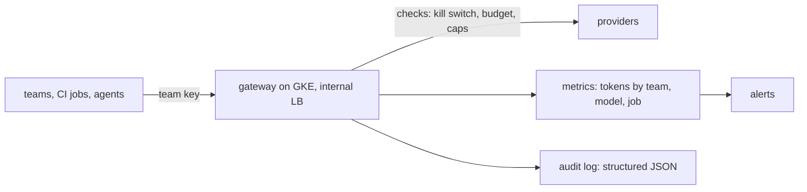

LLM API bills grow in surprising ways: an agent loops, a retry storm repeats a large prompt, a pipeline runs on every push of every branch, or a new team starts using the shared key. Cloud billing alerts tell you after the money is spent. This note describes how to bound spend before it happens with a gateway, caps, attribution, alerts and a kill switch, and how to keep an audit trail of what agents did with their tools. Cloud cost allocation in general is in [[finops-cost-allocation-and-guardrails]].

> [!info] Scope
> Written for a platform team on GCP and GKE offering one internal gateway to teams and CI jobs. No provider is named, and no prices or limits are quoted: check each provider's current pricing and documentation, and change nothing here into a number without doing so.

> [!note] Not verified
> Not run against a real gateway or billing account. Unchecked: the `gcloud billing budgets create` flags in your SDK version, provider features for caching and batching, and the metric names your gateway emits.

## Where the spend comes from

Cost is usually the product of a few things multiplied together:

- **Input and output tokens per request.** Long prompts (whole files, full logs) and long outputs are billed. Output is typically priced differently from input; check the provider's pricing page.
- **Retries.** A failing request retried five times is five bills. A retry storm during a provider incident multiplies it.
- **Agent loops.** An agent that calls tools repeatedly re-sends the growing conversation each time.
- **Fan-out.** One MR event triggering many jobs, each calling the model, across many repositories.
- **Waste.** Tests and experiments on the most expensive model, unused keys left running, and prompts that include irrelevant context.

Know which of these dominates before optimising; the metrics below tell you.

## A gateway as the enforcement point

Put one internal gateway between everything and the providers. Clients get an internal URL and a team-scoped credential; only the gateway holds provider keys. Budgets, caps, logging and the kill switch live there, so they apply to every tool and cannot be bypassed by editing a prompt.



Deploy it on GKE behind an internal load balancer, reachable only from your VPC and runners. Give it a Kubernetes service account bound to a Google service account with Workload Identity ([[gke-workload-identity]]) so it reads provider keys from Secret Manager without exported key files. Budgets live in the gateway or runner configuration, never in the prompt: a prompt that says "stay under 5,000 tokens" is a suggestion.

## Per-team keys and attribution

- One credential per team and per environment, issued by the gateway and revocable alone. A shared key makes it impossible to tell who caused a spike.
- Require a `job` identifier (pipeline or tool name) on each request, and refuse requests without it.
- Record team, model and job as labels on every metric and log line. Keep the label values few and controlled; avoid free-text labels that create unbounded series.
- Report spend per team monthly through the same showback process as other cloud costs ([[finops-cost-allocation-and-guardrails]]).
- Rolling out a tool to a team includes issuing its key and budget first ([[rolling-out-ai-tools-in-a-team]]).

## Hard caps

Caps are limits the gateway enforces and the client cannot raise:

- **`max_tokens` per request** (output cap), set by the gateway if the client omits it and lowered if the client asks for too much.
- **Prompt size cap**: reject or truncate over-long inputs with a visible error.
- **Request count and tool-call cap per job.** An agent job that has made N calls is stopped, whatever it wants.
- **Timeouts** per request and per job.
- **Concurrency limit** per team so a fan-out cannot saturate the budget in minutes.
- **Retries with capped exponential backoff and jitter**, a small maximum count, and no retry on errors that will not change (invalid request, quota). The reasoning is the same as for service calls in [[timeouts-retries-load-shedding]].

```yaml title="gateway-policy.yaml (illustrative)"
# Illustrative policy for a gateway you operate. The field names are examples;
# map them to your gateway's configuration.
teams:
  platform:
    monthly_budget_usd: 500 # change: the team's approved budget
    max_tokens_per_request: 2000 # change after measuring typical output
    max_requests_per_job: 40
    max_tool_calls_per_job: 25
    job_timeout_seconds: 900
    models: [small-default] # larger models by request, behind an evaluation
retries:
  max_attempts: 3
  backoff: exponential
  jitter: true
kill_switch:
  flag: llm_enabled
```

## Caching, batching and model tiering

These reduce cost without reducing control, but each depends on provider features and terms:

- **Prompt caching** can make repeated long prefixes (system prompts, shared context) cheaper on some providers. Check the current documentation for how it works, how long entries live and what it costs; quote no numbers.
- **Response caching** in the gateway for identical requests, with a short lifetime and keys that include the team and model. Never cache across teams where data differs.
- **Batch APIs** suit non-urgent work such as nightly analysis. They are a provider feature with their own terms; check the current docs.
- **Model tiering:** route routine, low-risk tasks to a smaller model and keep the larger one for work that needs it. Tiering sits behind an evaluation gate: move a task to a cheaper model only if the golden set (as in [[evaluating-ai-tools-for-a-platform-team]]) shows no unacceptable drop.
- **Smaller prompts:** cluster and summarise logs before sending them ([[llm-log-analysis-and-alert-triage]]); send diffs instead of whole files.

## Budgets and alerts

GCP budgets alert; they do not cap spend. A budget notification can arrive after the money is gone, and billing data lags. Use budgets as a second line and enforce at the gateway.

```bash title="create-budget.sh"
set -euo pipefail

BILLING_ACCOUNT="000000-000000-000000"  # change: your billing account ID
gcloud billing budgets create \
  --billing-account="$BILLING_ACCOUNT" \
  --display-name=ai-budget \
  --budget-amount=500USD \
  --threshold-rule=percent=0.5 \
  --threshold-rule=percent=0.9 \
  --threshold-rule=percent=1.0
```

Check the flags in the current `gcloud billing budgets` reference; scope the budget to the project or labels that hold the provider spend if it appears on your GCP bill, and check the budget API overview for notification options. If the provider bills outside GCP, the same idea applies with their tools plus your gateway's own counts.

Alert on the metrics you control, which move before the bill does. The gateway exports a token counter, and Prometheus alerts on its rate:

```yaml title="llm-cost-alerts.yaml"
groups:
  - name: llm-cost
    rules:
      - alert: LlmTokenRateHigh
        expr: sum by (team, model) (rate(llm_gateway_tokens_total[15m])) > 2000 # change: your normal rate
        for: 15m
        labels:
          severity: warning
        annotations:
          summary: "Token rate for {{ $labels.team }} on {{ $labels.model }} is above its normal level"
      - alert: LlmJobRunaway
        expr: max by (team, job) (llm_gateway_job_requests) > 40
        labels:
          severity: warning
```

Labels are `team`, `model` and `job`. Page only for user-facing symptoms; route cost alerts to the owning team's queue, in line with the alerting practice in the Prometheus documentation.

## Kill switch

You need a way to stop spend in one action:

- **Gateway flag** (`llm_enabled`), checked on every request. Off returns a clear error that clients treat as "feature unavailable" and not as "retry".
- **Per-team and per-key switches**, so one runaway team does not stop everyone.
- **Pipeline cancel:** a documented command or job that cancels running pipelines using the model.
- **Revoking the provider key** as the last resort, since that also breaks every other consumer.

Practise it. Run a drill where the flag is flipped and verify that clients fail safe: advisory jobs skip and say so, and nothing pages. Document who may use it and how it is reversed.

## Tool-call audit log

Cost is only one reason to log. Agents that call tools need a record of what they did, kept apart from application logs:

```json title="audit-line.json"
{
  "ts": "2026-10-19T09:14:07Z",
  "request_id": "req-8c1f",
  "job_id": "pipeline-12345/job-678",
  "actor": "svc-review-bot",
  "team": "platform",
  "tool": "read_file",
  "input_sha256": "9f2b...e1",
  "result": "ok",
  "tokens_in": 1840,
  "tokens_out": 212
}
```

Log a hash of the input, not the input itself, when it may contain sensitive data. Use the field conventions in [[structured-logging-conventions]], ship the log to your normal store with the retention you need for incident review, and keep it append-only for the people who run the agents.

## Failure modes

- **Budget bypass.** A team calls the provider directly with a personal key. Block provider hosts at egress for everything except the gateway ([[securing-ai-agents-in-ci-and-cloud]]).
- **Retry storms.** A provider outage turns every client's retries into a flood. Use capped backoff with jitter and a circuit breaker in the gateway.
- **Metric label explosion.** Free-text labels such as prompt hashes blow up Prometheus. Keep `team`, `model`, `job` only, and put detail in logs.
- **Silent downgrade.** A cheaper model is substituted and quality drops. Tiering changes go through the evaluation gate and are logged.
- **Cache poisoning or leakage.** A shared cache returns another team's answer. Namespace by team.
- **Kill switch that nobody can use.** Test it, and make sure on-call knows where it is.

## Rollback

Caps and budgets are configuration, so roll them back like configuration: keep the gateway policy in version control, change it through reviewed merge requests, and revert the commit to restore the previous values. If a tiering change reduced quality, route the task back to the previous model and re-run the evaluation. If the gateway itself fails, clients should degrade (skip advisory AI steps), not bypass it with direct keys.

## Sources

- [Create and manage budgets](https://cloud.google.com/billing/docs/how-to/budgets), Google Cloud Billing documentation.
- [Budget API overview](https://cloud.google.com/billing/docs/how-to/budget-api-overview), Google Cloud Billing documentation.
- [Alerting best practices](https://prometheus.io/docs/practices/alerting/), Prometheus documentation.

## Related

- [[finops-cost-allocation-and-guardrails]]: cloud cost allocation and guardrails.
- [[securing-ai-agents-in-ci-and-cloud]]: egress and credential rules for agents.
- [[timeouts-retries-load-shedding]]: timeouts and retry behaviour.
- [[gke-workload-identity]]: credentials for the gateway.
- [[structured-logging-conventions]]: log fields for the audit trail.
- [[rolling-out-ai-tools-in-a-team]]: budgets as part of a rollout.
- [[llm-log-analysis-and-alert-triage]]: reducing tokens and capping calls in alert storms.
- [[evaluating-ai-tools-for-a-platform-team]]: the evaluation gate for tiering.
- [the owner's AI skills catalogue](https://ai.szolotov.com): reusable agent skills and workflows.
