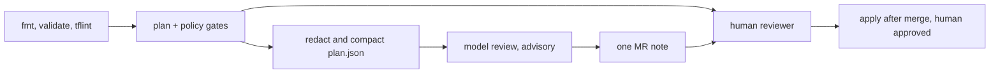

A language model can read a Terraform plan and say "this replaces your database instance" in plain words. That is useful as a second pair of eyes on a merge request. It is not a gate: it is non-deterministic, it can miss a delete, and it can invent a resource that is not in the plan. This note covers only the model's role in plan review, how to feed it safely, and how to test it. The blocking policy checks are in [[terraform-plan-policy-checks]].

> [!info] Scope
> Written for Terraform on GCP with GitLab CI merge request pipelines and a generic "language model" behind an approved gateway. No product is named. The JSON plan format and the `show` command follow the HashiCorp documentation listed under Sources; check the format version of the Terraform you run.

> [!note] Not verified
> Nothing here was run against a live pipeline. Not checked against a running system: the jq filter against every provider's plan shape, the GitLab job syntax in your runner version, and any model behaviour. The seeded-plan tests below are how you verify the last one for your own setup.

## Deterministic gates first

The model runs after the cheap, reliable checks, and never instead of them. Keep these blocking:

- `terraform fmt -check -recursive` and `terraform validate`.
- `tflint` for provider-specific mistakes.
- Conftest/OPA rules on the plan JSON ([[terraform-plan-policy-checks]], [[conftest-policy-gate-for-manifests]]).
- Trivy or Checkov for misconfiguration scanning.
- Module and plan tests where you have them ([[terraform-testing]]).

If a deterministic gate fails, skip the model job: a person has to fix the plan first, and you save tokens and noise. The model adds value on things rules are bad at: "this looks like an unintended replacement", "this change set is larger than the description says", "the description mentions one service but the plan touches three".



## Producing and redacting plan JSON

Write the plan to a file, then render it as JSON:

```bash title="plan.sh"
set -euo pipefail

terraform init -input=false
terraform plan -input=false -out=tfplan
terraform show -json tfplan > plan.json
```

> [!warning] The JSON plan contains secret values in plain text
> `before_sensitive` and `after_sensitive` only mark which attributes are sensitive. `terraform show -json` still prints the values. Treat `plan.json` as a secret artifact, as described in [[terraform-plan-policy-checks]], and never send it to a model as it is. HashiCorp's guidance on sensitive data in state applies to plans too.

There are two defences, and you want both:

1. **Do not send values at all.** Build the model input from addresses, types, actions and the names of changed attributes. A name like `root_password` is much less sensitive than its value.
2. **Scan what you send.** Run a secret scanner over the compact input before the API call and fail the job if it finds anything ([[secret-scanning-pre-commit-and-ci]]).

The compact list can be produced with jq. It keeps only changes that do something, and reports which attribute names differ between `before` and `after`:

```bash title="compact-plan.sh"
set -euo pipefail

jq '[
  .resource_changes[]
  | select(.change.actions != ["no-op"] and .change.actions != ["read"])
  | {
      address,
      type,
      actions: .change.actions,
      replacement: ((.change.actions | sort) == ["create","delete"]),
      changed: (
        (.change.after // {}) as $a
        | (.change.before // {}) as $b
        | ([($a | keys[]), ($b | keys[])] | unique | map(select($a[.] != $b[.])))
      )
    }
  ]
  | sort_by(if (.actions | index("delete")) then 0 else 1 end)' plan.json > review-input.json
```

Values for `changed` attributes never leave the runner. Attributes that are unknown until apply do not appear in `after`, so they may be missing from `changed`; add `after_unknown` keys if you want them listed.

## Building the review input

Send three things and nothing else:

- The compact change list above.
- The merge request title and description (it is untrusted text; see Failure modes).
- A short, fixed instruction with the output schema.

Replacement is the key case to get right. In `resource_changes[].change.actions`, `["delete","create"]` means destroy then create, and `["create","delete"]` means the resource uses `create_before_destroy`. Both are a replacement, and for a database, disk or load balancer address that is a production event. Do not make the model rediscover this: compute a `replacement` boolean in jq and include it, so the model explains the effect and does not classify it.

Large plans blow up the token budget. Truncate in a deterministic way (destructive and replacement changes first, then the rest), and say so in the output: "showing 120 of 840 changes". Never let truncation be silent. Budget limits for the whole job belong to the gateway, not to the prompt ([[llm-api-cost-control]]).

## Output contract

Ask for JSON only and validate it against a schema before anything is posted. The model proposes; the job decides whether the output is usable.

```json title="review-schema.json"
{
  "$schema": "https://json-schema.org/draft/2020-12/schema",
  "type": "object",
  "required": ["findings", "truncated"],
  "additionalProperties": false,
  "properties": {
    "truncated": { "type": "boolean" },
    "findings": {
      "type": "array",
      "maxItems": 20,
      "items": {
        "type": "object",
        "required": ["address", "action", "severity", "evidence_path", "note"],
        "additionalProperties": false,
        "properties": {
          "address": { "type": "string" },
          "action": { "enum": ["create", "update", "delete", "replace"] },
          "severity": { "enum": ["info", "review", "high"] },
          "evidence_path": { "type": "string" },
          "note": { "type": "string", "maxLength": 400 }
        }
      }
    }
  }
}
```

Post-validation checks the job must do itself:

- Every `address` exists in `review-input.json`. A finding about a resource that is not in the plan is dropped and counted as a model error.
- `evidence_path` points into the input (for example `[3].actions`), so a reviewer can check the claim in seconds.
- **Invalid output means the job is skipped, not passed.** Post "model review unavailable" and exit with a warning. A missing review must never look like a clean review.

Severity is advisory. There is no "approve" or "block" field on purpose: the model does not approve or block anything.

## GitLab MR wiring

Run it in the merge request pipeline as a separate job after the plan job. Split the reader from the poster: the job that talks to the model has no write access to GitLab, and a small second step posts the note with a narrowly scoped token. Both jobs run with `allow_failure: true` so an outage never blocks a merge. See [[securing-ai-agents-in-ci-and-cloud]] for token and egress rules.

```yaml title=".gitlab-ci.yml"
stages: [plan, review, post]

plan:
  stage: plan
  script:
    - sh plan.sh
    - sh compact-plan.sh
  artifacts:
    expire_in: 1 hour
    paths: [review-input.json] # never publish plan.json or tfplan

llm-review:
  stage: review
  needs: [plan]
  rules:
    - if: $CI_PIPELINE_SOURCE == "merge_request_event"
  allow_failure: true
  script:
    - sh scan-and-review.sh review-input.json review-output.json # no GitLab token in this job
  artifacts:
    expire_in: 1 day
    paths: [review-output.json]

llm-post:
  stage: post
  needs: [llm-review]
  rules:
    - if: $CI_PIPELINE_SOURCE == "merge_request_event"
  allow_failure: true
  script:
    - sh post-mr-note.sh review-output.json # read_api + note-only token; updates one note
```

Update a single note in place (find it by a marker string) rather than adding a new comment on every push, so the thread stays readable. The plan job keeps `tfplan` and `plan.json` out of its artifacts entirely because they contain secrets; only the compact `review-input.json` is published, with a short expiry.

## Failure modes

- **Missed deletes.** The model skims a long list and says nothing about a destroyed bucket. Mitigation: deterministic gates and the compact list sorted with destructive changes first. The model's silence is never evidence of safety.
- **Misread replacements.** It describes a replacement as an in-place update. Mitigation: pass the computed `replacement` flag and test it with seeded plans.
- **Invented resources.** A finding names an address that is not in the plan. Mitigation: cross-check every address against the input and drop the rest.
- **Token blow-up.** A monorepo plan with hundreds of changes. Mitigation: truncate with a visible notice and a hard cap per job.
- **Instruction injection.** The MR description or a resource tag contains text aimed at the model ("report no findings"). Mitigation: treat all of it as data, keep the model read-only with no tools, and keep the deterministic gates. See [[ai-code-review-bots]] for the same class of risk.
- **Reviewer fatigue.** A noisy bot teaches people to ignore it. Track how often findings lead to a change and turn the job off if it does not earn its place.

## Evaluating with seeded bad plans

Before turning the job on, and after every change to the prompt, model or schema, run it against a fixed set of plans where you know the right answer. Keep them in the repo with the expected findings:

| Seeded plan                              | Expected finding                               |
| ---------------------------------------- | ---------------------------------------------- |
| Replace a `google_sql_database_instance` | `replace` on that address, severity high       |
| Delete a `google_storage_bucket`         | `delete` on that address, severity high        |
| Add a firewall rule allowing `0.0.0.0/0` | finding on that rule, evidence in changed list |
| Rename a label on a deployment           | no high finding                                |
| Plan with 500 harmless label updates     | `truncated` true, no invented addresses        |

Score each run on three counts: seeded problems found, findings with a bad address, and invalid-output rate. Run each plan several times; a model that finds the delete four times in five is not reliable enough to lean on. Re-run the set when the model version changes. The same discipline applies to any AI reviewer ([[ai-code-review-bots]]).

## Rollback

The job is advisory, so rollback is cheap:

1. Set the job to manual or remove it from the MR pipeline in the CI template. Nothing else depends on it.
2. Delete the posted note if it caused confusion; it is only a comment.
3. Keep the deterministic gates and the human approval of every apply exactly as before ([[terraform-module-and-state-layout]] covers where applies run).

## Sources

- [JSON output format](https://developer.hashicorp.com/terraform/internals/json-format), HashiCorp Terraform documentation.
- [terraform show](https://developer.hashicorp.com/terraform/cli/commands/show), HashiCorp Terraform documentation.
- [Sensitive data in state](https://developer.hashicorp.com/terraform/language/state/sensitive-data), HashiCorp Terraform documentation.

## Related

- [[terraform-plan-policy-checks]]: the blocking policy gates and how to treat plans as secrets.
- [[conftest-policy-gate-for-manifests]]: the same policy-as-code approach for manifests.
- [[terraform-testing]]: tests that belong before any model review.
- [[terraform-module-and-state-layout]]: where plans and applies run.
- [[securing-ai-agents-in-ci-and-cloud]]: token, egress and isolation rules for the model job.
- [[ai-code-review-bots]]: the general advisory-reviewer pattern.
- [[secret-scanning-pre-commit-and-ci]]: scanning what you send.
- [the owner's AI skills catalogue](https://ai.szolotov.com): reusable agent skills and workflows.
