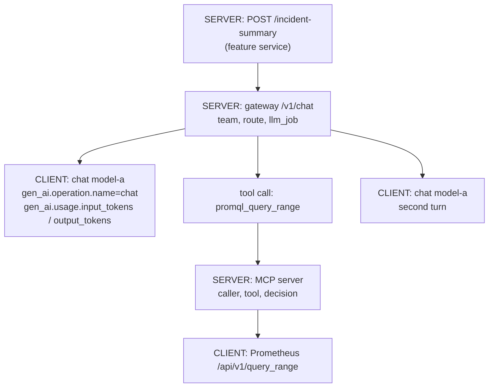

An LLM-backed feature fails differently from a normal service. It can be slow to start answering and still fast to finish, or the reverse. It can return HTTP 200 with an answer that fails schema validation. It can be throttled by a provider while every one of your pods is healthy. An agent can make twelve tool calls where it used to make three, and the only symptom is cost. The token metrics in [[llm-api-cost-control]] cover spend; this note covers the rest: which signals to collect, how to trace a request across the gateway, the model and the tools with the OpenTelemetry GenAI conventions, how to keep prompts out of telemetry, and how to put LLM features under SLOs and burn-rate alerts like any other user-facing service.

> [!info] Scope
> Services and agents that call models through one internal gateway, with OpenTelemetry for traces ([[observability-pipeline-opentelemetry]]) and Prometheus for metrics and alerting. Applies to managed APIs ([[vertex-ai-private-access-from-gke]]) and self-hosted models ([[self-hosted-llm-inference-on-gke]]) alike.

> [!note] Not verified
> The OpenTelemetry GenAI semantic conventions are in **Development** status: names and attributes can change between versions, and sources disagree on how mature each part is. Checked only through search excerpts on 2026-10-21: the span name format, span kind, `gen_ai.operation.name`, `gen_ai.request.model`, the `gen_ai.usage.*` token attributes, the `gen_ai.client.token.usage` and `gen_ai.client.operation.duration` metrics, the `OTEL_SEMCONV_STABILITY_OPT_IN` value, and that content capture is opt-in. Not confirmed: tool-call span names and attributes, error and cache-hit attributes, the time-to-first-token metric names (they have moved between versions), the environment variable that turns on content capture in a given instrumentation, how trace context crosses an MCP server, and which libraries implement which version. Not checked against the Prometheus practice pages and the SRE workbook chapters; verify there. The burn-rate numbers come from [[slo-burn-rate-alerting]]. The Prometheus rules below passed `promtool check rules` (promtool 2.45.3); nothing else was run.

## Signals that matter

| Signal                                                                           | Why it matters                                         | Where to measure                              |
| -------------------------------------------------------------------------------- | ------------------------------------------------------ | --------------------------------------------- |
| Time to first token (streaming)                                                  | What a person waiting for an answer feels              | Gateway, per request                          |
| Total request duration                                                           | What a batch job or a non-streaming caller feels       | Gateway, per request                          |
| Outcome: ok, client error, error, timeout, rate limited, schema invalid, blocked | The availability SLI, and which fix applies            | Gateway, per request                          |
| 429s and retries                                                                 | Provider capacity or quota; retry storms               | Gateway, per attempt                          |
| Input and output tokens                                                          | Cost, and the main driver of latency                   | Gateway, from the provider's usage fields     |
| Tool calls per run, and tool failures                                            | Agent behaviour drift, loops, broken tools             | Agent runtime and tool servers                |
| Cache hits                                                                       | Whether caching works, and why latency or cost changed | Gateway                                       |
| Schema validation failures and refusals                                          | Quality proxies you can measure on every request       | The calling service, after parsing the answer |
| Queue depth and GPU saturation                                                   | Capacity of self-hosted models                         | Model server metrics                          |
| Offline eval pass rate                                                           | Answer quality, which no runtime metric shows          | Nightly eval job                              |

Two of these deserve emphasis. **Schema validation failures** are the cheapest quality signal you have: if a feature expects JSON with certain fields and parses every answer, a jump in failures after a model change is a regression you can alert on. **Tool calls per run** catches agents that loop or change strategy; it often moves before cost does.

## Traces with the OpenTelemetry GenAI conventions

One user request becomes a tree of spans: the feature's own server span, the gateway, each model call, each tool call and whatever the tool calls upstream.



What the conventions specify for a model call span (from the GenAI spans page, Development status):

- **Name:** `{gen_ai.operation.name} {gen_ai.request.model}`, for example `chat model-a`.
- **Kind:** `CLIENT` for a call to a remote model; `INTERNAL` is allowed for a model running in the same process.
- **Attributes:** `gen_ai.operation.name` is required; `gen_ai.request.model` names the requested model; token usage goes in `gen_ai.usage.input_tokens` and `gen_ai.usage.output_tokens`.
- **Metrics:** the client metrics `gen_ai.client.token.usage` and `gen_ai.client.operation.duration` are histograms.

Instrument in two places:

1. **The gateway** creates the model-call spans itself, from the request and the provider's usage fields, whatever client library the caller used. This is the one place where every call is guaranteed to be traced in the same way.
2. **Agents and tool servers** create spans for each tool call and continue the trace context they received. The conventions also cover agent and tool spans; check the current page for their names and attributes before you build dashboards on them.

Because the conventions change, plan for it. Many instrumentations keep emitting the older form unless told otherwise; setting `OTEL_SEMCONV_STABILITY_OPT_IN=gen_ai_latest_experimental` asks them to emit the latest experimental conventions instead. Pin instrumentation versions, record which convention version each service emits, and when you move, update queries and dashboards in the same change ([[0046-dashboards-and-alert-rules-as-code]]). A rename handled in the collector gateway ([[0043-opentelemetry-collector-gateway]]) can bridge a transition.

### Trace context across the gateway and tools

- The gateway accepts the W3C `traceparent` header from callers and continues the trace; it never starts a new root for a request that came with context.
- Calls from the gateway to a remote MCP server or any other HTTP tool carry `traceparent` too, and the server continues it. Whether and how the MCP specification carries trace context was not checked; for your own servers ([[internal-mcp-servers-for-platform-tools]]) propagate it as an HTTP header and record the trace ID in the audit line.
- A stdio tool started by an agent has no HTTP headers. Pass the context in the way your agent framework documents, or accept that those spans are separate and link them by a run ID attribute.

## Keep prompts out of telemetry

Prompt and response content is opt-in in the GenAI conventions because it often contains personal data. When it is turned on, it lands in structured attributes such as `gen_ai.input.messages`, `gen_ai.output.messages` and `gen_ai.system_instructions`; older versions of the conventions used span events instead, so check what your instrumentation emits.

The default for production: **content capture off**. Traces carry sizes, token counts, model, outcome and hashes, not text. If a team needs content for debugging:

- capture it only after the redaction filter ([[redacting-sensitive-data-before-llm-calls]]), never before;
- send it to a separate, access-restricted backend with short retention, not the shared trace store;
- turn it on per route and for a limited time, through a reviewed change.

Enforce the default in the collector as well, so one service with the wrong setting does not leak into the shared store:

```yaml title="otel-collector-drop-genai-content.yaml"
processors:
  attributes/drop-genai-content:
    actions:
      - { key: gen_ai.input.messages, action: delete }
      - { key: gen_ai.output.messages, action: delete }
      - { key: gen_ai.system_instructions, action: delete }

service:
  pipelines:
    traces:
      processors: [memory_limiter, attributes/drop-genai-content, batch]
```

The processor works on span attributes; content carried in span events or logs needs its own handling (a transform or filter processor, or dropping those events). Add the processor to the existing pipeline definition in your collector gateway rather than replacing it.

## Metrics: Prometheus histograms with few labels

The gateway exports the request-level metrics. Names follow Prometheus conventions (base units, `_total` for counters):

| Metric                                    | Type      | Labels                                            |
| ----------------------------------------- | --------- | ------------------------------------------------- |
| `llm_gateway_requests_total`              | counter   | `team`, `model`, `route`, `outcome`               |
| `llm_gateway_request_duration_seconds`    | histogram | `model`, `route`                                  |
| `llm_gateway_time_to_first_token_seconds` | histogram | `model`, `route`                                  |
| `llm_gateway_tokens_total`                | counter   | `team`, `model`, `llm_job`, `direction`           |
| `llm_gateway_attempts_total`              | counter   | `model`, `result` (`ok`, `429`, `5xx`, `timeout`) |
| `llm_gateway_tool_calls_total`            | counter   | `tool`, `outcome`                                 |
| `llm_gateway_cache_requests_total`        | counter   | `model`, `result` (`hit`, `miss`)                 |

Rules for labels:

- Fixed, small value sets only: `outcome`, `direction` and `result` are enums; `team`, `model`, `route` and `llm_job` come from gateway configuration, not from the request text. Never a prompt hash, user ID, request ID or tool argument; those go in traces and logs ([[prometheus-high-cardinality-triage]]).
- `llm_job`, not `job`: Prometheus reserves `job` for the scrape job (as in [[llm-api-cost-control]]).
- LLM latencies are long and spread out. Choose histogram buckets from measured data, covering from a fraction of a second up to your longest timeout, with boundaries at your SLO thresholds (the rules below need a bucket at exactly `2.5`).

Self-hosted model servers export their own metrics (vLLM uses a `vllm:` prefix, including a time-to-first-token histogram and waiting and running request gauges); scrape them next to the gateway's, through [[0042-managed-prometheus-for-application-metrics]] on GKE.

## SLIs and SLOs

Put an SLO on the **user-facing feature**, not on the provider: users do not care whose fault a timeout was, and the error budget is what decides whether to add a fallback, change regions or buy capacity.

- **Availability SLI:** valid requests that returned a usable answer, divided by valid requests. Valid excludes client errors (malformed request, policy block of a bad input). Bad includes errors, timeouts, rate limiting that reached the user after retries, and **schema-invalid answers**, because a 200 with unusable content is a failure to the user.
- **Latency SLI:** for streaming features, the share of requests whose first token arrived within a threshold; for non-streaming ones, the share completed within a threshold. Set thresholds from what users accept, and check them against measured percentiles.
- **Quality SLO (design choice):** a target pass rate on a golden evaluation set, run nightly and on every model or prompt change ([[model-version-pinning-and-upgrade-evals]]). It is not a burn-rate alert; a drop opens a ticket and blocks the next change, as the error budget policy would ([[error-budget-policy]]).
- **Advisory features** (a review bot that comments, a triage summary on an alert) may not deserve a paging SLO at all. Page only where a user is blocked ([[0045-page-only-on-slo-burn-rate]]); route the rest to tickets.

Targets for LLM features are usually lower than for the core service they sit next to, because they depend on a provider you do not control. Write the target down with that reason; do not copy the core service's number.

Recording rules and multi-window, multi-burn-rate alerts, with the burn rates and windows from [[slo-burn-rate-alerting]]. The route, the 99% target and the 2.5 s threshold are examples; change them per feature:

```yaml title="llm-slo-rules.yaml"
groups:
  - name: llm-sli
    rules:
      # Valid requests: everything except requests the caller got wrong.
      - record: llm:requests:rate5m
        expr: sum by (route) (rate(llm_gateway_requests_total{outcome!="client_error"}[5m]))
      - record: llm:requests:rate30m
        expr: sum by (route) (rate(llm_gateway_requests_total{outcome!="client_error"}[30m]))
      - record: llm:requests:rate1h
        expr: sum by (route) (rate(llm_gateway_requests_total{outcome!="client_error"}[1h]))
      - record: llm:requests:rate6h
        expr: sum by (route) (rate(llm_gateway_requests_total{outcome!="client_error"}[6h]))
      # Bad requests: no usable answer reached the user.
      - record: llm:requests_bad:rate5m
        expr: sum by (route) (rate(llm_gateway_requests_total{outcome=~"error|timeout|rate_limited|schema_invalid"}[5m]))
      - record: llm:requests_bad:rate30m
        expr: sum by (route) (rate(llm_gateway_requests_total{outcome=~"error|timeout|rate_limited|schema_invalid"}[30m]))
      - record: llm:requests_bad:rate1h
        expr: sum by (route) (rate(llm_gateway_requests_total{outcome=~"error|timeout|rate_limited|schema_invalid"}[1h]))
      - record: llm:requests_bad:rate6h
        expr: sum by (route) (rate(llm_gateway_requests_total{outcome=~"error|timeout|rate_limited|schema_invalid"}[6h]))
      - record: llm:error_ratio:rate5m
        expr: llm:requests_bad:rate5m / llm:requests:rate5m
      - record: llm:error_ratio:rate30m
        expr: llm:requests_bad:rate30m / llm:requests:rate30m
      - record: llm:error_ratio:rate1h
        expr: llm:requests_bad:rate1h / llm:requests:rate1h
      - record: llm:error_ratio:rate6h
        expr: llm:requests_bad:rate6h / llm:requests:rate6h
      # Latency SLI: share of streamed requests whose first token arrived within 2.5 s.
      # 2.5 must be one of the histogram's bucket boundaries.
      - record: llm:ttft_fast_ratio:rate1h
        expr: |
          sum by (route) (rate(llm_gateway_time_to_first_token_seconds_bucket{le="2.5"}[1h]))
          /
          sum by (route) (rate(llm_gateway_time_to_first_token_seconds_count[1h]))

  - name: llm-slo-alerts
    rules:
      # SLO: 99% of valid requests to the incident-summary route succeed over 30 days.
      # Burn rates and windows as in the SLO burn-rate alerting note; 0.01 is the error budget.
      - alert: LlmFeatureErrorBudgetFastBurn
        expr: |
          llm:error_ratio:rate1h{route="incident-summary"} > (14.4 * 0.01)
          and
          llm:error_ratio:rate5m{route="incident-summary"} > (14.4 * 0.01)
        labels:
          severity: page
        annotations:
          summary: "incident-summary is burning its error budget at 14.4x or more"
          runbook_url: "https://example.com/runbooks/llm-feature-degraded"
      - alert: LlmFeatureErrorBudgetSlowBurn
        expr: |
          llm:error_ratio:rate6h{route="incident-summary"} > (6 * 0.01)
          and
          llm:error_ratio:rate30m{route="incident-summary"} > (6 * 0.01)
        labels:
          severity: page
        annotations:
          summary: "incident-summary is burning its error budget at 6x or more"
          runbook_url: "https://example.com/runbooks/llm-feature-degraded"
      - alert: LlmTimeToFirstTokenSlow
        expr: llm:ttft_fast_ratio:rate1h{route="incident-summary"} < 0.95
        for: 30m
        labels:
          severity: ticket
        annotations:
          summary: "Fewer than 95% of incident-summary responses start within 2.5 s"
```

Every paging alert has a runbook ([[alert-and-runbook-standard]]); for an LLM feature the first questions are: is it one model or all, is it 429s or errors, did a model, prompt or configuration change just ship, and is the fallback working?

## Dashboards

One dashboard per feature, built as code, with these rows:

1. **Outcomes:** request rate by outcome, error ratio against the SLO, remaining error budget.
2. **Latency:** time to first token and total duration, p50, p95 and p99 by model.
3. **Tokens:** input and output tokens per request (distribution, not just averages), tokens per minute by team.
4. **Capacity:** attempts by result (429 share), retries per request, cache hit ratio, and for self-hosted models queue depth.
5. **Agents and tools:** tool calls per run, tool failures by tool, runs stopped by caps.
6. **Quality:** schema validation failures, refusals, last nightly eval result with a link to the report.

Put the model ID and the deployed configuration version on the dashboard as annotations, so a change in any panel can be matched to a change in what was deployed.

## Graceful degradation

Decide in advance what the feature does when the model is slow or down, and measure it:

- **Fallback model or region**, behind the same evaluation gate as any model change.
- **Cached or partial answers** where stale is better than nothing.
- **Feature off with a clear message**, through the gateway's kill switch, for advisory features.
- **Queue and retry later** for batch work, with a deadline.
- A **circuit breaker** in the gateway so a provider outage does not turn into a retry storm ([[timeouts-retries-load-shedding]]).

Count degraded responses as their own outcome (`degraded`), and decide per feature whether it counts as good or bad for the availability SLI. Either way, alert if the feature has been degraded for longer than you agreed.

## Troubleshooting

| Symptom                                                  | Likely cause                                               | How to check                                                                                       |
| -------------------------------------------------------- | ---------------------------------------------------------- | -------------------------------------------------------------------------------------------------- |
| p99 latency jumps, traffic flat                          | Longer prompts or outputs (a new caller, a context change) | Input and output token distributions by route; traces of the slowest requests                      |
| Time to first token fine, total duration slow            | Long outputs                                               | Output tokens per request; the gateway's output cap                                                |
| Error ratio rises with 429 share                         | Provider capacity or quota                                 | Attempts by result and by model and region; the quota guidance for your provider                   |
| Request rate to the provider far above user request rate | Retry storm or agent loop                                  | Attempts per request, tool calls per run; circuit breaker state                                    |
| Schema failures jump with no deploy                      | The model behind an alias changed                          | Model ID on the spans; pin versions ([[model-version-pinning-and-upgrade-evals]])                  |
| Traces broken into pieces                                | Trace context not propagated through the gateway or a tool | Look for spans without parents and a matching run ID; check `traceparent` forwarding               |
| Prometheus series count grows quickly                    | A label filled from request data                           | [[prometheus-high-cardinality-triage]]; fix the label at the gateway                               |
| Self-hosted latency rises with load                      | Queue building on the model server                         | Queue depth and running requests; autoscaling on queue size ([[self-hosted-llm-inference-on-gke]]) |

## Sources

- [Semantic conventions for generative AI systems](https://opentelemetry.io/docs/specs/semconv/gen-ai/), OpenTelemetry: status, opt-in, content capture guidance.
- [GenAI spans](https://opentelemetry.io/docs/specs/semconv/gen-ai/gen-ai-spans), OpenTelemetry: span name, kind and attributes.
- [Histograms and summaries](https://prometheus.io/docs/practices/histograms/) and [metric and label naming](https://prometheus.io/docs/practices/naming/), Prometheus documentation.
- [Implementing SLOs](https://sre.google/workbook/implementing-slos/) and [alerting on SLOs](https://sre.google/workbook/alerting-on-slos/), The Site Reliability Workbook.

## Related

- [[observability-pipeline-opentelemetry]]: the collector pipeline these traces go through.
- [[slo-burn-rate-alerting]]: burn rates, windows and recording rules.
- [[error-budget-policy]]: what happens when the budget is spent.
- [[llm-api-cost-control]]: token metrics, caps and the audit line.
- [[structured-logging-conventions]]: log fields that carry trace IDs.
- [[redacting-sensitive-data-before-llm-calls]]: the filter content capture must sit behind.
- [[timeouts-retries-load-shedding]]: retries, circuit breakers and shedding.
- [[internal-mcp-servers-for-platform-tools]]: tool servers that continue the trace.
- [the owner's AI skills catalogue](https://ai.szolotov.com): reusable agent skills and workflows.
