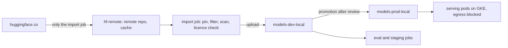

Teams that would never `pip install` from a random URL in production will happily call a model hub from a pod at startup and load whatever the `main` branch holds that day. Model weights are artifacts: they come from third parties, they can be swapped or typosquatted, they carry licence terms, and some formats run code when they are loaded. The rules already used for packages and images ([[artifactory-repository-design]], [[artifact-promotion-artifactory]]) apply: proxy the upstream, pin what you use, check it before promotion, record where it came from, and let production pull only from internal repositories.

> [!info] Scope
> Written for a platform team that serves open-weight models on GKE ([[self-hosted-llm-inference-on-gke]]) and runs JFrog Artifactory. The hub examples use Hugging Face because its client and Artifactory's support for it are documented; the same pattern fits any hub. No Artifactory version, JFrog plan, model or licence is named: check what your installation and contracts provide.

> [!note] Not verified
> Checked only at page level, on 2026-10-21, through search summaries of the Python, Hugging Face and JFrog documentation, not a full read. Not checked: which Artifactory version first supports Hugging Face repositories, whether copy and promotion between Hugging Face local repositories work like other package types, the JFrog CLI property flags, JFrog's statements that virtual Hugging Face repositories support downloads through `snapshot_download` only and that `jf hf` supports download and upload only, whether the `docs.jfrog.com` page addresses in Sources still resolve, whether Xray, Curation or malicious-model detection is in your licence, and the exact scanner commands. The scripts and pipeline are illustrations, not run.

## What can go wrong

| Risk                               | How it happens                                                                                         | Control in this pattern                                           |
| ---------------------------------- | ------------------------------------------------------------------------------------------------------ | ----------------------------------------------------------------- |
| Code execution on load             | A pickle-based weight file runs arbitrary code when it is deserialised                                 | Allow only safe formats; scan; never load pickles in serving      |
| Swapped model                      | The upstream repository's `main` changes, or an author's account is taken over                         | Pin full commit hashes; cache upstream; checksums at promotion    |
| Typosquatting                      | A repository with a near-identical name to a popular model                                             | Allowlist of approved repository IDs, reviewed by a person        |
| Licence breach                     | The model's licence restricts use, or a gated model's terms were accepted by one person for themselves | Licence review before promotion, recorded on the artifact         |
| Upstream disappears                | A model is deleted or made private                                                                     | Remote repository cache and promoted local copies                 |
| Unbounded egress from serving pods | Pods download from the internet at startup                                                             | Serving pods pull from internal repositories only; egress blocked |

### Pickle runs code

Python's `pickle` documentation is blunt: never unpickle data that could have come from an untrusted source or could have been tampered with, because malicious pickle data can execute arbitrary code during unpickling.[^pickle] Many checkpoint formats in the Python ecosystem use pickle inside (PyTorch's default checkpoints are commonly a zip archive with a pickled object in it), so "loading the model" can mean "running the uploader's code" with the pod's service account, network and mounted secrets.

Hugging Face's own security page repeats the warning, describes its pickle scanner (it lists the imports a pickle references and highlights suspicious ones) and suggests trusting specific uploaders, checking signed commits, or using formats that do not carry code.[^hubpickle] Two limits matter:

- **A signed commit shows who uploaded a file, not that the file is safe.**
- **Import-based scanning is pattern matching.** A scanner that looks for known dangerous module names can be evaded. Scanning is necessary, not sufficient; the real control is not loading pickles in production at all.

### Prefer safetensors

The safetensors format was designed to store tensors without pickle's code-execution risk: a file is a small JSON header followed by raw tensor bytes.[^safetensors] Hugging Face commissioned an external audit that reported no critical flaw and led to fixes of minor issues; treat that as a point-in-time review, not a guarantee. The safetensors project also recommends that downstream libraries be configured to require safetensors, so loading fails instead of silently falling back to a pickle file. Look up the option in the library you use; it differs per library and version.

Policy:

- **Allowed for promotion:** safetensors weights, plus the plain-text and JSON files a model needs (configuration, tokenizer files, generation configuration, model card).
- **Rejected by default:** `*.bin`, `*.pt`, `*.pth`, `*.pkl`, `*.ckpt` and any other pickle-bearing file, whatever the extension says. A converted safetensors copy is the fix; the conversion runs in an isolated job (below), never on a workstation with credentials.
- **Exception:** a model that exists only in a pickle format goes through a written security exception, is loaded only in an isolated sandbox, and is converted there before anything else touches it.

## Repository design



| Repository          | Type                 | Who can read                   | Who can write          |
| ------------------- | -------------------- | ------------------------------ | ---------------------- |
| `hf-remote`         | Remote, Hugging Face | The import job's identity only | Artifactory (cache)    |
| `models-dev-local`  | Local, Hugging Face  | Eval and staging jobs          | The import job         |
| `models-prod-local` | Local, Hugging Face  | Serving workloads              | The promotion job only |

JFrog documents remote, local and virtual Hugging Face repository types, with `https://huggingface.co` as the supported remote upstream, and notes that the remote cache protects you against a model being removed or changed upstream.[^jfroghf] New Hugging Face repositories use a "Machine Learning" repository layout by default; check the layout and repository options your Artifactory version offers before creating them.[^jfrogml]

Developers and notebooks do **not** read `hf-remote` directly. If they did, the cache would fill with whatever anyone tried, and every serving path would be one configuration mistake away from unreviewed weights. They read `models-dev-local`, and request new models through the import job.

If your Artifactory version has no Hugging Face repository type, use a generic local repository filled by the same import job: it downloads from the hub in an isolated job and uploads the approved files with the JFrog CLI. The checks below stay the same; only the client configuration changes.

### Gated models

Some models require each user to accept terms on the hub. JFrog's troubleshooting page says downloads of gated or licensed models can fail through the remote repository because developer credentials are not forwarded, and suggests storing Hugging Face credentials on the remote repository itself.[^jfroglimits] That credential belongs to the organisation, accepted by someone allowed to accept licence terms for it. Do not use an engineer's personal hub token for this; the licence was accepted by that person, not the company.

## Client configuration

The Hugging Face client reads its endpoint from `HF_ENDPOINT` and its token from `HF_TOKEN`. JFrog's documentation gives the endpoint form for a Hugging Face repository:

```bash title="import-job.env (shape from the JFrog docs)"
export HF_ENDPOINT="https://artifactory.example.com/artifactory/api/huggingfaceml/hf-remote"
# HF_TOKEN is an Artifactory access token from a masked, protected CI variable, never a literal.
```

Issue that token as a short-lived token from CI, as in [[artifactory-access-tokens-and-oidc-for-ci]].

Downloads then use the normal client calls, pinned to a full commit hash and filtered to the allowed files:

```python title="fetch_model.py (illustrative, not run)"
#!/usr/bin/env python3
"""Download one pinned model revision through Artifactory, allowed files only."""
import sys

from huggingface_hub import snapshot_download

REPO_ID = sys.argv[1]   # for example "example-org/example-model"
REVISION = sys.argv[2]  # the full 40-character commit hash, never "main" or a short prefix
DEST = sys.argv[3]

if len(REVISION) != 40 or any(c not in "0123456789abcdef" for c in REVISION):
    sys.exit(f"revision must be a full lowercase commit hash, got {REVISION!r}")

path = snapshot_download(
    repo_id=REPO_ID,
    revision=REVISION,
    local_dir=DEST,
    allow_patterns=["*.safetensors", "*.json", "*.txt", "*.model", "README.md"],
)
print(path)
```

- `revision` accepts a branch, tag or commit hash. A commit hash must be the full hash; a 7-character prefix is not accepted.[^download] Pin the full hash: a branch or tag can move.
- `allow_patterns` keeps pickle files out of the download in the first place. It is a convenience, not the control; the scan below checks what actually arrived.
- JFrog notes that virtual Hugging Face repositories support downloads through `snapshot_download` only, and its page suggests raising the client's ETag and download timeouts for large models; check the variable names on that page.
- `jf hf` in the JFrog CLI supports download and upload only.[^jfcli]

## The import and promotion gate

One pipeline, run on request, takes a repository ID, a full commit hash and a ticket reference, and either produces an approved artifact in `models-dev-local` or fails with a reason. Run it on an isolated runner with no other credentials, under the restrictions in [[securing-ai-agents-in-ci-and-cloud]]: the files it handles are untrusted until it finishes.

### 1. Allowlist check

The repository ID must be on a reviewed allowlist (a file in the platform repository, changed by merge request). The person approving an addition checks the organisation behind the repository, its history and that the name is not a lookalike.

### 2. Format check

Reject anything that is not on the allowed list, by extension and by content. A pickle renamed to `.safetensors` fails the header check.

```python title="check_weights.py (illustrative, not run)"
#!/usr/bin/env python3
"""Fail on pickle-bearing files and on safetensors files with an invalid header."""
import json
import os
import struct
import sys

ALLOWED_OTHER = {".json", ".txt", ".md", ".model"}  # change: the non-weight files you accept
TEXT_EXT = {".json", ".txt", ".md"}  # .model (SentencePiece) is binary protobuf, so no text check
PICKLE_EXT = {".bin", ".pt", ".pth", ".pkl", ".pickle", ".ckpt"}
MAX_HEADER = 100 * 1024 * 1024  # refuse absurd header sizes before reading them


def check_safetensors(path):
    size = os.path.getsize(path)
    with open(path, "rb") as f:
        raw = f.read(8)
        if len(raw) != 8:
            return "too short for a safetensors header"
        (n,) = struct.unpack("<Q", raw)
        if n == 0 or n > MAX_HEADER or 8 + n > size:
            return f"header length {n} is invalid for a {size}-byte file"
        try:
            header = json.loads(f.read(n).decode("utf-8"))
        except (UnicodeDecodeError, json.JSONDecodeError) as e:
            return f"header is not JSON: {e}"
    data_len = size - 8 - n
    spans = []
    for name, info in header.items():
        if name == "__metadata__":
            continue
        try:
            start, end = info["data_offsets"]
        except (KeyError, TypeError, ValueError):
            return f"tensor {name!r} has no valid data_offsets"
        if not 0 <= start <= end <= data_len:
            return f"tensor {name!r} offsets {start}-{end} outside data of {data_len} bytes"
        spans.append((start, end))
    spans.sort()
    for (s1, e1), (s2, _) in zip(spans, spans[1:]):
        if s2 < e1:
            return "tensor data ranges overlap"
    return None


def main(root):
    problems = []
    for dirpath, _, files in os.walk(root):
        for fn in files:
            path = os.path.join(dirpath, fn)
            ext = os.path.splitext(fn)[1].lower()
            with open(path, "rb") as f:
                magic = f.read(4)
            if ext in PICKLE_EXT:
                problems.append(f"{path}: pickle-bearing extension, not allowed")
            elif ext == ".safetensors":
                err = check_safetensors(path)
                if err:
                    problems.append(f"{path}: {err}")
            elif ext not in ALLOWED_OTHER:
                problems.append(f"{path}: extension {ext!r} is not on the allowed list")
            elif ext in TEXT_EXT and (magic[:1] == b"\x80" or magic == b"PK\x03\x04"):
                problems.append(f"{path}: looks like a pickle or an archive, not text")
    for p in problems:
        print("ERROR", p)
    print(f"{len(problems)} problems")
    return 1 if problems else 0


if __name__ == "__main__":
    sys.exit(main(sys.argv[1]))
```

The header layout used here (an 8-byte little-endian length, then a JSON header with `dtype`, `shape` and `data_offsets` per tensor, and an optional `__metadata__` entry) is described in the safetensors repository; check it against the current README before relying on the script. The magic-byte check on text files is a heuristic for common pickle protocols and zip-based checkpoints renamed to an allowed extension, not a full detector; a pickle renamed to `.safetensors` fails the header check instead.

### 3. Malware and pickle scan

Run the scanners you have on the downloaded tree, and keep their output as a build artifact:

- **Your existing scanner** (Xray or another tool, see [[jfrog-xray-vs-trivy-vs-grype]]), if it supports model files in your version and licence. JFrog documents a malicious AI model detection feature;[^jfrogmal] whether it is in your plan, and how it reports, was not verified.
- **An import-listing pickle scanner** for any pickle you hold under an exception. Python's `pickletools` disassembles a pickle without executing it; `python3 -m pickletools FILE` prints the opcodes, and `GLOBAL` or `STACK_GLOBAL` entries show which callables the pickle would import. Anything outside plain tensor reconstruction is a reason to reject.
- **The hub's own scan results**, as a signal only. The third-party scanners the hub integrates change over time; check its current security documentation.

### 4. Licence review

Read the licence on the model card and in the repository files, record it, and follow [[open-source-license-compliance]]. Model licences are often custom (use restrictions, attribution, user thresholds, field-of-use clauses), so a licence identifier alone is not enough. Legal decides what is acceptable; engineering records what the licence says, which revision it applies to, and who approved it. A licence can change between revisions, which is one more reason to pin.

### 5. Record provenance and checksums

Write a manifest next to the files and keep it with the artifact:

```json title="model-manifest.json (example)"
{
  "source": "https://huggingface.co/example-org/example-model",
  "repo_id": "example-org/example-model",
  "revision": "0123456789abcdef0123456789abcdef01234567",
  "files": {
    "model-00001-of-00002.safetensors": "sha256:9f2b...",
    "model-00002-of-00002.safetensors": "sha256:41ac...",
    "config.json": "sha256:7d10..."
  },
  "license": "as stated on the model card at this revision",
  "license_review": "TICKET-1234",
  "scans": { "format_check": "pass", "malware_scan": "pass", "report": "scan-report.json" },
  "imported_by": "pipeline 456789",
  "approved_by": "platform-security"
}
```

```bash title="checksums.sh"
set -euo pipefail

DEST="./model"  # change: the download directory from fetch_model.py
cd "$DEST"
# Hash every file except the two metadata files, with paths relative to the model directory.
find . -type f ! -name sha256sums.txt ! -name model-manifest.json -print0 \
  | sort -z | xargs -0 sha256sum > sha256sums.txt
# The same check runs again after promotion and in the serving init container.
sha256sum --check --strict --quiet sha256sums.txt && echo "checksums OK"
```

Treat the manifest as SBOM-like metadata: there is no single settled SBOM format for model weights, so store what an auditor would ask for (source, revision, hashes, licence, scans, approver) in a stable JSON shape and index it the same way as other SBOMs ([[sbom-generation-and-storage]]). If your import job produces build provenance for other artifacts, emit it here too ([[slsa-build-provenance]]): the "build" is the import, and its inputs are the repository ID and revision.

In Artifactory, attach the key fields (repository ID, revision, licence ticket, scan result) as properties on the uploaded files so that queries and cleanup rules can use them. The exact CLI command and flags for setting properties were not verified here; reuse the build-info and property approach from [[artifact-promotion-artifactory]].

### 6. Promote

Promotion from `models-dev-local` to `models-prod-local` happens after the model has passed its evaluation and a person has approved it, by a job that is the only identity with write access to the prod repository. Promote the exact files that passed, compare their SHA-256 against the manifest after the copy, and never re-download from the hub at promotion time. Whether copy and promotion between Hugging Face local repositories behave exactly like other package types was not verified; test it on a small model first.

## Serving from internal repositories only

- **Pull from `models-prod-local`, by revision.** The serving configuration names the repository ID and the full revision; it is reviewed like an image digest.
- **Download before the server starts**, in an init container or as part of the image build, into a volume the server reads. Verify the SHA-256 sums against the manifest in that step and fail the pod if they differ.
- **Block egress.** Serving pods have no route to public hubs; only the import job's runner can reach `hf-remote`'s upstream through Artifactory. Use the egress controls in [[private-gke-and-controlled-egress]]. A client setting such as an offline mode helps catch mistakes, but it is not a control; the network rule is.
- **Run with least privilege.** The serving pod's identity can read `models-prod-local` and nothing else in Artifactory.

Verify after rollout:

```bash title="verify-serving.sh (illustrative, not run)"
set -euo pipefail

NS="llm-serving"         # change: the serving namespace
DEPLOY="inference"       # change: the serving Deployment
POD="$(kubectl -n "$NS" get pods -l app="$DEPLOY" -o jsonpath='{.items[0].metadata.name}')"

# The pod must not reach the public hub; expect a timeout or connection failure.
kubectl -n "$NS" exec "$POD" -- sh -c 'curl -sS --max-time 5 https://huggingface.co >/dev/null && echo REACHABLE || echo BLOCKED'

# The files on disk must match the promoted manifest.
kubectl -n "$NS" exec "$POD" -- sh -c 'cd /models/current && sha256sum --check sha256sums.txt'
```

`curl` and `sha256sum` may not exist in a minimal serving image; run the same checks from a debug container in the pod's network namespace if needed.

## Retention

Model files are large, so retention matters more than for most artifacts. A starting policy, to adjust:

| Repository          | Keep                                                                                                 |
| ------------------- | ---------------------------------------------------------------------------------------------------- |
| `hf-remote`         | Cache cleanup by unused days; it refetches on demand                                                 |
| `models-dev-local`  | Revisions under evaluation, plus the last few rejected ones with their scan reports                  |
| `models-prod-local` | The revision in production, the previous approved revision for rollback, and anything audit requires |

Never let cleanup delete a revision that a running Deployment references; query the clusters first, as in [[artifact-promotion-artifactory]].

## Rollback

A model change is a change of the pinned revision in the serving configuration. Roll back by reverting that commit; the previous revision is still in `models-prod-local` because retention keeps it. Verify by checking the revision the pods report (an environment variable or a label you set from the configuration) and that the SHA-256 check passes. If a promoted model turns out to be malicious or unlicensed, revert first, then remove it from `models-prod-local` and `models-dev-local`, keep the scan reports and manifest as evidence, and treat any pod that loaded it as compromised ([[compromised-cloud-cluster-containment]]).

## Failure modes

- **"Just this once" direct download.** A team bypasses the gate for a demo, and the demo becomes production. Egress blocking makes the gate the only path.
- **Floating revisions.** `revision="main"` in serving configuration. Reject anything but a full hash in review and in the fetch script.
- **Fallback to pickle.** The library finds no safetensors file and loads the `.bin` beside it. Do not promote pickle files at all, and set the library to require safetensors where it can.
- **Scan theatre.** A green scanner result treated as proof of safety. The format rule is the control; the scan catches what slips past.
- **Personal licence acceptance.** A gated model pulled with an engineer's token. Use an organisation credential on the remote repository, accepted by someone authorised.
- **Cleanup deletes the rollback.** Retention removes the previous revision. Keep it explicitly.

[^pickle]: Python documentation, `pickle` module, the warning at the top of the page.

[^hubpickle]: Hugging Face Hub documentation, "Pickle scanning".

[^safetensors]: Hugging Face safetensors documentation and repository README.

[^jfroghf]: JFrog Artifactory documentation, "Hugging Face Repositories".

[^jfrogml]: JFrog Artifactory documentation, "Machine Learning Repositories".

[^jfroglimits]: JFrog documentation, security "Limitations and troubleshooting".

[^download]: Hugging Face Hub client documentation, "Download files from the Hub".

[^jfcli]: JFrog documentation, "Use Hugging Face with JFrog CLI".

[^jfrogmal]: JFrog documentation, "Detect malicious AI models".

## Sources

- [pickle: Python object serialization](https://docs.python.org/3/library/pickle.html), Python documentation: the untrusted-data warning and `pickletools`.
- [Safetensors](https://huggingface.co/docs/safetensors/index), Hugging Face documentation, and the [safetensors repository](https://github.com/huggingface/safetensors) for the file layout.
- [Safetensors security audit](https://huggingface.co/blog/safetensors-security-audit), Hugging Face blog.
- [Pickle scanning](https://huggingface.co/docs/hub/security-pickle), Hugging Face Hub documentation.
- [Download files from the Hub](https://huggingface.co/docs/huggingface_hub/guides/download), `huggingface_hub` documentation: `snapshot_download`, `revision`, `allow_patterns`.
- [Hugging Face repositories](https://docs.jfrog.com/artifactory/docs/hugging-face-repositories), JFrog Artifactory documentation.
- [Machine learning repositories](https://docs.jfrog.com/artifactory/docs/machine-learning-repositories), JFrog Artifactory documentation.
- [Use Hugging Face with JFrog CLI](https://docs.jfrog.com/artifactory/docs/use-hugging-face-with-jfrog-cli), JFrog documentation.
- [Limitations and troubleshooting](https://docs.jfrog.com/security/docs/limitations-and-troubleshooting), JFrog security documentation: gated models through remote repositories.
- [Detect malicious AI models](https://docs.jfrog.com/security/docs/detect-malicious-ai-models), JFrog security documentation (existence checked only).

## Related

- [[artifactory-repository-design]]: local, remote and virtual repositories and naming.
- [[artifact-promotion-artifactory]]: promotion, immutability and retention.
- [[artifactory-access-tokens-and-oidc-for-ci]]: short-lived tokens for the import and serving jobs.
- [[jfrog-xray-vs-trivy-vs-grype]]: choosing a scanner.
- [[slsa-build-provenance]]: provenance for the import job.
- [[sbom-generation-and-storage]]: where the manifest is indexed.
- [[open-source-license-compliance]]: the licence review step.
- [[self-hosted-llm-inference-on-gke]]: the serving side.
- [[private-gke-and-controlled-egress]]: blocking egress from serving pods.
- [[securing-ai-agents-in-ci-and-cloud]]: isolation for jobs that handle untrusted files.
- [the owner's AI skills catalogue](https://ai.szolotov.com): reusable agent skills and workflows.
