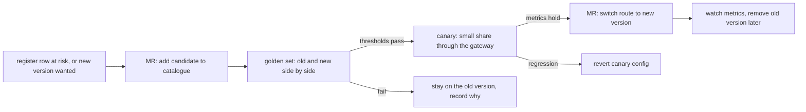

A model behind an auto-updating alias is a dependency with a floating version. When the provider moves the alias to a newer model, every job that uses it changes behaviour on the same day, with no commit, no review and no changelog in your repository: a review bot starts flagging different things, an extraction job's JSON loses a field, a triage summary gets longer and costs more. Provider retirement does the same in the other direction: a pinned ID that reaches its retirement date stops answering. This standard treats model IDs like any other pinned dependency ([[dependency-update-policy]]) and model upgrades like any other production change ([[production-change-checklist]]).

> [!info] Scope
> Written for a platform team that runs one internal LLM gateway ([[llm-api-cost-control]]) in front of one or more providers, with model IDs set in reviewed configuration. The Vertex AI lifecycle behaviour below comes from Google's documentation; for every other provider the rule is the same, but read that provider's own model and deprecation pages. No model names, versions, retirement dates or prices are quoted, on purpose: they change and the sources disagree.

> [!note] Not verified
> Checked only at page level against the Vertex AI "Model versions and lifecycle" page on 2026-10-21, through search summaries, not a full read. Not checked: the notice period before a retirement date, how users are notified, how much warning an alias move gets, and any other provider's behaviour. The gateway routing, canary and audit fields are a generic design, not run against a real gateway. The thresholds and scripts are starting points and illustrations; nothing here was run.

## Why aliases and retirements are change-management problems

Google's Vertex AI documentation describes two ways to name a model:[^vertex]

- **A versioned model ID** names one stable version. Behaviour stays the same until you change the ID, and each stable version has a published **retirement date** after which calls to it fail. Some dates on the page are minimums ("or later"), and changes to dates are announced in the Vertex AI release notes.
- **An auto-updated alias** (a model name without a version suffix) points at the latest stable model in a family and moves when a new one ships. Code that uses the alias can change behaviour without any change on your side.

Other providers use similar ideas under different names. Whatever the provider, there are two failure modes to manage:

| Event                             | What happens without a process                                 | What this standard does                                         |
| --------------------------------- | -------------------------------------------------------------- | --------------------------------------------------------------- |
| Alias moves to a newer model      | Behaviour, output format, latency and cost change silently     | Aliases are banned in production paths; upgrades are explicit   |
| Pinned version reaches retirement | Calls fail on the retirement date; the fix is a rushed upgrade | Retirement dates sit in the EOL register with an owner and plan |
| Provider changes a date           | Nobody notices until it fails                                  | The register row is re-checked on a schedule against the source |

Do not confuse the generative model aliases above with Vertex AI Model Registry aliases, which are a separate feature for models you register yourself.[^registry]

## Rules

1. **Pin an explicit model version in reviewed configuration.** Production paths (CI jobs, bots, services, scheduled agents) name a versioned model ID. Floating aliases ("latest", a family name without a version) are allowed only in sandbox projects and personal experiments.
2. **The gateway owns the mapping.** Clients ask for a logical name (`review-default`, `summarise-small`); the gateway's configuration maps it to a pinned provider model ID. One reviewed file changes the model for every consumer of that logical name, and one revert undoes it.
3. **Every model ID has a register row** in the platform EOL register ([[end-of-life-tracking-platform-versions]]): the ID, its consumers, the retirement date with the date it was last checked, the source URL and an owner.
4. **Inventory consumers from gateway logs, not from memory.** The list of who uses which model comes from what the gateway served in the last 30 days.
5. **An upgrade is a change.** It needs a golden-set evaluation of old and new side by side, agreed thresholds, a canary through the gateway, and a rollback that is one revert.
6. **Every output is traceable.** The audit record of each request carries the logical name, the requested model ID, the model ID the provider reports serving (when it reports one), the prompt version and the gateway policy version.
7. **Exceptions are written down** with an owner and an expiry, as in the Exceptions section below.

## Pinned configuration

Keep the mapping in the gateway's repository, changed only through reviewed merge requests. The model IDs below are placeholders: replace them with the exact versioned IDs from your provider's model page.

```json title="gateway/models.json"
{
  "policy_version": "2026-10-21.1",
  "routes": {
    "review-default": {
      "provider": "vertex-ai",
      "model": "example-model-002",
      "fallback": null,
      "owner": "platform-ai"
    },
    "summarise-small": {
      "provider": "vertex-ai",
      "model": "example-small-001",
      "fallback": null,
      "owner": "platform-ai"
    }
  }
}
```

`fallback` is `null` on purpose. An automatic fallback to a different model is an unreviewed model change at the worst possible moment; if you want one, it goes through the same eval as a normal upgrade and is listed in the register.

A catalogue of approved model IDs, with their lifecycle data, lives next to it:

```json title="gateway/model-catalogue.json"
{
  "example-model-002": {
    "kind": "versioned",
    "retirement": "unknown",
    "retirement_checked": "2026-10-21",
    "source": "https://cloud.google.com/vertex-ai/generative-ai/docs/learn/model-versions"
  },
  "example-small-001": {
    "kind": "versioned",
    "retirement": "unknown",
    "retirement_checked": "2026-10-21",
    "source": "https://cloud.google.com/vertex-ai/generative-ai/docs/learn/model-versions"
  }
}
```

Fill `retirement` with the date from the provider's page (`YYYY-MM-DD`), or leave `unknown` and say so in the register. Never guess a date.

### CI check: no aliases, no unknown models, no surprises

This check runs in the gateway repository on every merge request and on a weekly schedule. It fails when a route uses a model that is not in the catalogue, uses an entry marked `alias`, or uses a model whose retirement date is within the warning window. It uses the Python standard library only.

```python title="scripts/check_models.py (illustrative, not run)"
#!/usr/bin/env python3
"""Fail if a gateway route uses an unpinned, unknown or soon-retired model."""
import datetime as dt
import json
import sys

WARN_DAYS = 90  # change: the lead time your upgrade process needs
RECHECK_DAYS = 90  # change: how often a retirement date must be re-checked against the provider page


def main(routes_path: str, catalogue_path: str) -> int:
    with open(routes_path, encoding="utf-8") as f:
        routes = json.load(f)["routes"]
    with open(catalogue_path, encoding="utf-8") as f:
        catalogue = json.load(f)

    today = dt.date.today()
    errors = []
    for name, route in sorted(routes.items()):
        model = route["model"]
        entry = catalogue.get(model)
        if entry is None:
            errors.append(f"{name}: model {model!r} is not in the catalogue")
            continue
        if entry.get("kind") != "versioned":
            errors.append(f"{name}: model {model!r} is an alias, pin a version")
        checked = dt.date.fromisoformat(entry["retirement_checked"])
        if (today - checked).days > RECHECK_DAYS:
            errors.append(f"{name}: retirement date of {model!r} last checked {checked}, re-check it")
        retirement = entry.get("retirement", "unknown")
        if retirement != "unknown":
            days_left = (dt.date.fromisoformat(retirement) - today).days
            if days_left < WARN_DAYS:
                errors.append(f"{name}: {model!r} retires in {days_left} days ({retirement})")

    for line in errors:
        print(f"ERROR {line}")
    print(f"checked {len(routes)} routes, {len(errors)} problems")
    return 1 if errors else 0


if __name__ == "__main__":
    sys.exit(main(sys.argv[1], sys.argv[2]))
```

```yaml title=".gitlab-ci.yml (excerpt, not run in a pipeline)"
check-models:
  stage: test
  image: python:3-slim # change: pin your standard Python image by digest
  script:
    - python3 -I scripts/check_models.py gateway/models.json gateway/model-catalogue.json
  rules:
    - if: $CI_PIPELINE_SOURCE == "merge_request_event"
    - if: $CI_PIPELINE_SOURCE == "schedule"
```

The scheduled run is what catches a retirement date creeping closer while nobody touches the file. Route its failure to the owning team's queue, not to a pager.

Consumers outside the gateway (a script that calls a provider SDK directly) break rule 2. Find them with a repository search for provider SDK imports and model-name strings, and with the egress rule that only the gateway may reach provider hosts ([[securing-ai-agents-in-ci-and-cloud]]).

## Inventory of consumers

The register needs to know who would be affected by a change to each model. Build that list from the gateway's request log, which already records team, job and model for cost control ([[llm-api-cost-control]]):

```bash title="model-consumers.sh (illustrative, not run)"
set -euo pipefail

LOG_DIR="./gateway-logs"  # change: an export of the last 30 days of gateway request logs, JSON lines

# One line per (logical route, model, team, job) with a request count, most used first.
cat "$LOG_DIR"/*.jsonl \
  | jq -r '[.route, .model_requested, .team, .job_id_prefix] | @tsv' \
  | sort | uniq -c | sort -rn
```

The field names (`route`, `model_requested`, `team`, `job_id_prefix`) are examples; map them to what your gateway writes. Paste the result into the register row's consumers column, or better, have the scheduled job write it. A model with no traffic for 30 days is a candidate for removal from the catalogue.

## Deprecation tracking in the EOL register

Add one row per approved model ID to the same register as Kubernetes, Terraform and base images ([[end-of-life-tracking-platform-versions]]), so model retirements show up in the quarterly review next to everything else:

```yaml title="eol-register.yaml (excerpt)"
- component: LLM route review-default
  product: vertex-ai-model
  cycle: example-model-002 # change: the exact versioned model ID
  eol_source: https://cloud.google.com/vertex-ai/generative-ai/docs/learn/model-versions
  owner: platform-ai
  plan: upgrade eval, see ai/model-version-pinning-and-upgrade-evals
  status: ok
```

- **Source of truth:** the provider's model lifecycle page, plus its release notes for date changes (for Vertex AI, the generative AI release notes).[^notes] Re-check every row at least monthly, and when the provider announces a new model in the family.
- **Status:** `at risk` when retirement is within 90 days, the same rule as other components. Start the upgrade eval at that point at the latest; a forced migration in the final week skips the canary.
- **Notifications:** subscribe the owning team to the provider's deprecation notices, if the provider offers them. How and how early each provider notifies was not verified; do not rely on email alone.

## What counts as a breaking change

A new model version is breaking if any of these move beyond the agreed threshold on the golden set. The thresholds are starting points; set your own from the variance you see when you run the same model twice.

| Dimension               | Measure                                                                          | Starting threshold (adjust)                 |
| ----------------------- | -------------------------------------------------------------------------------- | ------------------------------------------- |
| Output schema adherence | Share of outputs that parse and validate against the expected schema             | No drop at all for machine-read outputs     |
| Task quality            | Golden-set pass rate as scored in [[evaluating-ai-tools-for-a-platform-team]]    | No drop larger than the run-to-run noise    |
| Refusal rate            | Share of cases where the model declines a legitimate task                        | No increase beyond noise                    |
| Safety                  | Results of the injection suite ([[prompt-injection-test-harness-for-ci-agents]]) | No new failures                             |
| Tool-call behaviour     | Tools called per task, and calls outside the expected set                        | No calls outside the expected set           |
| Latency                 | p50 and p95 per request through the gateway                                      | p95 within the job's timeout with headroom  |
| Cost                    | Input and output tokens per task                                                 | Within the team's budget at expected volume |

Output length is the one most often missed: a newer model that writes longer answers costs more, hits `max_tokens` caps and truncates JSON. Track it explicitly.

## Running an upgrade



1. **Open the change.** A merge request that adds the candidate model ID to the catalogue with its lifecycle data, and a change record that names the routes, the consumers from the inventory and the rollback ([[production-change-checklist]]).
2. **Run the golden set offline, old and new side by side.** The same cases, prompts and parameters, on both model IDs, through the gateway so the same caps apply. Run each side more than once if outputs vary between runs, so you can tell a regression from noise.
3. **Compare against the thresholds** with a script, not by eye (below). Attach its output to the merge request.
4. **Canary.** Route a small share of one route's traffic to the new version for a fixed period, for example a working week of normal use. How you split traffic depends on the gateway (weighted routes, per-team routing, a header); it was not tested here. Prefer routing whole teams or whole jobs over random per-request splits, so one pipeline does not see two models at once.
5. **Promote.** A second merge request switches the route to the new ID. That commit is the change; its revert is the rollback.
6. **Clean up.** Keep the old ID in the catalogue until the new one has run cleanly for an agreed period, then remove it and update the register row.

### Comparing two runs

Your eval harness writes one JSON line per case and run. The comparison is then a small, deterministic script:

```text title="results/candidate.jsonl (one JSON object per line, example)"
{"case_id": "mr-0142", "schema_ok": true, "passed": true, "refused": false, "latency_ms": 2840, "tokens_in": 5120, "tokens_out": 410}
```

```python title="scripts/compare_runs.py (illustrative, not run)"
#!/usr/bin/env python3
"""Compare a baseline and a candidate eval run and fail on regressions."""
import json
import statistics
import sys

# Starting thresholds; adjust from your own run-to-run variance.
MAX_PASS_RATE_DROP = 0.02
MAX_SCHEMA_DROP = 0.0
MAX_REFUSAL_RISE = 0.01
MAX_P95_LATENCY_RATIO = 1.25
MAX_TOKENS_OUT_RATIO = 1.20


def load(path):
    with open(path, encoding="utf-8") as f:
        return [json.loads(line) for line in f if line.strip()]


def summary(rows):
    n = len(rows)
    latencies = sorted(r["latency_ms"] for r in rows)
    return {
        "n": n,
        "pass_rate": sum(r["passed"] for r in rows) / n,
        "schema_rate": sum(r["schema_ok"] for r in rows) / n,
        "refusal_rate": sum(r["refused"] for r in rows) / n,
        "p95_latency_ms": statistics.quantiles(latencies, n=20)[-1] if n >= 2 else latencies[0],
        "mean_tokens_out": statistics.fmean(r["tokens_out"] for r in rows),
    }


def main(baseline_path, candidate_path):
    base, cand = summary(load(baseline_path)), summary(load(candidate_path))
    checks = [
        ("pass rate", base["pass_rate"] - cand["pass_rate"] <= MAX_PASS_RATE_DROP),
        ("schema adherence", base["schema_rate"] - cand["schema_rate"] <= MAX_SCHEMA_DROP),
        ("refusal rate", cand["refusal_rate"] - base["refusal_rate"] <= MAX_REFUSAL_RISE),
        ("p95 latency", cand["p95_latency_ms"] <= base["p95_latency_ms"] * MAX_P95_LATENCY_RATIO),
        ("output tokens", cand["mean_tokens_out"] <= base["mean_tokens_out"] * MAX_TOKENS_OUT_RATIO),
    ]
    for key in base:
        print(f"{key:18} baseline={base[key]:.3f} candidate={cand[key]:.3f}")
    failed = [name for name, ok in checks if not ok]
    print("RESULT", "FAIL: " + ", ".join(failed) if failed else "PASS")
    return 1 if failed else 0


if __name__ == "__main__":
    sys.exit(main(sys.argv[1], sys.argv[2]))
```

Make sure both files cover the same `case_id` set before comparing; a candidate run that silently skipped the hard cases will look better than it is. A pass rate on a few dozen cases is noisy, so read the small-sample notes in [[evaluating-ai-tools-for-a-platform-team]] before treating a one-point difference as real.

Retrieval systems need one more check: if the upgrade also changes the embedding model, the stored vectors no longer match the queries. Re-index and re-run the retrieval eval as in [[rag-over-runbooks-for-on-call]]; never mix embeddings from two models in one index.

## Recording the model with every output

An audit or a postmortem asks "which model and which prompt produced this?" The gateway's audit line answers it if it carries these fields:

```json title="audit-line.json (fields to add)"
{
  "route": "review-default",
  "model_requested": "example-model-002",
  "model_served": "example-model-002",
  "prompt_version": "prompts/review.md@3f9c2e1",
  "gateway_policy_version": "2026-10-21.1"
}
```

- `model_served` is what the provider's response says it used, when the response includes such a field. Whether and how each provider reports it was not verified; if it does not, record `null` rather than copying the requested ID.
- `prompt_version` is the path and commit of the prompt file. Prompts are code: they live in a repository and change by merge request, ideally next to the shared skills and workflows that use them ([[agent-skills-and-shared-workflows]]).
- Outputs that are stored (review comments, generated reports, triage summaries) carry the same fields in their metadata, so they can be traced after the logs expire. This also supports the provenance rules in [[ai-generated-code-policy-and-provenance]].
- Traces and SLOs for these requests are in [[llm-observability-tracing-and-slos]].

## Exceptions

| Exception                                | Allowed when                                                 | Conditions                                                                |
| ---------------------------------------- | ------------------------------------------------------------ | ------------------------------------------------------------------------- |
| Alias in a sandbox or experiment         | No production path, no stored output used downstream         | Separate gateway key; never promoted without pinning                      |
| Compressed upgrade before a retirement   | The pinned version retires before a full canary period fits  | Golden set still runs; canary shortened, not skipped; noted in the change |
| Pinned version kept past a warning       | The candidate failed the eval and the retirement date is far | Register status `at risk`, owner and a dated plan                         |
| Direct provider call without the gateway | A vendor product that cannot use the gateway                 | Listed in the register with its own model setting and owner               |

Every exception has an owner and an expiry date, and is reviewed in the same cycle as dependency exceptions ([[dependency-update-policy]]).

## Failure modes

- **Silent alias move.** A consumer bypasses the gateway and uses an alias. Detect it with the egress rule and the repository search; fix it by routing through the gateway.
- **Retirement surprise.** The register row was never re-checked and the provider moved the date. The scheduled check fails on `retirement_checked` older than 90 days.
- **Eval on the wrong set.** The golden set no longer resembles real traffic. Refresh it from recent, reviewed real cases each quarter.
- **Canary leakage.** The canary share is applied per request and one pipeline gets two models. Route by team or job.
- **Fallback roulette.** An automatic fallback model kicks in during a provider incident and outputs change. Keep `fallback` null unless the fallback passed the eval.
- **Untraceable outputs.** Stored results have no model or prompt version. Add the fields before the next upgrade, not after the first incident.

## Rollback

The upgrade is one commit that changes a route's `model`. Rollback is `git revert` of that commit through a normal merge request and a gateway redeploy; the old model ID is still in the catalogue because cleanup waits. Verify the rollback by checking that new audit lines show the old `model_requested` and that the comparison metrics return to the baseline. If the old version has already been retired by the provider, there is no rollback to it: that is why the eval starts at the 90-day warning, not in the last week.

## Checklist

- [ ] Every production route names a versioned model ID; no aliases.
- [ ] Every model ID is in the catalogue and in the EOL register with a checked date and a source URL.
- [ ] The scheduled check runs weekly and its failures reach the owner.
- [ ] The consumer inventory comes from gateway logs and is current.
- [ ] The upgrade has a golden-set comparison attached, run on the same cases for both versions.
- [ ] Schema adherence, quality, refusals, safety, tool calls, latency and tokens all pass their thresholds.
- [ ] The canary routes whole teams or jobs, for a fixed period, with metrics watched.
- [ ] The switch is a single reviewed commit, and its revert has been read and is ready.
- [ ] Audit lines and stored outputs carry the model and prompt versions.

[^vertex]: Google Cloud, "Model versions and lifecycle" for generative AI on Vertex AI; read the current page for the version list, the alias behaviour and the retirement dates.

[^registry]: Vertex AI Model Registry aliases name versions of models you upload to the registry; they are not the generative model aliases described here.

[^notes]: Vertex AI generative AI release notes, where Google announces changes to model availability and dates.

## Sources

- [Model versions and lifecycle](https://cloud.google.com/vertex-ai/generative-ai/docs/learn/model-versions), Vertex AI generative AI documentation: stable and latest stable versions, auto-updated aliases, retirement dates.
- [Generative AI on Vertex AI release notes](https://cloud.google.com/vertex-ai/generative-ai/docs/release-notes): announcements of model and date changes.
- [Model aliases in Vertex AI Model Registry](https://cloud.google.com/vertex-ai/docs/model-registry/model-alias): the separate registry alias feature.

## Related

- [[end-of-life-tracking-platform-versions]]: the register model retirements go into.
- [[dependency-update-policy]]: the same pinning and exception rules for packages and images.
- [[evaluating-ai-tools-for-a-platform-team]]: golden sets, scoring and small-sample statistics.
- [[llm-api-cost-control]]: the gateway, its logs and the token metrics.
- [[llm-observability-tracing-and-slos]]: traces and SLOs for LLM requests.
- [[production-change-checklist]]: the change process an upgrade follows.
- [[rag-over-runbooks-for-on-call]]: re-indexing when the embedding model changes.
- [[prompt-injection-test-harness-for-ci-agents]]: the safety suite in the upgrade eval.
- [the owner's AI skills catalogue](https://ai.szolotov.com): reusable agent skills and workflows.
