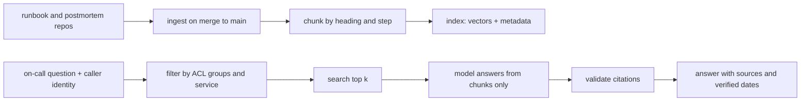

During an incident, "which runbook covers this and what is step three?" is a search problem, and retrieval-augmented generation (RAG) can answer it faster than a wiki search. It also adds new ways to fail: it can show a page the asker may not read, answer from a stale page, blend two services' runbooks, or follow instructions hidden in an indexed page. This note describes a design that handles those cases, and how to test it before on-call depends on it. The incident process is in [[incident-response]] and the safe use of assistants during one is in [[ai-assisted-incident-response]].

> [!info] Scope
> Written for runbooks and postmortems kept as Markdown in repositories, with a retrieval service behind an approved model gateway. Embedding models, vector stores and frameworks are deliberately not named; the controls hold across them. Check the current OWASP LLM list for how it numbers vector and embedding weaknesses.

> [!note] Not verified
> The design has not been built or measured. Unchecked: the filtering features of your vector store, the OWASP numbering, and every threshold. The golden-set gate is how you verify the behaviour in your own environment.

## Architecture: ingest, chunk by step, index with metadata



Ingest runs when a change merges to the default branch, so the index holds only reviewed text. Never index drafts or unmerged branches.

**Chunk by runbook step and heading**, not by a fixed number of characters. A step cut in half ("scale the deployment to zero" separated from "but first check the PDB") is dangerous. Keep each chunk self-contained: include the page title and the heading path at the top of the chunk text. Keep the full previous warning callouts with the step they apply to.

**Index metadata with every chunk:**

| Field           | Use                                                     |
| --------------- | ------------------------------------------------------- |
| `path`          | Citation, and the link the responder opens              |
| `owner`         | Who to ask, and who gets stale-page reports             |
| `service`       | Filtering to the service in the alert                   |
| `last-verified` | Staleness warning ([[verifying-ai-generated-runbooks]]) |
| `acl_groups`    | Who may see the chunk                                   |
| `commit`        | Which version was indexed, for debugging                |

## Access control at retrieval time

The rule is simple and often broken: **filter by the caller's groups in the query, never in the prompt.** If the retrieval returns a chunk the caller may not read, the model has seen it, and a prompt saying "do not reveal restricted content" is not a control.

- Take the caller's identity from the authenticated session (single sign-on), not from a field the client sends.
- Resolve group membership server side at query time, so removals take effect without a re-index.
- Apply the metadata filter inside the vector store query (`acl_groups` intersects caller groups), then search.
- Chunks with no ACL metadata are denied by default.
- Log which chunk paths were returned for each query so access can be reviewed ([[access-reviews-gcp-and-gke]] style) and incidents investigated.
- Postmortems may contain customer data or security details. Give them tighter groups than runbooks, or index only the sections meant for broad reading.

## Citations: no source, no answer

The assistant is allowed to answer only from retrieved chunks, and every answer shows where each statement came from:

- Each answer lists the **source path** and the **last-verified date** of every chunk used.
- A post-processing step checks that each cited path was in the retrieved set. An answer that cites something it was not given is discarded.
- If retrieval returns nothing above your relevance threshold, the answer is "no matching runbook found", with the closest titles. Do not let the model fill the gap from general knowledge during an incident.
- Show the chunk text next to the summary, so the responder can read the original instead of trusting the paraphrase.
- Commands are quoted from the runbook, not regenerated. The assistant never proposes an action that is not in a cited step, and never runs anything. It suggests; a human acts ([[securing-ai-agents-in-ci-and-cloud]]).

## Staleness signals

A confident answer from an old page is the worst outcome. Make age visible and, where it matters, loud:

- Compare `last-verified` with a threshold per service tier. Past the threshold the answer starts with a warning: "This runbook was last verified 2025-11-02 (owner: team-checkout); check commands before running."
- Missing `last-verified` counts as stale.
- Prefer newer chunks when relevance is similar, but never hide an old page that is the only match.
- Detect conflicts: if two retrieved chunks give different steps for the same thing, say so and cite both.
- Send a weekly report of stale pages to their owners; fix the source, not the index.
- After a platform upgrade ([[gke-cluster-upgrade]]) mark affected pages as needing re-verification.

## Indexed pages are untrusted input

Runbooks are written by people, but they also quote logs, alert text and error messages, and anyone who can edit a page can plant text there. A retrieved chunk is data. Treat it like any outside input:

- Put chunks in a delimited block and tell the model the block is data, not instructions.
- Give the assistant no tools beyond retrieval; it cannot call the cluster, post, or change anything, so an injected instruction has nothing to act on.
- Review who can edit indexed repositories; CODEOWNERS on runbook paths matters here.
- Test with planted instructions in sample pages and assert the answer ignores them, as in [[prompt-injection-test-harness-for-ci-agents]].
- Check the current OWASP LLM Top 10 for how it covers prompt injection and vector and embedding weaknesses; the numbering has changed between editions.

## Evaluation with golden questions

Build the evaluation set from your own history. For each of 30 to 50 past incidents, write a question the responder would have asked (using the alert text and the first symptoms) and record the right answer:

| Field          | Example                                                          |
| -------------- | ---------------------------------------------------------------- |
| Question       | "HighErrorRate on checkout after deploy. What do I check first?" |
| Correct source | `runbooks/checkout-rollback.md`, step 2                          |
| Correct step   | Compare the current and previous revision, then roll back        |
| Must not       | Propose a destructive action without a human step                |

Score each run on:

- **Correct step:** the answer contains the right step from the right runbook.
- **Cited source:** the citation matches and was retrieved.
- **No unattended action:** no action is proposed without a human decision.
- **Right service:** retrieved chunks belong to the service in the question.
- **Stale warning shown** when the page is past its threshold.

Also include negative questions with no matching runbook; the correct behaviour is "not found". Run each question several times, since model output varies, and report the rate, not a single run.

## Regression gate in CI

Treat changes to the index, chunking, prompt or model as code changes. A merge request that changes any of them runs the golden set, and the merge is gated on the score with no drop against the stored baseline for each criterion. A "no drop" rule is stricter than a threshold and keeps quality from eroding in small steps.

```yaml title=".gitlab-ci.yml"
rag-eval:
  stage: test
  rules:
    - changes: [rag/**/*, prompts/**/*]
  script:
    - python rag/eval.py --questions golden/questions.jsonl --repeat 3 --out score.json
    - python rag/compare.py --baseline golden/baseline.json --candidate score.json --max-drop 0
  artifacts:
    paths: [score.json]
    expire_in: 14 days
```

Re-baseline deliberately, in its own merge request, after a major runbook rewrite or a service rename, because the correct sources changed. Keep the golden questions in version control and add a case from every incident where the assistant was wrong.

## Failure modes

- **The wrong service's runbook.** Two services with similar names and similar steps. Filter by `service` from the alert labels, and show the service in the answer's first line.
- **Lost permissions.** A user left a group but the index kept their access. Resolve groups at query time, not at index time.
- **Silent index failure.** The ingest job broke and the index is weeks old. Alert on index age, and show the index commit in answers.
- **Over-confident paraphrase.** The model softens a warning. Quote warning callouts verbatim.
- **Context stuffing.** Too many chunks dilute the answer. Cap k and prefer fewer, better-filtered chunks.
- **Cost and latency in an incident.** Set timeouts and a fallback to plain keyword search; the assistant must degrade to "search results" and never to "nothing".
- **Leaked sensitive pages.** Treat ACL bugs as security incidents and keep the retrieval log.

## Sources

- [OWASP Top 10 for LLM applications](https://genai.owasp.org/llm-top-10/), OWASP GenAI Security Project.
- [Effective Troubleshooting](https://sre.google/sre-book/effective-troubleshooting/), Site Reliability Engineering, Google.

## Related

- [[ai-assisted-incident-response]]: what to automate during an incident and what never to.
- [[incident-response]]: the process the assistant supports.
- [[blameless-postmortems]]: the source of many golden questions.
- [[verifying-ai-generated-runbooks]]: keeping the indexed pages trustworthy.
- [[prompt-injection-test-harness-for-ci-agents]]: testing the injection cases.
- [[securing-ai-agents-in-ci-and-cloud]]: access and egress controls for the service.
- [[on-call-health]]: whether the assistant reduces load.
- [the owner's AI skills catalogue](https://ai.szolotov.com): reusable agent skills and workflows.
