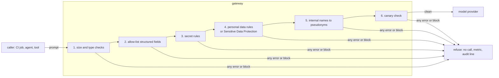

Every useful LLM workflow in operations sends real data: log lines for triage ([[llm-log-analysis-and-alert-triage]]), Terraform plans for review ([[llm-assisted-terraform-plan-review]]), incident timelines, runbook excerpts. Each of those notes says "redact first", and each team then writes its own regular expressions, in its own script, with its own gaps. This note describes one shared redaction layer instead: it runs in the gateway so every caller gets it, it combines field allow-lists, deterministic secret rules and (where classification demands it) Google Cloud Sensitive Data Protection, it **fails closed**, and it is tested with a seeded corpus and canaries so you know it works rather than hope so.

> [!info] Scope
> A platform team running one internal LLM gateway ([[llm-api-cost-control]]) in front of managed or self-hosted models. The code is a Python standard-library sketch of the gateway hook; port it to your gateway's language. What counts as personal or regulated data, and whether redaction or pseudonymisation is enough for a given purpose, is for your data protection officer and security team to decide; see [[pci-dss-and-gdpr-for-devops-logs-and-data]].

> [!note] Not verified
> The two Python files below were run locally (Python 3.13, standard library only) and their seven tests pass; nothing else was run. Not confirmed against current documentation: every Sensitive Data Protection API name, field, infoType name, transformation and limit shown below (the pages under Sources were not opened for this note), its latency and quotas for inline use, whether its responses or logs can contain the matched value, and the accuracy of the illustrative secret patterns (take real ones from your secret scanner's maintained rule set). Detection quality of any layer, meaning its false negatives and false positives on your data, is unknown until you measure it with your own corpus.

## What must not leave

Decide per category what the gateway does. The default for anything unclassified is to redact; the default for credentials is to block.

| Category                   | Examples                                                                                               | Default action                                                                |
| -------------------------- | ------------------------------------------------------------------------------------------------------ | ----------------------------------------------------------------------------- |
| Credentials and keys       | Private keys, cloud access keys, CI and Git tokens, JWTs, `Authorization` headers, passwords in config | Block the call, or redact for routes that must keep working; alert either way |
| Customer and personal data | Emails, names, phone numbers, addresses, account and card numbers, IPs tied to users                   | Redact; tokenize only when the answer must be mapped back                     |
| Regulated data             | Cardholder data, health data, anything your classification marks restricted                            | Block on routes not approved for it                                           |
| Internal topology          | Internal hostnames, private IP plans, project and cluster names                                        | Replace with stable pseudonyms per request, if policy says so                 |
| Free text from outsiders   | Request bodies, user agents, form fields, ticket text                                                  | Scan like everything else; also treat as possible prompt injection            |

The point of a table is that it is reviewed and versioned. Keep the policy file next to the gateway configuration and change it through merge requests.

## Where the filter runs



Put it in the gateway, not in each client:

- **Every caller gets it**, including the next tool someone builds without reading this note.
- **One rule set**, updated once, tested once.
- **Clients cannot skip it**, because only the gateway holds provider credentials and egress to providers is blocked for everything else ([[securing-ai-agents-in-ci-and-cloud]]).

Clients should still send less: summarise and cluster logs before the call, send diffs rather than files. Redaction is the safety net, not the design.

## Layer 1: allow-list structured fields

For structured input (JSON logs, plan JSON, events), do not try to find the bad fields. Keep the known good ones and drop the rest. A new field that appears in a log next month is dropped until someone decides it is safe, which is the right default. The field names follow [[structured-logging-conventions]].

`filter_json_log` in the module below does this for log lines. For Terraform plans the equivalent is to keep resource addresses, actions and the names of changed attributes, and drop values marked sensitive or unknown.

## Layer 2: deterministic secret rules

Credentials have recognisable shapes, and you already maintain rules for them: the secret scanner in your pipelines ([[secret-scanning-pre-commit-and-ci]]). Use the same rule set in the gateway so a token format added there is caught here too. Load the rules from the scanner's configuration file at startup instead of copying them by hand; if loading fails, the gateway does not start.

The module below has a few illustrative patterns to show the mechanics. They are not a complete or authoritative set.

## Layer 3: personal data, and Sensitive Data Protection where required

Regular expressions catch structured identifiers (emails, IP addresses) reasonably well and names, addresses and free-text personal data poorly. Where your data classification requires better coverage, call Google Cloud Sensitive Data Protection (the service formerly known as Cloud DLP) from the gateway to inspect and de-identify text. It detects built-in **infoTypes** and custom ones you define, and offers transformations such as masking, replacing a finding with its infoType name, and tokenization. It is a billed service; read its pricing page before sending every prompt through it.

An illustrative de-identify request (field and infoType names not verified; check the de-identification guide and the infoType reference before use):

```json title="deidentify-request.json"
{
  "inspectConfig": {
    "infoTypes": [
      { "name": "EMAIL_ADDRESS" },
      { "name": "PHONE_NUMBER" },
      { "name": "PERSON_NAME" }
    ]
  },
  "deidentifyConfig": {
    "infoTypeTransformations": {
      "transformations": [{ "primitiveTransformation": { "replaceWithInfoTypeConfig": {} } }]
    }
  },
  "item": { "value": "Ticket from Jane Doe, jane.doe@example.com, asked about invoice 4471." }
}
```

```bash title="deidentify.sh"
set -euo pipefail

PROJECT_ID="example-project"    # change: the project that holds the gateway
LOCATION="europe-west4"         # change: the region your data may be processed in

curl -sS -X POST \
  -H "Authorization: Bearer $(gcloud auth print-access-token)" \
  -H "Content-Type: application/json" \
  "https://dlp.googleapis.com/v2/projects/${PROJECT_ID}/locations/${LOCATION}/content:deidentify" \
  -d @deidentify-request.json
```

There is no `gcloud dlp` command group in the Cloud SDK checked for this note (SDK 570.0.0 rejects it), so use the REST API, a client library or Terraform for templates. Things to settle before you depend on it:

- **Where it runs.** Choose a regional location that matches your residency decision, and check whether the service can be restricted inside the same VPC Service Controls perimeter as the model calls ([[vertex-ai-private-access-from-gke]]).
- **Latency and quota.** An inline call adds a network round trip to every prompt. Measure it, and decide what happens when the service is slow or unavailable: under this pattern, the prompt is blocked, not sent unscanned.
- **What it returns and logs.** Make sure inspection results that include the matched text are not written to your own logs.

### Reversible tokenization only when needed

Masking and replacing are one-way, which is what you want in most cases. Sometimes the answer must point back to the real thing ("customer 3 has the failing payments"), and only then use reversible tokenization:

- Prefer an **in-memory pseudonym map per request** in the gateway (`host-1`, `customer-3`), applied in reverse to the response before it goes back to the caller. Nothing reversible ever leaves the gateway, and nothing is stored. The module below does this for internal hostnames.
- If tokens must be stable across requests, use deterministic encryption with a key held in Cloud KMS ([[cloud-kms-key-management]]); Sensitive Data Protection documents cryptographic transformations for this. Keep the re-identification permission on a different identity from the one that de-identifies, and log every re-identification.

Pseudonymised data is generally still personal data for data protection purposes; it lowers risk, it does not take the data out of scope. Ask your data protection officer.

## Fail closed

A redaction layer that sends the original prompt when it hits an error is worse than none, because everyone believes it works. The rules:

- Any exception in any layer means **no call**. The client gets a clear, non-retryable error (`redaction_failed`), the gateway counts it and writes an audit line.
- **Too big to scan means blocked**, not "skip scanning". Set the size limit from measurement, and ask callers to send less.
- **Non-text input** (images, PDFs, archives) is blocked on every route that has not been explicitly approved for it, because the text rules do not see inside it.
- A **timeout** of an external detector is an error, so it blocks.
- **Canaries.** Unique marker strings planted in test data and in a few real places (a test secret in a staging log, a fake customer record) must never survive the filter. If one does, the call is blocked and the alert says the filter has a gap.

The module, standard library only:

```python title="redact.py"
"""Fail-closed redaction for prompts sent through the LLM gateway (standard library only)."""
import json
import re
from dataclasses import dataclass, field

MAX_SCAN_BYTES = 200_000   # larger prompts are blocked, never sent unscanned

# Illustrative rules. Load the real set from the same maintained rule file your secret scanner uses.
SECRET_RULES = {
    "private-key": re.compile(r"-----BEGIN [A-Z ]*PRIVATE KEY-----[\s\S]*?(-----END [A-Z ]*PRIVATE KEY-----|$)"),
    "aws-access-key-id": re.compile(r"\b(AKIA|ASIA)[0-9A-Z]{16}\b"),
    "github-token": re.compile(r"\bgh[pousr]_[A-Za-z0-9]{36,}\b"),
    "gitlab-token": re.compile(r"\bglpat-[A-Za-z0-9_-]{20,}"),
    "google-api-key": re.compile(r"\bAIza[0-9A-Za-z_-]{35}\b"),
    "jwt": re.compile(r"\beyJ[A-Za-z0-9_-]{10,}\.[A-Za-z0-9_-]{10,}\.[A-Za-z0-9_-]{10,}"),
    "bearer-header": re.compile(r"(?i)\bauthorization:\s*bearer\s+[A-Za-z0-9._~+/=-]{16,}"),
    "password-assignment": re.compile(r"(?i)\b(password|passwd|secret|api[_-]?key|token)\s*[:=]\s*['\"]?[^\s'\"]{8,}"),
}
PERSONAL_RULES = {
    "email": re.compile(r"\b[A-Za-z0-9._%+-]+@[A-Za-z0-9.-]+\.[A-Za-z]{2,}\b"),
    "ipv4": re.compile(r"\b(?:\d{1,3}\.){3}\d{1,3}\b"),
}
INTERNAL_HOST = re.compile(r"\b[a-z0-9-]+(?:\.[a-z0-9-]+)*\.internal\.example\.com\b")   # change: your internal domains

SAFE_LOG_FIELDS = {"ts", "severity", "service", "namespace", "pod", "container", "message",
                   "error_code", "http_status", "route", "duration_ms", "trace_id"}


class RedactionError(Exception):
    """Any failure in the filter. The gateway turns it into a blocked request."""


@dataclass
class Result:
    text: str
    counts: dict = field(default_factory=dict)
    blocked_reason: str = ""


def filter_json_log(line: str) -> str:
    """Keep only allow-listed fields of a structured log line; drop everything else."""
    record = json.loads(line)
    if not isinstance(record, dict):
        raise RedactionError("log line is not a JSON object")
    return json.dumps({k: v for k, v in record.items() if k in SAFE_LOG_FIELDS}, sort_keys=True)


def redact(text: str, policy: dict) -> Result:
    if not isinstance(text, str):
        raise RedactionError("prompt is not text")
    if len(text.encode("utf-8")) > MAX_SCAN_BYTES:
        return Result("", {}, "too_large_to_scan")
    counts = {}
    hosts = {}

    def sub(rule_name, pattern, replacement, value):
        def repl(match):
            counts[rule_name] = counts.get(rule_name, 0) + 1
            return replacement(match) if callable(replacement) else replacement
        return pattern.sub(repl, value)

    out = text
    for name, pattern in SECRET_RULES.items():
        out = sub(name, pattern, f"[REDACTED:{name}]", out)
    if any(counts.get(n) for n in SECRET_RULES) and policy.get("on_secret") == "block":
        return Result("", counts, "secret_detected")
    for name, pattern in PERSONAL_RULES.items():
        out = sub(name, pattern, f"[REDACTED:{name}]", out)
    out = sub("internal-host", INTERNAL_HOST,
              lambda m: hosts.setdefault(m.group(0), f"host-{len(hosts) + 1}"), out)
    for canary in policy.get("canaries", ()):
        if canary in out:
            return Result("", counts, "canary_survived")
    return Result(out, counts)


def guarded_redact(text: str, policy: dict) -> Result:
    """Fail closed: an exception anywhere means the request is not sent."""
    try:
        return redact(text, policy)
    except Exception as exc:  # noqa: BLE001 - deliberately broad: any failure blocks
        return Result("", {}, f"redaction_error:{type(exc).__name__}")
```

`redact` returns redacted text and per-rule counts, or a block reason. The gateway sends the request only when `blocked_reason` is empty, and records the counts as metrics. A route can choose `on_secret: block` (no call when a credential is found) or `redact` (strip it and continue); either way a found credential raises an alert, because it means a credential was somewhere it should not be, and the owner should rotate it ([[leaked-credential-rotation]]).

## Tests: a seeded corpus and canaries

The filter is security-critical code, so it is tested like it. The minimum suite seeds one example of every rule into a prompt, asserts that none survives, asserts that a canary blocks the call, and forces an internal error to prove the filter fails closed:

```python title="test_redact.py"
"""Seeded-corpus tests: no canary or seeded secret may reach the provider."""
import unittest
from unittest import mock

import redact

CANARIES = ["CANARY-7f3c9a1e-do-not-send"]
POLICY = {"on_secret": "redact", "canaries": CANARIES}
# Seeded values are assembled at runtime so no secret-shaped literal sits in the repository.
SEEDED = {
    "private-key": "-----BEGIN " + "RSA PRIVATE KEY-----\nTESTONLYTESTONLY\n-----END " + "RSA PRIVATE KEY-----",
    "aws-access-key-id": "AKIA" + "TESTONLY" + "00000000",
    "github-token": "ghp_" + "T" * 36,
    "gitlab-token": "glpat-" + "t" * 20,
    "google-api-key": "AIza" + "x" * 35,
    "jwt": "eyJ" + "a" * 20 + "." + "b" * 20 + "." + "c" * 20,
    "email": "jane.doe@example.com",
    "ipv4": "203.0.113.42",
}


class SeededCorpus(unittest.TestCase):
    def test_every_seeded_value_is_removed(self):
        for rule, value in SEEDED.items():
            with self.subTest(rule=rule):
                result = redact.guarded_redact(f"error near {value} in request", POLICY)
                self.assertEqual(result.blocked_reason, "")
                self.assertNotIn(value, result.text)
                self.assertIn(f"[REDACTED:{rule}]", result.text)

    def test_canary_blocks_the_call(self):
        result = redact.guarded_redact(f"note: {CANARIES[0]}", POLICY)
        self.assertEqual(result.blocked_reason, "canary_survived")
        self.assertEqual(result.text, "")

    def test_secret_policy_block(self):
        result = redact.guarded_redact(SEEDED["aws-access-key-id"], {"on_secret": "block"})
        self.assertEqual(result.blocked_reason, "secret_detected")

    def test_fails_closed_on_internal_error(self):
        with mock.patch.object(redact, "redact", side_effect=RuntimeError("boom")):
            result = redact.guarded_redact("anything", POLICY)
        self.assertTrue(result.blocked_reason.startswith("redaction_error"))
        self.assertEqual(result.text, "")

    def test_too_large_is_blocked_not_skipped(self):
        result = redact.guarded_redact("a" * (redact.MAX_SCAN_BYTES + 1), POLICY)
        self.assertEqual(result.blocked_reason, "too_large_to_scan")

    def test_internal_hosts_become_stable_pseudonyms(self):
        text = "db-1.internal.example.com timed out; retried db-1.internal.example.com then cache.internal.example.com"
        result = redact.guarded_redact(text, POLICY)
        self.assertEqual(result.text, "host-1 timed out; retried host-1 then host-2")

    def test_json_log_allow_list(self):
        line = '{"ts":"2026-10-21T09:00:00Z","message":"timeout","user_email":"jane.doe@example.com","card":"x"}'
        self.assertEqual(redact.filter_json_log(line), '{"message": "timeout", "ts": "2026-10-21T09:00:00Z"}')


if __name__ == "__main__":
    unittest.main()
```

Run it with `python3 -m unittest test_redact` in CI on every change to the rules or the policy. Then go further:

- **A real corpus.** Collect a few hundred prompts of the kinds you send (log batches, plans, incident notes), seed them with known values of every category, and measure how many seeded values survive. That number is your measured false negative rate; track it per category over time.
- **The provider side.** In an integration test, point the gateway at a mock provider that records request bodies, send the seeded corpus through the full gateway, and assert that no seeded value or canary appears in what the mock received. This tests the wiring, not just the function.
- **Injection overlap.** The same seeded prompts are a good place for planted instructions; combine with [[prompt-injection-test-harness-for-ci-agents]].
- **False positives.** Measure how often useful content is destroyed (a commit SHA mistaken for a token, a version string mistaken for an IP address). A filter that makes answers useless gets bypassed.

## Metrics, logs and alerts

- `llm_gateway_redactions_total{rule, team}`: what is being found, and by whom.
- `llm_gateway_blocked_requests_total{reason, team}`: `secret_detected`, `too_large_to_scan`, `canary_survived`, `redaction_error:*`.
- Alert on any `canary_survived` (filter gap), on `redaction_error` above zero for more than a few minutes (the filter is broken and everything is blocked), and on a sudden rise of `secret_detected` for one team (a credential is being pasted around).
- **Never log the matched value**, not even partly masked. Log the rule name, the count and a hash of the request, as in the audit line in [[llm-api-cost-control]], with the field names from [[structured-logging-conventions]].

Keep `rule` and `reason` as fixed lists so the metrics stay low-cardinality.

## Limits

Be honest with users about what this does not do:

- **False negatives are certain.** New token formats, secrets split across lines or encoded in base64, personal data in free text, data in another language, data inside code. The filter reduces risk; it does not remove it. The allow-list layer is the only one that is close to complete, and only for structured input.
- **Context leaks.** Even with every identifier removed, the remaining text can identify a customer or reveal an incident. Data classification decides which routes may send which sources at all.
- **The provider's own retention** still applies to whatever you send; for Vertex AI see the data governance section of [[vertex-ai-private-access-from-gke]].
- **Images and documents** are out of scope here; block them unless a route is specifically designed and approved for them.

## Rollout and rollback

1. **Shadow mode.** Run the filter on live traffic, record counts and would-be blocks, change nothing. Read the results with the teams that own the routes.
2. **Redact.** Turn on redaction route by route; watch the false positive reports and answer quality.
3. **Block** credentials and canaries everywhere, and regulated data on routes not approved for it.

Rollback is a policy change in Git: a route that breaks goes back to shadow mode for personal data rules while the rule is fixed. Credential rules and fail-closed behaviour are never rolled back to "off"; if they block a legitimate workflow, fix the rule or the workflow.

## Sources

- [De-identifying sensitive data](https://cloud.google.com/sensitive-data-protection/docs/deidentify-sensitive-data), Sensitive Data Protection documentation.
- [InfoType detector reference](https://cloud.google.com/sensitive-data-protection/docs/infotypes-reference), Sensitive Data Protection documentation.
- [Transformation reference](https://cloud.google.com/sensitive-data-protection/docs/transformations-reference), Sensitive Data Protection documentation.
- [Sensitive Data Protection pricing](https://cloud.google.com/sensitive-data-protection/pricing): it is billed; read the current page.
- [gitleaks](https://github.com/gitleaks/gitleaks): the scanner whose rule set the gateway can share; check its current configuration format.

## Related

- [[secret-scanning-pre-commit-and-ci]]: the rule set to share with the gateway.
- [[pci-dss-and-gdpr-for-devops-logs-and-data]]: what counts as regulated data, and redaction at the source.
- [[llm-log-analysis-and-alert-triage]]: a main consumer of this filter.
- [[llm-assisted-terraform-plan-review]]: another consumer, with its own allow-list.
- [[llm-api-cost-control]]: the gateway this runs in.
- [[cloud-kms-key-management]]: keys for reversible tokenization.
- [[structured-logging-conventions]]: field names for the allow-list and the audit line.
- [[prompt-injection-test-harness-for-ci-agents]]: seeded test inputs for injection.
- [[llm-observability-tracing-and-slos]]: why prompt content capture stays off in traces.
- [the owner's AI skills catalogue](https://ai.szolotov.com): reusable agent skills and workflows.
