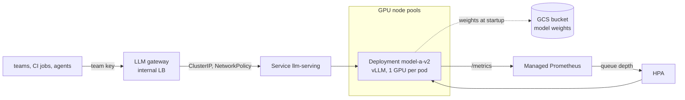

A managed model API is the default: no GPUs to buy, no drivers to patch, no capacity to chase. Some workloads still belong inside your own cluster: data that may not leave the VPC, a steady high volume where per-token pricing loses to GPU-hours, a fine-tuned open-weights model, or latency that a shared public endpoint cannot hold. This note describes how to run that on GKE so it behaves like any other production service: a dedicated GPU node pool, a pinned model server with an OpenAI-compatible API, model weights loaded through Workload Identity, autoscaling on queue depth, Spot capacity with a safe floor, and a rollback that is one Service change.

> [!info] Scope
> GKE Standard, NVIDIA GPUs, and [vLLM](https://docs.vllm.ai/) as the model server. The same structure fits other servers (the GKE tutorials also use others), but the metric names and flags differ. No GPU prices, GPU memory sizes, model sizes or per-region availability are quoted: they change often and differ by region, so check the GKE GPU page and the pricing page for your region before sizing anything. Behind this service sits the shared gateway from [[llm-api-cost-control]]; clients never call the model server directly.

> [!note] Not verified
> Nothing here was run against a real cluster. The `gcloud container node-pools create` flags were read from the local `--help` text of Google Cloud SDK 570.0.0; the rest comes from official documentation read only as search excerpts on 2026-10-21. Not confirmed: whether `cloud.google.com/gke-accelerator` is the documented node selector on GKE Standard (only the Autopilot page was seen), the vLLM `/health` endpoint and every vLLM flag other than `--api-key`, the vLLM and Cloud SDK container image names and tags, the example GPU type and machine type pair, the `gmp-system` namespace for the managed collectors, the labels and taints GKE puts on Spot nodes, the Workload Identity setup for the Cloud Storage FUSE driver, the exact custom metric name the adapter exposes to the HPA for a Managed Service for Prometheus metric, and every HPA `behavior` value below (they are design starting points). Check the current pages under Sources before you copy anything.

## When to self-host and when to use a managed API

| Question            | Managed API (for example Vertex AI)                                 | Self-hosted on GKE                                                        |
| ------------------- | ------------------------------------------------------------------- | ------------------------------------------------------------------------- |
| Where does data go? | To the provider's endpoint, under its data terms and region options | Stays in your VPC and your nodes                                          |
| Which models?       | The provider's catalogue                                            | Any open-weights or fine-tuned model your licence allows                  |
| Cost shape          | Per token, scales to zero                                           | Per GPU-hour, whether or not it is busy                                   |
| Capacity            | Shared pool or purchased throughput; 429s when it is short          | Your GPU quota and the zone's stock; pods stay Pending when it is short   |
| Operations          | Retries, quotas, data settings                                      | Drivers, node upgrades, model loading, autoscaling, on-call for all of it |
| Latency control     | Limited to region choice                                            | Full: placement, batching, dedicated capacity                             |

Self-host when at least one of the left-hand constraints is hard (data residency or classification, a model only you have, a latency target) or when measured volume makes GPU-hours cheaper than tokens at your utilisation. Measure first: an idle GPU pool is the most expensive way to serve nothing. The private managed path on GCP is in [[vertex-ai-private-access-from-gke]].

## Architecture



- The gateway owns authentication, per-team budgets, caps and the kill switch ([[llm-api-cost-control]]). The model server is never exposed outside the cluster.
- Each model version is its own Deployment. The Service selects one of them; switching versions or rolling back is a selector change.
- Weights come from a versioned GCS bucket (or an artifact repository, see [[model-artifacts-in-artifactory]]), read with Workload Identity, never baked into the container image.

## GPU node pools

Keep GPUs in their own node pools, tainted so that only inference pods land there, and let them scale down when idle. Before creating the pool, check that the project has Compute Engine GPU quota for the type in that zone: the GKE GPU page says to request at least the autoscaler's maximum node count times the GPUs per node.

```bash title="create-gpu-node-pool.sh"
set -euo pipefail

PROJECT_ID="example-project"         # change: the cluster's project
CLUSTER="example-cluster"            # change: an existing GKE Standard cluster with Workload Identity enabled
LOCATION="europe-west4"              # change: the cluster's region
NODE_LOCATIONS="europe-west4-a"      # change: zones that offer the GPU type (see the list command below)
GPU_TYPE="nvidia-l4"                 # change: a type from `gcloud compute accelerator-types list`
MACHINE_TYPE="g2-standard-8"         # change: a machine type the GKE GPU page lists for that GPU type
MAX_NODES=4                          # change: the most nodes you have quota and budget for

# Which GPU types exist in the zone:
gcloud compute accelerator-types list --project="$PROJECT_ID" --filter="zone:${NODE_LOCATIONS}"

gcloud container node-pools create gpu-inference \
  --project="$PROJECT_ID" \
  --cluster="$CLUSTER" \
  --location="$LOCATION" \
  --node-locations="$NODE_LOCATIONS" \
  --machine-type="$MACHINE_TYPE" \
  --accelerator="type=${GPU_TYPE},count=1,gpu-driver-version=default" \
  --node-taints="dedicated=llm-inference:NoSchedule" \
  --node-labels="workload=llm-inference" \
  --workload-metadata=GKE_METADATA \
  --ephemeral-storage-local-ssd=count=1 \
  --enable-autoscaling --min-nodes=0 --max-nodes="$MAX_NODES"
```

What each part is for:

- **`--accelerator`.** `type` is required; `count` defaults to 1. `gpu-driver-version` is `default`, `latest` (Container-Optimized OS only) or `disabled` (you install drivers yourself, for example with the NVIDIA GPU Operator). The help text says `default` became the default from GKE 1.30.1-gke.1156000, and `disabled` was the default before that; check the GPU page for your version rather than relying on the default.
- **The taint and label.** GKE documents its own `nvidia.com/gpu=present:NoSchedule` taint for GPU pools in clusters that also have non-GPU pools, and adds a matching toleration to pods that request GPUs. That keeps CPU workloads off the GPUs but lets any GPU pod in. The extra `dedicated=llm-inference` taint and `workload=llm-inference` label reserve this pool for inference, so a batch job with a GPU request cannot take its nodes.
- **`--workload-metadata=GKE_METADATA`.** Pods reach the GKE metadata server, which is what makes Workload Identity work for the model download ([[gke-workload-identity]]).
- **`--ephemeral-storage-local-ssd`.** Backs the node's ephemeral storage with local SSD, so an `emptyDir` holding the weights is fast and does not fill the boot disk.
- **`--min-nodes=0`.** No idle GPUs at night. The cost is a cold start (node creation, driver, image pull, weight load) when traffic comes back; see the autoscaling section for when a floor of one is worth paying for.

Upgrades of GPU pools follow [[gke-node-pool-upgrade-strategies]]; surge upgrades need spare GPU quota for the surge node, so check that before an upgrade window, or use a blue-green pool change.

Other flags exist that may fit (`--reservation` with `--reservation-affinity`, `--flex-start`, `--enable-image-streaming`, `--secondary-boot-disk`, GPU sharing via `gpu-sharing-strategy` and multi-instance GPUs via `gpu-partition-size`). Only the names were read; check the reference before using them.

## The model server Deployment

One Deployment per model version, one GPU per pod (multi-GPU tensor parallelism is a separate design). The server takes its API key from a Secret so only the gateway can call it, and the NetworkPolicy below is the real access control.

```bash title="deploy-model.sh"
set -euo pipefail

NAMESPACE="llm-serving"
RELEASE="model-a-v2"                                 # change: model name and version; one Deployment per version
KSA="llm-server"                                     # the Kubernetes service account that reads the weights
: "${VLLM_IMAGE:?set VLLM_IMAGE to the vLLM OpenAI-compatible server image you evaluated, pinned by digest}"
: "${MODEL_URI:?set MODEL_URI to the versioned gs:// prefix that holds this model version}"

kubectl apply -f - <<EOF
apiVersion: apps/v1
kind: Deployment
metadata:
  name: ${RELEASE}
  namespace: ${NAMESPACE}
  labels: { app: llm-server, release: ${RELEASE} }
spec:
  replicas: 1
  selector:
    matchLabels: { app: llm-server, release: ${RELEASE} }
  template:
    metadata:
      labels: { app: llm-server, release: ${RELEASE} }
    spec:
      serviceAccountName: ${KSA}
      priorityClassName: llm-serving
      terminationGracePeriodSeconds: 60
      nodeSelector:
        workload: llm-inference
      tolerations:
        - { key: dedicated, operator: Equal, value: llm-inference, effect: NoSchedule }
        - { key: nvidia.com/gpu, operator: Exists, effect: NoSchedule }
      initContainers:
        - name: fetch-weights
          image: gcr.io/google.com/cloudsdktool/google-cloud-cli:slim  # pin by digest
          command: ["gcloud", "storage", "cp", "--recursive", "${MODEL_URI}/*", "/models/"]
          volumeMounts:
            - { name: models, mountPath: /models }
      containers:
        - name: vllm
          image: ${VLLM_IMAGE}
          command: ["vllm", "serve", "/models", "--host", "0.0.0.0", "--port", "8000"]
          env:
            - name: VLLM_API_KEY
              valueFrom:
                secretKeyRef: { name: llm-server-api-key, key: key }
          ports:
            - { name: http, containerPort: 8000 }
          resources:
            requests: { cpu: "4", memory: 24Gi }   # change: measure; the weights are loaded into host memory on the way to the GPU
            limits:
              memory: 24Gi
              nvidia.com/gpu: 1
          startupProbe:
            httpGet: { path: /health, port: http }
            periodSeconds: 10
            failureThreshold: 180    # tolerates about 30 minutes of loading (10 s x 180)
          readinessProbe:
            httpGet: { path: /health, port: http }
            periodSeconds: 5
            failureThreshold: 3
          livenessProbe:
            httpGet: { path: /health, port: http }
            periodSeconds: 15
            failureThreshold: 4
          volumeMounts:
            - { name: models, mountPath: /models, readOnly: true }
            - { name: dshm, mountPath: /dev/shm }
      volumes:
        - name: models
          emptyDir: {}               # on local SSD because of --ephemeral-storage-local-ssd
        - name: dshm
          emptyDir: { medium: Memory, sizeLimit: 2Gi }
EOF
```

Points that matter in production:

- **GPUs are limits only.** Kubernetes requires the GPU count under `limits`; a `requests` value is copied from it, must be equal if set, and fractions are not allowed. Pods schedule onto a node only after the NVIDIA device plugin advertises `nvidia.com/gpu`, which is why a fresh node takes a while to accept the pod. CPU and memory are sized separately, see [[kubernetes-resource-requests-and-limits]].
- **Probes sized for long loads.** Liveness and readiness do not start until the startup probe succeeds, and the startup probe never runs again after that. The tolerated start time is roughly `periodSeconds x failureThreshold`, here about 30 minutes. Measure your real cold start and set it with margin: a startup probe that is too short restarts the pod forever, which looks like a crash loop on a healthy pod. The `/health` path is not confirmed here; check the vLLM documentation for the version you run.
- **The API key is not enough.** vLLM's newer documentation says `--api-key` (or `VLLM_API_KEY`) protects only the `/v1`, `/v2` and `/inference` paths; other endpoints are unauthenticated. Keep the server reachable only from the gateway.
- **`/dev/shm`.** A memory-backed `emptyDir` gives the server shared memory beyond the container default; it counts against the pod's memory.
- **Pin everything.** The image by digest, the model by a versioned `gs://` prefix, and the vLLM flags in the manifest. vLLM metric names and flags have changed between releases; an unpinned `latest` breaks dashboards and HPAs on its own.

### Weights through Workload Identity

Grant the Kubernetes service account read access to the one bucket, with no service account key:

```bash title="grant-weights-read.sh"
set -euo pipefail

PROJECT_ID="example-project"
PROJECT_NUMBER="$(gcloud projects describe "$PROJECT_ID" --format='value(projectNumber)')"
BUCKET="example-project-model-weights"   # change: the bucket that holds the versioned model prefixes
NAMESPACE="llm-serving"
KSA="llm-server"

kubectl create namespace "$NAMESPACE" --dry-run=client -o yaml | kubectl apply -f -
kubectl -n "$NAMESPACE" create serviceaccount "$KSA" --dry-run=client -o yaml | kubectl apply -f -

gcloud storage buckets add-iam-policy-binding "gs://${BUCKET}" \
  --member="principal://iam.googleapis.com/projects/${PROJECT_NUMBER}/locations/global/workloadIdentityPools/${PROJECT_ID}.svc.id.goog/subject/ns/${NAMESPACE}/sa/${KSA}" \
  --role="roles/storage.objectViewer"
```

The principal form and its caveats are in [[gke-workload-identity]]. Turn on object versioning or retention on the bucket so the model a Deployment was tested with cannot be overwritten under it.

### Choosing how weights reach the GPU

| Option                                 | Good for                                                  | Watch out for                                                                                   |
| -------------------------------------- | --------------------------------------------------------- | ----------------------------------------------------------------------------------------------- |
| Copy to local SSD in an init container | Simple, predictable, works everywhere                     | Every new pod downloads the full model; cold start grows with model size                        |
| Cloud Storage FUSE CSI driver          | No copy step; the docs describe preloading and file cache | Needs its own sidecar and IAM setup (not verified here); tune parallel download for large files |
| Hyperdisk ML volume                    | Many pods reading the same weights, read-only-many        | Zonal; suits weights that change rarely; a new model means a new disk                           |
| Weights baked into the image           | Nothing                                                   | Huge images, slow pulls, and the model version is hidden inside an image tag                    |

Google's documentation positions Cloud Storage FUSE as regional and better for frequently updated data, and Hyperdisk ML as zonal and better for data that changes rarely. Start with the init-container copy, measure the cold start, and move only if it is the bottleneck.

## Network exposure

The model server is an internal backend:

```yaml title="llm-serving-network.yaml"
apiVersion: v1
kind: Service
metadata:
  name: llm-serving
  namespace: llm-serving
spec:
  type: ClusterIP
  selector: { app: llm-server, release: model-a-v2 } # switching versions changes only this line
  ports:
    - { name: http, port: 80, targetPort: http }
---
apiVersion: networking.k8s.io/v1
kind: NetworkPolicy
metadata:
  name: llm-server-ingress
  namespace: llm-serving
spec:
  podSelector:
    matchLabels: { app: llm-server }
  policyTypes: [Ingress]
  ingress:
    - from:
        - namespaceSelector:
            matchLabels: { kubernetes.io/metadata.name: llm-gateway }
      ports:
        - { port: 8000, protocol: TCP }
    - from:
        - namespaceSelector:
            matchLabels: { kubernetes.io/metadata.name: gmp-system }
      ports:
        - { port: 8000, protocol: TCP }
```

The second rule lets the managed Prometheus collectors scrape `/metrics`; adjust it to where your collectors run ([[kubernetes-network-policies]]). Egress from the serving namespace needs only the Google APIs for the weights; the cluster-wide egress pattern is in [[private-gke-and-controlled-egress]].

## Autoscaling on queue depth

CPU utilisation says nothing about a GPU server. Google's inference autoscaling guidance recommends the model server's **queue size** as the signal when you optimise throughput and cost within a latency target: start with a target between 3 and 5 waiting requests per pod and raise it until latency becomes unacceptable; for targets under 10, tune the HPA's scale-up behaviour. Queue size does not cap concurrency, so the gateway still needs its own concurrency limits.

vLLM exposes Prometheus metrics on `/metrics` with a `vllm:` prefix, including the gauges `vllm:num_requests_waiting` and `vllm:num_requests_running` and the histogram `vllm:time_to_first_token_seconds`. Scrape them with Managed Service for Prometheus ([[0042-managed-prometheus-for-application-metrics]]):

```yaml title="llm-podmonitoring.yaml"
apiVersion: monitoring.googleapis.com/v1
kind: PodMonitoring
metadata:
  name: llm-server
  namespace: llm-serving
spec:
  selector:
    matchLabels: { app: llm-server }
  endpoints:
    - port: http
      path: /metrics
      interval: 15s
```

Then point an HPA at the waiting-requests metric. The HPA reads it through a custom metrics adapter (the GKE how-to uses the Custom Metrics Stackdriver Adapter); the metric name the adapter exposes depends on the adapter and must be checked against the GKE how-to for your setup.

```yaml title="llm-hpa.yaml"
apiVersion: autoscaling/v2
kind: HorizontalPodAutoscaler
metadata:
  name: model-a-v2
  namespace: llm-serving
spec:
  scaleTargetRef: { apiVersion: apps/v1, kind: Deployment, name: model-a-v2 }
  minReplicas: 1
  maxReplicas: 4 # never above the GPU node pool's max
  metrics:
    - type: Pods
      pods:
        metric:
          name: prometheus.googleapis.com|vllm:num_requests_waiting|gauge # not verified: confirm with the adapter docs
        target: { type: AverageValue, averageValue: "4" }
  behavior:
    scaleUp:
      stabilizationWindowSeconds: 0
      policies: [{ type: Pods, value: 1, periodSeconds: 60 }]
    scaleDown:
      stabilizationWindowSeconds: 900 # a new pod costs a long cold start; do not give it back quickly
      policies: [{ type: Pods, value: 1, periodSeconds: 300 }]
```

Design notes ([[kubernetes-autoscaling]] covers HPA and the cluster autoscaler in general):

- **Scale-up is slow by nature.** A new pod may need a new GPU node, the driver, the image and the weights. If your latency target cannot absorb that, keep `minReplicas` and the pool's minimum at one or more during working hours and accept the idle cost; let the gateway queue or shed load meanwhile ([[timeouts-retries-load-shedding]]).
- **`maxReplicas` must match quota.** An HPA that asks for more pods than the pool can hold leaves pods Pending and makes the queue metric look worse, which asks for even more.
- **Scale to zero** is possible with the node pool at `--min-nodes=0`, but the HPA keeps at least `minReplicas` pods; scaling the Deployment itself to zero needs a scheduled job or an event-driven autoscaler, and the first request after that waits for the whole cold start.

## Spot GPUs and preemption

Spot GPU nodes are cheaper and can be reclaimed at any time. Google's Spot VM page describes roughly 30 seconds from notice to shutdown; with the default graceful node shutdown, regular pods get about 15 seconds and system pods the rest, and a larger `terminationGracePeriodSeconds` does not add time. The page has described an extension in Preview for newer versions; check the current page, since the timings have changed between revisions.

A pattern that survives this:

- A small **on-demand pool** sized for the minimum you must always serve, plus a **Spot pool** (`--spot` on a second pool with the same taint and label) for burst capacity.
- A **PriorityClass** so the guaranteed replicas are not displaced by burst replicas ([[priority-classes-and-preemption]]):

```yaml title="llm-priority.yaml"
apiVersion: scheduling.k8s.io/v1
kind: PriorityClass
metadata:
  name: llm-serving
value: 100000
globalDefault: false
description: Model servers; above batch and dev workloads, below platform components.
```

- A **PodDisruptionBudget** helps with drains and upgrades, but not with Spot reclamation: the VM is going away regardless.
- **Clients retry through the gateway.** A request in flight on a reclaimed node fails; the gateway retries once on another replica with backoff, and a streaming response that was cut off is reported as an error, not silently truncated.
- **Spread** replicas across zones that have the GPU type so one zone's stockout or reclamation wave does not take everything ([[topology-spread-constraints-gke]]).

## Capacity, quota and reservations

GPU capacity fails in two different ways, and the fix differs:

- **Quota.** The project has no GPU quota for the type in that zone, or not enough. Pods stay Pending, the autoscaler logs that it cannot scale up, and node pool creation or resize fails with a quota error. Request more quota per zone and per type before a launch; free-trial accounts get none by default.
- **Stock.** Quota is approved, but the zone has no GPUs to give right now; the error says the zone does not have enough resources. That is capacity, not permission: try another zone that offers the type, retry later, or use a reservation.

For a service with a latency SLO, reserve capacity (`--reservation-affinity=specific --reservation=NAME` on the node pool) for the floor and use on-demand or Spot above it. Keep the cost visible as its own line: label the pools and the namespace so GPU-hours show up per team in the showback from [[finops-cost-allocation-and-guardrails]], and compare GPU-hours per million tokens served with what the managed API would have cost at the same volume.

## Rollout and rollback

Treat a new model, a new vLLM version and new server flags as production changes:

1. Deploy the new version as its own Deployment (`model-a-v3`) next to the old one; nothing routes to it yet.
2. Run the evaluation set against it directly through a port-forward or a test route in the gateway ([[model-version-pinning-and-upgrade-evals]]).
3. Shift a share of traffic in the gateway, or switch the Service selector for all of it.
4. Keep the old Deployment running, at least at one replica, until the new one has held its SLO for an agreed period.

```bash title="switch-model.sh"
set -euo pipefail

NAMESPACE="llm-serving"
TARGET="model-a-v3"     # change: the release to route to; set it back to the previous release to roll back

kubectl -n "$NAMESPACE" rollout status deployment/"$TARGET" --timeout=30m
kubectl -n "$NAMESPACE" patch service llm-serving --type=merge \
  -p "{\"spec\":{\"selector\":{\"app\":\"llm-server\",\"release\":\"${TARGET}\"}}}"
kubectl -n "$NAMESPACE" get endpointslices -l kubernetes.io/service-name=llm-serving -o wide
```

Rollback is the same command with the previous release name. It is instant only while the previous Deployment still has ready pods; if it was scaled to zero, rollback waits for a full cold start, which is the main reason to keep it warm during the bake period.

## Validation

None of these were run for this note; they are the checks to run after each change.

```bash title="validate-llm-serving.sh"
set -euo pipefail

NAMESPACE="llm-serving"
RELEASE="model-a-v2"

# Nodes: the GPU is allocatable and the taint and label are there.
kubectl get nodes -l workload=llm-inference
kubectl describe nodes -l workload=llm-inference | grep -E 'nvidia.com/gpu|Taints'

# The pod sees the GPU.
POD="$(kubectl -n "$NAMESPACE" get pods -l release="$RELEASE" -o jsonpath='{.items[0].metadata.name}')"
kubectl -n "$NAMESPACE" exec "$POD" -c vllm -- nvidia-smi

# The API answers with the key, through a port-forward (no external exposure).
kubectl -n "$NAMESPACE" port-forward "pod/${POD}" 8000:8000 &
PF_PID=$!
trap 'kill "$PF_PID"' EXIT
sleep 3
API_KEY="$(kubectl -n "$NAMESPACE" get secret llm-server-api-key -o jsonpath='{.data.key}' | base64 -d)"
curl -sS -H "Authorization: Bearer ${API_KEY}" http://127.0.0.1:8000/v1/models
# Without the key this should be refused:
curl -sS -o /dev/null -w '%{http_code}\n' http://127.0.0.1:8000/v1/models
# Metrics for the HPA:
curl -sS http://127.0.0.1:8000/metrics | grep -E '^vllm:num_requests_(waiting|running)'
```

Then check the HPA sees the metric: `kubectl -n llm-serving describe hpa model-a-v2` should show a current value, not `<unknown>`. Finally run a short load test through the gateway ([[load-and-performance-testing]]) and watch time to first token and the queue.

## Troubleshooting

| Symptom                                                         | Likely cause                                                                  | How to confirm and fix                                                                                                                |
| --------------------------------------------------------------- | ----------------------------------------------------------------------------- | ------------------------------------------------------------------------------------------------------------------------------------- |
| Pod `Pending`, events say `Insufficient nvidia.com/gpu`         | No GPU node yet, the pool is at max, or the device plugin is not ready yet    | `kubectl describe pod`; check the autoscaler's events and the pool's max; wait a few minutes on a fresh node                          |
| Autoscaler cannot add nodes                                     | GPU quota in the zone, or a stockout                                          | Node pool and autoscaler events; quota page for the type and zone; try another zone, request quota, or reserve                        |
| Pod lands on a GPU node meant for something else, or not at all | Taint, toleration and node selector do not match                              | `kubectl describe node` for taints and labels; compare with the pod spec                                                              |
| Container restarts during model load                            | Startup probe window shorter than the real load time, or memory limit too low | `kubectl describe pod` shows probe failures or `OOMKilled`; raise `failureThreshold` or memory after measuring                        |
| CUDA out-of-memory in the server log                            | Model, context length or batch does not fit the GPU                           | Server log; reduce context length or batch settings (check the flag names for your vLLM version), or use a larger GPU                 |
| Slow cold start                                                 | Image pull, weight download, or a new node                                    | Pod events with timestamps for each step; image streaming or secondary boot disk for the image, local SSD or Hyperdisk ML for weights |
| HPA shows `<unknown>` for the metric                            | Adapter not installed, wrong metric name, or the scrape is blocked            | `kubectl get --raw` on the custom metrics API; the PodMonitoring status; the NetworkPolicy for the collectors                         |
| Latency rises with low queue depth                              | Long prompts or outputs, not load                                             | Compare token histograms at the gateway ([[llm-observability-tracing-and-slos]]); cap prompt and output size at the gateway           |
| Requests fail in bursts on Spot nodes                           | Reclamation                                                                   | Node events show preemption; keep the on-demand floor; retry once at the gateway                                                      |
| Driver errors after an upgrade                                  | Driver version changed with the node image                                    | Node pool `gpu-driver-version` setting and the GKE release notes; upgrade a canary pool first                                         |

For general pod failures see [[kubernetes-pod-troubleshooting]]; for nodes under memory or disk pressure, [[node-resource-pressure-triage]].

## Sources

- [Run GPUs in GKE Standard node pools](https://docs.cloud.google.com/kubernetes-engine/docs/how-to/gpus), Google Cloud documentation: quota, driver installation, taints.
- [About GPUs in GKE](https://docs.cloud.google.com/kubernetes-engine/docs/concepts/gpus), Google Cloud documentation.
- [Serve Gemma open models using GPUs on GKE with vLLM](https://docs.cloud.google.com/kubernetes-engine/docs/tutorials/serve-gemma-gpu-vllm), Google Cloud tutorial (model and GPU lists change; read the current version).
- [Best practices for autoscaling LLM inference workloads with GPUs](https://docs.cloud.google.com/kubernetes-engine/docs/best-practices/machine-learning/inference/autoscaling), Google Cloud documentation.
- [Spot VMs in GKE](https://docs.cloud.google.com/kubernetes-engine/docs/concepts/spot-vms), Google Cloud documentation: preemption notice and graceful shutdown.
- [Cloud Storage FUSE CSI driver](https://docs.cloud.google.com/kubernetes-engine/docs/concepts/cloud-storage-fuse-csi-driver), Google Cloud documentation.
- [Schedule GPUs](https://kubernetes.io/docs/tasks/manage-gpus/scheduling-gpus/), Kubernetes documentation.
- [Configure liveness, readiness and startup probes](https://kubernetes.io/docs/tasks/configure-pod-container/configure-liveness-readiness-probes/), Kubernetes documentation.
- [OpenAI-compatible server](https://docs.vllm.ai/en/latest/serving/openai_compatible_server.html) and [metrics](https://docs.vllm.ai/en/latest/design/metrics/), vLLM documentation.
- `gcloud container node-pools create --help`, Google Cloud SDK 570.0.0: the node pool flags used above.

## Related

- [[llm-api-cost-control]]: the gateway in front of this service.
- [[vertex-ai-private-access-from-gke]]: the managed alternative on GCP, called privately.
- [[kubernetes-autoscaling]]: HPA and cluster autoscaler behaviour.
- [[gke-workload-identity]]: keyless access to the weights bucket.
- [[priority-classes-and-preemption]]: keeping guaranteed replicas ahead of burst.
- [[gke-node-pool-upgrade-strategies]]: upgrading GPU pools.
- [[kubernetes-resource-requests-and-limits]]: CPU and memory sizing next to the GPU.
- [[private-gke-and-controlled-egress]]: egress for the serving namespace.
- [[finops-cost-allocation-and-guardrails]]: GPU-hours in showback.
- [[model-artifacts-in-artifactory]]: storing and promoting model weights.
- [[llm-observability-tracing-and-slos]]: latency, queue and token signals.
- [the owner's AI skills catalogue](https://ai.szolotov.com): reusable agent skills and workflows.
