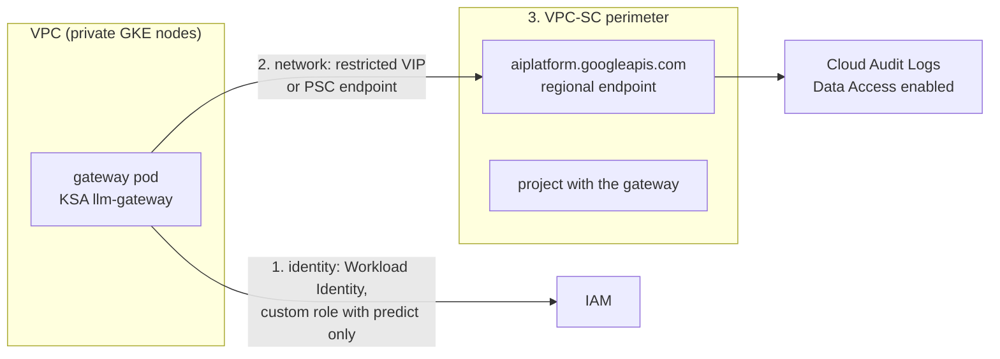

The managed path on GCP is Vertex AI: no GPUs to run, and the same project, IAM and logging you already use. "Managed" does not mean "private" by default. A pod with a downloaded service account key, calling the public endpoint through Cloud NAT, works on day one and fails every review after that. This note hardens the path the gateway in [[llm-api-cost-control]] uses as its upstream: a keyless identity with one narrow permission, a private network path to Google APIs, a VPC Service Controls perimeter rolled out in dry run first, a deliberate region choice, retries that respect quota, and audit logs that prove who called what.

> [!info] Scope
> GKE Standard or Autopilot with Workload Identity Federation for GKE, calling generative models on Vertex AI from one gateway workload. Self-hosting instead is in [[self-hosted-llm-inference-on-gke]]. No quotas, request rates, prices, model names or region lists are quoted: they change per model and per region, so read them from the current pages under Sources.

> [!note] Not verified
> Nothing was run against a real project. The `gcloud access-context-manager` and `gcloud compute addresses` and `forwarding-rules` flags were read from the local `--help` text of Google Cloud SDK 570.0.0; the rest comes from official pages read only as search excerpts on 2026-10-21 (some of them from translated copies). Not confirmed: what `roles/aiplatform.user` contains in full, whether `aiplatform.endpoints.predict` alone covers every call your models need, the exact Data Access log type for prediction calls and whether those entries hold prompt text, whether CMEK covers prompts and responses, which other services (Cloud Storage, Logging, Artifact Registry, GKE) your perimeter must also restrict, the DNS names for a Private Service Connect endpoint, the `gcloud dns` and egress firewall commands, per-model quota names, Google's recommended backoff values, the exact text of the VPC Service Controls error, the `generateContent` REST path for your model family, and whether the Cloud SDK `slim` image ships `curl` and `getent`. Test each step in a sandbox project first.

## The three layers



Each layer covers a different failure. Identity limits what a stolen token can do. The network path keeps the traffic off the internet and lets you remove public egress. The perimeter stops data leaving even when an identity is over-privileged or a token is used from outside. Audit logs show what actually happened.

## Identity: Workload Identity and one permission

Only the gateway calls Vertex AI. Teams and agents call the gateway with their own keys; they get no Vertex AI role at all. That keeps the permission on one identity you can monitor ([[gcp-iam-guardrails-for-agent-service-accounts]]).

Google's generative AI access-control page names `roles/aiplatform.user` and `roles/aiplatform.admin`, says prompt requests need `aiplatform.endpoints.predict`, and notes that predefined roles often carry more than a workload needs, with a custom role holding only that permission as its example. Do that:

```bash title="vertex-identity.sh"
set -euo pipefail

PROJECT_ID="example-project"                      # change: the project that calls Vertex AI
PROJECT_NUMBER="$(gcloud projects describe "$PROJECT_ID" --format='value(projectNumber)')"
NAMESPACE="llm-gateway"
KSA="llm-gateway"

gcloud iam roles create vertexPredictOnly \
  --project="$PROJECT_ID" \
  --title="Vertex AI predict only" \
  --description="Send prompt requests to Vertex AI models; nothing else" \
  --permissions="aiplatform.endpoints.predict" \
  --stage=GA

gcloud projects add-iam-policy-binding "$PROJECT_ID" \
  --member="principal://iam.googleapis.com/projects/${PROJECT_NUMBER}/locations/global/workloadIdentityPools/${PROJECT_ID}.svc.id.goog/subject/ns/${NAMESPACE}/sa/${KSA}" \
  --role="projects/${PROJECT_ID}/roles/vertexPredictOnly" \
  --condition=None
```

- **No keys.** The pod gets short-lived tokens from the GKE metadata server ([[gke-workload-identity]]). Enforce the organisation policy that disables service account key creation so nobody "fixes" an error with a key.
- **Shared pool caveat.** With principal identifiers the workload identity pool is shared by every cluster in the project, so the same namespace and service account name in another cluster gets the same access. Keep the gateway's namespace name unique to the cluster that should have it, or keep inference callers in a dedicated project.
- **Fallback.** If a call fails with a permission error although the role is bound, the API may not accept federated principals for that use; impersonate a Google service account instead, as described in [[gke-workload-identity]].
- **Check what you grant.** Before choosing between the custom role and `roles/aiplatform.user`, look at what the predefined role contains: `gcloud iam roles describe roles/aiplatform.user --format='value(includedPermissions)'`.

## Network path: Private Google Access or Private Service Connect

Private GKE nodes have no external addresses. They reach Google APIs either through Private Google Access on the subnet and one of Google's virtual IP ranges, or through a Private Service Connect endpoint with an internal address of your choosing. The surrounding egress design is in [[private-gke-and-controlled-egress]].

| Option                          | What the docs say                                                  | When to use it                                                             |
| ------------------------------- | ------------------------------------------------------------------ | -------------------------------------------------------------------------- |
| `restricted.googleapis.com` VIP | `199.36.153.4/30`; only APIs that support VPC Service Controls     | Inside a perimeter: anything outside the supported set fails closed        |
| `private.googleapis.com` VIP    | `199.36.153.8/30`; most Google APIs                                | No perimeter, or workloads that need APIs VPC-SC does not support          |
| PSC endpoint, bundle `vpc-sc`   | Same APIs as the restricted VIP, on an internal address you choose | You want your own address, hybrid reachability, or per-VPC routing control |
| PSC endpoint, bundle `all-apis` | Same APIs as the private VIP                                       | As above, without the VPC-SC restriction                                   |

Do not mix addresses from the two VIP ranges. For either VIP you need DNS that resolves `*.googleapis.com` to the VIP, a route to the range, and an egress firewall rule that allows it.

```bash title="restricted-vip.sh"
set -euo pipefail

PROJECT_ID="example-project"
NETWORK="example-vpc"               # change: the VPC the GKE nodes use
REGION="europe-west4"               # change: the nodes' region
SUBNET="gke-nodes"                  # change: the nodes' subnet

gcloud compute networks subnets update "$SUBNET" --project="$PROJECT_ID" \
  --region="$REGION" --enable-private-ip-google-access

# Private zone so googleapis.com names resolve to the restricted VIP inside this VPC.
gcloud dns managed-zones create googleapis-restricted --project="$PROJECT_ID" \
  --dns-name="googleapis.com." --visibility=private --networks="$NETWORK" \
  --description="Google APIs through restricted.googleapis.com"
gcloud dns record-sets create "restricted.googleapis.com." --project="$PROJECT_ID" \
  --zone=googleapis-restricted --type=A --ttl=300 \
  --rrdatas=199.36.153.4,199.36.153.5,199.36.153.6,199.36.153.7
gcloud dns record-sets create "*.googleapis.com." --project="$PROJECT_ID" \
  --zone=googleapis-restricted --type=CNAME --ttl=300 --rrdatas="restricted.googleapis.com."

# Route and firewall, needed when the default internet route or a deny-all egress rule is in place.
gcloud compute routes create google-apis-restricted --project="$PROJECT_ID" \
  --network="$NETWORK" --destination-range=199.36.153.4/30 \
  --next-hop-gateway=default-internet-gateway
gcloud compute firewall-rules create allow-egress-google-apis-restricted --project="$PROJECT_ID" \
  --network="$NETWORK" --direction=EGRESS --action=ALLOW --rules=tcp:443 \
  --destination-ranges=199.36.153.4/30 --priority=1000
```

A private zone for all of `googleapis.com` captures every Google API name in that VPC, including the ones that are not supported behind the restricted VIP. Run it in a test VPC first and check every workload there still works.

The Private Service Connect alternative, from the `gcloud` help examples. The endpoint cannot be changed after creation (delete and recreate it), and each one counts toward a per-VPC quota:

```bash title="psc-google-apis.sh"
set -euo pipefail

PROJECT_ID="example-project"
NETWORK="example-vpc"
PSC_ADDRESS="10.110.0.10"     # change: an unused internal address outside every subnet range in the VPC

gcloud compute addresses create psc-google-apis --project="$PROJECT_ID" \
  --global --purpose=PRIVATE_SERVICE_CONNECT --addresses="$PSC_ADDRESS" --network="$NETWORK"
gcloud compute forwarding-rules create pscvpcsc --project="$PROJECT_ID" \
  --global --network="$NETWORK" --address=psc-google-apis \
  --target-google-apis-bundle=vpc-sc
```

You still need DNS records that send the API names to the endpoint; follow the Private Service Connect for Google APIs page for the names it expects. Endpoint names have their own format rules; check the page if `forwarding-rules create` rejects the name.

## VPC Service Controls: dry run, then enforce

Google's Vertex AI VPC-SC page says that with `aiplatform.googleapis.com` as a restricted service, public internet access to Vertex AI is blocked and protected artifacts include Gemini models and online inference requests; private access goes through Private Service Connect or Private Google Access. Some Vertex AI features need extra network setup inside a perimeter (the page lists vector search querying, the custom training data plane, Pipelines and private online prediction endpoints), and Pipelines components cannot install from public PyPI inside one. Read the page before you enforce if the project uses any of those.

The perimeter design itself (access levels, ingress and egress rules, who may use the console) is in [[zero-trust-access-iap-and-vpc-service-controls]]. The rollout is the same audit-then-enforce idea as [[policy-rollout-audit-to-enforce]]:

```bash title="vpc-sc-dry-run.sh"
set -euo pipefail

POLICY_ID="123456789012"                  # change: your access policy ID (gcloud access-context-manager policies list --organization=ORG_ID)
PERIMETER="llm_inference"
PROJECT_NUMBER="111111111111"             # change: the number of the project that holds the gateway

# Read the flags first; a new perimeter may need more of them than shown here.
gcloud access-context-manager perimeters dry-run create --help >/dev/null

gcloud access-context-manager perimeters dry-run create "$PERIMETER" \
  --policy="$POLICY_ID" \
  --perimeter-title="LLM inference" \
  --perimeter-type=regular \
  --perimeter-resources="projects/${PROJECT_NUMBER}" \
  --perimeter-restricted-services="aiplatform.googleapis.com"

gcloud access-context-manager perimeters dry-run describe "$PERIMETER" --policy="$POLICY_ID"
```

`gcloud` keeps the dry-run configuration in the perimeter's `spec`. Two details from the help text matter: without an explicit dry-run configuration, the enforced configuration is used as the dry-run one and no dry-run audit logs appear; and `dry-run enforce` copies the dry-run configuration into enforcement and clears it, refusing to run when there is none. Whether to add `storage.googleapis.com`, `logging.googleapis.com` or other services to the same perimeter is a design decision; check each against the [supported products](https://docs.cloud.google.com/vpc-service-controls/docs/supported-products) list (`gcloud access-context-manager supported-services list` shows it too). Adding a service changes behaviour for every caller of that service in the project.

While in dry run, violating requests succeed and are logged. Read them for at least a full business cycle (nightly jobs, month-end jobs):

```bash title="vpc-sc-violations.sh"
set -euo pipefail

PROJECT_ID="example-project"
gcloud logging read --project="$PROJECT_ID" --freshness=7d --limit=50 \
  'protoPayload.metadata."@type"="type.googleapis.com/google.cloud.audit.VpcServiceControlAuditMetadata"' \
  --format='table(timestamp, protoPayload.serviceName, protoPayload.methodName, protoPayload.metadata.violationReason, protoPayload.metadata.dryRun)'
```

For longer analysis, route the `cloudaudit.googleapis.com%2Fpolicy` log to BigQuery as the dry-run page describes. When the only remaining violations are ones you intend to block:

```bash title="vpc-sc-enforce.sh"
set -euo pipefail

POLICY_ID="123456789012"
PERIMETER="llm_inference"
gcloud access-context-manager perimeters dry-run enforce "$PERIMETER" --policy="$POLICY_ID"
```

> [!warning] Enforcing blocks real traffic
> Once enforced, any caller of Vertex AI from outside the perimeter is refused, including developers using the console or notebooks from their laptops unless an access level or ingress rule allows them. Announce the change, keep an ingress rule ready for the break-glass group, and enforce outside peak hours. Manage the perimeter in Terraform so the enforced state is reviewed and can be reverted by a commit.

## Regions and data residency

Pick the region before you build, because it decides where requests are processed:

- **Regional endpoint.** A request to a region's endpoint is processed in that region or multi-region, according to the data residency page. Regional endpoints that the page's residency tables do not list carry no processing guarantee.
- **Global endpoint** (location `global`). Google says it can improve availability and reduce 429 errors, but you cannot control the processing region, so it advises against it when you have ML-processing residency requirements. The page also lists features the global endpoint does not support; read the current list before you route a workload to it.
- **Data at rest** stays in the location you selected.

Record the choice and its reason as a decision, configure it in the gateway (one region per model, not chosen by the caller), and make "region" a label on the gateway's metrics so a change shows up. Model availability differs by region; check the locations page for each model before committing.

## Data governance and CMEK

Read Google's generative AI data governance page and record what applies to you; do not rely on a summary. The points from it that most often change a design:

- Google states it does not train on customer data without permission.
- Gemini caches inputs and outputs in memory by default, isolated per project, for a limited time; caching can be disabled per project, and zero data retention requires disabling it.
- Abuse-monitoring prompt logging applies to some billing and terms categories, and an exception can be requested.
- Features such as session resumption and grounding have their own retention terms.

For encryption at rest, Vertex AI encrypts by default, and customer-managed encryption keys cover resources such as datasets, models and endpoints. CMEK for Vertex AI does not configure CMEK for other products you use alongside it. Whether it applies to prompts and responses of generative model calls was not confirmed; check the CMEK page before promising it to anyone. Key management itself is in [[cloud-kms-key-management]].

Sending less is the strongest control: redact secrets and personal data in the gateway before the call ([[redacting-sensitive-data-before-llm-calls]]).

## Quotas and 429s

Two kinds of 429 look similar and need different fixes:

| Response                                    | Meaning (from Google's throughput pages)                   | What to do                                                                                         |
| ------------------------------------------- | ---------------------------------------------------------- | -------------------------------------------------------------------------------------------------- |
| 429 on pay-as-you-go ("resource exhausted") | The shared pool had no capacity at that moment             | Retry with capped exponential backoff and jitter; consider the global endpoint if residency allows |
| 429 on Provisioned Throughput               | Requests exceeded what you reserved; overages are rejected | Spill over to pay-as-you-go, smooth the load, or buy more throughput                               |
| 429 from your own project quota             | Your project's quota for that model and region is used up  | Request a quota increase for that region; spread load across regions only if residency allows      |

Google's documentation tells you to build retry logic for the shared-pool case. Keep retries in the gateway, not in every client, so one place controls them ([[timeouts-retries-load-shedding]]):

- At most a few attempts with capped exponential backoff and full jitter; respect a `Retry-After` header if the response has one.
- A circuit breaker per model and region: after a burst of 429s, fail fast for a short period instead of queueing everyone.
- Never retry 400, 403 or `PERMISSION_DENIED`: they will not change.
- Count 429s as their own metric by model and region; a steady rate means a quota request, not more retries.

## Audit logs

Admin Activity audit logs are always on and cannot be disabled. Data Access audit logs are off by default and must be enabled; Google's Vertex AI audit logging page says to enable them to get logs of model endpoint usage. Enable them for `aiplatform.googleapis.com` in the project's IAM policy:

```yaml title="audit-config-fragment.yaml"
# Merge into the policy from `gcloud projects get-iam-policy`, keeping its etag,
# then apply it with `gcloud projects set-iam-policy PROJECT_ID policy.yaml`.
auditConfigs:
  - service: aiplatform.googleapis.com
    auditLogConfigs:
      - logType: DATA_READ
      - logType: DATA_WRITE
```

> [!warning] set-iam-policy replaces the whole policy
> `set-iam-policy` writes the complete policy, bindings included. Always edit the file you just fetched, keep the `etag` so a concurrent change makes the write fail instead of being overwritten, and prefer managing audit configuration in Terraform.

Data Access logs can be large; check the volume after a day and set retention and exclusions deliberately. Reading the `data_access` stream needs `roles/logging.privateLogViewer`. Route these logs to your SIEM with the rest of the audit trail ([[gcp-audit-logs-siem]]).

## Validation

Run a test request from a pod that uses the gateway's Kubernetes service account, then confirm the audit entry. The access token is used once in the pod and never printed or logged.

```bash title="validate-vertex-private.sh"
set -euo pipefail

PROJECT_ID="example-project"
REGION="europe-west4"                 # change: the region you chose
NAMESPACE="llm-gateway"
KSA="llm-gateway"
: "${MODEL:?set MODEL to a model ID that the Vertex AI locations page lists for REGION}"

kubectl -n "$NAMESPACE" run vertex-check --rm -i --restart=Never \
  --image=gcr.io/google.com/cloudsdktool/google-cloud-cli:slim \
  --overrides="{\"spec\":{\"serviceAccountName\":\"${KSA}\"}}" \
  --env="PROJECT_ID=${PROJECT_ID}" --env="REGION=${REGION}" --env="MODEL=${MODEL}" \
  -- bash -c '
    set -euo pipefail
    getent hosts "${REGION}-aiplatform.googleapis.com"   # expect an address in 199.36.153.4/30 or your PSC address
    curl -sS -X POST \
      -H "Authorization: Bearer $(gcloud auth print-access-token)" \
      -H "Content-Type: application/json" \
      "https://${REGION}-aiplatform.googleapis.com/v1/projects/${PROJECT_ID}/locations/${REGION}/publishers/google/models/${MODEL}:generateContent" \
      -d "{\"contents\":[{\"role\":\"user\",\"parts\":[{\"text\":\"Reply with the word ok.\"}]}]}" \
      | head -c 400
  '

# A few minutes later, the call should appear in the Data Access log.
gcloud logging read --project="$PROJECT_ID" --freshness=1h --limit=5 \
  'protoPayload.serviceName="aiplatform.googleapis.com" AND logName:"cloudaudit.googleapis.com%2Fdata_access"' \
  --format='table(timestamp, protoPayload.methodName, protoPayload.authenticationInfo)'
```

Then the negative tests, which matter more than the positive one:

1. The same request from a pod with a different Kubernetes service account fails with `PERMISSION_DENIED`.
2. After enforcement, the same request from outside the perimeter (a workstation without an access level) fails with a VPC Service Controls error that carries a unique identifier.
3. With public egress removed, `getent hosts` in the pod never returns a public Google address for the API name.

The REST path above follows the documented `generateContent` pattern for publisher models; check the current API reference for your model family.

## Troubleshooting

| Symptom                                                           | What it means                                                                     | How to confirm and fix                                                                                                                                           |
| ----------------------------------------------------------------- | --------------------------------------------------------------------------------- | ---------------------------------------------------------------------------------------------------------------------------------------------------------------- |
| `PERMISSION_DENIED` on the call                                   | The identity lacks the permission, or the principal string is wrong               | Check the binding's project number, namespace and service account name; describe the custom role; try the GSA fallback                                           |
| `Request is prohibited by organization's policy` with a unique ID | VPC Service Controls refused it                                                   | Search the audit logs for the identifier (read the field name from your own entry; Google's page and samples spell it differently) and read the violation reason |
| `RESOURCES_NOT_IN_SAME_SERVICE_PERIMETER`                         | Caller and target are in different perimeters                                     | Put both in the same perimeter or add ingress and egress rules                                                                                                   |
| `NO_MATCHING_ACCESS_LEVEL`                                        | The caller's IP, device or identity matches no access level or ingress rule       | Add an ingress rule for that identity, or call from inside the perimeter                                                                                         |
| Timeouts on connect                                               | DNS points to a VIP with no route or no egress firewall rule, or to the wrong VIP | `getent hosts` in the pod; the route and firewall rule above; never mix the two VIP ranges                                                                       |
| A non-Vertex API now fails in the same VPC                        | The restricted VIP or the `vpc-sc` bundle does not serve it                       | Check the supported-products list; use the private VIP for that VPC or move the workload                                                                         |
| 429 bursts                                                        | Shared-pool capacity, Provisioned Throughput overage or project quota             | Read the error text; follow the quota table above; watch the 429 metric by model and region                                                                      |
| No Data Access entries                                            | Data Access logging not enabled, or an exclusion drops them                       | `gcloud projects get-iam-policy PROJECT_ID --format=json` and look for `auditConfigs`; check the Log Router exclusions                                           |

## Rollback

- **Perimeter.** While in dry run, nothing is blocked: delete the dry-run configuration (`gcloud access-context-manager perimeters dry-run delete`) to stop it. After enforcement, revert the Terraform change that added the restricted service, or remove it with `gcloud access-context-manager perimeters update` (check the `--remove-restricted-services` flag in the current help), then put it back in dry run while you fix the cause.
- **Network.** Keep the old egress path (Cloud NAT and its firewall rule) disabled but defined until the private path has run a full cycle; re-enabling it is a single change. Removing the private DNS zone sends names back to public resolution.
- **Identity.** If the custom role is too narrow, add the missing permission to it; do not fall back to a key or to a broad role on the project.
- **Region.** Changing region is a gateway configuration change; revert the commit. Remember that residency commitments may forbid the old region.

## Sources

- [VPC Service Controls with Vertex AI](https://docs.cloud.google.com/vertex-ai/docs/general/vpc-service-controls), Google Cloud documentation.
- [Supported products and limitations](https://docs.cloud.google.com/vpc-service-controls/docs/supported-products), VPC Service Controls documentation.
- [Dry run mode for service perimeters](https://docs.cloud.google.com/vpc-service-controls/docs/dry-run-mode) and [troubleshooting](https://docs.cloud.google.com/vpc-service-controls/docs/troubleshoot-services-within-perimeter), VPC Service Controls documentation.
- [Configure Private Google Access](https://docs.cloud.google.com/vpc/docs/configure-private-google-access), VPC documentation: the VIP ranges and DNS.
- [Access Google APIs through Private Service Connect endpoints](https://docs.cloud.google.com/vpc/docs/configure-private-service-connect-apis), VPC documentation.
- [Generative AI access control](https://docs.cloud.google.com/vertex-ai/generative-ai/docs/access-control), Vertex AI documentation: role and permission names.
- [Data governance](https://docs.cloud.google.com/vertex-ai/generative-ai/docs/data-governance) and [data residency](https://docs.cloud.google.com/vertex-ai/generative-ai/docs/learn/data-residency), Vertex AI documentation.
- [Customer-managed encryption keys](https://docs.cloud.google.com/vertex-ai/docs/general/cmek), Vertex AI documentation.
- [Throughput and quotas](https://docs.cloud.google.com/vertex-ai/generative-ai/docs/resources/throughput-quota), Vertex AI documentation: 429 handling.
- [Enable audit logs](https://docs.cloud.google.com/vertex-ai/generative-ai/docs/enable-audit-logs), Vertex AI documentation, and [configure Data Access audit logs](https://docs.cloud.google.com/logging/docs/audit/configure-data-access), Cloud Logging documentation.
- `gcloud access-context-manager perimeters dry-run --help`, `gcloud compute addresses create --help` and `gcloud compute forwarding-rules create --help`, Google Cloud SDK 570.0.0.

## Related

- [[llm-api-cost-control]]: the gateway that is the only caller.
- [[gke-workload-identity]]: the principal form and the GSA fallback.
- [[zero-trust-access-iap-and-vpc-service-controls]]: perimeter design and access levels.
- [[0058-vpc-service-controls-for-production-data]]: the proposed decision to put production data projects inside a perimeter.
- [[gcp-iam-guardrails-for-agent-service-accounts]]: deny policies and outer fences for agent identities.
- [[private-gke-and-controlled-egress]]: removing public egress from the cluster.
- [[redacting-sensitive-data-before-llm-calls]]: sending less in the first place.
- [[self-hosted-llm-inference-on-gke]]: the self-hosted alternative.
- [the owner's AI skills catalogue](https://ai.szolotov.com): reusable agent skills and workflows.
