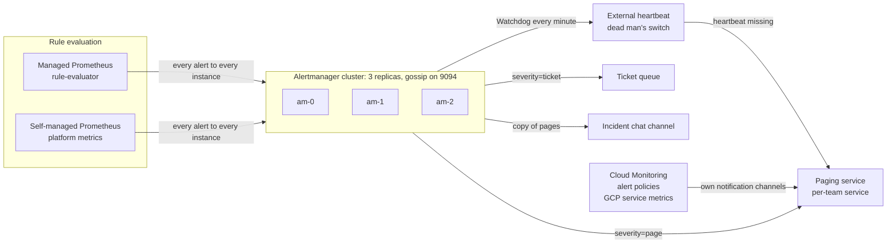

This note describes the delivery path for alerts: where rules are evaluated, how a firing alert reaches exactly one owning team through a highly available Alertmanager, how noise is grouped and inhibited, and how the alerting path itself is monitored so it cannot fail silently. It is for the platform team that runs the path. What to page on is decided in [[adr/0045-page-only-on-slo-burn-rate]] and [[patterns/slo-burn-rate-alerting]]; the labels, annotations and runbooks every alert must carry are in [[standards/alert-and-runbook-standard]]; per-tenant metrics storage is in [[architecture/multi-tenant-prometheus-architecture]]. The paging product at the end of the path is compared in [[tools/pagerduty-vs-opsgenie-vs-grafana-irm]], and a page that never arrived is traced hop by hop with [[runbooks/alert-fired-but-nobody-was-paged]].

> [!info] Scope and sources
> Written against the Alertmanager and Prometheus documentation and source (configuration, README, `amtool`, metric definitions), the Prometheus rule unit-testing docs and the open-source Google Cloud Managed Service for Prometheus engine repository, read on 2026-10-21. Not checked against the Google Cloud product pages; verify there.

> [!note] Not verified
> Nothing here was run. Check before relying on it: the managed rule evaluation and managed Alertmanager behaviour on Google Cloud (resource names, namespaces, replica count, HA, billing); how Cloud Monitoring alerting policies notify and close incidents; the `*_file` receiver fields and `inhibit_rules` `name` field in your Alertmanager version; the matcher parsing mode your version uses; and any metric name not listed under Meta-monitoring. Metric names were read from source on `main` and can change between releases.

## Goals

- **Every page is actionable and owned.** A firing alert reaches one team's pager, chosen by labels, never by guesswork.
- **One notification per fault.** Related alerts are grouped; symptoms of a known parent fault are inhibited.
- **No silent failure.** If rule evaluation, Alertmanager or the paging integration breaks, someone is told by a path that does not depend on the broken part.
- **Configuration is code.** Rules and routing live in Git, are tested in CI and deployed by pipeline ([[adr/0046-dashboards-and-alert-rules-as-code]]).

## Pipeline



Rules are evaluated in one of two places. [[adr/0042-managed-prometheus-for-application-metrics]] puts application metrics in Managed Service for Prometheus, whose open-source `rule-evaluator` reads Prometheus-style rule files, queries the managed store and sends firing alerts to an Alertmanager. Platform components that are still scraped by a self-managed Prometheus evaluate their rules locally. Both send to the same Alertmanager cluster, so there is one routing tree. GCP service metrics (Cloud SQL, load balancers, Pub/Sub) stay in Cloud Monitoring alert policies; see Coexistence below. The trade-offs between the two metric systems are in [[tools/prometheus-vs-cloud-monitoring]].

Prometheus alerting rules "do not handle summarization, rate limiting, silencing, or alert dependencies" (Prometheus docs); grouping, inhibition, silences and delivery are the Alertmanager's job, which is why it is a separate tier.

## Rule sources as code

- **Application rules** live in each service's repository next to its SLO definition and are rendered into the managed rule resources. The open-source engine defines `Rules` (namespace-scoped; results keep `project_id`, `cluster` and `namespace`), `ClusterRules` (cluster-scoped) and `GlobalRules` (project-scoped). A team writes `Rules` in its own namespace, so its rules can only see its own namespace's data.
- **Platform rules** (cluster health, meta-monitoring below) live in the platform repository as `ClusterRules` or plain Prometheus rule files.
- **Routing** (`alertmanager.yml`) lives in the platform repository. Teams change their own receiver and child route by merge request, reviewed by the platform team, because one bad matcher can swallow every page.
- **CI** runs `promtool check rules`, `promtool test rules`, `amtool check-config` and routing tests on every change (see Testing). Learners can start with [[learn/first-prometheus-alert]] and [[learn/promql-for-alert-rules-and-recording-rules]].

## Ownership labels

Routing relies on the labels from [[standards/alert-and-runbook-standard]]: `severity` (`page` or `ticket`; absent means dashboard only), `team` and `service`. Rules must set them; they must not be guessed downstream.

- **Where `team` comes from.** Workloads carry the team label required by [[standards/kubernetes-labels-and-annotations-standard]], and each namespace belongs to one team. Rule authors copy it into the alert labels; a CI lint rejects a rule without `team`, `service` and `runbook_url`.
- **Unowned pages are not dropped.** A `page` alert whose `team` matches no child route goes to the platform on-call, who fixes the label the next working day. Silence is worse than a misrouted page.
- **External labels** (`cluster`, `project_id`) identify where the alert came from and are used in `group_by` and inhibition. Do not use them for routing to teams.

## Routing tree

The root route matches every alert and has no matchers. Children are tried in order and the first match wins unless `continue: true` is set. Timers (`group_wait` 30s, `group_interval` 5m, `repeat_interval` 4h are the documented defaults) are inherited by children unless overridden.

```yaml title="alertmanager.yml"
global:
  resolve_timeout: 5m # default; ignored for Prometheus alerts, which carry EndsAt

time_intervals:
  - name: working-hours
    time_intervals:
      - weekdays: ["monday:friday"]
        times:
          - start_time: "08:00"
            end_time: "18:00"
        location: "UTC" # an IANA name needs a time zone database in the image

route:
  receiver: default-null # dashboard-only alerts (no severity) end here
  group_by: [cluster, team, service, alertname]
  group_wait: 30s
  group_interval: 5m
  repeat_interval: 4h
  routes:
    # 1. Dead man's switch: always firing, sent often to the external heartbeat
    - matchers: [alertname="Watchdog"]
      receiver: heartbeat
      group_by: [cluster]
      group_wait: 0s
      group_interval: 1m
      repeat_interval: 1m # keep it below the heartbeat service's grace period

    # 2. Every page also goes to the incident chat; continue so it is still paged
    - matchers: [severity="page"]
      receiver: chat-incidents
      continue: true

    # 3. Pages by owning team; unknown teams fall back to the platform pager
    - matchers: [severity="page"]
      receiver: pager-platform
      routes:
        - matchers: [team="team-orders"]
          receiver: pager-orders
        - matchers: [team="team-payments"]
          receiver: pager-payments

    # 4. Tickets: created at any time, chat copy only in working hours
    - matchers: [severity="ticket"]
      receiver: ticket-queue
      continue: true
    - matchers: [severity="ticket"]
      receiver: chat-tickets
      active_time_intervals: [working-hours]

inhibit_rules:
  # A cluster-level outage suppresses the per-service pages it causes.
  # The target excludes the source alert, so no alert matches both sides.
  - source_matchers: [alertname="ClusterUnreachable"]
    target_matchers: [severity="page", alertname!="ClusterUnreachable"]
    equal: [cluster]
  # A page for a service suppresses its tickets
  - source_matchers: [severity="page"]
    target_matchers: [severity="ticket"]
    equal: [team, service]

receivers:
  - name: default-null
  - name: heartbeat
    webhook_configs:
      - url_file: /etc/alertmanager/secrets/heartbeat-url
        send_resolved: false
  - name: pager-platform
    pagerduty_configs:
      - routing_key_file: /etc/alertmanager/secrets/pager-platform
  - name: pager-orders
    pagerduty_configs:
      - routing_key_file: /etc/alertmanager/secrets/pager-orders
  - name: pager-payments
    pagerduty_configs:
      - routing_key_file: /etc/alertmanager/secrets/pager-payments
  - name: chat-incidents
    slack_configs:
      - api_url_file: /etc/alertmanager/secrets/chat-webhook
        channel: "#incidents"
        send_resolved: true # chat and email send no resolved notices by default
  - name: chat-tickets
    slack_configs:
      - api_url_file: /etc/alertmanager/secrets/chat-webhook
        channel: "#alerts-tickets"
        send_resolved: true
  - name: ticket-queue
    webhook_configs:
      - url_file: /etc/alertmanager/secrets/ticket-bridge-url
```

Design notes:

- **Secrets stay out of the file.** Integration keys and webhook URLs are read from `*_file` paths mounted from a Secret, synced as in [[architecture/secrets-architecture-gcp-and-gke]]. The file itself can then be reviewed in Git.
- **`continue: true` only where double delivery is intended**, as for the chat copy above. Anywhere else it causes duplicate pages.
- **Inhibition is subtle.** A missing label and an empty label count as equal, and if every `equal` label is missing on both alerts the rule still applies. An alert matching both the source and target side cannot be inhibited by others that also match both, so write matchers that cannot match both sides.
- **Matchers.** `match` and `match_re` are deprecated; use `matchers` with `=`, `!=`, `=~` and `!~`. Quote values that contain special characters. Recent versions changed matcher parsing; `amtool check-config` reports incompatible matchers.
- **Paging tool.** The receivers use the PagerDuty integration as an example of one paging service per team. Use the Events API v2 routing key (`routing_key`), not the older `service_key`; the two are mutually exclusive.

## Severity and destination

| `severity` | Destination                                  | When            | Rule of thumb                                                          |
| ---------- | -------------------------------------------- | --------------- | ---------------------------------------------------------------------- |
| `page`     | Team pager, plus a copy in the incident chat | 24x7            | Only SLO burn-rate alerts, per [[adr/0045-page-only-on-slo-burn-rate]] |
| `ticket`   | Ticket queue, chat copy in working hours     | Ticket any time | Needs a human within days, never at night                              |
| none       | Nowhere (`default-null`)                     | n/a             | Dashboards and recording only                                          |
| `Watchdog` | External heartbeat                           | Continuously    | Not a severity; routed by `alertname`                                  |

Watch the load with [[management/on-call-health]]: if a rota gets more pages than it can act on, tune rules before adding people.

## Alertmanager high availability

Alertmanager replicas form a gossip cluster that shares silences and the notification log, so only one replica sends a given notification. Clustering is on by default (`--cluster.listen-address` defaults to `0.0.0.0:9094`; an empty value disables it). Peers are listed with repeated `--cluster.peer` flags, and both TCP and UDP must be open on the cluster port, in the Service, the NetworkPolicy and any firewall.

The critical rule, from the Alertmanager README: **do not load balance traffic between Prometheus and its Alertmanagers.** Every evaluator must send every alert to every replica. Deduplication happens after the notification log is shared; if an alert reaches only one replica and that replica dies, the alert is lost. A ClusterIP Service or load balancer in front of the replicas breaks this.

```yaml title="prometheus.yml (alerting fragment)"
alerting:
  alertmanagers:
    - api_version: v2
      timeout: 10s
      static_configs:
        - targets:
            # StatefulSet pods through the headless Service, one entry per replica
            - alertmanager-0.alertmanager-headless.monitoring.svc:9093
            - alertmanager-1.alertmanager-headless.monitoring.svc:9093
            - alertmanager-2.alertmanager-headless.monitoring.svc:9093
```

```yaml title="alertmanager StatefulSet (container args fragment)"
args:
  - --config.file=/etc/alertmanager/alertmanager.yml
  - --storage.path=/alertmanager
  - --cluster.listen-address=0.0.0.0:9094
  - --cluster.peer=alertmanager-0.alertmanager-headless.monitoring.svc:9094
  - --cluster.peer=alertmanager-1.alertmanager-headless.monitoring.svc:9094
  - --cluster.peer=alertmanager-2.alertmanager-headless.monitoring.svc:9094
  - --cluster.label=prod-alerting # keeps a staging cluster from joining by mistake
```

For the managed rule evaluator, the open-source engine's `OperatorConfig` has `rules.alerting.alertmanagers[]`, which names an Endpoints object by `namespace`, `name` and `port`. Point it at the headless Service, and confirm in a test that every replica receives alerts by querying each replica's `/api/v2/alerts`. The engine also offers a managed Alertmanager configured from a Secret; whether it is replicated, and how, is not verified, so this design keeps one self-managed cluster that both evaluators share.

Run three replicas spread across zones with a PodDisruptionBudget, persistent storage for silences (`--storage.path`), and pod anti-affinity. Two replicas work but leave no margin during a node upgrade.

## Silences and maintenance windows

- **Planned work:** create a silence with an author, a comment and an end time, scoped by `cluster`, `service` or `team` matchers. Never silence by `severity` alone.
- **Recurring windows:** use `time_intervals` with `mute_time_intervals` on a route, kept in Git. Time intervals are not inherited by child routes and cannot be set on the root route.
- **Audit:** silences live in Alertmanager's state, not Git. Review active silences weekly; expired silences are kept for the retention period (`--data.retention`, default 120h) and then garbage collected.

```bash title="silence-maintenance.sh"
#!/usr/bin/env bash
set -euo pipefail
AM_URL="http://localhost:9093"  # change: kubectl -n monitoring port-forward svc/alertmanager 9093
CLUSTER="gke-prod-ew1"          # change: the cluster under maintenance

amtool --alertmanager.url="$AM_URL" silence add \
  cluster="$CLUSTER" service="payments-api" \
  --author="platform-oncall" --duration=2h \
  --comment="Planned node pool upgrade, change ticket in comment"
amtool --alertmanager.url="$AM_URL" silence query cluster="$CLUSTER"
```

## Meta-monitoring

The alerting path must be watched from outside itself. Two layers:

1. **Dead man's switch.** A `Watchdog` alert is always firing (`expr: vector(1)`), routed with a short repeat interval to an external heartbeat service. That service expects a regular ping and pages through its own integration when the pings stop. It catches every failure upstream of it: evaluator down, Alertmanager down, network policy, expired credentials. Run one Watchdog per evaluator and cluster, matching the per-tenant synthetic alert in [[architecture/multi-tenant-prometheus-architecture]], and give each its own heartbeat check (a child route per `cluster` with its own URL file). With one shared check, a healthy cluster keeps the check green while another cluster's pipeline is dead.
2. **Internal alerts** on metrics read from Alertmanager and Prometheus source. Route them to the platform team with a chat copy, because if the pager integration is the broken part, a page about it will not arrive.

```yaml title="rules/meta-alerts.yaml"
groups:
  - name: alerting-pipeline
    rules:
      - alert: Watchdog
        expr: vector(1)
        annotations:
          summary: "Always firing; proves the alerting pipeline delivers"
          runbook_url: "https://runbooks.example.com/platform/watchdog"

      - alert: AlertmanagerNotificationsFailing
        expr: sum by (integration, reason) (rate(alertmanager_notifications_failed_total[5m])) > 0
        for: 10m
        labels:
          severity: page
          team: platform
          service: alertmanager
        annotations:
          summary: "Alertmanager cannot deliver notifications"
          description: "Notifications to an integration have failed for 10 minutes."
          runbook_url: "https://runbooks.example.com/platform/alertmanager-notify"

      - alert: PrometheusRuleEvaluationFailures
        expr: increase(prometheus_rule_evaluation_failures_total[10m]) > 0
        labels:
          severity: ticket
          team: platform
          service: prometheus
        annotations:
          summary: "Rule evaluations are failing"
          runbook_url: "https://runbooks.example.com/platform/rule-eval-failures"
```

Further expressions for the same group, with example thresholds to tune:

| Signal                             | Expression                                                                                                      |
| ---------------------------------- | --------------------------------------------------------------------------------------------------------------- |
| Rule group not evaluating          | `time() - prometheus_rule_group_last_evaluation_timestamp_seconds > 3 * prometheus_rule_group_interval_seconds` |
| Evaluations skipped                | `increase(prometheus_rule_group_iterations_missed_total[10m]) > 0`                                              |
| Alerts dropped before Alertmanager | `increase(prometheus_notifications_dropped_total[10m]) > 0`                                                     |
| Fewer Alertmanagers than replicas  | `prometheus_notifications_alertmanagers_discovered < 3`                                                         |
| Bad config reload                  | `alertmanager_config_last_reload_successful == 0`                                                               |
| Cluster peers failing              | `alertmanager_cluster_failed_peers > 0`                                                                         |

The `prometheus_*` rule and notifier metrics come from the Prometheus code base; check that the managed rule evaluator exposes them before relying on them there. `alertmanager_notifications_failed_total` carries a `reason` label (for example `authError`, `rateLimited`, `serverError`); an `authError` usually means a rotated or revoked integration key.

## Coexistence with Cloud Monitoring

Some signals exist only in Cloud Monitoring, such as managed database and load balancer metrics. Rules that keep one page per fault:

- **Each condition is evaluated in exactly one system.** If a Cloud SQL condition lives in a Cloud Monitoring policy, do not also write it as a PromQL rule. This is a design rule, not product behaviour.
- **Same labels, same destination.** Put `severity`, `team` and `service` in the policy's user labels and the runbook in its documentation, as [[standards/alert-and-runbook-standard]] describes, and point the policy's notification channel at the same team service in the paging tool.
- **No grouping across systems.** Alertmanager cannot inhibit a Cloud Monitoring incident. Where a cloud outage would page from both sides, accept it or deliberately route the cloud side to tickets.
- **Policies are code** in Terraform, reviewed like rules.

Check the Cloud Monitoring alerting docs for notification channel types, PromQL conditions and incident auto-close before designing around them.

## Testing

```bash title="ci/alerting-checks.sh"
#!/usr/bin/env bash
set -euo pipefail
CONFIG="alertmanager/alertmanager.yml" # change: path in your platform repo

amtool check-config "$CONFIG"
promtool check rules rules/*.yaml
promtool test rules tests/*_test.yml

# Routing tests: labels in, expected receivers out (comma separated, in tree order)
amtool config routes test --config.file="$CONFIG" \
  --verify.receivers=chat-incidents,pager-orders \
  severity=page team=team-orders alertname=OrdersApiErrorBudgetFastBurn
amtool config routes test --config.file="$CONFIG" \
  --verify.receivers=chat-incidents,pager-platform severity=page team=unknown-team
amtool config routes test --config.file="$CONFIG" \
  --verify.receivers=heartbeat alertname=Watchdog
amtool config routes test --config.file="$CONFIG" \
  --verify.receivers=default-null alertname=SomeDashboardSignal
```

`amtool config routes test` prints `WARNING: Expected receivers did not match resolved receivers.` and exits 1 on a mismatch, so each line is a CI assertion. Add `--tree` to see the matching routes when debugging. A rule unit test for the delivery alert:

```yaml title="tests/meta-alerts_test.yml"
rule_files:
  - ../rules/meta-alerts.yaml
evaluation_interval: 1m
tests:
  - interval: 1m
    input_series:
      - series: 'alertmanager_notifications_failed_total{integration="pagerduty",reason="authError"}'
        values: "0+0x10 1+1x20"
    alert_rule_test:
      - eval_time: 5m
        alertname: AlertmanagerNotificationsFailing
        exp_alerts: []
      - eval_time: 25m
        alertname: AlertmanagerNotificationsFailing
        exp_alerts:
          - exp_labels:
              integration: pagerduty
              reason: authError
              severity: page
              team: platform
              service: alertmanager
            exp_annotations:
              summary: "Alertmanager cannot deliver notifications"
              description: "Notifications to an integration have failed for 10 minutes."
              runbook_url: "https://runbooks.example.com/platform/alertmanager-notify"
```

## Failure modes

| Failure                                       | Effect                                           | Mitigation                                                                         |
| --------------------------------------------- | ------------------------------------------------ | ---------------------------------------------------------------------------------- |
| Evaluator sends to a load-balanced address    | Alerts lost when the receiving replica restarts  | List every replica; test that each one sees each alert                             |
| Paging integration key revoked                | Pages silently fail                              | `AlertmanagerNotificationsFailing` to chat as well; heartbeat path                 |
| Config reload fails after a bad merge         | Old config keeps running; new routes never apply | `amtool check-config` in CI; alert on `alertmanager_config_last_reload_successful` |
| Gossip port blocked (TCP or UDP)              | Replicas act alone; duplicate notifications      | Open 9094 TCP and UDP; check `cluster.status` and peers in `/api/v2/status`        |
| Wrong or missing `team` label                 | Page goes to the platform fallback or nowhere    | Lint in CI; fallback receiver; weekly review of fallback pages                     |
| Over-broad silence                            | Real incidents muted                             | Matchers by service, short durations, weekly silence review                        |
| Whole cluster down, including Alertmanager    | No alerts at all                                 | External heartbeat pages through its own path                                      |
| High-cardinality rule overloads the evaluator | Missed evaluations, late alerts                  | Missed-iteration alert; [[runbooks/prometheus-high-cardinality-triage]]            |

## Pitfalls

- Treating `group_by: ['...']` as a convenience: it disables grouping and turns one fault into hundreds of notifications.
- Setting `continue: true` on a team route by habit, so the platform fallback pages as well.
- Routing the Watchdog through the same paging integration that it is supposed to prove.
- Expecting resolved notifications in chat while `send_resolved` is still at its default of `false` for chat and email.
- Silencing during an incident and forgetting the silence; always set an end time.
- Letting an AI triage bot ([[ai/llm-log-analysis-and-alert-triage]]) suppress or close pages. It may summarise; the routing tree decides.

## Verify

```bash title="verify-alerting.sh"
#!/usr/bin/env bash
set -euo pipefail
AM_URL="http://localhost:9093" # change: port-forward to one replica at a time

# 1. Cluster formed: expect "ready" and one peer per replica
curl -fsS "$AM_URL/api/v2/status" | jq -r '.cluster.status, (.cluster.peers | length)'

# 2. The Watchdog is present on this replica (repeat for every replica)
amtool --alertmanager.url="$AM_URL" alert query alertname=Watchdog

# 3. End to end: post a short-lived test ticket and see it in the queue and chat
END=$(date -u -d '+5 min' +%Y-%m-%dT%H:%M:%SZ 2>/dev/null || date -u -v+5M +%Y-%m-%dT%H:%M:%SZ)
curl -fsS -X POST "$AM_URL/api/v2/alerts" -H 'Content-Type: application/json' \
  -d "[{\"labels\":{\"alertname\":\"PipelineEndToEndTest\",\"severity\":\"ticket\",\"team\":\"platform\",\"service\":\"alertmanager\"},\"annotations\":{\"summary\":\"Test, ignore\"},\"endsAt\":\"$END\"}]"
```

Also run a quarterly drill: block the heartbeat route in a non-production Alertmanager and confirm the heartbeat service pages within its grace period; revoke a test integration key and confirm `AlertmanagerNotificationsFailing` reaches chat. Record the results in the runbook as [[runbooks/incident-response]] expects.

## Adopt incrementally

1. Put `alertmanager.yml` in Git with `amtool check-config` and routing tests in CI.
2. Enforce the `severity`, `team` and `service` labels with a lint; add the platform fallback receiver.
3. Run three Alertmanager replicas and list every replica in each evaluator; verify `cluster.status`.
4. Add the Watchdog and the external heartbeat, then the internal meta-alerts.
5. Point the managed rule evaluator at the same cluster and move application rules to `Rules` resources per namespace.
6. Align Cloud Monitoring policies: one system per condition, same labels and destinations.

## Sources

- Alertmanager configuration: https://prometheus.io/docs/alerting/latest/configuration/
- Alertmanager overview and high availability: https://prometheus.io/docs/alerting/latest/alertmanager/
- Alertmanager README (high availability, amtool): https://github.com/prometheus/alertmanager
- Prometheus alerting rules: https://prometheus.io/docs/prometheus/latest/configuration/alerting_rules/
- Prometheus rule unit tests: https://prometheus.io/docs/prometheus/latest/configuration/unit_testing_rules/
- Watchdog runbook (prometheus-operator runbooks repository): https://github.com/prometheus-operator/runbooks/blob/main/content/runbooks/general/Watchdog.md
- Managed Service for Prometheus engine (rule-evaluator, rule resources): https://github.com/GoogleCloudPlatform/prometheus-engine
- Managed rule evaluation and alerting: https://cloud.google.com/stackdriver/docs/managed-prometheus/rules-managed
- Cloud Monitoring alerting: https://cloud.google.com/monitoring/alerts

## Related

- [[adr/0045-page-only-on-slo-burn-rate]]
- [[patterns/slo-burn-rate-alerting]]
- [[standards/alert-and-runbook-standard]]
- [[architecture/multi-tenant-prometheus-architecture]]
- [[runbooks/incident-response]]
- [[management/on-call-health]]
- [[tools/pagerduty-vs-opsgenie-vs-grafana-irm]]
- [[runbooks/alert-fired-but-nobody-was-paged]]
