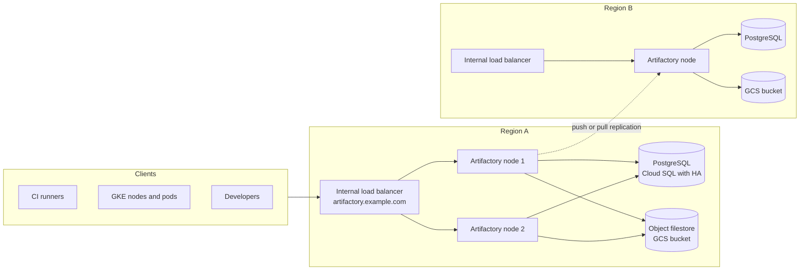

This note describes a reference architecture for running Artifactory as the single artifact and dependency path for CI, builds and clusters. It covers the repository model, a highly available topology on GCP, remote repositories as the only egress for dependencies, replication between regions, identity, and backup. It deliberately leaves promotion between environments to [[patterns/artifact-promotion-artifactory]], retention to [[standards/artifact-retention-policy]], and the end-to-end chain of evidence to [[architecture/software-supply-chain-end-to-end]].

> [!info] Scope and sources
> Written against the JFrog Artifactory documentation and the Cloud SQL high availability documentation as a general design. Product tiers, feature names and prerequisites change; the JFrog documentation is the source of truth.

> [!note] Not verified
> Nothing here was run against a live installation. Check before relying on it: which licence tier provides high availability and replication, the exact `system.yaml` keys for the database and filestore, how many nodes and which load balancer settings the current docs recommend, and the replication options available for each package type.

## Decision drivers

Artifactory sits on the critical path of every build and every deploy that pulls an image. If it is down, CI stops and new pods cannot pull images that are not cached on the node. Decide these before drawing boxes:

- **Availability target.** Is a short outage during a node restart acceptable, or must builds survive the loss of a node or a zone? A single node with good backups is a legitimate choice for a small team. HA is for when the registry is a shared platform dependency.
- **Blast radius of a bad upload.** One shared instance means one place where a poisoned package can land. Repository permissions and curation matter more than node count.
- **Regions.** Do builds and clusters run in more than one region? Cross-region pulls cost latency and egress, and a regional outage should not stop the other region.
- **Licence.** HA and replication features depend on the licensed tier. Check the JFrog documentation for the current tier names and what each one includes before you commit to a design.
- **Operating model.** Self-hosted on GKE or VMs, or a SaaS offering. The rest of this note assumes self-hosted on GCP, because that is where the shared database and filestore choices are yours.

## Repository model

Use three repository types with a strict naming scheme, because the name is the contract that CI, Helm values and policies rely on.

| Type    | Purpose                                              | Who writes             | Example name                    |
| ------- | ---------------------------------------------------- | ---------------------- | ------------------------------- |
| Local   | Artifacts your organisation builds                   | CI service identities  | `payments-docker-dev-local`     |
| Remote  | Cached proxy of an upstream registry                 | Nobody; fetched on use | `npm-npmjs-remote`              |
| Virtual | One URL that aggregates local and remote for clients | Nobody                 | `docker-virtual`, `npm-virtual` |

Naming follows [[0003-artifactory-repository-layout]]: `<team>-<type>-<stage>-local` for local, `<type>-<upstream>-remote` for remote and `<type>-virtual` for virtual repositories. Keep one local repository per environment stage (`payments-docker-dev-local`, `payments-docker-stage-local`, `payments-docker-prod-local`) so promotion is a move or copy between repositories, as described in [[patterns/artifact-promotion-artifactory]].

Rules that keep the model predictable:

- Clients only ever see the virtual repository. Which local or remote repositories sit behind it can change without touching a pipeline.
- Resolution order inside a virtual repository matters. Put local repositories before remote ones so an internal package name cannot be shadowed by a public package of the same name (dependency confusion). Ordering alone is not enough for npm and PyPI, because version metadata is merged across the virtual repository and the highest version wins. Add exclude patterns for internal scopes and names on remote repositories and enable priority resolution on the local repository. Check the current docs for how your package type handles priority and for any per-package-type exclusion patterns.
- Production deploys pull from the `-prod-local` repository only, never from a remote or a dev repository.

## HA topology

A highly available installation runs several Artifactory nodes behind one load balancer. The nodes are stateless between themselves: state lives in a shared database and a shared filestore.



Design points:

- **Shared database.** Metadata, permissions and repository configuration live in PostgreSQL. Use a managed HA database such as Cloud SQL with high availability enabled (see the Cloud SQL high availability documentation). Database failover means a short interruption while connections are re-established, so nodes must retry rather than crash.
- **Shared filestore.** Binaries are content-addressed files. An object store such as GCS lets every node read every binary and removes local disks as a failure domain. Latency to the object store affects every download that is not in a node cache, so keep the bucket in the same region as the nodes.
- **Load balancer.** An internal load balancer with a health check per node. The ping endpoint is cheap and does not require authentication.
- **Nodes.** Two or more, spread across zones. Size by concurrent builds, not by users. Check the JFrog sizing guidance for current recommendations.
- **Where it runs.** On GKE with the official Helm chart, or on VMs in a managed instance group. The Helm route gives rolling upgrades and a declarative config; the VM route gives simpler networking to a private database. Either is valid.

A database fragment for `system.yaml`. The host is a placeholder and the password is not written to the file:

```yaml title="system.yaml (database fragment)"
shared:
  database:
    type: postgresql
    driver: org.postgresql.Driver
    url: jdbc:postgresql://artifactory-db.internal.example.com:5432/artifactory
    username: artifactory
    # password: set JF_SHARED_DATABASE_PASSWORD from a Kubernetes Secret synced
    # from Secret Manager (or the Helm chart's database secret settings), never committed
```

`system.yaml` does not expand shell-style variables, so a `${...}` value would be read as the literal password; Artifactory overrides keys through `JF_`-prefixed environment variables instead. Check the JFrog documentation for the current key names and for how the chart or installer expects the filestore to be configured, because these have changed between releases. Pull the password from Secret Manager at deploy time as described in [[patterns/external-secrets-with-secret-manager]]; do not put it in Helm values in Git.

## Remote repositories as the single egress

Make Artifactory the only way builds reach public registries. Every build resolves Docker Hub, npm, PyPI, Maven Central and similar through a remote repository, and CI runners have no direct route to those registries.

Benefits:

- **One egress allowlist entry.** The NAT and firewall only need to allow Artifactory to reach the upstreams. Runners and nodes do not need one allowlist entry per public registry. This fits the controlled egress design in [[architecture/private-gke-and-controlled-egress]].
- **Availability.** A cached package keeps building when the upstream is down or has rate-limited you.
- **Reproducibility.** What was resolved is recorded in Artifactory, which feeds the dependency list in [[compliance/sbom-generation-and-storage]].
- **A policy point.** Block or quarantine packages before they reach builds.

Risks to design for:

- **Cache poisoning.** A remote repository will serve whatever the upstream serves, including a malicious new version. Mitigate with checksum and metadata policies, pinned versions with lock files, a curation or allowlist layer for new packages, and a delay before very new versions are consumable. Check the current JFrog docs for which curation features your tier offers.
- **Upstream credentials.** Remote repositories that use credentials for a private upstream hold a secret. Store it in the platform secret store and rotate it.
- **Unbounded cache growth.** Remote caches fill storage. Apply cleanup as in [[standards/artifact-retention-policy]].

## Replication between regions

Replication copies artifacts from one instance to another so a second region has them locally.

- **Push replication** sends artifacts from a source to a target on a schedule or on events. Use it from the primary build region to read-mostly regions.
- **Pull replication** has the target fetch from a source. It suits a remote site that should control its own load.
- **What it does not copy.** Replication moves binaries and their properties for the repositories you configure. It does not by itself copy users, permissions, repository definitions or system configuration. Keep those in code (Terraform with the Artifactory provider, or the REST API from a pipeline) and apply them to every instance.
- **Event versus scheduled.** Event-driven replication gives lower lag for release artifacts; scheduled replication is gentler for large remote caches. Pick per repository.
- **Client failover.** Clients use one DNS name. For active-passive, repoint the record at the standby instance. For regional read locality, use per-region names with a fallback in client config. DNS caching extends failover time, so set a low TTL on the record before you need it.

Replication is asynchronous. An artifact that was just published may not exist in region B yet. Pipelines that publish in region A and immediately deploy in region B must wait for the artifact or pull from region A.

## Access and identity

- **Single sign-on.** Federate users through the corporate identity provider and map groups to Artifactory permission targets. Avoid local users except for a break-glass admin kept in the secret store.
- **No anonymous access.** Disable it. Even read access to internal images should be authenticated.
- **Scoped tokens with expiry.** CI uses short-lived access tokens scoped to the repositories it needs. Prefer exchanging a workload identity for a token over storing a long-lived one, in line with [[architecture/iam-groups-and-ci-workload-identity-federation]]. Check the current docs for OIDC token exchange support in your version.
- **Write rights are narrow.** Only the pipeline identity for a stage writes to that stage's local repository. Developers do not push to `-prod-local`.
- **Audit.** Keep the access and audit logs and ship them to the central log platform.

## Backup and disaster recovery

The data is the database plus the filestore. Back up both consistently:

- Cloud SQL automated backups and point-in-time recovery for the database, following [[architecture/backup-architecture-gke-cloud-sql-gcs]].
- Versioning or a second copy for the filestore bucket, with the same retention thinking.
- Configuration in Git, so a rebuilt instance gets repositories, permissions and tokens' scopes from code.
- A second region with replication is a warm standby for artifacts, not a backup. A bad deletion replicates too.

Choose a tier for the service with [[architecture/disaster-recovery-tiers-rpo-rto]]. Most organisations land on warm standby: replicated binaries in region B, a database replica or restorable backup, and a documented DNS switch.

## Failure modes

| Failure                          | What happens                                                | Mitigation                                                                 |
| -------------------------------- | ----------------------------------------------------------- | -------------------------------------------------------------------------- |
| Database failover                | Nodes lose connections for a short time; some requests fail | Connection retry, health check that tolerates brief blips, retry in CI     |
| Filestore latency or throttling  | Slow downloads, timeouts on large layers                    | Same-region bucket, node cache, monitor request latency                    |
| Split or lagging replication     | Region B lacks recent artifacts or shows stale metadata     | Replication lag alert, wait-for-artifact step, do not deploy ahead of sync |
| Cache poisoning via remote repo  | A malicious upstream version enters builds                  | Lock files, checksum policy, curation, delay on new versions               |
| Disk or quota exhaustion on node | Uploads fail                                                | Cleanup policies, storage alerts                                           |
| Expired or leaked token          | Builds fail with 401, or an attacker pulls internal images  | Short expiry, scoped tokens, rotation runbook                              |

## Pitfalls

- Treating the virtual repository order as unimportant, or relying on order alone for npm and PyPI, and then shadowing an internal package with a public one. Use exclude patterns and priority resolution as well.
- Pointing every region's builds at one distant instance and discovering the latency only under load.
- Configuring HA but leaving the database as a single zonal instance.
- Letting `latest` tags into production repositories. Promote by digest.
- Forgetting that replication does not carry permissions, so region B denies what region A allows.
- Storing the admin token in CI variables.

## Verify

Check every node behind the load balancer, then the name clients use. Replace the hostnames with your own:

```bash title="verify-artifactory.sh"
#!/usr/bin/env bash
set -euo pipefail

# Per-node checks (internal node names are examples)
for host in artifactory-1.example.com artifactory-2.example.com; do
  echo -n "${host}: "
  curl -fsS "https://${host}/artifactory/api/system/ping"
  echo
done

# The name clients use, through the load balancer
curl -fsS https://artifactory.example.com/artifactory/api/system/ping

# Anonymous access must be refused for an internal repository
code=$(curl -s -o /dev/null -w '%{http_code}' \
  https://artifactory.example.com/artifactory/api/docker/docker-virtual/v2/_catalog)
echo "anonymous catalog status: ${code}"
case "$code" in
  401|403) ;;
  *) echo "anonymous access not refused: $code" >&2; exit 1 ;;
esac
```

Also test the failure paths on purpose: stop one node and confirm builds continue; fail over the database in a non-production environment and measure the interruption; take a replication target offline and confirm the lag alert fires.

## Adopt incrementally

1. Stand up one node with a managed PostgreSQL and an object filestore. Put it behind the final DNS name from day one.
2. Create remote repositories for the registries you use and move CI to resolve through virtual repositories.
3. Close direct egress from runners to public registries.
4. Add the second node and the health-checked load balancer, then rehearse a node loss.
5. Add replication to a second region and a documented DNS switch, then rehearse it.
6. Add curation and identity-based token exchange.

## Sources

- JFrog Artifactory documentation: https://jfrog.com/help/r/jfrog-artifactory-documentation (high availability installation, repository types, replication, access tokens). Check the current docs for tiers and prerequisites.
- Cloud SQL for PostgreSQL high availability: https://cloud.google.com/sql/docs/postgres/high-availability

## Related

- [[patterns/artifact-promotion-artifactory]]
- [[standards/artifact-retention-policy]]
- [[compliance/sbom-generation-and-storage]]
- [[architecture/private-gke-and-controlled-egress]]
- [[architecture/disaster-recovery-tiers-rpo-rto]]
- [[architecture/backup-architecture-gke-cloud-sql-gcs]]
- [[architecture/software-supply-chain-end-to-end]]
- [[0002-artifactory-as-single-artifact-store]]
- [[0003-artifactory-repository-layout]]
- [[0011-artifactory-hosting-saas-or-self-managed]]
