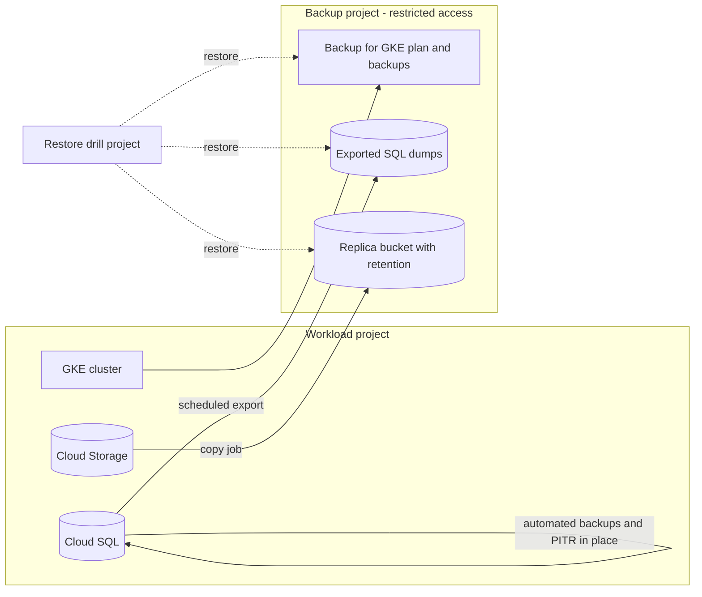

This note is for senior DevOps engineers who must decide what to back up on a GKE platform, where to store the backups, and how to prove they restore. It covers Kubernetes state and volume data, Cloud SQL and Cloud Storage. It leaves region-loss planning to [[architecture/disaster-recovery-tiers-rpo-rto]], evidence handling to [[compliance/audit-evidence-collection-and-retention]], and application rollbacks to [[runbooks/helm-release-rollback]].

> [!info] Scope and sources
> Written against Backup for GKE, Cloud SQL automated backups and point-in-time recovery, and Cloud Storage versioning and retention, using the public product documentation on cloud.google.com and the Terraform Google provider documentation. No RTO figures are given: they depend on data size and must be measured.

> [!note] Not verified
> The claims below were written from documentation knowledge and were not checked against a running system or the current docs: what Backup for GKE excludes, its minimum schedule and achievable RPO, the Terraform resource and field names shown, and the point-in-time recovery retention limits. Check them before relying on them.

## What needs a backup and what does not

The first design decision is to stop backing up things you can rebuild. A cluster built from Terraform and synced from Git is cattle. Data is not.

| Item                                     | Rebuilt from                         | Needs a backup?                                 |
| ---------------------------------------- | ------------------------------------ | ----------------------------------------------- |
| Cluster, node pools, networking          | Terraform                            | No, but back up the state                       |
| Deployments, Services, config            | Git through Argo CD                  | No                                              |
| Container images                         | CI, Artifactory or Artifact Registry | Keep in a replicated repository                 |
| Secrets                                  | Secret manager                       | Back up the secret manager's source of truth    |
| Persistent volume data                   | Nothing                              | Yes                                             |
| In-cluster custom resources made by hand | Nothing                              | Yes, or move them to Git                        |
| Cloud SQL databases                      | Nothing                              | Yes                                             |
| Cloud Storage objects                    | Nothing                              | Yes (versioning, retention)                     |
| Terraform state                          | Nothing                              | Yes (see [[runbooks/terraform-state-recovery]]) |

If an object exists only in the cluster, treat that as a defect to fix by moving it to Git. See [[adr/0001-gitops-with-argocd]] for the GitOps model this assumes.

## Design

Backups live in a separate project with its own, much smaller set of administrators. A compromised workload project, or an engineer with broad rights there, should not be able to delete the backups.



Principles:

- **Separate blast radius.** Different project, different admin group, no standing write access from workload service accounts beyond what the copy job needs.
- **Restore into somewhere new.** Restores go to a new cluster, new instance or new bucket, never over production.
- **Retention follows the data, not the tool.** Decide retention per data class, then configure each tool to match.
- **Know your RPO per path.** Each path has a different recovery point; write it down next to the schedule.

## Backup for GKE

Backup for GKE captures Kubernetes resources and, optionally, persistent volume data, on a schedule defined by a backup plan. Check the current documentation for what it does not capture and for the shortest schedule it allows, because that sets your RPO for volume data.

```hcl title="modules/gke-backup/main.tf"
resource "google_gke_backup_backup_plan" "daily" {
  name     = "prod-daily"
  cluster  = google_container_cluster.primary.id
  location = "europe-west1" # change: region of the backup plan
  project  = var.backup_project_id

  backup_config {
    include_volume_data = true
    include_secrets     = false # secrets come from the secret manager
    all_namespaces      = true
  }

  backup_schedule {
    cron_schedule = "0 2 * * *" # change: daily at 02:00 in the plan's time zone
  }

  retention_policy {
    backup_retain_days      = 30 # change: from your retention decision
    backup_delete_lock_days = 7
  }
}
```

Notes:

- Excluding secrets is a deliberate choice here: restored secrets would bypass your secret manager. Decide this explicitly for your own setup.
- A delete lock stops anyone from deleting a backup before its lock expires. Treat it as a safety feature and do not set it so long that it blocks cleaning up after a mistake.
- A restore of Kubernetes resources into a cluster that Argo CD also manages can fight with Argo CD. Restore volumes and data-bearing resources, and let GitOps reapply the rest.

## Cloud SQL

Cloud SQL provides automated backups and point-in-time recovery (PITR). PITR relies on continuous log retention, so it lets you recover to a moment before a bad change, such as a wrong `DELETE`.

```hcl title="modules/database/primary.tf"
resource "google_sql_database_instance" "primary" {
  name                = "orders-primary"
  region              = "europe-west1" # change: your region
  database_version    = "POSTGRES_16"  # change: your engine and version
  deletion_protection = true

  settings {
    tier = "db-custom-4-16384" # change: size for your load

    backup_configuration {
      enabled                        = true
      start_time                     = "01:00" # change: low-traffic window, UTC
      point_in_time_recovery_enabled = true
      transaction_log_retention_days = 7 # change: check the allowed range

      backup_retention_settings {
        retained_backups = 14 # change: from your retention decision
        retention_unit   = "COUNT"
      }
    }
  }
}
```

For MySQL the log-based option is named differently (binary logging); check the provider documentation for the engine you run.

Test a restore by cloning to a point in time into a new instance:

```bash
set -euo pipefail

PROJECT_ID="my-project"            # change: your project ID
SOURCE="orders-primary"            # change: instance to recover from
TARGET="orders-restore-test"       # change: NEW instance name, never the source
POINT_IN_TIME="2026-10-17T09:15:00Z"  # change: a time before the incident, UTC

gcloud sql instances clone "${SOURCE}" "${TARGET}" \
  --project "${PROJECT_ID}" \
  --point-in-time "${POINT_IN_TIME}"

gcloud sql instances describe "${TARGET}" \
  --project "${PROJECT_ID}" \
  --format="value(name,state)"
```

Never clone over production. Once the clone is verified, copy the needed rows or promote the clone as part of a planned change ([[standards/production-change-checklist]]). Delete the test instance afterwards so it does not become a forgotten cost.

Automated backups live with the instance and are tied to it. For protection against loss of the instance or the project, also run scheduled exports to a bucket in the backup project, and keep those under retention.

## Cloud Storage

Versioning keeps noncurrent versions after overwrite or delete. A retention policy blocks deletion and overwrite until objects reach a minimum age. Lifecycle rules then expire what you no longer need, so versioning does not grow forever.

```hcl title="modules/storage/backup-bucket.tf"
resource "google_storage_bucket" "backup" {
  name                        = "my-backup-project-orders-backup" # change: globally unique
  project                     = var.backup_project_id
  location                    = "EU" # change: location type per your DR tier
  uniform_bucket_level_access = true
  public_access_prevention    = "enforced"

  versioning {
    enabled = true
  }

  retention_policy {
    retention_period = 2592000 # 30 days in seconds; change: your retention
    is_locked        = false   # keep false until the period is agreed (see warning)
  }

  lifecycle_rule {
    condition {
      num_newer_versions = 5
      with_state         = "ARCHIVED"
    }
    action {
      type = "Delete"
    }
  }
}
```

> [!danger] Locking a retention policy is irreversible
> Setting `is_locked = true` permanently locks the retention period: you cannot shorten or remove it, and the bucket cannot be deleted until every object has aged out. Lock only after the period is agreed with the data owner, and never in a test project you intend to delete.

Do not rely on versioning alone for important data: someone with enough rights can delete versions. Retention plus a separate project is what protects against that.

## Isolation and retention locks

- Give the backup project its own folder or IAM boundary, with owners separate from the workload teams.
- Grant copy jobs write-only access to the backup buckets. Reads happen during restores, by a named group.
- Use organization policy where available to block public access and restrict locations.
- Alert on deletions and on IAM changes in the backup project.
- Keep retention periods at least as long as your detection time for silent corruption. A 7-day retention does not help if you notice a problem after 10 days.

## Restore drills

A backup that has never been restored is an assumption. Run a drill every quarter, alternating services so each critical service is covered at least once a year.

Quarterly restore-drill checklist:

- [ ] Pick the service and the restore point; record the target RPO.
- [ ] Create an isolated restore project or namespace with no route to production data stores.
- [ ] Restore Cloud SQL to a new instance from PITR and from a scheduled export.
- [ ] Restore the Backup for GKE backup into a scratch cluster, including volume data.
- [ ] Restore objects from a previous version or replica bucket.
- [ ] Start the application against the restored data and run a business check.
- [ ] Record elapsed time for each step; this is your measured restore time.
- [ ] Record gaps (missing permissions, undocumented steps, expired keys) and open tickets.
- [ ] Destroy the drill resources and confirm no cost remains.
- [ ] Store the drill record with your evidence ([[compliance/audit-evidence-collection-and-retention]]).

## Pitfalls

- **Backups in the same project as the data.** One bad `terraform destroy` or one compromised credential removes both.
- **Encryption keys with the data.** If backups use a customer-managed key, losing or disabling the key makes the backups unreadable. Keep key access and recovery in the plan.
- **Assuming PITR covers a deleted instance.** Recovery depends on the instance still existing; plan exports for that case.
- **Restoring over production.** Always restore beside it.
- **Forgetting the schema or app version.** A restored database may need the application version that matches it. Record versions with each backup.
- **Silent failures.** Alert when a backup plan or export does not complete, not only when it errors.
- **Argo CD fights.** Restored resources can be pruned or overwritten by GitOps; coordinate the restore with the sync policy.

## Related

- [[architecture/disaster-recovery-tiers-rpo-rto]]: tiers and targets that decide how much backup is enough.
- [[runbooks/helm-release-rollback]]: rolling back a release does not need a backup, but data changes might.
- [[compliance/audit-evidence-collection-and-retention]]: how to keep drill records and retention proof.
- [[adr/0001-gitops-with-argocd]]: why cluster state can be rebuilt from Git.
- [[runbooks/terraform-state-recovery]]: protecting the state that rebuilds the platform.
