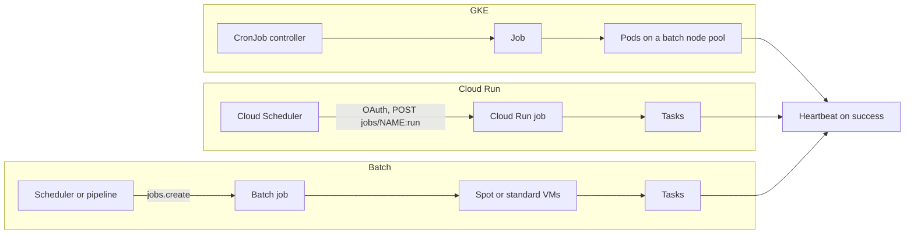

This note describes how to run scheduled and batch work on GCP: which of the three common platforms to choose, how to configure each so runs neither overlap nor go missing silently, how to make re-runs safe, and how to monitor freshness rather than only failures. It is for platform and service teams that own nightly exports, reconciliations, report builds, clean-ups and fan-out processing. Event-triggered work is in [[architecture/pubsub-event-driven-messaging]]; how alerts reach the on-call team is in [[architecture/alerting-and-paging-pipeline]]; host-level cron and systemd timers are taught in [[learn/linux-services-packages-and-scheduled-jobs]]. The field-by-field Job and CronJob baseline is in [[patterns/kubernetes-jobs-and-cronjobs]], and the rules every scheduled job must meet are in [[standards/scheduled-jobs-standard]].

> [!info] Scope and sources
> Written against the Kubernetes CronJob and Job documentation, the kube-state-metrics metric reference and the Google API definitions (protos) for Cloud Run jobs, Cloud Scheduler and Batch, read on 2026-10-21. Not checked against the Google Cloud product pages and the `gcloud` reference, so behaviour documented only there is hedged; verify there.

> [!note] Not verified
> Nothing here was run. Check before relying on it: every quota and maximum (task timeout, task count, parallelism, job duration) for Cloud Run jobs and Batch; pricing and scale-to-zero claims; all `gcloud` flags shown (use `--help`); the IAM roles that let Cloud Scheduler run a Cloud Run job and that Batch needs; GKE Spot node labels and taints and Autopilot behaviour for Jobs; how cluster autoscaling evicts Job pods; the feature state of `podFailurePolicy` on your Kubernetes version; daylight saving behaviour of `.spec.timeZone`; and the Batch JSON field spellings.

## Workload classes

| Class                 | Example                                       | Shape                                      |
| --------------------- | --------------------------------------------- | ------------------------------------------ |
| Short periodic task   | Expire sessions, refresh a cache every 15 min | Seconds to minutes, one container          |
| Nightly or hourly job | Export invoices, reconcile ledgers            | Minutes to an hour, must run once per slot |
| Fan-out batch         | Re-render 50,000 documents                    | Many independent tasks, parallel           |
| Heavy compute         | Simulations, large media processing           | Hours, large or special machines           |
| Data pipelines        | Multi-step ETL with dependencies              | Out of scope: use a workflow orchestrator  |

## Decision

| Aspect      | GKE CronJob / Job                                     | Cloud Scheduler + Cloud Run jobs                          | Batch                                                       |
| ----------- | ----------------------------------------------------- | --------------------------------------------------------- | ----------------------------------------------------------- |
| Runs on     | Your GKE nodes                                        | Managed containers                                        | Compute Engine VMs it provisions per job                    |
| Trigger     | In-cluster controller                                 | Cloud Scheduler calls the Run Jobs API                    | An API call, from Cloud Scheduler or a pipeline             |
| Identity    | Kubernetes SA with [[patterns/gke-workload-identity]] | Job's service account                                     | Job's service account (Compute default if unset)            |
| Retries     | `backoffLimit`, `podFailurePolicy`                    | Per task `max_retries` (default 3) plus Scheduler retries | Per task `max_retry_count` (0 to 10) and lifecycle policies |
| Timeout     | `activeDeadlineSeconds` for the whole Job             | Per attempt task `timeout` (default 600s)                 | Per task `max_run_duration`                                 |
| Parallelism | `parallelism`, Indexed Jobs                           | `task_count`, `parallelism`                               | `task_count`, `parallelism`                                 |
| Idle cost   | Cluster capacity you already pay for                  | Nothing between runs (check pricing)                      | VMs only while the job runs (check pricing)                 |
| Ops load    | Lowest if you already run GKE                         | Low                                                       | Low for compute, more design for networking and images      |
| Best for    | Jobs that need cluster services or private networking | Independent periodic tasks, teams without GKE             | Large fan-out, long runs, special machines, Spot VMs        |

Limits (maximum timeouts, task counts, parallelism) exist for both managed products but are not quoted here; check the current quotas pages. Default rule: if the job talks to services inside the cluster, use a CronJob; if it is a standalone container calling Google APIs, use a Cloud Run job; if it needs many machines or hours of compute, use Batch.



## GKE CronJob design

```yaml title="billing/invoice-export-cronjob.yaml"
apiVersion: batch/v1
kind: CronJob
metadata:
  name: invoice-export # 52 characters at most
  namespace: billing
  labels:
    app.kubernetes.io/name: invoice-export
    team: team-billing
spec:
  schedule: "15 2 * * *"
  timeZone: "Etc/UTC" # CRON_TZ or TZ inside schedule is rejected
  concurrencyPolicy: Forbid # never two runs at once
  startingDeadlineSeconds: 900 # at least 10; a run missed by more is skipped
  successfulJobsHistoryLimit: 3
  failedJobsHistoryLimit: 3 # default is 1; keep a few for debugging
  jobTemplate:
    spec:
      backoffLimit: 3
      activeDeadlineSeconds: 3600 # whole Job, all retries included
      ttlSecondsAfterFinished: 172800
      podFailurePolicy:
        rules:
          # Preemption, eviction and node drain do not count as failures
          - action: Ignore
            onPodConditions:
              - type: DisruptionTarget
                status: "True"
          # Exit 42 = bad input or config: retrying will not help
          - action: FailJob
            onExitCodes:
              containerName: export
              operator: In
              values: [42]
      template:
        metadata:
          labels:
            app.kubernetes.io/name: invoice-export
        spec:
          serviceAccountName: invoice-export
          restartPolicy: Never # required by podFailurePolicy
          priorityClassName: batch
          nodeSelector:
            cloud.google.com/gke-spot: "true" # change: check the Spot label for your cluster mode
          tolerations: # change: match the taint on your Spot nodes, if any
            - key: cloud.google.com/gke-spot
              operator: Equal
              value: "true"
              effect: NoSchedule
          containers:
            - name: export
              image: registry.example.com/billing/invoice-export@sha256:0000000000000000000000000000000000000000000000000000000000000000 # placeholder
              args:
                ["--date=yesterday", "--checkpoint=gs://team-billing-prod-batch/invoice-export/"]
              resources:
                requests:
                  cpu: 500m
                  memory: 512Mi
                limits:
                  memory: 512Mi
```

Why each setting:

- **`concurrencyPolicy: Forbid`** so runs never overlap, **`startingDeadlineSeconds`** so a long outage cannot leave the CronJob stuck behind the 100 missed schedules rule, **`activeDeadlineSeconds`** so a hung run becomes a visible `DeadlineExceeded` failure instead of blocking the next run, a small **`backoffLimit`**, and a **`podFailurePolicy`** that keeps Spot preemption from using up retries. The defaults and caveats of each field are in [[patterns/kubernetes-jobs-and-cronjobs#Job fields that matter|Job fields that matter]] and [[patterns/kubernetes-jobs-and-cronjobs#CronJob fields that matter|CronJob fields that matter]].
- **`ttlSecondsAfterFinished`** removes finished Jobs created by hand with `kubectl create job --from`, which history limits do not cover.
- **Priority and capacity.** A low priority class lets batch yield to serving workloads ([[patterns/priority-classes-and-preemption]]); requests are honest so the scheduler and autoscaler size correctly ([[patterns/kubernetes-resource-requests-and-limits]]).

> [!warning] Long jobs on autoscaled nodes
> Cluster autoscaling and node upgrades evict pods when they consolidate or drain nodes. A two-hour job without checkpoints restarts from zero each time. Keep long jobs on a node pool that is not scaled down aggressively, checkpoint progress, and check how your autoscaler treats Job pods ([[patterns/kubernetes-autoscaling]]). PodDisruptionBudgets help serving workloads ([[patterns/pod-disruption-budgets-for-stateless-services]]) but do not stop Spot preemption.

On Autopilot ([[adr/0018-gke-autopilot-for-new-clusters]]), node selection works through workload requests and compute classes rather than node pools; check the Autopilot docs for Spot Pods and long-running job guidance.

## Cloud Scheduler and Cloud Run jobs

A Cloud Run job runs `task_count` tasks (default 1) with up to `parallelism` at once. Each task attempt gets the full `timeout` (default 600 seconds) and is retried up to `max_retries` (default 3) times, so the worst case for one task is `(max_retries + 1) x timeout`. Cloud Scheduler has its own retry config (`retry_count` 0 to 5, default 0) for the call that starts the run. The two layers multiply: a Scheduler retry after a slow API response can start a second execution. Keep Scheduler retries at 0 for jobs that are not idempotent, and let task retries handle failures.

Cloud Scheduler can attach an OAuth token (meant for Google APIs on `*.googleapis.com`) or an OIDC token (meant for Cloud Run services and endpoints that validate it). Starting a job is a call to the Run Admin API (`POST /v2/projects/*/locations/*/jobs/*:run`), which suggests an OAuth token; that is an inference from the API definitions, so follow the "execute jobs on a schedule" guide for the method it currently documents.

```bash title="deploy-invoice-export.sh"
#!/usr/bin/env bash
set -euo pipefail
PROJECT="team-billing-prod"                                        # change
REGION="europe-west1"                                              # change
JOB="invoice-export"
IMAGE="registry.example.com/billing/invoice-export@sha256:0000000000000000000000000000000000000000000000000000000000000000" # change
JOB_SA="invoice-export@${PROJECT}.iam.gserviceaccount.com"          # runs the job
SCHED_SA="scheduler-invoker@${PROJECT}.iam.gserviceaccount.com"     # starts the job

# Flags: check `gcloud run jobs deploy --help` for your gcloud version
gcloud run jobs deploy "$JOB" --project "$PROJECT" --region "$REGION" \
  --image "$IMAGE" --service-account "$JOB_SA" \
  --tasks 1 --max-retries 1 --task-timeout 30m

# Create on the first run, update on later runs (create fails if the job exists).
# Flags: check `gcloud scheduler jobs create http --help` and `... update http --help`
if gcloud scheduler jobs describe "${JOB}-nightly" --project "$PROJECT" --location "$REGION" >/dev/null 2>&1; then
  ACTION="update"
else
  ACTION="create"
fi
gcloud scheduler jobs "$ACTION" http "${JOB}-nightly" --project "$PROJECT" --location "$REGION" \
  --schedule "15 2 * * *" --time-zone "Etc/UTC" \
  --uri "https://run.googleapis.com/v2/projects/${PROJECT}/locations/${REGION}/jobs/${JOB}:run" \
  --http-method POST \
  --oauth-service-account-email "$SCHED_SA" \
  --max-retry-attempts 0
```

The scheduler service account needs permission to run this one job and nothing else, and the account creating the Scheduler job needs `iam.serviceAccounts.actAs` on it; the service account must be in the same project as the Scheduler job. Check the Cloud Run IAM docs for the role that grants running a job.

## Batch for fan-out and heavy compute

Batch provisions VMs per job, runs tasks in containers or scripts, and deletes the VMs afterwards. Useful defaults from the API: `max_retry_count` is 0 (valid range 0 to 10), lifecycle policies can retry or fail a task by exit code, only one task group and one instance policy are supported, and logs are not kept unless `logsPolicy` sends them to Cloud Logging. Spot capacity is a provisioning model on the instance policy.

```json title="batch/rerender-job.json"
{
  "taskGroups": [
    {
      "taskCount": 500,
      "parallelism": 50,
      "taskSpec": {
        "runnables": [
          {
            "container": {
              "imageUri": "registry.example.com/docs/rerender@sha256:0000000000000000000000000000000000000000000000000000000000000000"
            }
          }
        ],
        "computeResource": { "cpuMilli": 2000, "memoryMib": 4096 },
        "maxRetryCount": 3,
        "maxRunDuration": "3600s",
        "lifecyclePolicies": [{ "action": "FAIL_TASK", "actionCondition": { "exitCodes": [42] } }]
      }
    }
  ],
  "allocationPolicy": {
    "instances": [{ "policy": { "machineType": "e2-standard-4", "provisioningModel": "SPOT" } }],
    "serviceAccount": { "email": "rerender@team-docs-prod.iam.gserviceaccount.com" },
    "network": { "networkInterfaces": [{ "noExternalIpAddress": true }] }
  },
  "logsPolicy": { "destination": "CLOUD_LOGGING" }
}
```

Set the service account explicitly, or the job runs as the Compute Engine default service account. Without external IPs the VMs need Cloud NAT or Private Google Access to pull images and reach APIs; check the Batch networking docs. Submit with `gcloud batch jobs submit` (check `--help` for the flags), and use the job's Pub/Sub notifications for state changes if a pipeline must react.

## Idempotency

Kubernetes says it directly: a CronJob creates a Job "approximately once" per schedule, and in some circumstances two Jobs or none. Retries, Scheduler retries and preemption make duplicates normal on every platform. Design for it:

- **Key the work by its slot**, for example the business date, not by "now". A re-run for 2026-10-20 produces the same output.
- **Write with upserts or to a temporary location, then swap**; never append blindly.
- **Checkpoint** long jobs to object storage or a table, and resume from the last checkpoint.
- **Lock** when two runs would conflict: a lease row in the database with an expiry, not a file on a node.
- **Make the shard explicit** in fan-out: each task derives its slice from its index (check the task index variable each platform sets), so a retried task redoes only its slice.

## Monitoring: freshness, not just failure

A job that never starts produces no failure: a suspended CronJob, a run skipped after the starting deadline, more than 100 missed schedules, a paused Scheduler job or a broken IAM binding all look like silence. The alert that pages is therefore **freshness**: the last successful run is older than the interval plus slack. Failures are tickets unless a run is time-critical.

```yaml title="rules/batch-freshness.yaml"
groups:
  - name: batch-freshness
    rules:
      - alert: InvoiceExportStale
        # Daily job: page if no success for 26 hours (interval plus slack; tune it)
        expr: |
          time() - kube_cronjob_status_last_successful_time{namespace="billing", cronjob="invoice-export"}
            > 26 * 3600
        labels:
          severity: page
          team: team-billing
          service: invoice-export
        annotations:
          summary: "invoice-export has not succeeded for over 26 hours"
          runbook_url: "https://runbooks.example.com/billing/invoice-export-stale"
      - alert: BatchJobFailed
        expr: kube_job_failed{condition="true", namespace="billing"} > 0
        labels:
          severity: ticket
          team: team-billing
          service: invoice-export
        annotations:
          summary: "A billing Job failed"
          runbook_url: "https://runbooks.example.com/billing/job-failed"
      - alert: CronJobSuspended
        expr: kube_cronjob_spec_suspend{namespace="billing"} == 1
        for: 24h
        labels:
          severity: ticket
          team: team-billing
          service: invoice-export
        annotations:
          summary: "A billing CronJob has been suspended for a day"
          runbook_url: "https://runbooks.example.com/billing/cronjob-suspended"
```

These use kube-state-metrics series marked stable in its reference; confirm `kube_cronjob_status_last_successful_time` is populated on your cluster version. A CronJob that has never succeeded has no such series, so add an `absent()` or a check against `kube_cronjob_created` for new jobs. For Cloud Run jobs and Batch, the simplest uniform signal is a **heartbeat on success**: the job's last step calls an external dead man's switch, the same mechanism as the Watchdog in [[architecture/alerting-and-paging-pipeline]]. Labels and runbooks follow [[standards/alert-and-runbook-standard]]; data freshness can also be an SLO with burn-rate alerts ([[patterns/slo-burn-rate-alerting]]).

## Identity and cost

- **One service account per job**, with only the roles that job needs; on GKE through Workload Identity, on Cloud Run and Batch set explicitly. The scheduler identity that starts a job is separate from the identity the job runs as.
- **Spot capacity** for anything idempotent and checkpointed: Spot node pools on GKE, `SPOT` provisioning in Batch.
- **Batch small work**: a 15-minute job that runs for 5 seconds is cheaper as one CronJob on an existing cluster than as anything that boots VMs.
- **Label everything** with `team` and `service` so batch spend shows up in [[architecture/finops-cost-allocation-and-guardrails]].

## Failure modes

| Failure                                | Symptom                                    | Mitigation                                                   |
| -------------------------------------- | ------------------------------------------ | ------------------------------------------------------------ |
| Controller or cluster down at run time | Run skipped after the starting deadline    | Freshness alert; manual run with `kubectl create job --from` |
| Overlapping runs                       | Duplicate output, lock contention          | `Forbid`, `activeDeadlineSeconds`, a lease lock              |
| Stuck run under `Forbid`               | Every later run skipped                    | `activeDeadlineSeconds`; freshness alert                     |
| Spot preemption mid-run                | Restarts, retries used up                  | `podFailurePolicy` ignore on `DisruptionTarget`; checkpoints |
| Retry layers multiply                  | Two executions of a non-idempotent job     | Scheduler retries 0; idempotent design                       |
| Image or secret missing at 02:15       | Job fails every run until morning          | Pin by digest; deploy-time smoke run with `--from`           |
| IAM binding removed                    | Silent: Scheduler call fails, no execution | Freshness alert; Scheduler `last_attempt_time` and status    |

## Pitfalls

- Scheduling in a local time zone without testing the daylight saving transitions; prefer UTC and convert in the job.
- Relying on `failedJobsHistoryLimit: 1` and losing the evidence of earlier failures.
- Putting a two-hour export on the default node pool of an aggressively autoscaled cluster.
- Alerting only on failed Jobs, which says nothing when no Job is created.
- Giving the Cloud Run job's runtime service account permission to run other jobs.

## Verify

```bash title="verify-batch.sh"
#!/usr/bin/env bash
set -euo pipefail
NS="billing"; CJ="invoice-export"           # change
PROJECT="team-billing-prod"; REGION="europe-west1" # change

# GKE: settings as intended, then a manual run from the CronJob template
kubectl -n "$NS" get cronjob "$CJ" \
  -o jsonpath='{.spec.schedule} {.spec.timeZone} {.spec.concurrencyPolicy} {.status.lastSuccessfulTime}{"\n"}'
kubectl -n "$NS" create job "${CJ}-manual-$(date +%s)" --from="cronjob/${CJ}"
kubectl -n "$NS" get jobs -l app.kubernetes.io/name="$CJ" --sort-by=.metadata.creationTimestamp

# Cloud Run job: run now and wait (check flags with --help)
gcloud run jobs execute invoice-export --project "$PROJECT" --region "$REGION" --wait

# Cloud Scheduler: force a run, then check the last attempt
gcloud scheduler jobs run invoice-export-nightly --project "$PROJECT" --location "$REGION"
gcloud scheduler jobs describe invoice-export-nightly --project "$PROJECT" --location "$REGION"
```

Expected: the manual Job completes and `lastSuccessfulTime` moves; the Cloud Run execution reports succeeded tasks; the Scheduler job shows a recent `lastAttemptTime` and no error status. Then test the alert: suspend a test CronJob and confirm the freshness alert fires after its threshold.

## Adopt incrementally

1. Inventory scheduled work, including cron on VMs, and record owner, interval and what "fresh" means for each.
2. Add freshness alerts for the existing jobs before changing anything.
3. Standardise the CronJob template above (deadline, `Forbid`, history, failure policy) and roll it out.
4. Move standalone jobs that only call Google APIs to Cloud Run jobs with dedicated identities.
5. Move large fan-out or long compute to Batch on Spot, with checkpoints.
6. Review cost and failure history quarterly; retire jobs nobody reads.

## Sources

- Kubernetes CronJob: https://kubernetes.io/docs/concepts/workloads/controllers/cron-jobs/
- Kubernetes Job (backoff, deadlines, TTL, pod failure policy): https://kubernetes.io/docs/concepts/workloads/controllers/job/
- kube-state-metrics CronJob metrics: https://github.com/kubernetes/kube-state-metrics/blob/main/docs/metrics/workload/cronjob-metrics.md
- kube-state-metrics Job metrics: https://github.com/kubernetes/kube-state-metrics/blob/main/docs/metrics/workload/job-metrics.md
- Cloud Run jobs: https://cloud.google.com/run/docs/create-jobs
- Execute Cloud Run jobs on a schedule: https://cloud.google.com/run/docs/execute/jobs-on-schedule
- Cloud Scheduler: https://cloud.google.com/scheduler/docs
- Batch: https://cloud.google.com/batch/docs/get-started
- Google API definitions for Cloud Run v2, Cloud Scheduler v1 and Batch v1: https://github.com/googleapis/googleapis

## Related

- [[architecture/alerting-and-paging-pipeline]]
- [[architecture/pubsub-event-driven-messaging]]
- [[architecture/gke-platform-topology-and-tenancy]]
- [[adr/0018-gke-autopilot-for-new-clusters]]
- [[patterns/priority-classes-and-preemption]]
- [[patterns/kubernetes-autoscaling]]
- [[patterns/kubernetes-jobs-and-cronjobs]]
- [[standards/scheduled-jobs-standard]]
