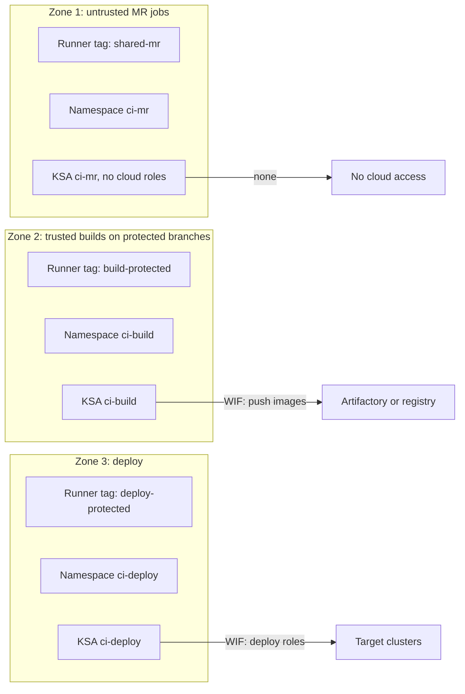

This note describes the platform view of CI on GKE: which components exist, how the cluster and node pools are laid out, how jobs are split into trust zones, how each zone reaches the cloud without stored keys, and how the platform fails and recovers. It deliberately leaves the Helm install and executor settings to [[patterns/gitlab-runners-on-gke]], controller hardening to [[patterns/jenkins-controller-and-agent-hardening]], shared pipeline code to [[patterns/jenkins-shared-libraries]], and the product comparison to [[tools/gitlab-ci-vs-jenkins]].

> [!info] Scope and sources
> Written against the GitLab Runner Kubernetes executor, the Jenkins Kubernetes plugin and GCP Workload Identity Federation as general designs. Product behaviour changes between releases; the vendor documentation listed under Sources is authoritative.

> [!note] Not verified
> Nothing here was run. Check before relying on it: the current runner registration and authentication flow, how `id_tokens` claims are named in your GitLab version, the Jenkins Kubernetes plugin pod template options, and the attribute names your Workload Identity Federation provider maps.

## Goals

- Run every job in an ephemeral, isolated pod that is gone when the job ends.
- Separate code that anyone can propose from code that is allowed to deploy.
- Give each class of job only the cloud access it needs, with no long-lived keys.
- Keep the platform rebuildable from Git, so losing a cluster is an inconvenience, not an incident.
- Make capacity and cost visible, because CI is bursty and easy to overspend on.

## Components

| Component                     | Role                                                                                                      | State                             |
| ----------------------------- | --------------------------------------------------------------------------------------------------------- | --------------------------------- |
| GitLab (SaaS or self-managed) | Source, merge requests, pipeline definition, job queue                                                    | Held by GitLab                    |
| Runner manager                | Long-running pod that polls GitLab and creates a pod per job                                              | Config in Git, no job data        |
| Job pod                       | Build container, helper container, optional services; deleted at end                                      | None                              |
| Jenkins controller            | Schedules builds, holds job config and history                                                            | Persistent volume; config as code |
| Jenkins agent pod             | Ephemeral inbound agent created per build by the Kubernetes plugin                                        | None                              |
| Artifactory                   | Dependency proxy and artifact store, see [[architecture/artifact-management-architecture-artifactory-ha]] | Held by Artifactory               |
| Object storage                | Distributed cache and artifacts                                                                           | Bucket                            |

Most organisations run one of the two CI systems. When both exist, for example during a migration, they share the cluster pattern but not the trust zones, because their credentials models differ.

## Cluster and node pool layout

Two shapes work:

- **A dedicated CI cluster.** The strongest isolation: a node or kernel escape lands in a cluster that holds no production workload. It costs an extra control plane and some duplicated add-ons.
- **CI node pools in a shared cluster.** Cheaper, acceptable when the CI namespaces are isolated with network policies and the pools are tainted so no production pod can land on them. Follow the tenancy guidance in [[architecture/gke-platform-topology-and-tenancy]].

Node pools, by purpose:

- **Build pool, spot.** Most jobs are retryable. Spot capacity is cheaper and can be reclaimed, so configure automatic retry for infrastructure failures and keep jobs idempotent.
- **Deploy pool, on-demand.** Deploy jobs should not be interrupted halfway through a rollout.
- **Optional large-memory or GPU pool** for the few jobs that need it, behind a runner tag.

Taint each pool and add tolerations in the runner or pod template so the scheduler places a job class only on its own pool. Autoscale each pool with a floor of zero or one and a ceiling that protects your quota and budget.

## Trust zones

A trust zone is a set of jobs that are equally trusted, with its own runners, namespace, service account and egress. Three zones cover most organisations.



- **Zone 1, untrusted.** Merge request pipelines, including those from forks or from contributors who can push branches. Code here is attacker-controlled. The zone gets no cloud identity, no deploy credentials and no protected variables. It can resolve dependencies through Artifactory and run tests.
- **Zone 2, trusted builds.** Pipelines on protected branches and tags build and publish artifacts. They may push to the artifact store, sign, and attest.
- **Zone 3, deploy.** Jobs that change environments. Deploy runners are protected: they only accept jobs from protected refs, and merge request pipelines can never reach them. Prefer a pull-based GitOps model, so the deploy zone only commits to a config repository, as in [[architecture/gitops-repo-topology-and-promotion]].

Each zone gets:

- Its own runner tags, so a job cannot land in a more trusted zone by accident. Mark trusted runners as protected so they run only protected refs.
- Its own namespace and Kubernetes service account.
- Its own network policy and egress rules, see [[patterns/kubernetes-network-policies]]. Zone 1 should not reach internal services or the metadata server.
- Its own variables. Protected variables are exposed only to jobs on protected branches and tags, never to merge request pipelines from unprotected refs.

Hard rules for all zones:

- No privileged containers. Build images with a daemonless builder rather than mounting the Docker socket or running Docker-in-Docker with privileges.
- No host path mounts and no host networking.
- Restrict `hostPath`, capabilities and privilege escalation with admission policy, not just with runner config.
- Pin job images by digest where the job holds any credential.

## Keyless cloud access per zone

Do not store service account keys in CI variables. Use OIDC and Workload Identity Federation, described in [[architecture/iam-groups-and-ci-workload-identity-federation]].

For GitLab, a job requests an OIDC token with `id_tokens`, and the provider exchanges it for short-lived Google credentials. Condition the exchange on attributes that differ per zone:

```yaml title=".gitlab-ci.yml (job fragment)"
publish-image:
  stage: publish
  tags: [build-protected]
  rules:
    - if: $CI_COMMIT_BRANCH == $CI_DEFAULT_BRANCH
  id_tokens:
    GCP_ID_TOKEN:
      aud: https://iam.googleapis.com/projects/123456789/locations/global/workloadIdentityPools/ci-pool/providers/gitlab
  script:
    - ./scripts/exchange-token-and-push.sh
```

On the cloud side, the provider's attribute condition decides who may impersonate which service account. A trusted-build service account should only accept tokens whose project path, ref and ref-protected claim match. Example condition shape (claim names depend on your GitLab version, so check the current docs):

```text title="attribute condition (shape only)"
assertion.project_path == "platform/payments-api"
&& assertion.ref_protected == "true"
&& assertion.ref_type == "branch"
&& assertion.ref == "main"
```

For Jenkins, agents run with a Kubernetes service account bound to a Google service account through Workload Identity (see [[patterns/gke-workload-identity]]), with one service account per trust zone. Jenkins has no built-in per-build OIDC token equivalent, so the pod identity is the boundary; this is a reason to keep Jenkins agent pools small and per zone.

## Caching and dependencies

- **Dependencies.** Resolve everything through Artifactory remote repositories. Runners have no direct route to public registries. This makes builds faster and reproducible.
- **Distributed cache.** Use an object storage bucket for the GitLab cache so any runner pod can reuse it. Scope the cache key per branch or lock file and keep zone 1 and zone 2 caches separate, so an untrusted job cannot poison a cache that a trusted build later restores. This separation matters: a shared cache across trust zones is a supply chain hole.
- **Image layers.** Use a registry-side cache or a build cache backend instead of a local Docker daemon.
- **Node-local caches** such as pulled job images speed up cold starts. Pre-pull the helper and common build images with a DaemonSet if start time matters.

## Capacity and cost

- Measure concurrency, not pipelines: peak simultaneous jobs per zone drives node count.
- Set pod resource requests honestly. CI pods that request too little get packed too tightly and fail on memory; too much leaves nodes idle.
- Set a job timeout and a ceiling on concurrent jobs per runner so a runaway pipeline cannot consume the cluster.
- Scale the build pool to zero or near zero outside working hours if the workload allows.
- Tag cost by zone and team using the labels in [[architecture/finops-cost-allocation-and-guardrails]].

## Failure modes

| Failure                              | Effect                                              | Mitigation                                                                |
| ------------------------------------ | --------------------------------------------------- | ------------------------------------------------------------------------- |
| Spot reclaim during a job            | Job fails with an infrastructure error              | Retry on runner system failure, idempotent jobs                           |
| Runner manager pod lost              | New jobs queue until it is rescheduled              | Two replicas per zone, PodDisruptionBudget, alert on queue age            |
| Jenkins controller loss              | No scheduling, history unavailable                  | Config as code, persistent volume snapshots, restore drill                |
| Image registry or Artifactory outage | Every build stalls at dependency resolution         | HA registry, cached base images, a clear status page                      |
| Compromised MR job                   | Attacker runs code in zone 1                        | No cloud identity, no protected variables, network policy, ephemeral pods |
| Over-broad WIF condition             | Untrusted job impersonates a deploy service account | Attribute conditions on protected ref and project, periodic access review |
| Quota exhaustion                     | Pods stay Pending                                   | Quota alerts, autoscaler ceiling below quota                              |

## Pitfalls

- Using one runner pool for everything and relying on variable names for safety.
- Making a deploy runner reachable by tag from merge request pipelines.
- Sharing a cache bucket prefix between untrusted and trusted jobs.
- Granting the CI node pool's own service account broad roles. Pods on the node can reach it unless metadata access is restricted.
- Copying old guides that use registration tokens. GitLab moved runner registration from registration tokens to runner authentication tokens; check the current docs and do not script from outdated examples.
- Letting the Jenkins controller run builds itself instead of using ephemeral agents.

## Rollback and DR

- Keep runner manager config, Helm values, node pool definitions and namespace policies in Git and apply them with Terraform and GitOps.
- Rebuild the Jenkins controller from configuration as code and a restored volume snapshot, and keep job definitions in Git.
- Back out a runner change by pinning the previous chart values in Git and re-syncing. Because job pods are ephemeral, there is no per-job state to migrate.
- If a trust zone is suspected compromised, pause its runners in GitLab, scale its pool to zero, rotate any variables the zone could read, and review the WIF audit logs.

## Verify

```bash title="verify-ci-platform.sh"
#!/usr/bin/env bash
set -euo pipefail

CTX="gke_example-ci_europe-west1_ci-cluster"

# Runner managers are running in each zone
kubectl --context "$CTX" get pods -n ci-build -l app=gitlab-runner
kubectl --context "$CTX" get pods -n ci-deploy -l app=gitlab-runner

# No privileged pods exist in CI namespaces
kubectl --context "$CTX" get pods -A -o json \
  | jq -r '.items[] | select(.metadata.namespace | startswith("ci-"))
      | select(.spec.containers[].securityContext.privileged == true)
      | .metadata.namespace + "/" + .metadata.name'

# Zone 1 cannot reach the metadata server (expect a timeout)
kubectl --context "$CTX" -n ci-mr run nettest --rm -i --restart=Never \
  --image=curlimages/curl -- curl -s -m 5 -H "Metadata-Flavor: Google" \
  http://metadata.google.internal/computeMetadata/v1/ || echo "blocked as expected"
```

Then run a merge request pipeline that tries to read a protected variable and to request a cloud token, and confirm both fail.

## Adopt incrementally

1. Move to ephemeral pods with no privileged containers.
2. Split protected and unprotected runners and tag them.
3. Replace stored cloud keys with OIDC and one service account per zone.
4. Separate caches per zone and put dependencies behind Artifactory.
5. Add network policies and a dedicated node pool per zone.
6. Move deploys to pull-based GitOps so the deploy zone shrinks.

## Sources

- GitLab Runner Kubernetes executor: https://docs.gitlab.com/runner/executors/kubernetes/
- GitLab OIDC `id_tokens`: https://docs.gitlab.com/ci/secrets/id_token_authentication/
- GitLab CI/CD variables, protected variables: https://docs.gitlab.com/ci/variables/
- Jenkins Kubernetes plugin: https://plugins.jenkins.io/kubernetes/
- Workload Identity Federation: https://cloud.google.com/iam/docs/workload-identity-federation

Check the current docs for each; names and flows change.

## Related

- [[patterns/gitlab-runners-on-gke]]
- [[patterns/jenkins-controller-and-agent-hardening]]
- [[patterns/jenkins-shared-libraries]]
- [[tools/gitlab-ci-vs-jenkins]]
- [[architecture/iam-groups-and-ci-workload-identity-federation]]
- [[architecture/gke-platform-topology-and-tenancy]]
- [[patterns/kubernetes-network-policies]]
- [[architecture/artifact-management-architecture-artifactory-ha]]
