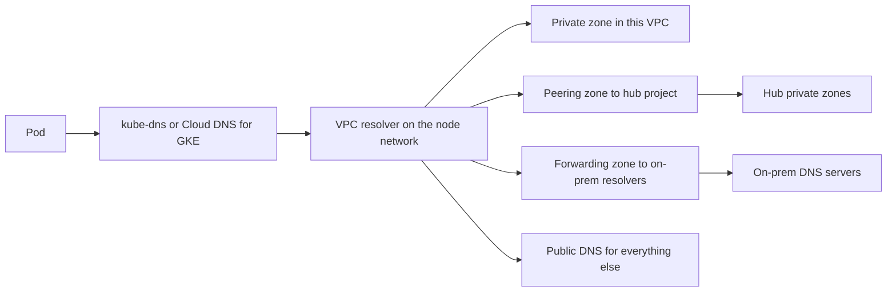

This note describes a DNS layout for a GCP organisation with several projects, a hybrid link to on-prem and GKE clusters: which zones exist, who owns them, and how a query travels from a Pod to its answer. It is written for senior DevOps engineers. Network layout is in [[architecture/shared-vpc-hub-and-spoke]], cluster egress is in [[architecture/private-gke-and-controlled-egress]], and debugging steps are in [[runbooks/network-troubleshooting-dns-mtu-tls-load-balancers]].

> [!info] Scope and sources
> Written against the Cloud DNS documentation on cloud.google.com (private zones, peering zones, forwarding zones, server policies, Cloud DNS for GKE), as understood in October 2026. Terraform examples use the `google` provider.

> [!note] Not verified
> The claims below were written from documentation knowledge and were not checked against a running system or the current docs: DNS peering and forwarding limits, the scopes available in Cloud DNS for GKE, response policy features, and the virtual IP addresses used for the restricted API range. Check them before relying on them.

## Requirements

- Internal names resolve from every project and environment that needs them, and from on-prem.
- On-prem names resolve from GCP, without copying on-prem zones into GCP.
- Each zone has one owner and one project; a team cannot hijack a name another team owns.
- Production and non-production use separate names, so a mistake in a test cannot point a prod client at a test service.
- Google API names can be steered to private ranges without breaking APIs you did not plan for.

## Query flow



A Pod asks the cluster DNS first. Names under `cluster.local` are answered inside the cluster. Anything else goes to the VPC resolver, which picks the most specific zone that applies to the VPC: a private zone, a peering zone, or a forwarding zone. If none match, the query goes to public DNS.

## Zone layout

| Zone                          | Visibility                    | Project              | Owner            |
| ----------------------------- | ----------------------------- | -------------------- | ---------------- |
| `example.com`                 | Public                        | dns-hub              | Platform team    |
| `prod.gcp.example.com`        | Private, attached to prod VPC | dns-hub              | Platform team    |
| `dev.gcp.example.com`         | Private, attached to non-prod | dns-hub              | Platform team    |
| `corp.example.com`            | Forwarding to on-prem         | dns-hub              | Network team     |
| `team-a.prod.gcp.example.com` | Private, per team             | team service project | Application team |
| `googleapis.com`              | Private, API steering         | dns-hub              | Platform team    |

Rules for the layout:

- One central DNS project (the hub) owns shared and forwarding zones. Spokes get names through peering and do not create their own zones for shared names.
- Delegate narrow sub-zones (`team-a.prod.gcp.example.com`) to application teams in their own projects, with IAM on the zone, so they can manage records without touching shared zones.
- Use a different parent name for each environment (`prod.gcp.example.com`, `dev.gcp.example.com`). Same names with different answers per environment are tempting and confusing.

## Terraform

The private zone lives in the hub and is visible to the hub VPC. Peering zones in each spoke VPC send queries for the shared names to the hub.

```hcl title="dns/zones.tf"
variable "hub_network" {
  type        = string
  description = "Self link of the hub VPC"
  default     = "projects/net-hub/global/networks/hub" # change: your hub VPC
}

variable "prod_network" {
  type        = string
  description = "Self link of the prod spoke VPC"
  default     = "projects/net-prod-host/global/networks/prod" # change: your prod VPC
}

resource "google_dns_managed_zone" "prod_private" {
  project     = "dns-hub" # change: DNS hub project
  name        = "prod-gcp-example-com"
  dns_name    = "prod.gcp.example.com." # change: your domain
  description = "Internal names for production"
  visibility  = "private"

  private_visibility_config {
    networks {
      network_url = var.hub_network
    }
  }
}

# In the spoke: queries for the shared names go to the hub VPC.
resource "google_dns_managed_zone" "prod_peering" {
  project     = "net-prod-host" # change: spoke host project
  name        = "peer-to-hub-prod"
  dns_name    = "prod.gcp.example.com." # change: same name as the hub zone
  description = "Peering zone to the hub"
  visibility  = "private"

  private_visibility_config {
    networks {
      network_url = var.prod_network
    }
  }

  peering_config {
    target_network {
      network_url = var.hub_network
    }
  }
}

# In the spoke: queries for on-prem names also go to the hub, where the forwarding zone lives.
resource "google_dns_managed_zone" "corp_peering" {
  project     = "net-prod-host" # change: spoke host project
  name        = "peer-to-hub-corp"
  dns_name    = "corp.example.com." # change: your on-prem domain
  description = "Peering zone for on-prem names"
  visibility  = "private"

  private_visibility_config {
    networks {
      network_url = var.prod_network
    }
  }

  peering_config {
    target_network {
      network_url = var.hub_network
    }
  }
}

# In the hub: queries for on-prem names go to on-prem resolvers.
resource "google_dns_managed_zone" "corp_forwarding" {
  project     = "dns-hub" # change: DNS hub project
  name        = "corp-example-com"
  dns_name    = "corp.example.com." # change: your on-prem domain
  description = "Forward to on-prem resolvers"
  visibility  = "private"

  private_visibility_config {
    networks {
      network_url = var.hub_network
    }
  }

  forwarding_config {
    target_name_servers {
      ipv4_address = "10.0.0.53" # change: on-prem resolver 1 (RFC 1918 example)
    }
    target_name_servers {
      ipv4_address = "10.0.1.53" # change: on-prem resolver 2 (RFC 1918 example)
    }
  }
}

# In the hub: let on-prem query GCP private zones.
resource "google_dns_policy" "hub_inbound" {
  project                   = "dns-hub" # change: DNS hub project
  name                      = "hub-inbound"
  description               = "Inbound forwarding for on-prem resolvers"
  enable_inbound_forwarding = true

  networks {
    network_url = var.hub_network
  }
}
```

A DNS peering zone is created in the consuming network and points at the producing network. The producing (hub) network must be able to resolve the name, which is why the private zone is attached to the hub VPC.

## On-prem integration

- **GCP to on-prem.** The forwarding zone sends queries for `corp.example.com` to the on-prem resolvers. Make sure the hybrid link allows UDP and TCP port 53 from the Cloud DNS source ranges documented for forwarding; confirm the ranges in the current docs, because they are easy to forget in on-prem firewalls.
- **On-prem to GCP.** The inbound policy gives the hub VPC entry-point addresses; on-prem resolvers forward `gcp.example.com` to those addresses.
- **Only the hub talks to on-prem.** Spokes reach on-prem names through the peering chain or through their own forwarding zones; do not create an on-prem path in every project.

## Naming per environment

- `<service>.<env>.gcp.example.com` for internal service names.
- `<service>.example.com` for public names, split-horizon only where a service has both an internal and an external face. For split-horizon, the private zone shadows the public one inside attached networks, so every record that should still resolve must exist in the private zone too.
- Keep TLS in mind: internal names need certificates ([[runbooks/tls-certificate-renewal]]).

## Private zone for Google APIs

To steer Google API traffic to private ranges, create a private zone for the API domain with records pointing at the chosen range, as described in [[architecture/private-gke-and-controlled-egress]]. The two documented targets are `private.googleapis.com` and `restricted.googleapis.com`.

```hcl title="dns/googleapis.tf"
variable "nonprod_network" {
  type        = string
  description = "Self link of the non-prod spoke VPC"
  default     = "projects/net-nonprod-host/global/networks/nonprod" # change: your non-prod VPC
}

# The GKE nodes live in the spoke VPCs, so the zone must be attached to them too
# (cross-project binding), not only to the hub. Alternative: peering zones in each spoke.
locals {
  api_zone_networks = [var.hub_network, var.prod_network, var.nonprod_network]
}

resource "google_dns_managed_zone" "googleapis" {
  project     = "dns-hub" # change: DNS hub project
  name        = "googleapis-restricted"
  dns_name    = "googleapis.com."
  description = "Steer Google API names to the restricted range"
  visibility  = "private"

  private_visibility_config {
    dynamic "networks" {
      for_each = local.api_zone_networks
      content {
        network_url = networks.value
      }
    }
  }
}

# Artifact Registry pulls use pkg.dev and gcr.io, not googleapis.com. Add equivalent zones
# (same shape as above, one each, with a CNAME of *.pkg.dev. and *.gcr.io. to
# restricted.googleapis.com.). Confirm the names in the current VPC-SC and Artifact Registry docs.
resource "google_dns_managed_zone" "pkg_dev" {
  project     = "dns-hub" # change: DNS hub project
  name        = "pkg-dev-restricted"
  dns_name    = "pkg.dev."
  description = "Steer Artifact Registry names to the restricted range"
  visibility  = "private"

  private_visibility_config {
    dynamic "networks" {
      for_each = local.api_zone_networks
      content {
        network_url = networks.value
      }
    }
  }
}

resource "google_dns_record_set" "pkg_dev_wildcard" {
  project      = "dns-hub" # change: DNS hub project
  managed_zone = google_dns_managed_zone.pkg_dev.name
  name         = "*.pkg.dev."
  type         = "CNAME"
  ttl          = 300
  rrdatas      = ["restricted.googleapis.com."]
}

# The restricted range is reached through the default internet gateway route.
resource "google_compute_route" "restricted_googleapis" {
  project          = "net-prod-host" # change: host project; repeat per VPC that uses the range
  name             = "restricted-googleapis"
  network          = "prod" # change: VPC name
  dest_range       = "199.36.153.4/30" # confirm in current docs
  next_hop_gateway = "default-internet-gateway"
  priority         = 1000
}

resource "google_dns_record_set" "restricted_a" {
  project      = "dns-hub" # change: DNS hub project
  managed_zone = google_dns_managed_zone.googleapis.name
  name         = "restricted.googleapis.com."
  type         = "A"
  ttl          = 300
  rrdatas      = ["199.36.153.4", "199.36.153.5", "199.36.153.6", "199.36.153.7"] # confirm in current docs
}

resource "google_dns_record_set" "wildcard" {
  project      = "dns-hub" # change: DNS hub project
  managed_zone = google_dns_managed_zone.googleapis.name
  name         = "*.googleapis.com."
  type         = "CNAME"
  ttl          = 300
  rrdatas      = ["restricted.googleapis.com."]
}
```

The restricted range serves only APIs that VPC Service Controls supports. A `gcr.io.` zone follows the same pattern as `pkg.dev.` if you still use Container Registry names. The restricted range also needs the route above, because the addresses are not reachable through a default route to an on-prem gateway. Any other Google API name that resolves through this zone stops working. See the pitfalls.

## Pitfalls

- **Forwarding loops.** On-prem forwards `gcp.example.com` to GCP, and GCP forwards a parent zone back to on-prem. Queries bounce until they time out. Keep zones disjoint: GCP forwards only `corp.example.com`; on-prem forwards only `gcp.example.com`.
- **A private zone for the Google API domain breaks unlisted APIs.** A wildcard CNAME to the restricted range makes every API name resolve there, including APIs that are not supported by VPC Service Controls. List the APIs you use, test them, and keep `private.googleapis.com` available as a fallback.
- **ndots and search domains in Pods.** Kubernetes sets `ndots:5` by default, so an external name like `api.example.com` is tried with several search suffixes first. That multiplies queries and latency. Use fully qualified names with a trailing dot, or set `dnsConfig.options` with a lower `ndots` for chatty workloads.
- **Peering zone without the hub zone.** A spoke peering zone returns `SERVFAIL` or `NXDOMAIN` if the hub zone is not attached to the hub VPC.
- **Overlapping zones.** Two private zones with the same name attached to the same VPC are rejected; two zones with different specificity pick the most specific one, which can hide records.
- **Short TTLs and quota.** Very low TTLs on busy names raise query volume; check current DNS quotas.

## Verify

```bash
set -euo pipefail

PROJECT_ID="dns-hub"   # change: DNS hub project

gcloud dns managed-zones list --project "$PROJECT_ID" \
  --format "table(name,dnsName,visibility)"

gcloud dns policies list --project "$PROJECT_ID" \
  --format "table(name,enableInboundForwarding)"

# Debug Pod. Image is an example: pin by digest in real use.
kubectl run dnsutils --restart=Never \
  --image=registry.k8s.io/e2e-test-images/jessie-dnsutils:1.3 \
  --command -- sleep 3600
kubectl wait --for=condition=Ready pod/dnsutils --timeout=60s

kubectl exec dnsutils -- dig +short app.prod.gcp.example.com   # change: a real internal name
kubectl exec dnsutils -- dig +short host.corp.example.com      # change: a real on-prem name
kubectl exec dnsutils -- nslookup kubernetes.default.svc.cluster.local

kubectl delete pod dnsutils
```

Expected: the internal name returns its private address, the on-prem name returns an on-prem address, and the cluster service name returns the cluster IP. If `dig` returns nothing, repeat the query against a specific server (`dig @10.0.0.53 ...`) to separate GCP from on-prem failures.

## Adopt it incrementally

1. Create the hub project and the per-environment private zones; move existing records into Terraform.
2. Add peering zones in one spoke and test from a debug Pod.
3. Add the forwarding zone and the inbound policy, and test both directions from a single host before widening.
4. Add the Google API steering last, and only with a list of the APIs you depend on.

## Related

- [[architecture/shared-vpc-hub-and-spoke]]: the hub and spoke VPCs the zones attach to.
- [[architecture/private-gke-and-controlled-egress]]: why Google API names are steered to private ranges.
- [[runbooks/network-troubleshooting-dns-mtu-tls-load-balancers]]: step-by-step debugging of failed lookups.
- [[runbooks/tls-certificate-renewal]]: certificates for the internal names defined here.
