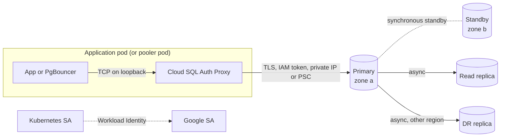

This note describes how a platform team offers Cloud SQL for PostgreSQL to application teams on GKE: how instances are laid out, how pods reach them without public IPs or passwords, how high availability and replicas behave, and what to watch. The decision to use Cloud SQL is [[adr/0027-cloud-sql-for-production-postgres]]. Connection pooling is in [[patterns/postgres-connection-pooling-gke]], schema changes in [[patterns/postgres-expand-contract-migrations]], backups in [[architecture/backup-architecture-gke-cloud-sql-gcs]], and a failover gone wrong in [[runbooks/cloud-sql-ha-failover-recovery]].

> [!info] Scope and sources
> Flags, enum values and defaults for `gcloud sql` were read from the gcloud reference text and the Cloud SQL Admin API field descriptions. Product behaviour, editions, SLAs, limits and the Cloud SQL Auth Proxy were not checked against the current documentation; the pages under Sources are authoritative. Nothing here was run against a live instance.

> [!note] Not verified
> Check these before relying on them:
>
> - Cloud SQL Auth Proxy v2 flag names (`--private-ip`, `--psc`, `--auto-iam-authn`, `--port`, `--health-check`, `--http-port`, `--structured-logs`, `--max-sigterm-delay`, `--quitquitquit`), the image name and tag, and the instance connection name format `PROJECT:REGION:INSTANCE`.
> - IAM database authentication: the database flag that enables it (commonly `cloudsql.iam_authentication=on`), the roles a principal needs (commonly `roles/cloudsql.instanceUser` and `roles/cloudsql.client`), the PostgreSQL username format for a service account (commonly the email without `.gserviceaccount.com`), and the token lifetime.
> - How many days after the notification each maintenance channel (`preview`, `production`, `week5`) is scheduled (commonly 7 to 14, 15 to 21 and 35 to 42 days), and whether automatic DNS records are created for Private Service Connect instances by default.
> - What happens to connections during an HA failover, how long it takes, and maintenance downtime figures for each edition.
> - Enterprise vs Enterprise Plus: SLAs, prices, near-zero-downtime maintenance, and which features each edition and version supports, beyond the flags named below.
> - Read replica limits (count, cross-region, cascading), lag behaviour, and whether a promoted replica can rejoin. The `promote-replica` help does not say promotion is reversible or irreversible.
> - Private services access vs Private Service Connect trade-offs: IP planning, cross-project and cross-region reach, and which features (replicas, DR replica) work with PSC.
> - `max_connections` defaults per machine size, managed connection pooling availability by edition, version and region.
> - Cloud Monitoring metric names and the Terraform `google` provider argument names and `type` strings in the sketch.
> - Which Cloud SQL service agent needs access to a CMEK key: the `--disk-encryption-key` help names a different agent from the one usually documented.

## Goals

- No public IP, no authorised networks, no database passwords in application config.
- One owner per instance, and a clear rule for when a team gets its own instance.
- HA in production by default, with failover rehearsed and its effect on clients known.
- A DR story that matches the tier in [[architecture/disaster-recovery-tiers-rpo-rto]] and the regions in [[adr/0028-primary-and-dr-regions-per-environment]].
- Changes (flags, versions, maintenance) go through Terraform and review, like any other infrastructure.

## Instance layout

| Layout                                | Strengths                                                 | Costs                                                                      | Use when                                                      |
| ------------------------------------- | --------------------------------------------------------- | -------------------------------------------------------------------------- | ------------------------------------------------------------- |
| One instance per service              | Isolation of load, maintenance, versions and blast radius | More instances to pay for and patch; idle capacity                         | Production services with their own SLO or data classification |
| Shared instance, database per service | Cheaper, fewer instances                                  | Noisy neighbours, shared `max_connections`, one maintenance window for all | Non-production, small internal tools                          |
| Shared instance, schema per service   | Cheapest                                                  | No real isolation; one bad migration affects everyone                      | Avoid outside sandboxes                                       |

Rules: an instance lives in the service project of the team that owns it (or in a platform data project per environment), never in a project that spans environments ([[architecture/environment-separation-on-gcp]]). Production instances are `REGIONAL`; non-production is `ZONAL` unless you are testing HA behaviour.

## Connectivity



| Option                               | How it works                                                                                                 | Notes                                                                                                                                                                                                           |
| ------------------------------------ | ------------------------------------------------------------------------------------------------------------ | --------------------------------------------------------------------------------------------------------------------------------------------------------------------------------------------------------------- |
| Private IP (private services access) | The instance gets an address in a range allocated to Google's service producer network, peered with your VPC | `--network` takes the full URL for Shared VPC (`projects/HOST/global/networks/NAME`). The API text says the private network cannot be removed once set. Peering is not transitive.                              |
| Private Service Connect              | The instance publishes a service attachment; consumers create an endpoint in their own VPC                   | `--enable-private-service-connect` with `--allowed-psc-projects`; `--psc-auto-connections` can create consumer endpoints automatically. DNS behaviour: check the PSC page. Avoids range allocation and peering. |
| Public IP with authorised networks   | Instance reachable on the internet, filtered by CIDR                                                         | Avoid. Block it with the `sql.restrictPublicIp` and `sql.restrictAuthorizedNetworks` constraints ([[compliance/gcp-organization-policy-guardrails]]).                                                           |

Pick one connectivity model per environment and stick to it; mixing PSA and PSC makes DNS and firewall rules hard to reason about. PSA fits a single Shared VPC ([[architecture/shared-vpc-hub-and-spoke]]); PSC fits consumers in many VPCs or projects.

On top of the network path:

- **The Auth Proxy or a language connector** handles TLS and IAM. Run it as a sidecar next to the pooler, as [[patterns/postgres-connection-pooling-gke]] describes, not in every application pod as well.
- **`--connector-enforcement=REQUIRED`** makes the instance accept only connections from Cloud SQL connectors (the Auth Proxy and the Java, Python and Go connectors). The help warns that it disables all existing authorised networks. Turn it on once every client uses a connector.
- **`--ssl-mode=ENCRYPTED_ONLY`** (or `TRUSTED_CLIENT_CERTIFICATE_REQUIRED`) for any path that does not go through a connector. `ssl_mode` takes priority over the legacy `require_ssl`.
- Private clusters and egress control are in [[architecture/private-gke-and-controlled-egress]].

## Identity

- **Workloads use IAM database authentication.** The pod's Kubernetes service account maps to a Google service account through [[patterns/gke-workload-identity]]; that account is a database user of type `CLOUD_IAM_SERVICE_ACCOUNT` (the API enum; `gcloud sql users create --type`). The proxy obtains and refreshes the token, so no password exists.
- **Humans use their own identity** as `CLOUD_IAM_USER`, or a group (`CLOUD_IAM_GROUP`), with read-only database roles by default. For a manual session, `gcloud sql generate-login-token` produces a token to use as the password.
- **Database privileges are still PostgreSQL privileges.** IAM lets a principal log in; `GRANT` decides what it can do. `--database-roles` on `gcloud sql users create` assigns predefined roles such as `cloudsqlsuperuser` or your own roles. Give the application role only what the service needs, and run migrations with a separate identity.
- **Break-glass.** Keep one `BUILT_IN` administrative user whose password is in Secret Manager, readable only through the just-in-time path in [[compliance/privileged-access-just-in-time-gcp-gke]] and rotated after each use ([[patterns/secret-rotation-without-downtime]], [[architecture/secrets-architecture-gcp-and-gke]]). PostgreSQL requires the root password to be set before you can connect.

## High availability and maintenance

- `--availability-type=regional` gives a standby in another zone and automatic failover; `zonal` (the default) has no failover. After a failover the instance's `gceZone` changes.
- Expect open connections to drop and in-flight transactions to fail during a failover (the HA page has the details, including whether the address stays the same). Clients must reconnect with backoff and retry idempotent work ([[patterns/timeouts-retries-load-shedding]]). Measure the real interruption in a drill with `gcloud sql instances failover`.
- **Maintenance.** Set `--maintenance-window-day` and `--maintenance-window-hour` (UTC) to a low-traffic slot, and use the release channel to let non-production take updates first: `preview` for non-prod and `production` for prod; a third channel, `week5`, releases after production with a 5-week advance notification (gcloud help). The Cloud SQL maintenance docs give the scheduling delay after notification for each channel. Deny periods (`--deny-maintenance-period-start-date`, `-end-date`, `-time`) cover freezes; leaving out the year makes them recur every year. `gcloud sql reschedule-maintenance` moves a scheduled update.
- **Storage.** `--storage-auto-increase` is on by default and increases are permanent; the help warns that a full disk can take the instance offline and drop connections. Alert on disk utilisation well before it is full.

## Read replicas and DR

- **Read replicas** (`gcloud sql instances create REPLICA --master-instance-name=PRIMARY`) serve read-only traffic and reporting. Treat them as lagging: a read after a write can return old data. Route only lag-tolerant reads to them, and check the replication page for how lag behaves under load.
- **Cross-region DR replica.** A replica in the DR region gives a low RPO for regional failure. On Enterprise Plus, `gcloud sql instances patch --failover-dr-replica-name=REPLICA` designates a DR replica, and the API describes a PSA write endpoint (DNS) that follows the primary after a switchover or replica failover. Check edition and connectivity requirements before you design around it.
- **Planned vs unplanned.** `gcloud sql instances switchover REPLICA` swaps roles in a planned way (with `--db-timeout`, default 10 minutes). `gcloud sql instances promote-replica REPLICA` detaches a replica as a standalone instance for real disasters.

> [!danger] Promotion breaks replication
> After `promote-replica`, the former replica is a standalone instance and writes go to it; the old primary does not automatically follow. Plan to rebuild replication (and any other replicas) afterwards, update every client to the new endpoint, and confirm in the current docs whether any path back exists for your edition. Rehearse it in non-production first; the steps are in [[runbooks/cloud-sql-ha-failover-recovery]].

## Connections and pooling

`max_connections` is a budget, not a default to accept. Compute it per instance:

```text title="connection budget"
needed = sum over services of (max pods x pool size per pod)
       + migration and batch jobs at peak
       + replication and monitoring connections
       + admin headroom (break-glass, psql sessions)
```

If `needed` approaches the instance limit, put a pooler in front ([[patterns/postgres-connection-pooling-gke]]) instead of raising the limit, because each PostgreSQL connection costs memory. gcloud also exposes a managed connection pooling option (`--enable-connection-pooling` and `--connection-pool-flags`); check which editions and versions support it before choosing it over an in-cluster pooler. Watch the HPA: scaling pods multiplies connections.

## Backups, encryption and schema changes

- Automated backups with `--backup-start-time`, `--retained-backups-count` and `--enable-point-in-time-recovery`. The help gives transaction log retention of up to 7 days on Enterprise and up to 35 on Enterprise Plus; set retention to cover your RPO. Backups exist only if restores are proven ([[adr/0051-backups-proven-by-quarterly-restore-drills]]).
- Keep `--deletion-protection` on, and keep `--final-backup` (default retention 30 days) so deleting an instance still leaves a backup.
- CMEK with `--disk-encryption-key` where policy requires it ([[patterns/cloud-kms-key-management]]); check which service agent needs the Encrypter/Decrypter role. Evidence for auditors is in [[compliance/encryption-at-rest-and-in-transit-evidence-gcp]].
- Schema changes through expand and contract ([[patterns/postgres-expand-contract-migrations]]), run by a migration identity, never by the application user.

## Observability

- Query Insights on in production (`--insights-config-query-insights-enabled`, plus `--insights-config-record-application-tags` if your ORM sets tags). It shows the slow queries behind a CPU spike.
- Alert on CPU, memory, disk utilisation, connection count against the budget, replication lag on every replica, and failed backups. Pick the metric names from the Cloud SQL metrics list in Cloud Monitoring.
- Watch `gcloud sql operations list` (or its audit log equivalent) for failovers, maintenance and restarts, and annotate dashboards with them.

## Terraform sketch

Argument names follow the `google` provider as commonly documented; check them, and the allowed `type` strings, against the provider docs for your pinned version.

```hcl title="cloudsql/main.tf"
resource "google_sql_database_instance" "orders" {
  project             = "team-a-prod"   # change: owning service project
  name                = "orders-pg-prod"
  region              = "europe-west1"  # change: primary region
  database_version    = "POSTGRES_16"   # change: a version listed in gcloud sql instances create --help
  deletion_protection = true

  settings {
    tier              = "db-custom-4-16384" # change: size from load tests
    availability_type = "REGIONAL"

    ip_configuration {
      ipv4_enabled    = false
      private_network = "projects/net-prod-host/global/networks/prod" # change: Shared VPC network
      ssl_mode        = "ENCRYPTED_ONLY"
    }

    backup_configuration {
      enabled                        = true
      point_in_time_recovery_enabled = true
      start_time                     = "02:00"
    }

    maintenance_window {
      day          = 7 # change: your low-traffic day
      hour         = 3
      update_track = "stable"
    }

    database_flags {
      name  = "cloudsql.iam_authentication"
      value = "on"
    }

    insights_config {
      query_insights_enabled = true
    }
  }
}

resource "google_sql_user" "orders_app" {
  project  = google_sql_database_instance.orders.project
  instance = google_sql_database_instance.orders.name
  name     = "orders-app@team-a-prod.iam" # change: the documented username form for your service account
  type     = "CLOUD_IAM_SERVICE_ACCOUNT"
}
```

## Failure modes

| Failure                    | Effect                                      | Mitigation                                                                  |
| -------------------------- | ------------------------------------------- | --------------------------------------------------------------------------- |
| Zonal failure, HA instance | Automatic failover; connections drop        | Client reconnect and retry; drill failover each quarter                     |
| Regional failure           | Primary and standby gone                    | DR replica, switchover or promotion runbook, clients re-pointed             |
| Connection exhaustion      | New connections refused, cascading timeouts | Pooler, budget per service, HPA max replicas bounded                        |
| Disk full                  | Instance can go offline                     | Auto-increase on, disk alerts, cleanup of bloat and logs                    |
| Maintenance at a bad time  | Short outage in peak traffic                | Window, release channel, deny periods for freezes                           |
| Replica lag                | Stale reads, higher RPO for DR              | Lag alert, route only tolerant reads, size the replica like the primary     |
| Proxy sidecar not ready    | App starts before the proxy and crashes     | Native sidecar or startup ordering, readiness that checks the database path |

## Pitfalls

- Creating an instance without `--database-version`: the gcloud default is a MySQL version.
- Using the `postgres` built-in user from applications "for now".
- Read-after-write through a read replica.
- `--no-assign-ip` forgotten, so a public IP exists even though nobody uses it.
- Failover drills scheduled without checking pending maintenance, so the drill and an update overlap and the results mean nothing.
- A pool size per pod that looked fine at three replicas and exhausts the instance at thirty.

## Verify

```bash title="verify-cloudsql.sh"
#!/usr/bin/env bash
set -euo pipefail

PROJECT="team-a-prod"      # change: owning project
INSTANCE="orders-pg-prod"  # change: instance ID

# Expect: RUNNABLE, REGIONAL, no PRIMARY (public) address, ENCRYPTED_ONLY
gcloud sql instances describe "$INSTANCE" --project "$PROJECT" \
  --format="yaml(state,gceZone,settings.availabilityType,ipAddresses,settings.ipConfiguration.sslMode,replicaNames)"

# Recent operations: failovers, maintenance, backups
gcloud sql operations list --instance "$INSTANCE" --project "$PROJECT" --limit 20

# IAM users exist with the expected types
gcloud sql users list --instance "$INSTANCE" --project "$PROJECT" --format="table(name,type)"

# Point-in-time recovery window
gcloud sql instances get-latest-recovery-time "$INSTANCE" --project "$PROJECT"
```

Then, from a pod in the namespace (or locally with the proxy), connect as the workload identity and run `SELECT current_user;`. Expected: the IAM user name, without any password configured. The proxy invocation depends on its version; read `cloud-sql-proxy --help` before scripting it.

## Adopt incrementally

1. Block public IPs with organisation policy and move existing instances to private connectivity.
2. Introduce the proxy with IAM authentication for one service; remove its password user once it works.
3. Make production instances regional, set maintenance windows and deny periods, and run a failover drill.
4. Add Query Insights and the alerts above.
5. Add a DR replica for services whose tier needs it, and rehearse switchover and promotion in non-production.
6. Turn on connector enforcement once every client uses a connector.

## Sources

Official documentation this note was not checked against; verify there:

- [Configure private IP](https://cloud.google.com/sql/docs/postgres/configure-private-ip)
- [Private Service Connect](https://cloud.google.com/sql/docs/postgres/configure-private-service-connect)
- [Cloud SQL Auth Proxy](https://cloud.google.com/sql/docs/postgres/sql-proxy)
- [IAM database authentication](https://cloud.google.com/sql/docs/postgres/iam-authentication)
- [High availability](https://cloud.google.com/sql/docs/postgres/high-availability)
- [Replication](https://cloud.google.com/sql/docs/postgres/replication)
- [Maintenance](https://cloud.google.com/sql/docs/postgres/maintenance)
- [Query Insights](https://cloud.google.com/sql/docs/postgres/using-query-insights)
- [Managed connection pooling](https://cloud.google.com/sql/docs/postgres/managed-connection-pooling)
- The gcloud reference for `gcloud sql instances create`, `patch`, `failover`, `switchover`, `promote-replica` and `gcloud sql users create`.

## Related

- [[adr/0027-cloud-sql-for-production-postgres]]
- [[adr/0028-primary-and-dr-regions-per-environment]]
- [[adr/0051-backups-proven-by-quarterly-restore-drills]]
- [[patterns/postgres-connection-pooling-gke]]
- [[patterns/postgres-expand-contract-migrations]]
- [[runbooks/cloud-sql-ha-failover-recovery]]
- [[runbooks/cloud-sql-point-in-time-recovery]]
- [[architecture/backup-architecture-gke-cloud-sql-gcs]]
