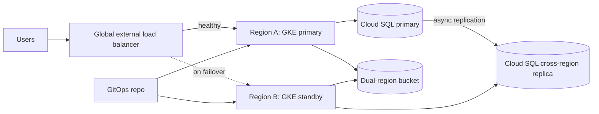

This note helps senior DevOps engineers choose a disaster recovery (DR) tier for a service running on GKE with Cloud SQL and Cloud Storage, and shows the active-passive layout in detail. It covers targets, tiers, the data layer, a failover outline and rehearsals. It deliberately leaves backups and restores to [[architecture/backup-architecture-gke-cloud-sql-gcs]], cluster and tenancy layout to [[architecture/gke-platform-topology-and-tenancy]], and live incident handling to [[runbooks/incident-response]].

> [!info] Scope and sources
> Written against GKE, Cloud SQL and Cloud Storage as a general design, not a specific product version. It follows the structure of Google Cloud's public disaster recovery planning guidance and the Cloud SQL, Cloud Load Balancing and Cloud Storage documentation on cloud.google.com.

> [!note] Not verified
> The claims below were written from documentation knowledge and were not checked against a running system or the current docs: the names and URLs of Google's DR guides, the dual-region bucket syntax in the current Terraform provider, the behaviour of Cloud SQL replica promotion, and the names of replication lag metrics. Check them before relying on them.

## Context and goals

Disaster recovery is the plan for losing a whole failure domain, usually a region, or for losing data through corruption or deletion. High availability inside a region (zonal clusters, regional database HA) is a different and cheaper problem. Decide which one you are solving before you spend money.

Goals of this design:

- Pick a tier per service from business targets, not from habit.
- Make failover a rehearsed, boring procedure with a known owner.
- Keep the cost of each tier visible so the trade-off is an explicit decision.

### Terms

- **RPO (recovery point objective):** how much data you can afford to lose, measured as time. It is set by the data path: how often data is copied and how asynchronous that copy is.
- **RTO (recovery time objective):** how long the service may be down. It is set by how much you must start, promote, reconfigure and verify during failover.
- The targets belong to the business owner of the service. Engineering reports what each tier can realistically deliver, measured in a rehearsal. A target you have never rehearsed is a wish.

## Tier table

The tiers below are a common ladder. The RPO and RTO columns are deliberately examples to replace with your own targets, not guarantees of any product.

| Tier               | Typical use                      | Data approach                               | Relative cost | Operational burden |
| ------------------ | -------------------------------- | ------------------------------------------- | ------------- | ------------------ |
| Backup and restore | Internal tools, batch, dev       | Backups copied to another region or project | Lowest        | Low, restore slow  |
| Pilot light        | Services that tolerate hours     | Replicated data, compute scaled to zero     | Low           | Medium             |
| Warm standby       | Customer-facing, moderate impact | Replicated data, small running footprint    | Medium        | Medium to high     |
| Active-passive     | Revenue-critical services        | Replicated data, full-size idle standby     | High          | High               |
| Active-active      | Services that cannot go down     | Multi-writer or partitioned data            | Highest       | Highest            |

Example targets to change (not defaults): backup and restore may mean an RPO of hours and an RTO of a day; active-passive may aim for an RPO of minutes and an RTO of tens of minutes. Active-active changes the application: it needs conflict handling or data partitioning, which is a design problem, not an infrastructure toggle.

Choose the cheapest tier whose measured RPO and RTO meet the target. Most internal services belong in the first two tiers.

## Active-passive design

Two regions. The primary serves all traffic. The secondary has a cluster built from the same Terraform and GitOps repositories, a cross-region Cloud SQL read replica, and a bucket that is replicated by design.



Key points:

- **One global entry point.** A global load balancer with health checks and a backend in each region lets traffic move without DNS changes. With DNS-based failover, remember that resolver caching extends your RTO.
- **Same code, two clusters.** Both clusters sync from the same GitOps repository (see [[adr/0001-gitops-with-argocd]]), so the standby is not a hand-built copy. The standby can run with fewer replicas, scaled up during failover.
- **Replica promotion is the point of no return.** The standby database is a read replica until you promote it. After promotion it becomes an independent primary; the old primary does not rejoin on its own.
- **Stateless first.** Keep session state, queues and caches either replicated or rebuildable. Anything stateful that is not in the database or the bucket must be named and handled.

## Data layer choices

### Cloud SQL

A cross-region read replica gives asynchronous replication, so the RPO is the replication lag at the moment of the disaster, plus anything not yet shipped. Regional HA protects against a zone failure only; it does not protect against a region loss.

```hcl title="modules/database/replica.tf"
variable "primary_region" {
  type    = string
  default = "europe-west1" # change: region of the primary
}

variable "replica_region" {
  type    = string
  default = "europe-west4" # change: DR region
}

resource "google_sql_database_instance" "primary" {
  name                = "orders-primary"
  region              = var.primary_region
  database_version    = "POSTGRES_16" # change: your engine and version
  deletion_protection = true

  settings {
    tier              = "db-custom-4-16384" # change: size for your load
    availability_type = "REGIONAL"

    backup_configuration {
      enabled                        = true
      point_in_time_recovery_enabled = true
    }
  }
}

resource "google_sql_database_instance" "dr_replica" {
  name                 = "orders-dr-replica"
  region               = var.replica_region
  database_version     = "POSTGRES_16" # must match the primary
  master_instance_name = google_sql_database_instance.primary.name
  deletion_protection  = true

  replica_configuration {
    failover_target = false
  }

  settings {
    tier = "db-custom-4-16384" # keep equal to the primary or promotion will be undersized
  }
}
```

Size the replica like the primary. A replica that is smaller saves money until the day you promote it and it cannot carry production load.

### Cloud Storage

Pick the location type from the RPO. Dual-region and multi-region buckets store data in more than one region as part of the service, so you do not run your own copy job. Check the current documentation for the replication guarantees of each option and for any turbo replication setting.

```hcl title="modules/storage/bucket.tf"
resource "google_storage_bucket" "assets" {
  name                        = "my-project-assets-dr" # change: globally unique name
  location                    = "EU"                   # change: multi-region or dual-region parent
  uniform_bucket_level_access = true
  public_access_prevention    = "enforced"

  # Custom dual-region: the two regions that hold the data.
  custom_placement_config {
    data_locations = ["EUROPE-WEST1", "EUROPE-WEST4"] # change: your region pair
  }

  versioning {
    enabled = true
  }
}
```

Dual-region placement protects against a region loss, not against deletion or overwrite. Versioning and retention are covered in [[architecture/backup-architecture-gke-cloud-sql-gcs]].

### Kubernetes state

Keep desired state in Git, not in the cluster. Secrets should come from a secret manager, not from the cluster, so the standby can fetch them. Persistent volumes are the exception and need a backup or application-level replication.

## Failover procedure outline

Write a runbook per service from this outline and keep it next to the code. Treat the failover itself as a production change and follow [[standards/production-change-checklist]].

1. Declare the disaster and name an incident commander ([[runbooks/incident-response]]).
2. Confirm the primary region is really unavailable and not a partial fault that a rollback would fix.
3. Freeze deploys and pipeline runs that target the affected region.
4. Check replica health and lag; record the lag as the observed data loss.
5. Promote the replica.
6. Scale up the standby and point the application at the promoted database.
7. Shift traffic at the load balancer.
8. Verify with synthetic checks and a business transaction.
9. Communicate status; plan failback as a separate, later change.

Check the replica state before anything else:

```bash
set -euo pipefail

PROJECT_ID="my-project"       # change: your project ID
REPLICA="orders-dr-replica"   # change: your replica instance name

gcloud sql instances describe "${REPLICA}" \
  --project "${PROJECT_ID}" \
  --format="yaml(name,state,region,instanceType,masterInstanceName,replicaConfiguration)"
```

> [!danger] Replica promotion cannot be undone
> Promoting a replica detaches it from its primary and makes it a standalone instance. You cannot turn it back into a replica of the old primary; failback means building a new replica and promoting again in the other direction. Do not run this command for a test against production. Rehearse on a copy.

```bash
set -euo pipefail

PROJECT_ID="my-project"       # change: your project ID
REPLICA="orders-dr-replica"   # change: replica to promote

# IRREVERSIBLE. Run only after the failover decision is recorded.
gcloud sql instances promote-replica "${REPLICA}" --project "${PROJECT_ID}"
```

### Failover checklist

| Step                 | Owner              | Done when                                       |
| -------------------- | ------------------ | ----------------------------------------------- |
| Decision recorded    | Incident commander | Time and reason written in the incident channel |
| Lag captured         | Database owner     | Replica lag noted as the expected data loss     |
| Replica promoted     | Database owner     | Instance reports as a standalone primary        |
| Standby scaled up    | Platform engineer  | Pods ready, autoscalers at expected size        |
| Config switched      | Service owner      | Application uses the promoted database          |
| Traffic shifted      | Platform engineer  | Load balancer sends traffic to the standby      |
| Verification passed  | Service owner      | Synthetic check and one business transaction OK |
| Stakeholders updated | Incident commander | Status page and leadership informed             |

## Rehearsing

An untested DR plan usually fails on something small: a missing secret, a firewall rule, an expired certificate in the standby region, a quota.

A game day plan:

- Pick one service and one scenario, for example loss of the primary region.
- Agree scope and a stop condition beforehand. Run the first rehearsals in a non-production copy of the setup.
- Time each step. The sum of measured steps is your real RTO; the lag you observe is your real RPO.
- Record what surprised you, fix it in code, and repeat. Do at least one rehearsal after any major platform change.
- Include a restore from backup in the exercise, because replication also copies corruption (see [[architecture/backup-architecture-gke-cloud-sql-gcs]]).
- If Terraform state or pipelines are in the affected region, include that dependency; [[runbooks/terraform-state-recovery]] covers state loss.

## Pitfalls

- **Treating replication as backup.** A replica copies a bad delete within seconds. You need both.
- **Quota in the standby region.** Quotas are per region. Request headroom before the disaster, not during it.
- **Hidden regional dependencies.** CI runners, artifact registries, secret stores, DNS zones and identity providers can all live in the failed region.
- **Standby drift.** If the standby is not deployed by the same pipeline, it will not match production. Sync it from the same Git source.
- **Undersized replica.** See above; test the promoted database under realistic load.
- **No failback plan.** Promotion is one-way. Decide how and when you return, and treat it as its own change.
- **Targets nobody owns.** If the business has not signed the RPO and RTO, the tier choice is unsupported.

## Adopting incrementally

1. List services and agree an RPO and RTO per service with its owner.
2. Put every service in the cheapest tier that meets its target, starting with backup and restore.
3. Rehearse a restore for the critical services before building any standby.
4. Add cross-region replicas for the services whose targets demand them.
5. Build the standby cluster from GitOps for the top few services and rehearse failover.
6. Revisit tiers yearly and after incidents.

## Related

- [[architecture/backup-architecture-gke-cloud-sql-gcs]]: backups and restores, which replication does not replace.
- [[architecture/gke-platform-topology-and-tenancy]]: how clusters and projects are laid out, including a second region.
- [[runbooks/incident-response]]: the process that wraps a failover decision.
- [[runbooks/terraform-state-recovery]]: recovering the IaC state you need to rebuild.
- [[standards/production-change-checklist]]: treat failover and failback as production changes.
