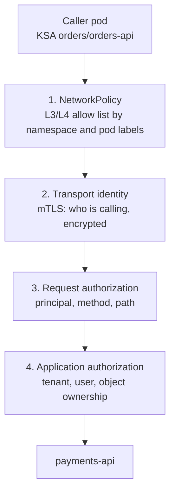

This note describes how to secure traffic between services inside GKE clusters, in layers: L3/L4 network policy, transport identity with mTLS, request authorization by caller identity, and authorization in the application. It gives the options for each layer, a recommended starting point, a safe rollout from permissive to strict, and example manifests. Whether to adopt a mesh at all, and which one, is in [[tools/service-mesh-on-gke]]; the NetworkPolicy mechanics are in [[patterns/kubernetes-network-policies]]; access from people and the internet (north-south) is in [[architecture/zero-trust-access-iap-and-vpc-service-controls]].

> [!info] Scope and sources
> Written against the Kubernetes NetworkPolicy, service account token and TokenReview documentation and the Istio PeerAuthentication, AuthorizationPolicy, mTLS migration, health check and ambient documentation, read from their documentation sources on 2026-10-21. Not checked against the Google Cloud pages for Cloud Service Mesh and GKE network policy; verify there.

> [!note] Not verified
> Nothing here was run. Check before relying on it: the Cloud Service Mesh product name, supported modes (sidecar, ambient), trust domain and supported GKE versions; GKE network policy enforcement (Dataplane V2 or Calico) and its logging; the GKE metadata server and DNS addresses for egress rules; the support status of Istio ambient on your versions; the Istio API version for the examples (`kubectl api-resources | grep security.istio.io`); Istio metric and label names; and the RBAC binding a TokenReview-calling service needs. No performance overhead numbers are given; measure your own.

## Threats

Start from what a single compromised or buggy pod can do, as in [[standards/platform-threat-modelling]]:

- **Lateral movement.** A pod with a remote code execution flaw connects to every other service, database and the metadata server it can reach.
- **Spoofed callers.** Without caller identity, a service trusts anything that reaches its port, including a test pod in the wrong namespace.
- **Sniffing and tampering.** Plaintext traffic between nodes can be read by anyone with access to the network path or a privileged pod on the node.
- **Confused deputy.** A front end that is allowed to call the payment service lets any of its own callers do the same, unless the payment service checks more than "the caller is the front end".

## Layers



Each layer covers what the previous one cannot. The Kubernetes docs list what NetworkPolicy does not do: no TLS, no targeting by service name or node identity, no explicit deny rules, no event logging, and no cluster-wide default policy. It works on IPs and ports, so it says nothing about who is calling.

## Options

| Option                                        | Identity strength                              | Encryption   | Operational cost                                         | Notes                                                                              |
| --------------------------------------------- | ---------------------------------------------- | ------------ | -------------------------------------------------------- | ---------------------------------------------------------------------------------- |
| NetworkPolicy only                            | None; IP and labels                            | No           | Low                                                      | Baseline for every namespace, per [[adr/0020-default-deny-network-policies]]       |
| Application TLS with cert-manager certs       | Per workload certificate, if clients verify it | Yes          | High: every app loads, rotates and verifies certificates | Workable for a few services; easy to get verification wrong                        |
| Mesh mTLS (Istio or Cloud Service Mesh)       | Workload principal from the service account    | Yes          | Medium to high: control plane, proxies, upgrades         | Sidecar or ambient data plane; see [[tools/service-mesh-on-gke]]                   |
| Projected service account token + TokenReview | Pod-bound, audience-scoped, short-lived token  | No (add TLS) | Medium: callee calls TokenReview or validates the JWT    | No mesh needed; works for a few high-value callees                                 |
| Google-signed ID tokens                       | Google service account via Workload Identity   | No (add TLS) | Medium                                                   | Fits callees that already validate Google tokens; check the GKE docs for audiences |

## Recommended starting point

1. **Default-deny NetworkPolicy in every namespace**, then explicit allows per caller, plus DNS and metadata egress. This is cheap and stops most lateral movement.
2. **One Kubernetes ServiceAccount per workload.** Never share `default`. The service account is the identity every later layer uses: the mesh principal `<trust-domain>/ns/<namespace>/sa/<service-account>` and, through [[patterns/gke-workload-identity]], the Google service account for cloud APIs.
3. **Mesh mTLS in STRICT mode for sensitive namespaces first** (payments, identity, anything holding personal data), then everywhere.
4. **AuthorizationPolicy by principal** on those namespaces: allow-nothing, then explicit allows naming the calling service accounts, methods and paths.
5. **Where there is no mesh**, protect high-value callees with projected tokens and TokenReview, over TLS.

Application authorization (layer 4) is always the application's job; no network layer knows which customer owns an order.

## Rollout from permissive to strict

Istio's `mtls.mode` has `PERMISSIVE` (accepts plaintext and mTLS), `STRICT` (requires mTLS and a client certificate) and `DISABLE`. `UNSET` inherits from the parent, or is PERMISSIVE if there is none. A policy without a selector applies to its namespace; one in the root namespace without a selector applies mesh-wide.

1. Run the namespace in PERMISSIVE and find remaining plaintext clients (the Istio migration guide uses the Grafana Istio dashboard).
2. Bring every client into the mesh, or move it behind a meshed proxy.
3. Apply a `PeerAuthentication` named `default` with `STRICT` to one namespace; verify; repeat per namespace.
4. Go mesh-wide in the root namespace last.

> [!warning] STRICT breaks non-mesh clients
> After STRICT, anything without mesh identity fails to connect: CronJobs and Jobs not injected, Prometheus scrapers outside the mesh, ingress controllers or gateways that are not mesh members, and tools run with `kubectl exec` from non-mesh pods. Istio rewrites HTTP, TCP and gRPC probes by default so kubelet probes keep working; if a pod disables this with `sidecar.istio.io/rewriteAppHTTPProbers: "false"`, its HTTP probes fail under STRICT. If some clients cannot be migrated, the namespace must stay PERMISSIVE, and plaintext then gets no authentication or authorization.

With ambient mode, ztunnel provides L4 mTLS and authorization per node, and waypoint proxies add L7. `DISABLE` is ignored there. An AuthorizationPolicy with an L7 rule (such as an HTTP method) on a workload that has only ztunnel becomes a DENY, so even the allowed caller fails; deploy a waypoint before writing L7 rules.

## Egress to managed services and the platform

- **DNS.** Default-deny egress blocks DNS too. Allow UDP and TCP 53 to the cluster DNS pods (below). If you use NodeLocal DNSCache or Cloud DNS for GKE, DNS goes to different addresses; check the GKE docs and adjust.
- **Metadata server.** Workload Identity tokens come from the GKE metadata server; a default-deny egress policy blocks it. Allow it explicitly; check the GKE network policy docs for the address and ports.
- **Google APIs and Cloud SQL.** Egress to Google APIs leaves the cluster; control it at the VPC level as in [[architecture/zero-trust-access-iap-and-vpc-service-controls]]. Cloud SQL is reached through the Auth Proxy or connectors, which add IAM-based authentication on their own.
- **Mesh egress.** A mesh can route egress through a gateway with its own policy, but that is not a replacement for VPC-level controls; a pod that bypasses its sidecar still has a network path unless NetworkPolicy blocks it.

## Example manifests

Default deny plus DNS, and one allowed caller:

```yaml title="payments/networkpolicy.yaml"
apiVersion: networking.k8s.io/v1
kind: NetworkPolicy
metadata:
  name: default-deny
  namespace: payments
spec:
  podSelector: {}
  policyTypes: [Ingress, Egress]
---
apiVersion: networking.k8s.io/v1
kind: NetworkPolicy
metadata:
  name: allow-dns
  namespace: payments
spec:
  podSelector: {}
  policyTypes: [Egress]
  egress:
    - to:
        - namespaceSelector:
            matchLabels:
              kubernetes.io/metadata.name: kube-system
          podSelector:
            matchLabels:
              k8s-app: kube-dns # change: check the labels of your cluster DNS pods
      ports:
        - { protocol: UDP, port: 53 }
        - { protocol: TCP, port: 53 }
---
apiVersion: networking.k8s.io/v1
kind: NetworkPolicy
metadata:
  name: payments-api-from-orders
  namespace: payments
spec:
  podSelector:
    matchLabels:
      app.kubernetes.io/name: payments-api
  policyTypes: [Ingress]
  ingress:
    - from:
        # Same entry = AND: pods labelled orders-api in the orders namespace
        - namespaceSelector:
            matchLabels:
              kubernetes.io/metadata.name: orders
          podSelector:
            matchLabels:
              app.kubernetes.io/name: orders-api
      ports:
        - { protocol: TCP, port: 8080 }
```

`namespaceSelector` and `podSelector` in one list entry are ANDed; as two entries they are ORed, which silently allows every pod in `orders` plus every `orders-api` pod anywhere. The `kubernetes.io/metadata.name` label is set by the control plane and cannot be changed, so it is safe to select on. The `payments` namespace also needs egress allows for its own dependencies.

mTLS and authorization for the same namespace (check the API version your mesh serves):

```yaml title="payments/mesh-security.yaml"
apiVersion: security.istio.io/v1
kind: PeerAuthentication
metadata:
  name: default
  namespace: payments
spec:
  mtls:
    mode: STRICT
---
# Deny everything that is not explicitly allowed below
apiVersion: security.istio.io/v1
kind: AuthorizationPolicy
metadata:
  name: allow-nothing
  namespace: payments
spec: {}
---
apiVersion: security.istio.io/v1
kind: AuthorizationPolicy
metadata:
  name: payments-api-callers
  namespace: payments
spec:
  selector:
    matchLabels:
      app.kubernetes.io/name: payments-api
  action: ALLOW
  rules:
    - from:
        - source:
            # change: your mesh trust domain (cluster.local is the Istio default)
            principals: ["cluster.local/ns/orders/sa/orders-api"]
      to:
        - operation:
            methods: ["POST"]
            paths: ["/v1/charges"]
```

Evaluation order matters: a CUSTOM deny first, then any DENY match denies; if the workload has no ALLOW policy the request is allowed; otherwise an ALLOW match is required. `spec: {}` on an ALLOW policy matches nothing and so denies everything, while a rule of `{}` matches everything. `principals`, `namespaces` and `serviceAccounts` only work with mTLS; `requestPrincipals` need request authentication with JWTs.

Without a mesh, a caller mounts a token bound to its pod, with an audience naming the callee:

```yaml title="orders/deployment.yaml (pod spec fragment)"
spec:
  serviceAccountName: orders-api
  containers:
    - name: app
      image: registry.example.com/orders/orders-api@sha256:0000000000000000000000000000000000000000000000000000000000000000 # placeholder
      volumeMounts:
        - name: payments-token
          mountPath: /var/run/secrets/tokens
          readOnly: true
  volumes:
    - name: payments-token
      projected:
        sources:
          - serviceAccountToken:
              path: payments-token
              audience: payments-api
              expirationSeconds: 3600
```

The kubelet rotates the token when it is older than 80% of its lifetime or older than 24 hours; the application must re-read the file (every few minutes is fine). The token becomes invalid when the pod or service account is deleted. The callee sends the received token to the TokenReview API with `spec.audiences: ["payments-api"]` and accepts it only if `status.authenticated` is true, the audience matches and `status.user.username` is `system:serviceaccount:orders:orders-api`. Offline JWT validation is faster but does not check that the bound pod still exists, so use TokenReview where that matters. The callee's service account needs permission to create TokenReviews; `system:auth-delegator` is the usual ClusterRole for that, check it for your cluster.

## Observability

- **Mesh telemetry** reports per-request source and destination identity and whether the connection used mTLS; Istio's standard request metrics carry a connection security label and the response code. Alert on plaintext traffic in STRICT namespaces and on bursts of 403 responses after a policy change. Check the metric and label names in the Istio docs for your version.
- **Network policy logging.** GKE can log allowed and denied connections for network policy on some data planes; check the GKE docs before relying on it.
- **Packet capture** settles disputes about whether traffic is encrypted: [[runbooks/kubernetes-packet-capture]].
- Retries and timeouts interact with denials: a caller retrying a 403 storm adds load for nothing, see [[patterns/timeouts-retries-load-shedding]].

## Failure modes

| Failure                                     | Effect                                                                             | Mitigation                                                              |
| ------------------------------------------- | ---------------------------------------------------------------------------------- | ----------------------------------------------------------------------- |
| AND/OR mistake in a NetworkPolicy           | Too open (OR) or everything blocked                                                | Policy tests in CI; curl tests from allowed and denied pods             |
| Default-deny egress without DNS or metadata | Name resolution and Workload Identity fail                                         | Ship the DNS and metadata allows with the default deny                  |
| STRICT before clients are meshed            | Connection resets for CronJobs, scrapers, tools                                    | PERMISSIVE first; find plaintext clients; canary namespace              |
| Typo in a principal or trust domain         | Allowed caller gets 403                                                            | Canary namespace; read the caller's principal from mesh telemetry first |
| L7 rule enforced only by ztunnel (ambient)  | Policy turns into a deny for everyone                                              | Waypoint before L7 rules                                                |
| Control plane down                          | New workloads cannot get certificates; existing ones run until certificates expire | Managed control plane or HA; alert on certificate issuance              |
| Token file not re-read                      | Calls fail after rotation                                                          | Reload on a timer; test with a short `expirationSeconds` in staging     |
| New pod before policies apply               | A brief window without isolation                                                   | Do not rely on policy timing for secrets at startup                     |

## Pitfalls

- Trusting labels as identity: anyone who can create pods in a namespace can set any label.
- Leaving `default` service accounts in use, so every workload in the namespace has the same principal.
- Encrypting with mTLS but never writing AuthorizationPolicy, so every meshed workload can still call every other.
- Putting `sidecar.istio.io/rewriteAppHTTPProbers` on the Deployment's own metadata, where it has no effect; it belongs on the pod template.
- Treating `hostNetwork` pods as covered: NetworkPolicy behaviour for them depends on the plugin.

## Verify

```bash title="verify-east-west.sh"
#!/usr/bin/env bash
set -euo pipefail
TARGET="http://payments-api.payments.svc.cluster.local:8080/healthz" # change: the callee
CURL_IMAGE="registry.example.com/mirror/curl:pinned"                   # change: a curl image pinned by digest

# 1. Allowed caller (orders-api, meshed; its image must contain curl): expect 200
kubectl -n orders exec deploy/orders-api -c app -- \
  curl -s -o /dev/null -w '%{http_code}\n' "$TARGET"

# 2. Denied caller in another namespace: expect a timeout (NetworkPolicy: HTTP 000, exit 28)
#    or 403 (AuthorizationPolicy, exit 0), never 200. Any other exit code (6 = DNS
#    failure, for example) means the probe never reached the policy: not a pass
kubectl -n team-orders-tools run probe-$RANDOM --rm -i --restart=Never \
  --image="$CURL_IMAGE" --command -- \
  sh -c "curl -s -m 5 -o /dev/null -w '%{http_code}\n' $TARGET; echo exit=\$?" || true

# 3. Plaintext client from a namespace without mesh injection, under STRICT:
#    expect curl exit code 56 and HTTP 000. The callee's NetworkPolicy must admit this
#    namespace, or the call times out (exit 28) before mTLS is ever checked
kubectl -n legacy run plain-$RANDOM --rm -i --restart=Never \
  --image="$CURL_IMAGE" --command -- \
  sh -c "curl -s -m 5 -o /dev/null -w '%{http_code}\n' $TARGET; echo exit=\$?" || true

# 4. Token path: create a token for the caller and review it as the callee would
TOKEN=$(kubectl -n orders create token orders-api --audience payments-api --duration 10m)
kubectl create -o jsonpath='{.status.authenticated} {.status.user.username}{"\n"}' -f - <<EOF
apiVersion: authentication.k8s.io/v1
kind: TokenReview
spec:
  token: "${TOKEN}"
  audiences: ["payments-api"]
EOF
# Expect: true system:serviceaccount:orders:orders-api
```

Run step 2 from a namespace that should be denied, and step 3 only where a non-mesh namespace exists for the test. Confirm encryption on the wire with the packet capture runbook.

## Adopt incrementally

1. Default-deny NetworkPolicy with DNS and metadata allows in every namespace; caller allows per service.
2. One ServiceAccount per workload, enforced by policy.
3. Choose the mesh model with [[tools/service-mesh-on-gke]]; install in PERMISSIVE; mesh one sensitive namespace and its callers.
4. STRICT on that namespace, then allow-nothing plus explicit AuthorizationPolicy by principal.
5. Repeat per namespace; go mesh-wide STRICT last.
6. For callees outside the mesh, add projected tokens and TokenReview over TLS.
7. Record encryption in transit as evidence with [[compliance/encryption-at-rest-and-in-transit-evidence-gcp]].

## Sources

- Kubernetes network policies: https://kubernetes.io/docs/concepts/services-networking/network-policies/
- Service account token volume projection: https://kubernetes.io/docs/tasks/configure-pod-container/configure-service-account/#serviceaccount-token-volume-projection
- Managing service accounts (bound tokens, TokenReview): https://kubernetes.io/docs/reference/access-authn-authz/service-accounts-admin/
- TokenReview API: https://kubernetes.io/docs/reference/kubernetes-api/authentication-resources/token-review-v1/
- Istio PeerAuthentication: https://istio.io/latest/docs/reference/config/security/peer_authentication/
- Istio AuthorizationPolicy: https://istio.io/latest/docs/reference/config/security/authorization-policy/
- Istio mutual TLS migration: https://istio.io/latest/docs/tasks/security/authentication/mtls-migration/
- Istio health checking of services: https://istio.io/latest/docs/ops/configuration/mesh/app-health-check/
- Istio ambient mode overview: https://istio.io/latest/docs/ambient/overview/
- Cloud Service Mesh overview: https://cloud.google.com/service-mesh/docs/overview
- GKE network policy: https://cloud.google.com/kubernetes-engine/docs/how-to/network-policy

## Related

- [[patterns/kubernetes-network-policies]]
- [[adr/0020-default-deny-network-policies]]
- [[tools/service-mesh-on-gke]]
- [[patterns/gke-workload-identity]]
- [[patterns/cert-manager-dns01-cloud-dns]]
- [[architecture/gke-platform-topology-and-tenancy]]
- [[architecture/secrets-architecture-gcp-and-gke]]
- [[architecture/ephemeral-preview-environments-on-gke]]
