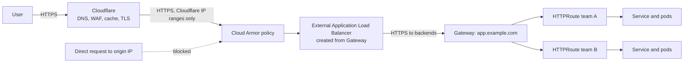

This note describes the request path from a user to a pod when Cloudflare sits in front of a Google Cloud load balancer that fronts GKE. It covers who owns each layer, how to make the origin reachable only through Cloudflare, TLS on each hop, how the Gateway API divides work between the platform team and application teams, and how to migrate from Ingress. It leaves rule design to [[patterns/edge-waf-rate-limiting]], cache design to [[patterns/cloudflare-cache-strategy]], and service-to-service access to [[patterns/cloudflare-access-service-tokens]].

> [!info] Scope and sources
> Written against Cloudflare, Google Cloud external Application Load Balancing, Cloud Armor and the GKE Gateway controller as general designs. Cloudflare ranges, GatewayClass names and feature support change; use the documentation listed under Sources.

> [!note] Not verified
> Nothing here was run. Check before relying on it: the GatewayClass names available on your GKE version, Cloud Armor rule syntax and limits on the number of addresses per rule, the current Cloudflare IP list endpoint, and whether your plan supports authenticated origin pulls with your chosen certificate setup.

## Context

Public traffic enters through Cloudflare for DNS, WAF, DDoS protection and caching. Cloudflare then connects to an origin: a Google Cloud external Application Load Balancer created by the GKE Gateway controller, which routes to Services in the cluster. Three layers, three owners, and one rule: the origin must not be reachable except through the edge, or the edge protections are optional.

## Layers and owners



| Layer                             | Owner                    | Responsibilities                                                               |
| --------------------------------- | ------------------------ | ------------------------------------------------------------------------------ |
| Cloudflare                        | Network or security team | DNS records, WAF and rate limits, cache rules, edge certificates, bot controls |
| Cloud Armor and the load balancer | Platform team            | Origin allowlist, backend security, TLS to Cloudflare, global IP addresses     |
| GatewayClass and Gateway          | Platform team            | Listeners, certificates, which namespaces may attach routes                    |
| HTTPRoute, Service, policies      | Application teams        | Hostnames and paths for their service, timeouts, health check policy           |

Keep the boundary explicit in documentation and in repository ownership. Application teams must be able to change their routes without touching edge or load balancer settings.

## Origin lock-down

Lock the origin on three levels.

**1. Network allowlist.** Create a Cloud Armor policy that allows only Cloudflare's published proxy ranges and denies everything else. The ranges change, so automate it: a scheduled job fetches the current list from Cloudflare, compares it with the policy, and applies a change through a reviewed pipeline. Do not paste ranges by hand. The command shape, with a documentation range as a placeholder:

```bash title="cloud-armor-allowlist.sh"
#!/usr/bin/env bash
set -euo pipefail

POLICY="edge-origin-lockdown"
PROJECT="example-prod"

# Default rule: deny. (Rule priority 2147483647 is the default rule.)
gcloud compute security-policies create "$POLICY" \
  --project "$PROJECT" \
  --description "Allow only Cloudflare proxy ranges"

gcloud compute security-policies rules update 2147483647 \
  --security-policy "$POLICY" --project "$PROJECT" \
  --action "deny-403"

# Allow rule. 203.0.113.0/24 is a placeholder; use the current published
# Cloudflare ranges, fetched by the sync job, not typed by hand.
gcloud compute security-policies rules create 1000 \
  --security-policy "$POLICY" --project "$PROJECT" \
  --description "Cloudflare ranges batch 1" \
  --src-ip-ranges "203.0.113.0/24" \
  --action "allow"
```

A policy may need several rules because of per-rule limits on the number of ranges; check the current Cloud Armor documentation. The sync job must handle splitting, additions and removals, and alert when the live policy differs from the published list. A stale allowlist breaks legitimate traffic when Cloudflare adds ranges, and silently keeps stale permission when it drops them.

Creating the policy does nothing until it is attached to the backend services behind the load balancer. With the GKE Gateway controller you do not create those backend services yourself; attach the policy with a `GCPBackendPolicy` that targets each Service:

```yaml title="gcp-backend-policy.yaml"
apiVersion: networking.gke.io/v1
kind: GCPBackendPolicy
metadata:
  name: payments-api
  namespace: payments
spec:
  default:
    securityPolicy: edge-origin-lockdown
  targetRef:
    group: ""
    kind: Service
    name: payments-api
```

Every Service behind the Gateway needs such a policy, or that backend stays open to direct traffic and the bypass remains. Audit for Services without one as part of the verify step. Check the GKE documentation "Configure Gateway resources using Policies" for the current fields and API version.

**2. Authentication of the connection.** An IP allowlist is not identity: anyone using a Cloudflare account can send requests from Cloudflare's addresses to your origin. Authenticated origin pulls (mutual TLS between Cloudflare and the origin) or a secret header checked at the origin make sure the request came through your zone. Choose one, based on what your load balancer and plan support, and check the current Cloudflare and Google documentation. Treat a shared secret header as a weak control: it must be long, rotated and stripped from logs.

**3. No direct DNS.** Never publish an A record for the origin IP outside Cloudflare, and avoid hostnames that leak it (`origin.example.com` in public DNS, certificate transparency logs, old records). Scan for historic exposure and, if the origin was ever exposed, change the load balancer address.

## TLS on each hop

| Hop                         | Certificate                                     | Notes                                                                                    |
| --------------------------- | ----------------------------------------------- | ---------------------------------------------------------------------------------------- |
| User to Cloudflare          | Cloudflare edge certificate                     | Managed by Cloudflare                                                                    |
| Cloudflare to load balancer | A certificate on the Gateway listener           | Use a trusted or origin CA certificate; set the Cloudflare SSL/TLS mode to Full (strict) |
| Load balancer to pods       | Backend protocol HTTPS or HTTP/2 where required | Decide per service; plain HTTP inside the VPC is a risk decision                         |

Own each certificate: record who issues it, where it lives and how it renews. An expiry on the Gateway listener takes the site down while the edge still looks healthy. See [[runbooks/tls-certificate-renewal]]. Avoid "flexible" modes that leave the Cloudflare-to-origin leg unencrypted.

## Gateway API roles

The Gateway API splits the Ingress resource by role:

- **GatewayClass:** provided by the controller; names depend on the GKE version and whether the load balancer is global or regional, so check the current docs.
- **Gateway:** owned by the platform team. Declares listeners, hostnames, certificates and which namespaces may attach routes.
- **HTTPRoute:** owned by application teams. Maps hostnames and paths to Services.

A platform-owned Gateway, shared by selected namespaces:

```yaml title="gateway.yaml"
apiVersion: gateway.networking.k8s.io/v1
kind: Gateway
metadata:
  name: external-http
  namespace: edge
spec:
  gatewayClassName: gke-l7-global-external-managed # check the current docs for names
  listeners:
    - name: https
      protocol: HTTPS
      port: 443
      hostname: "*.example.com"
      tls:
        mode: Terminate
        certificateRefs:
          - kind: Secret
            name: wildcard-example-com
      allowedRoutes:
        namespaces:
          from: Selector
          selector:
            matchLabels:
              example.com/gateway-access: external
        kinds:
          - kind: HTTPRoute
```

A team-owned route that attaches to it:

```yaml title="httproute.yaml"
apiVersion: gateway.networking.k8s.io/v1
kind: HTTPRoute
metadata:
  name: payments-api
  namespace: payments
spec:
  parentRefs:
    - name: external-http
      namespace: edge
  hostnames:
    - app.example.com
  rules:
    - matches:
        - path:
            type: PathPrefix
            value: /payments
      backendRefs:
        - name: payments-api
          port: 8080
```

`allowedRoutes` is the control that stops a team in an unrelated namespace from claiming a hostname on the shared Gateway. Label only the namespaces that are allowed to attach, and protect the label with RBAC and admission policy so a team cannot label its own namespace.

Health checks are configured separately from Kubernetes readiness probes in some implementations (on GKE, through a `HealthCheckPolicy` attached to the Service). Align them, or the load balancer marks backends unhealthy while Kubernetes considers them ready.

## Shared versus per-team gateways

| Model                                                   | Strengths                                                  | Costs                                                      |
| ------------------------------------------------------- | ---------------------------------------------------------- | ---------------------------------------------------------- |
| One shared Gateway                                      | Fewer load balancers and addresses, central TLS and policy | Larger blast radius, route conflicts, noisy-neighbour risk |
| Gateway per team or domain                              | Isolation, independent change and certificates             | More load balancers to pay for and operate, more addresses |
| Shared per environment, separate for sensitive services | Balanced                                                   | Needs a clear rule for what counts as sensitive            |

Start shared per environment, with namespace selection, and split out services that need different policy, certificates or isolation.

## Migrating from Ingress

1. Inventory Ingress objects, annotations and the behaviour they rely on (rewrites, timeouts, health checks, redirects).
2. Create the Gateway alongside the existing Ingress, with a different address.
3. Translate routes one service at a time into HTTPRoutes. Annotations rarely map one-to-one; use policy resources and filters, and check feature support in the current GKE docs.
4. Test with `curl --resolve` against the new address, then compare responses.
5. Shift traffic by changing the origin address in Cloudflare, or with weighted pools, then watch error rates.
6. Remove the Ingress once nothing uses it, and keep the old address reserved for a rollback window.

## Caching and rate-limit split

Do caching and WAF decisions at Cloudflare where they are cheapest, and keep Cloud Armor for origin protection and emergency rules. The detailed rule design is in [[patterns/edge-waf-rate-limiting]] and [[patterns/cloudflare-cache-strategy]]. Avoid duplicating the same rate limit at both layers with different thresholds; the stricter one produces confusing errors.

## Failure modes

| Failure                        | Effect                                                     | Mitigation                                                                       |
| ------------------------------ | ---------------------------------------------------------- | -------------------------------------------------------------------------------- |
| Origin bypass                  | WAF and rate limits skipped, attacks hit the load balancer | Cloud Armor allowlist, authenticated origin pulls, no public origin DNS          |
| Stale IP allowlist             | New Cloudflare ranges receive 403 from the origin          | Automated sync, drift alert, alert on spike in 403 from Cloud Armor              |
| Certificate mismatch or expiry | 525 or 526 errors at the edge                              | Ownership, expiry alerts, renewal runbook                                        |
| Route conflicts                | Two routes claim the same host and path                    | Gateway status conditions, admission policy, per-team hostnames                  |
| Unhealthy NEGs                 | Load balancer returns 502 or 503                           | Align health checks with readiness, check firewall rules for health check ranges |
| Misapplied Cloudflare rule     | Legitimate users blocked everywhere                        | Review and staged rollout of edge rules, quick revert                            |

For diagnosis see [[runbooks/network-troubleshooting-dns-mtu-tls-load-balancers]].

## Pitfalls

- Allowlisting Cloudflare IPs and believing the origin is protected, without authenticating the connection.
- Hard-coding the IP list once and forgetting it.
- Giving every namespace permission to attach to the shared Gateway.
- Terminating TLS at the load balancer and forgetting the hop to the pod.
- Rolling out a pod change faster than the load balancer drains connections. Align with [[patterns/zero-downtime-deployments-kubernetes]].
- Forgetting that Cloudflare Access or Zero Trust tooling needs its own path, see [[architecture/zero-trust-access-iap-and-vpc-service-controls]].

## Verify

```bash title="verify-edge.sh"
#!/usr/bin/env bash
set -euo pipefail

CTX="gke_example-prod_europe-west1_gke-prod-ew1"
ORIGIN_IP="203.0.113.10"   # placeholder: the load balancer address of the Gateway

# Gateway and routes are accepted and programmed
kubectl --context "$CTX" get gateway,httproute -A

# Through Cloudflare: expect 200
curl -sS -o /dev/null -w 'via edge: %{http_code}\n' https://app.example.com/payments/healthz

# Direct to the origin, bypassing Cloudflare: expect a refusal (403, or a TLS
# failure, which makes curl print 000 and exit non-zero; both are fine here)
code=$(curl -s -o /dev/null -w '%{http_code}' \
  --resolve app.example.com:443:"${ORIGIN_IP}" \
  https://app.example.com/payments/healthz || true)
echo "direct: ${code}"
[ "$code" != "200" ] || { echo "origin exposed" >&2; exit 1; }

# Armor policy attached to the backend service
gcloud compute backend-services list --global --format='table(name,securityPolicy)'
```

The direct request must fail. If it returns 200, the origin is exposed. Re-run this check on a schedule, and after any Gateway, Armor or Cloudflare change.

## Rollback

- Edge rules and records: revert in Git or in the Cloudflare change history. Keep a tested way to bypass the cache or a rule quickly.
- Armor policy: keep the previous version of the policy in code, and keep a break-glass rule at a documented priority that allows the monitoring ranges.
- Gateway and routes: revert the manifest through GitOps. During a Gateway migration, keep the old Ingress and address live until the rollback window ends.
- Certificates: keep the previous certificate available until the new one is confirmed on every hop.

## Sources

- Cloudflare IP addresses: https://developers.cloudflare.com/fundamentals/concepts/cloudflare-ip-addresses/
- Authenticated origin pulls: https://developers.cloudflare.com/ssl/origin-configuration/authenticated-origin-pull/
- Cloud Armor: https://cloud.google.com/armor/docs
- GKE Gateway API: https://cloud.google.com/kubernetes-engine/docs/concepts/gateway-api
- Kubernetes Gateway API: https://gateway-api.sigs.k8s.io/

Check the current docs, particularly for GatewayClass names and Cloudflare range endpoints.

## Related

- [[patterns/edge-waf-rate-limiting]]
- [[patterns/cloudflare-cache-strategy]]
- [[patterns/cloudflare-access-service-tokens]]
- [[architecture/zero-trust-access-iap-and-vpc-service-controls]]
- [[architecture/private-gke-and-controlled-egress]]
- [[runbooks/tls-certificate-renewal]]
- [[runbooks/network-troubleshooting-dns-mtu-tls-load-balancers]]
- [[patterns/zero-downtime-deployments-kubernetes]]
- [[0023-gateway-api-for-north-south-traffic]]
