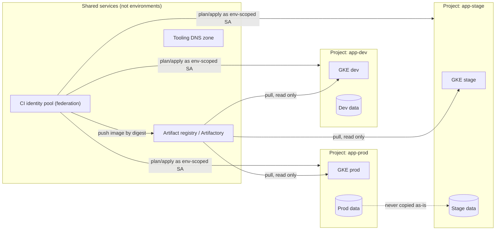

This note compares three ways to separate dev, stage and prod on GCP and GKE: a project per environment, a cluster per environment in a shared project, and a namespace per environment in one cluster. It recommends one layout, lists what is deliberately shared and what must never cross, and shows the Terraform and policy that enforce it. It is written for senior DevOps engineers. It does not repeat the GitOps decision ([[adr/0001-gitops-with-argocd]]) or the mechanics of promoting artifacts ([[patterns/artifact-promotion-artifactory]]).

> [!info] Scope and sources
> Written against GCP projects, GKE and Terraform, based on the Google Cloud resource hierarchy, GKE and Kyverno documentation. The recommendation is the author's opinion for a mid-sized organization; teams with a different risk profile may choose differently.

> [!note] Not verified
> The claims below were written from documentation knowledge and were not checked against a running system or the current docs: project ID immutability and the window in which a deleted project's ID can be reused; Kyverno field names in the current release (the policy uses `validationFailureAction`, which newer releases may replace). Check them before relying on them.

## The options

| Concern        | Project per environment                                     | Cluster per environment, shared project             | Namespace per environment, one cluster                       |
| -------------- | ----------------------------------------------------------- | --------------------------------------------------- | ------------------------------------------------------------ |
| Isolation      | Strong: separate IAM, quota, APIs, networks                 | Medium: shared project IAM and quota                | Weak: shared nodes, control plane and cluster-wide objects   |
| IAM            | Per-project bindings, easy to keep prod tighter             | One IAM policy covers all clusters                  | Kubernetes RBAC only, one cloud IAM policy                   |
| Billing        | Cost per project without labels                             | Needs labels or cluster-level cost allocation       | Needs namespace-level cost allocation                        |
| Quota          | Each environment has its own                                | Shared; a load test in stage can exhaust prod quota | Shared; the same, plus node-level contention                 |
| Cost           | Higher: more control planes, fixed fees, more idle capacity | Medium                                              | Lowest                                                       |
| Ops effort     | Needs a project factory and per-environment Terraform       | Moderate                                            | Lowest, but policy and quotas inside the cluster get complex |
| Upgrade safety | Upgrade stage first, prod later, independently              | Same                                                | Upgrade hits every environment at once                       |

The namespace option fails the test that matters most for production: a bad cluster upgrade, an admission webhook outage or a noisy neighbour in dev affects prod. Use it for review environments and feature previews, not for the dev, stage and prod chain.

Between the other two, the difference is the project boundary. A project is the unit for IAM, quota, API enablement and billing. If prod must be stricter than stage, and a person who can deploy to stage must not be able to touch prod data, the project boundary is the cleanest place to draw the line.

## Recommended layout

One project per workload per environment, one GKE cluster per project, and a small set of shared services outside the environment projects. See [[architecture/gcp-resource-hierarchy-and-landing-zone]] for the folders and the project factory.



Arrows that cross a boundary are the only crossings allowed, and each one is read-only toward the environment or goes through a federated, environment-scoped identity. Nothing from prod flows to dev unchanged: the dotted arrow shows the case you must handle deliberately (see the data rules below).

The promotion path is the same artifact in every environment. CI builds an image once, pushes it to the registry and records its digest. Dev, stage and prod each deploy that digest, with only configuration differing. See [[architecture/gitops-repo-topology-and-promotion]] for the repository layout that holds the per-environment config, and [[patterns/artifact-promotion-artifactory]] for how the artifact itself is promoted.

## Per-environment Terraform

Use one module for the shape of an environment and one small root per environment that sets its values. The state is separate per environment so that a plan in dev cannot lock or touch prod. See [[patterns/terraform-module-and-state-layout]] for the broader structure.

```hcl title="live/prod/main.tf"
terraform {
  required_version = ">= 1.6"

  backend "gcs" {
    bucket = "acme-tfstate" # change: the state bucket in the bootstrap project
    prefix = "live/prod"
  }

  required_providers {
    google = {
      source  = "hashicorp/google"
      version = "~> 6.0" # change: pin to a version you have tested
    }
  }
}

variable "environment" {
  type        = string
  description = "Environment name: dev, stage or prod."
}

variable "project_id" {
  type        = string
  description = "Project that holds this environment."
}

variable "region" {
  type        = string
  description = "Primary region."
}

variable "cluster_node_count" {
  type        = number
  description = "Nodes per zone for the default node pool."
}

variable "cluster_machine_type" {
  type        = string
  description = "Machine type for the default node pool."
}

variable "deletion_protection" {
  type        = bool
  description = "Protect the cluster and databases from accidental deletion."
}

provider "google" {
  project = var.project_id
  region  = var.region
}

module "environment" {
  source = "../../modules/environment"

  environment          = var.environment
  project_id           = var.project_id
  region               = var.region
  cluster_node_count   = var.cluster_node_count
  cluster_machine_type = var.cluster_machine_type
  deletion_protection  = var.deletion_protection
}
```

The values per environment live in tfvars files. Terraform loads only `terraform.tfvars` and `*.auto.tfvars` on its own, so CI selects the file by directory and passes it explicitly with `terraform plan -var-file=prod.tfvars`:

```hcl title="live/prod/prod.tfvars"
environment          = "prod"
project_id           = "acme-billing-prod"
region               = "europe-west1"
cluster_node_count   = 3
cluster_machine_type = "e2-standard-8"
deletion_protection  = true
```

```hcl title="live/dev/dev.tfvars"
environment          = "dev"
project_id           = "acme-billing-dev"
region               = "europe-west1"
cluster_node_count   = 1
cluster_machine_type = "e2-standard-4"
deletion_protection  = false
```

The dev root is a copy of `live/prod/main.tf` with its own backend `prefix` (`live/dev`). Keep the copies identical apart from the prefix, and let CI fail if they drift. Differences in size and protection belong in the tfvars, not in the module code, so that stage is a real rehearsal for prod.

### Resources per environment

| Resource              | Dev                 | Stage                    | Prod                                  |
| --------------------- | ------------------- | ------------------------ | ------------------------------------- |
| Project               | Own                 | Own                      | Own                                   |
| GKE cluster           | Own, small          | Own, same shape as prod  | Own, regional, larger                 |
| Service accounts      | Own set             | Own set                  | Own set, never reused elsewhere       |
| Databases and buckets | Own, synthetic      | Own, masked or synthetic | Own, real data                        |
| Secrets               | Own, in the project | Own, in the project      | Own, in the project                   |
| Network               | Own VPC or subnets  | Own VPC or subnets       | Own VPC or subnets                    |
| Image registry        | Shared              | Shared                   | Shared (read only from the cluster)   |
| CI identity pool      | Shared              | Shared                   | Shared, with an environment condition |
| Tooling DNS zone      | Shared              | Shared                   | Shared                                |
| Deletion protection   | Off                 | On                       | On                                    |

## What crosses environment boundaries

Allowed, and each deliberately:

- Container images and charts from the shared registry, pulled with read-only access. See [[patterns/artifact-promotion-artifactory]].
- The CI identity pool, which is configured once. Each environment gets its own service account behind it, the provider's attribute condition limits which tokens are accepted, and each service account's `roles/iam.workloadIdentityUser` principalSet binding decides who may impersonate it. See [[architecture/iam-groups-and-ci-workload-identity-federation]].
- A tooling DNS zone for internal names that are not environment specific.
- Monitoring that reads from all environments into a central project, if that is read-only.

Never allowed:

- Service accounts used in more than one environment. A shared account means a compromise in dev is a compromise in prod.
- Production credentials, keys or secrets in dev or stage, including in CI variables that every job can read.
- Network paths from dev or stage into production data stores.
- Production data in lower environments unless it has been transformed first.
- A single Terraform state that contains more than one environment.

## Data rules

- Dev uses synthetic data. Stage uses synthetic or masked data, built by a job that runs in prod's trust zone and writes only the masked output to a bucket that stage can read.
- Never restore a prod backup into stage as it is. Restore into a quarantine project, run the masking job and then load the result.
- Bucket and database names include the environment, and the service account for each environment has IAM only on its own project.
- Treat a copy of production data as production data for access, retention and logging until it has been masked.

## Enforcing digests in prod

Promotion by digest only works if prod rejects anything else. A Kyverno policy can refuse pods whose images are not pinned by digest in the prod cluster (the policy is installed there only):

```yaml title="policies/require-image-digest.yaml"
apiVersion: kyverno.io/v1
kind: ClusterPolicy
metadata:
  name: require-image-digest
  annotations:
    policies.kyverno.io/title: Require image digests in prod
    policies.kyverno.io/description: Images in prod namespaces must be pinned by digest.
spec:
  validationFailureAction: Audit # switch to Enforce after existing workloads comply
  background: true
  rules:
    - name: containers-use-digest
      match:
        any:
          - resources:
              kinds:
                - Pod
              namespaces:
                - "*"
      exclude:
        any:
          - resources:
              namespaces:
                - kube-system
                - gmp-system
                - gke-managed-system
      validate:
        message: "Containers in prod namespaces must use an image pinned by digest (name@sha256:...)."
        pattern:
          spec:
            containers:
              - image: "*@sha256:*"
    - name: init-containers-use-digest
      match:
        any:
          - resources:
              kinds:
                - Pod
              namespaces:
                - "*"
      exclude:
        any:
          - resources:
              namespaces:
                - kube-system
                - gmp-system
                - gke-managed-system
      validate:
        message: "Init containers in prod namespaces must use an image pinned by digest (name@sha256:...)."
        pattern:
          spec:
            =(initContainers):
              - image: "*@sha256:*"
```

Run it in audit mode first and promote it to enforcement after the existing workloads comply. The same procedure for any policy is described in [[tools/gatekeeper-vs-kyverno]]. Because the cluster in prod is already in its own project, this policy lives in the prod cluster only; dev may keep tags for speed.

## Pitfalls

- Treating the Terraform workspace as the environment boundary. Workspaces share a backend and a provider config; a wrong selected workspace applies to the wrong project.
- Stage that is smaller and shaped differently from prod, so it passes tests that prod fails. Keep the shape identical and scale only the numbers.
- A shared CI service account with owner on every project. Give CI one account per environment, with the least role that works, and a stricter attribute condition for prod.
- Putting dev and stage in one project "to save money" and then sharing quota. A load test then competes with everything else in that project.
- Reusing project IDs after deleting a project, or assuming a deleted ID is free at once. Project IDs are chosen at creation and cannot be changed, and Google documents how long a deleted project can be restored; read that before planning a rebuild with the same ID.
- Letting the image tag drift between environments. Deploy by digest and record it in the GitOps repository.
- Debug access that stays open: a human with owner in prod "for the incident" who never loses it.

## Adopting it incrementally

1. Start with prod. Move it to its own project first, since that is where isolation pays most.
2. Put the image registry and CI identity in shared projects and make them the only crossing paths.
3. Create stage as a copy of the prod shape in its own project, and send all promotions through it.
4. Collapse dev into the same pattern last; dev can be a smaller project with looser policy.
5. Add the digest policy in audit mode, fix the findings, then enforce it.
6. Remove cross-environment service accounts and CI variables as you find them.

## Related

- [[architecture/gcp-resource-hierarchy-and-landing-zone]]: the folders and project factory that create the environment projects.
- [[architecture/gke-platform-topology-and-tenancy]]: how clusters and tenants are arranged inside an environment.
- [[patterns/terraform-module-and-state-layout]]: how to split modules and state for the per-environment roots.
- [[architecture/gitops-repo-topology-and-promotion]]: the repository layout that carries a digest from dev to prod.
- [[tools/gatekeeper-vs-kyverno]]: choosing and rolling out the admission policy engine used for the digest rule.
- [[adr/0001-gitops-with-argocd]]: the decision that makes Git the source of truth for what runs in each environment.
