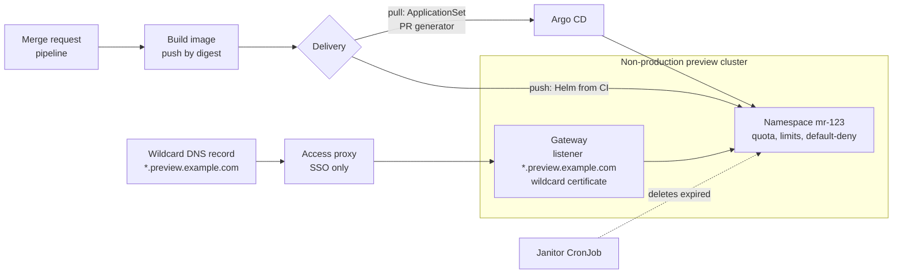

This note describes how to give every merge request its own short-lived environment on GKE: one namespace per merge request in a dedicated non-production cluster, reached at `mr-<iid>.preview.example.com` behind access control, and removed when the merge request closes or goes stale. It covers the two delivery models (CI pushes with Helm, or Argo CD pulls with an ApplicationSet), the namespace kit, DNS and TLS, data, secrets, lifecycle, cost and the credential problem that merge request pipelines create. Pipeline structure is in [[patterns/gitlab-ci-pipeline-structure]], CI trust zones in [[architecture/ci-platform-gitlab-runners-and-jenkins-agents-on-gke]], and the edge in [[architecture/edge-and-ingress-cloudflare-gclb-gateway-api]].

> [!info] Scope and sources
> Written against the GitLab environments, review apps, variables and merge request pipeline docs, the Argo CD ApplicationSet pull request generator docs, the Kubernetes ResourceQuota, LimitRange and NetworkPolicy docs, cert-manager DNS-01 and the Let's Encrypt challenge types, read from their documentation sources on 2026-10-21.

> [!note] Not verified
> Nothing here was run. Check before relying on it: exactly when GitLab runs the stop job on merge or close; how often GitLab's `auto_stop_in` worker runs (about hourly is stated below) and whether each deploy resets the timer; the setting name that lets merge request pipelines read protected variables; what Argo CD does to a preview Application and its namespace when the merge request closes; Cloudflare Access and IAP configuration for wildcard hostnames; GKE Gateway class names, Spot node labels and taints; and Let's Encrypt rate limits (none are quoted here).

## Goals and non-goals

Goals:

- A reviewer opens a link on the merge request and sees the change running, within minutes of the pipeline finishing.
- Previews are isolated from each other and from everything else, and cannot reach production data or credentials.
- Every preview is deleted automatically; nothing depends on someone remembering.
- Cost is capped: a fixed ceiling on concurrent previews and on resources per preview.

Non-goals:

- **Not a replacement for stage.** Previews run fixtures and fakes, not the real integrations, sizes or data. Release validation still happens in stage ([[architecture/environment-separation-on-gcp]]).
- **Not for every repository.** Libraries and back-office jobs rarely need one. Make it opt-in per project, or per merge request with a label.

## Topology



- **A dedicated preview cluster** (or at least a dedicated node pool and namespaces in a non-production cluster). The cluster has no route to production networks and no identity that can read production secrets. A janitor with namespace delete rights is then harmless outside previews.
- **Names come from the merge request IID**, not the branch: namespace `mr-123`, release `app-123`, host `mr-123.preview.example.com`. `CI_COMMIT_REF_SLUG` can be up to 63 bytes and `CI_ENVIRONMENT_SLUG` is truncated to 24 characters with a random suffix in some cases, while the IID is short, unique per project and stable.
- **One wildcard record and one wildcard certificate** for `*.preview.example.com`, attached to one Gateway listener. Each preview only adds an HTTPRoute with its own hostname.
- **Images by digest**, built once by the merge request pipeline. Previews never build in the cluster.

## Delivery: push or pull

| Aspect              | CI push with Helm                                               | Argo CD ApplicationSet pull request generator                                  |
| ------------------- | --------------------------------------------------------------- | ------------------------------------------------------------------------------ |
| Credential in CI    | The merge request job needs a credential for the preview cluster | None; Argo CD polls the GitLab API with its own token                           |
| Latency             | Deploys when the job runs                                       | Poll default is 1800 seconds; set up the ApplicationSet webhook for minutes     |
| Lifecycle           | GitLab environment `on_stop` and `auto_stop_in`                 | Application follows the merge request state the generator sees                 |
| Status on the MR    | Environment link and job status native in GitLab                | Needs a notification or commit status integration                              |
| Fits                | Teams without Argo CD, or charts that already deploy from CI    | Platforms on GitOps, per [[adr/0001-gitops-with-argocd]]                        |
| Main risk           | Merge request code runs next to a deploy credential             | A templated `project` or untrusted ApplicationSet authors can escalate         |

The pull model fits the trust zones in [[architecture/ci-platform-gitlab-runners-and-jenkins-agents-on-gke]] better: merge request pipelines stay in the untrusted zone with no cluster credential, and only Argo CD writes to the cluster. Choose push only when you accept a dedicated preview zone (below). Promotion and repository layout for the GitOps side are in [[architecture/gitops-repo-topology-and-promotion]].

### Pull: ApplicationSet

```yaml title="argocd/applicationset-previews.yaml"
apiVersion: argoproj.io/v1alpha1
kind: ApplicationSet
metadata:
  name: orders-api-previews
  namespace: argocd
spec:
  goTemplate: true
  generators:
    - pullRequest:
        requeueAfterSeconds: 1800 # the default; add the webhook to react faster
        gitlab:
          api: https://gitlab.example.com/
          project: "1234" # change: numeric project ID
          tokenRef:
            secretName: gitlab-preview-reader
            key: token
          pullRequestState: opened
          labels:
            - preview # opt-in: only merge requests with this label
  template:
    metadata:
      name: "orders-api-mr-{{.number}}"
    spec:
      project: previews # fixed; never derived from merge request data
      source:
        repoURL: https://gitlab.example.com/team-orders/orders-api.git
        targetRevision: "{{.head_sha}}"
        path: deploy/chart
        helm:
          parameters:
            - name: image.tag
              value: "{{.head_sha}}"
            - name: host
              value: "mr-{{.number}}.preview.example.com"
      destination:
        server: https://kubernetes.default.svc
        namespace: "mr-{{.number}}"
      syncPolicy:
        automated:
          prune: true
        syncOptions:
          - CreateNamespace=true
```

Notes: the Argo CD `previews` project restricts destinations to `mr-*` namespaces on the preview cluster and source repositories to the ones you allow. Only administrators may create or change ApplicationSets, because a template can reference Secrets and projects. `CreateNamespace=true` creates a bare namespace, so the namespace kit below must ship inside the chart or as a second source. Until CI has pushed the image for `head_sha`, the Application shows image pull errors; that is expected. What happens to the Application and namespace when the merge request closes depends on your Argo CD version and deletion settings; test it and keep the janitor as a backstop.

## Namespace kit

Every preview namespace gets the same objects. One LimitRange per namespace only: with several, the applied default is not deterministic.

```yaml title="deploy/preview/namespace-kit.yaml"
apiVersion: v1
kind: Namespace
metadata:
  name: __NS__
  labels:
    preview: "true"
    preview-mr: "__MR__"
    preview-expires-at: "__EXPIRES__" # epoch seconds; the janitor reads it
    team: team-orders
---
apiVersion: v1
kind: ResourceQuota
metadata:
  name: preview-quota
  namespace: __NS__
spec:
  hard:
    requests.cpu: "2"
    requests.memory: 4Gi
    limits.memory: 8Gi
    pods: "20"
    persistentvolumeclaims: "2"
    services.loadbalancers: "0" # traffic only through the shared Gateway
    services.nodeports: "0"
---
apiVersion: v1
kind: LimitRange
metadata:
  name: preview-defaults
  namespace: __NS__
spec:
  limits:
    - type: Container
      defaultRequest:
        cpu: 100m
        memory: 128Mi
      default:
        memory: 512Mi
---
apiVersion: networking.k8s.io/v1
kind: NetworkPolicy
metadata:
  name: default-deny
  namespace: __NS__
spec:
  podSelector: {}
  policyTypes: [Ingress, Egress]
---
apiVersion: networking.k8s.io/v1
kind: NetworkPolicy
metadata:
  name: allow-gateway-and-same-namespace
  namespace: __NS__
spec:
  podSelector: {}
  policyTypes: [Ingress]
  ingress:
    - from:
        - podSelector: {} # pods in this preview
        - namespaceSelector:
            matchLabels:
              kubernetes.io/metadata.name: gateway-system # change: your in-cluster gateway data path
```

The quota values are examples sized for one small service; derive yours from the stage footprint. Because the quota covers CPU and memory, a Pod without requests is rejected unless the LimitRange supplies defaults, and a quota breach on a Deployment shows up as missing Pods, not a failed `apply`; check with `kubectl describe`. Default-deny egress also blocks DNS and the metadata server; add the DNS and metadata allows from [[architecture/east-west-service-security-gke]]. The tenancy and policy baselines are [[adr/0019-namespace-per-team-tenancy]], [[adr/0020-default-deny-network-policies]] and [[patterns/kubernetes-resource-requests-and-limits]].

## DNS and TLS

- **Certificate.** A wildcard certificate needs the DNS-01 challenge; HTTP-01 and TLS-ALPN-01 cannot validate wildcards. Issue one `*.preview.example.com` certificate with cert-manager and the Cloud DNS solver, as in [[patterns/cert-manager-dns01-cloud-dns]]. One certificate for all previews also avoids issuing per merge request and running into the CA's rate limits.
- **One label deep.** A TLS wildcard covers exactly one label, so `mr-123.preview.example.com` is covered and `api.mr-123.preview.example.com` is not, even though a Gateway hostname `*.preview.example.com` would route both. Keep preview hostnames one label deep.
- **DNS.** One wildcard record pointing at the Gateway address is enough and creates nothing per preview. If you prefer per-preview records with [[patterns/external-dns-on-gke]], use a dedicated `--txt-owner-id` for the preview instance and start with `--policy=upsert-only`, because `sync` with a shared owner ID can delete other owners' records.

```yaml title="gateway-system/preview-gateway.yaml"
apiVersion: cert-manager.io/v1
kind: Certificate
metadata:
  name: preview-wildcard
  namespace: gateway-system
spec:
  secretName: preview-wildcard-tls
  dnsNames:
    - "*.preview.example.com"
  issuerRef:
    kind: ClusterIssuer
    name: letsencrypt-dns01 # change: the issuer from the cert-manager pattern
---
apiVersion: gateway.networking.k8s.io/v1
kind: Gateway
metadata:
  name: preview
  namespace: gateway-system
spec:
  gatewayClassName: internal-gateway-class # change: check kubectl get gatewayclass
  listeners:
    - name: https
      protocol: HTTPS
      port: 443
      hostname: "*.preview.example.com"
      tls:
        mode: Terminate
        certificateRefs:
          - name: preview-wildcard-tls
      allowedRoutes:
        namespaces:
          from: Selector
          selector:
            matchLabels:
              preview: "true"
```

Each preview's chart renders an HTTPRoute with `hostnames: ["mr-123.preview.example.com"]` and `parentRefs` to this Gateway. A route whose hostname does not intersect the listener's is not accepted (`Accepted=False`).

## Access

Previews are never public. Put the wildcard host behind the organisation's SSO: Cloudflare Access with an application covering `*.preview.example.com`, or IAP on the load balancer, as described in [[architecture/edge-and-ingress-cloudflare-gclb-gateway-api]] and [[architecture/zero-trust-access-iap-and-vpc-service-controls]]. Automated tests from CI use a service token ([[patterns/cloudflare-access-service-tokens]]) held only in the job that needs it. Check the Cloudflare Zero Trust or IAP docs for wildcard application support and how the identity header or JWT reaches the backend before you depend on it.

## Data and secrets

> [!warning] No production data in previews
> Previews are reachable by every reviewer, run unreviewed code and are torn down without ceremony. Copying production data into them is a data protection incident waiting to happen. Seed synthetic fixtures at deploy time; if realistic volume matters, use a generated dataset, not a masked copy.

- **Databases.** A small in-namespace database seeded with fixtures is simplest and dies with the namespace. Shared non-production backing services save cost but need a schema or database per preview and their own cleanup.
- **Secrets.** Only non-production values, delivered by External Secrets from a preview-only Secret Manager project ([[patterns/external-secrets-with-secret-manager]]). The preview cluster's identity can read that project and nothing else.

## Credentials and untrusted code

Merge request code is attacker-controlled until reviewed. GitLab gives these guarantees and gaps:

- Protected variables are available only to pipelines on protected branches or tags. Merge request source branches are normally not protected, so a preview deploy cannot use protected variables. Do not "fix" this by protecting feature branches or by letting merge request pipelines read protected variables.
- A pipeline for a merge request from a fork runs in the fork, with the fork's variables, and cannot access the parent project's protected resources. If a member runs the pipeline in the parent project instead, it uses the parent's variables, and the docs warn that malicious code can then compromise masked and protected variables. Administrators can disable running fork pipelines in the parent project.
- Masking is not protection; a job can print a variable in a form the mask does not catch.

Rules for this design:

1. **Pull model first**: the merge request job holds no cluster credential at all.
2. **If you push**, create a dedicated preview trust zone: runners tagged `preview-deployer`, an identity obtained keyless through Workload Identity Federation ([[architecture/iam-groups-and-ci-workload-identity-federation]]) that can only deploy to the preview cluster, and a rule that runs the deploy only for merge requests from branches in the same project.
3. **Never for forks.** The rules below skip fork merge requests; a maintainer can push the branch into the project after reading it.

The same rule applies to any other token in merge request jobs, such as a scanner token for code analysis.

## Lifecycle

- **Deploy job** sets `environment:name: review/mr-$CI_MERGE_REQUEST_IID`, an `on_stop` job and `auto_stop_in`. Each deploy resets the timer. GitLab's stop worker runs about hourly, so stops can be late.
- **Stop job** has `environment:action: stop`, `GIT_STRATEGY: none` (the branch may be gone), the same `rules` as the deploy job, the same stage, and a `when`. With `when: manual` inside `rules`, also set `allow_failure: true`.
- **Merge or close.** Check the current GitLab docs for when the stop job runs automatically for merge request environments; do not depend on it alone.
- **Janitor.** A CronJob in the preview cluster deletes namespaces whose `preview-expires-at` label is in the past. It catches stops that never ran, environments stuck in `stopping` after a deleted branch, and ApplicationSet leftovers.
- **Stuck namespaces.** A namespace that hangs in `Terminating` usually has a finalizer waiting on a controller; follow [[runbooks/namespace-stuck-terminating]].

```yaml title=".gitlab-ci.yml (preview jobs)"
variables:
  PREVIEW_DOMAIN: preview.example.com # change: your preview zone
  PREVIEW_TTL_SECONDS: "259200"       # 3 days, matches auto_stop_in

.preview_rules:
  rules:
    # Same-project merge requests only; fork merge requests get no preview
    - if: $CI_PIPELINE_SOURCE == "merge_request_event" && $CI_MERGE_REQUEST_SOURCE_PROJECT_PATH == $CI_MERGE_REQUEST_PROJECT_PATH

deploy_review:
  stage: review
  extends: .preview_rules
  image: registry.example.com/ci/deploy-tools:1.0.0 # change: pin your helm+kubectl image by digest
  tags: [preview-deployer]
  needs: [build_image] # writes IMAGE_DIGEST to a dotenv report
  variables:
    NS: mr-$CI_MERGE_REQUEST_IID
  environment:
    name: review/mr-$CI_MERGE_REQUEST_IID
    url: https://mr-$CI_MERGE_REQUEST_IID.$PREVIEW_DOMAIN
    on_stop: stop_review
    auto_stop_in: 3 days
  script:
    - set -o pipefail # the image's shell must support it (bash, or a recent busybox ash)
    - EXPIRES=$(( $(date +%s) + PREVIEW_TTL_SECONDS ))
    - >
      sed -e "s/__NS__/$NS/g" -e "s/__MR__/$CI_MERGE_REQUEST_IID/g" -e "s/__EXPIRES__/$EXPIRES/g"
      deploy/preview/namespace-kit.yaml | kubectl apply -f -
    - >
      helm upgrade --install "app-$CI_MERGE_REQUEST_IID" deploy/chart
      --namespace "$NS"
      --set image.digest="$IMAGE_DIGEST"
      --set host="mr-$CI_MERGE_REQUEST_IID.$PREVIEW_DOMAIN"
      --values deploy/chart/values-preview.yaml
      --wait --timeout 10m

stop_review:
  stage: review
  image: registry.example.com/ci/deploy-tools:1.0.0
  tags: [preview-deployer]
  variables:
    GIT_STRATEGY: none
    NS: mr-$CI_MERGE_REQUEST_IID
  environment:
    name: review/mr-$CI_MERGE_REQUEST_IID
    action: stop
  rules:
    - if: $CI_PIPELINE_SOURCE == "merge_request_event" && $CI_MERGE_REQUEST_SOURCE_PROJECT_PATH == $CI_MERGE_REQUEST_PROJECT_PATH
      when: manual
      allow_failure: true
  script:
    - helm uninstall "app-$CI_MERGE_REQUEST_IID" --namespace "$NS" || true
    - kubectl delete namespace "$NS" --ignore-not-found --wait=false
```

The janitor, in the preview cluster only, with a ClusterRole limited to listing and deleting namespaces:

```yaml title="preview-system/janitor.yaml"
apiVersion: batch/v1
kind: CronJob
metadata:
  name: preview-janitor
  namespace: preview-system
spec:
  schedule: "17 * * * *"
  timeZone: "Etc/UTC"
  concurrencyPolicy: Forbid
  startingDeadlineSeconds: 600
  jobTemplate:
    spec:
      backoffLimit: 1
      activeDeadlineSeconds: 900
      template:
        spec:
          serviceAccountName: preview-janitor
          restartPolicy: Never
          containers:
            - name: janitor
              image: registry.example.com/ci/kubectl:1.0.0 # change: pin by digest
              command: ["/bin/sh", "-c"]
              args:
                - |
                  set -eu
                  now=$(date +%s)
                  kubectl get ns -l preview=true \
                    -o jsonpath='{range .items[*]}{.metadata.name}{" "}{.metadata.labels.preview-expires-at}{"\n"}{end}' |
                  while read -r ns exp; do
                    case "$ns" in mr-*) ;; *) continue ;; esac
                    if [ -n "$exp" ] && [ "$exp" -lt "$now" ]; then
                      echo "deleting expired preview $ns"
                      kubectl delete ns "$ns" --wait=false
                    fi
                  done
              resources:
                requests: { cpu: 50m, memory: 64Mi }
                limits: { memory: 128Mi }
```

## Cost controls

- **Cap concurrency**: a cluster-level limit on preview namespaces (an admission rule or the janitor refusing beyond N), plus the per-namespace quota. The total is then bounded by N times the quota.
- **Cheap capacity**: run previews on a Spot node pool with a toleration in the preview values; previews tolerate preemption. Check the GKE Spot docs for the node label and taint in your cluster mode.
- **Short TTLs**: three days of inactivity is plenty; reviewers redeploy by pushing.
- **Scale down off-hours**: scale preview Deployments to zero overnight with a CronJob if your previews idle; restart on the next deploy.
- **Attribution**: the `team` and `preview` namespace labels feed cost allocation in [[architecture/finops-cost-allocation-and-guardrails]].

## Failure modes

| Failure                                   | Symptom                                         | Mitigation                                                                 |
| ----------------------------------------- | ----------------------------------------------- | -------------------------------------------------------------------------- |
| Stop job never runs (branch deleted)      | Environment stuck in `stopping`, namespace left | Janitor by TTL label; force stop the environment in GitLab                  |
| Namespace stuck `Terminating`             | Name reused by a reopened MR fails              | [[runbooks/namespace-stuck-terminating]]; check finalizers                  |
| Quota exhausted                           | Deployment exists, Pods missing                 | `kubectl describe` the ReplicaSet; raise the quota only with a reason       |
| Wildcard certificate renewal fails        | Every preview shows TLS errors at once          | Alert on certificate expiry and on cert-manager `Ready=False`               |
| Preview cluster full                      | Pods pending, deploy job times out              | Concurrency cap, cluster autoscaler limits, janitor health                  |
| ApplicationSet slow to notice a new MR    | Preview appears up to the poll interval late    | Configure the ApplicationSet webhook for merge request events               |

## Pitfalls

- Deriving hostnames from branch names and hitting length limits or collisions.
- Giving the merge request deploy job a credential that also works on stage.
- Pointing previews at shared stage databases "just for now".
- Leaving previews public because "the URL is unguessable". The wildcard certificate appears in public Certificate Transparency logs, which reveals the preview zone, and merge request IIDs are sequential.
- Different `rules` on deploy and stop jobs, so the stop job does not exist in the pipeline that created the environment.

## Verify

```bash title="verify-previews.sh"
#!/usr/bin/env bash
set -euo pipefail
MR="123"                          # change: a merge request IID with a preview
DOMAIN="preview.example.com"      # change: your preview zone
NS="mr-${MR}"

kubectl get ns -l preview=true -L preview-mr,preview-expires-at
kubectl describe resourcequota preview-quota -n "$NS"
kubectl get networkpolicy -n "$NS"
# The deploy identity must not reach non-preview namespaces (expect "no")
DEPLOYER="system:serviceaccount:preview-system:preview-deployer" # change: the identity your deploy path uses
kubectl auth can-i create deployments -n kube-system --as="$DEPLOYER" || true
kubectl get certificate -n gateway-system preview-wildcard
dig +short "mr-${MR}.${DOMAIN}"
# Without SSO the edge must refuse or redirect to login, never serve the app (expect 302, 401 or 403)
curl -s -o /dev/null -w '%{http_code}\n' "https://mr-${MR}.${DOMAIN}/"
```

Check the GitLab Environments page too: one `review/mr-<iid>` per open merge request, none for closed ones after the next janitor run.

## Adopt incrementally

1. Pick one service, create the preview cluster or node pool, the wildcard certificate, DNS record and access policy.
2. Ship the namespace kit and the janitor before the first preview, so cleanup exists from day one.
3. Start with the pull model if you already run Argo CD; otherwise the push jobs above in a dedicated preview zone.
4. Add opt-in by label, the concurrency cap and Spot capacity.
5. Add fixtures and service-token based smoke tests, then offer the template to other teams through [[learn/gitlab-ci-rules-dag-matrix-and-includes|shared CI includes]].

## Sources

- GitLab environments (dynamic environments, `on_stop`, `auto_stop_in`): https://docs.gitlab.com/ci/environments/
- GitLab review apps: https://docs.gitlab.com/ci/review_apps/
- GitLab CI/CD variables (protected variables, masking): https://docs.gitlab.com/ci/variables/
- GitLab merge request pipelines (fork behaviour): https://docs.gitlab.com/ci/pipelines/merge_request_pipelines/
- Argo CD ApplicationSet pull request generator: https://argo-cd.readthedocs.io/en/stable/operator-manual/applicationset/Generators-Pull-Request/
- Kubernetes resource quotas: https://kubernetes.io/docs/concepts/policy/resource-quotas/
- Kubernetes limit ranges: https://kubernetes.io/docs/concepts/policy/limit-range/
- Kubernetes network policies: https://kubernetes.io/docs/concepts/services-networking/network-policies/
- cert-manager DNS-01: https://cert-manager.io/docs/configuration/acme/dns01/
- Let's Encrypt challenge types: https://letsencrypt.org/docs/challenge-types/
- Gateway API HTTPRoute: https://gateway-api.sigs.k8s.io/api-types/httproute/
- ExternalDNS TXT registry: https://github.com/kubernetes-sigs/external-dns/blob/master/docs/registry/txt.md

## Related

- [[patterns/gitlab-ci-pipeline-structure]]
- [[learn/gitlab-ci-rules-dag-matrix-and-includes]]
- [[architecture/ci-platform-gitlab-runners-and-jenkins-agents-on-gke]]
- [[architecture/gitops-repo-topology-and-promotion]]
- [[adr/0001-gitops-with-argocd]]
- [[adr/0019-namespace-per-team-tenancy]]
- [[adr/0020-default-deny-network-policies]]
- [[architecture/east-west-service-security-gke]]
- [[patterns/external-dns-on-gke]]
- [[patterns/cert-manager-dns01-cloud-dns]]
- [[architecture/edge-and-ingress-cloudflare-gclb-gateway-api]]
- [[patterns/cloudflare-access-service-tokens]]
- [[patterns/external-secrets-with-secret-manager]]
- [[patterns/kubernetes-resource-requests-and-limits]]
- [[architecture/finops-cost-allocation-and-guardrails]]
- [[runbooks/namespace-stuck-terminating]]
