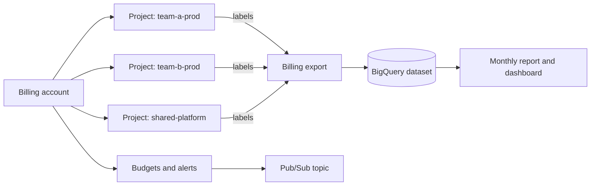

This note is for senior DevOps engineers and the engineering manager who owns the cloud bill. It covers how to attribute cost to teams, how to set budgets and alerts, which levers reduce spend, how to enforce labels in CI, and how to run a monthly review. It leaves the project and folder structure to [[architecture/gcp-resource-hierarchy-and-landing-zone]], workload scaling to [[patterns/kubernetes-autoscaling]] and request sizing to [[patterns/kubernetes-resource-requests-and-limits]].

> [!info] Scope and sources
> Written against Cloud Billing budgets, the Cloud Billing export to BigQuery, and GKE cost allocation, using the documentation on cloud.google.com and the Terraform Google provider docs. No prices or discount terms are given: look them up for your own contract.

> [!note] Not verified
> The claims below were written from documentation knowledge and were not checked against a running system or the current docs: details of the billing export schema, the name and behaviour of the GKE cost allocation feature, which resource types propagate labels to billing data, and the terms of committed use discounts. Check them before relying on them.

## Allocation model

You cannot manage cost you cannot attribute. The model is: every cost lands in a project, every project and resource carries labels that name an owner, and billing data in BigQuery is grouped by those labels into a report.



Projects are the strongest allocation boundary: one team or product per project beats any label scheme. Labels fill the gaps inside shared projects, such as a shared GKE cluster.

Labels and tags are different things. Labels are key-value metadata attached to resources and appear in billing export. Tags are IAM-governed resources that are inherited down the resource hierarchy and can be used in policy conditions. Use labels for cost reporting and tags for governance. Check the current documentation for which one billing data carries for each resource type.

## Mandatory labels

Keep the set small, so it is actually followed.

| Key           | Example values         | Owner               |
| ------------- | ---------------------- | ------------------- |
| `cost-center` | `cc-1042`, `platform`  | Finance partner     |
| `team`        | `payments`, `search`   | Engineering manager |
| `env`         | `prod`, `stage`, `dev` | Platform team       |
| `service`     | `checkout`, `ingest`   | Service owner       |

Label values should use lowercase letters, digits and hyphens, because label rules restrict allowed characters and length; check the current limits. Put the labels into Terraform modules so teams get them by default.

```hcl title="modules/project/main.tf"
variable "labels" {
  type        = map(string)
  description = "Mandatory cost labels for the project."

  validation {
    condition = alltrue([
      for k in ["cost-center", "team", "env"] : contains(keys(var.labels), k)
    ])
    error_message = "labels must include cost-center, team and env."
  }

  validation {
    condition = alltrue([
      for v in values(var.labels) : can(regex("^[a-z0-9_-]{1,63}$", v))
    ])
    error_message = "label values must be lowercase letters, digits, hyphen or underscore, up to 63 characters."
  }
}

variable "project_id" {
  type = string
}

variable "folder_id" {
  type = string
}

variable "billing_account" {
  type = string
}

resource "google_project" "this" {
  name            = var.project_id
  project_id      = var.project_id
  folder_id       = var.folder_id
  billing_account = var.billing_account
  labels          = var.labels
}
```

## Billing export and queries

Enable the standard billing export to a BigQuery dataset in a dedicated, access-controlled project. Billing data is only exported from when you enable it, so enable it early. Grant the finance and engineering management groups read access to the dataset; keep write access to the export service.

```sql title="queries/cost-by-cost-center.sql"
-- Change the table name to your billing export table.
SELECT
  invoice.month AS invoice_month,
  IFNULL(l.value, 'unlabelled') AS cost_center,
  ROUND(SUM(cost) + SUM(IFNULL((SELECT SUM(c.amount) FROM UNNEST(credits) AS c), 0)), 2) AS net_cost
FROM `my-billing-project.billing_export.gcp_billing_export_v1_XXXXXX_XXXXXX_XXXXXX`
LEFT JOIN UNNEST(labels) AS l
  ON l.key = 'cost-center'
WHERE usage_start_time >= TIMESTAMP('2026-10-01')
  AND usage_start_time < TIMESTAMP('2026-11-01')
GROUP BY invoice_month, cost_center
ORDER BY net_cost DESC;
```

Always report an `unlabelled` row. Its size is the main health metric of your allocation: a high share means labels are missing. Project-level labels appear in a separate column from resource labels in the export, so check the schema and decide which to use; mixed use is a common source of double counting.

## GKE cost allocation

Inside a shared GKE cluster, project-level billing shows only the cluster. GKE cost allocation, when enabled, splits cluster cost by namespace and by Kubernetes labels in the billing export. Check the documentation for the exact feature name, how to enable it in Terraform, and what it does not attribute (for example idle capacity, which shows as unallocated cost).

Practical advice:

- Use one namespace per team or service, and put the `team` and `service` labels on pods through your Helm chart conventions (see [[patterns/helm-chart-conventions]]).
- Resource requests drive allocation, so correct requests (see [[patterns/kubernetes-resource-requests-and-limits]]) also make the report fair.
- Decide who pays for idle capacity, and say so in the report. A common choice is to show it as a separate platform line rather than spreading it silently.

## Budgets and alerts

A budget watches spend and notifies at thresholds. It does not stop spend: nothing is shut down when a budget is exceeded. Alerts are for people, and optionally for automation that you build yourself with care.

```hcl title="modules/billing/budget.tf"
variable "billing_account_id" {
  type = string # change: e.g. 000000-AAAAAA-BBBBBB
}

variable "project_number" {
  type = string # change: project number, not project ID
}

resource "google_pubsub_topic" "budget_alerts" {
  name    = "budget-alerts"
  project = "my-billing-project" # change: project that owns the topic
}

resource "google_billing_budget" "team_a" {
  billing_account = var.billing_account_id
  display_name    = "team-a-prod monthly"

  budget_filter {
    projects = ["projects/${var.project_number}"]
  }

  amount {
    specified_amount {
      currency_code = "EUR" # change: your billing currency
      units         = "5000" # change: monthly budget in whole units
    }
  }

  threshold_rules {
    threshold_percent = 0.5
  }

  threshold_rules {
    threshold_percent = 0.9
  }

  threshold_rules {
    threshold_percent = 1.0
    spend_basis       = "FORECASTED_SPEND"
  }

  all_updates_rule {
    pubsub_topic   = google_pubsub_topic.budget_alerts.id
    schema_version = "1.0"
  }
}
```

Notes:

- Forecast-based thresholds warn before the money is spent; actual-spend thresholds only report after.
- Route alerts to a chat channel through the Pub/Sub topic, and name an owner for each budget.
- Do not wire an automatic project shutdown to a budget alert without a long review. Billing alerts can lag, and shutting down a production project is a larger incident than the overspend.

## Levers

| Lever                            | Saving source                              | Risk                                                                  |
| -------------------------------- | ------------------------------------------ | --------------------------------------------------------------------- |
| Right-size requests              | Fewer idle CPU and memory                  | Too little causes throttling or OOM kills                             |
| Autoscaling                      | Capacity follows load                      | Misconfiguration, slow scale-up ([[patterns/kubernetes-autoscaling]]) |
| Spot VMs for tolerant workloads  | Lower hourly price for interruptible nodes | Preemption; only for stateless, retryable work                        |
| Committed use discounts          | Lower price for a commitment               | Commitment you may not use; check current terms                       |
| Storage lifecycle rules          | Move or delete old data                    | Deleting data you needed; keep retention rules aligned                |
| Delete unused resources          | Orphan disks, IPs, idle instances          | Deleting something still used; label and notify first                 |
| Region and machine family choice | Different prices per option                | Latency, compliance with data location rules                          |

Commit only after right-sizing and autoscaling are stable, and size the commitment to your steady baseline, not to your peak.

## Guardrails in CI

Check labels before resources are created. With Terraform, evaluate the plan JSON with Conftest ([[patterns/terraform-plan-policy-checks]]).

```bash
set -euo pipefail

terraform plan -out=tfplan
terraform show -json tfplan > tfplan.json
conftest test --policy policy/ tfplan.json
```

```rego title="policy/cost_labels.rego"
package main

import rego.v1

# Resource types that support labels. Extend this list for your estate.
labelled_types := {
  "google_project",
  "google_compute_instance",
  "google_compute_disk",
  "google_sql_database_instance",
  "google_storage_bucket",
  "google_container_cluster",
}

required_labels := {"cost-center", "team", "env"}

deny contains msg if {
  some rc in input.resource_changes
  rc.type in labelled_types
  "delete" != rc.change.actions[0]
  labels := object.get(rc.change.after, "labels", {})
  is_object(labels)
  missing := required_labels - {k | some k, _ in labels}
  count(missing) > 0
  msg := sprintf("%s is missing cost labels: %v", [rc.address, missing])
}

deny contains msg if {
  some rc in input.resource_changes
  rc.type in labelled_types
  "delete" != rc.change.actions[0]
  object.get(rc.change.after, "labels", null) == null
  msg := sprintf("%s has no labels block; cost labels are required", [rc.address])
}
```

Some resource types report labels under a different field or inherit them from the project, so test the policy against your real plans before enforcing it. Roll out in warn mode first, then enforce.

## Monthly review

For the engineering manager, a 45-minute monthly review with finance and tech leads works well. Link it to your planning rhythm ([[management/planning-and-prioritization]]).

Agenda:

1. Total spend against budget and forecast for the quarter.
2. Spend per team and service, and the share of `unlabelled`.
3. Top five changes since last month and their causes (a launch, a bug, a missing limit).
4. Anomalies and budget alerts that fired, with owner and outcome.
5. Savings actions in progress: owner, expected effect, risk.
6. Commitments and expiring discounts.
7. Decisions needed, and actions with owners and dates.

## Pitfalls

- **Budgets treated as controls.** They notify; they do not cap.
- **Late billing export.** Data before you enabled it is not there.
- **Label sprawl.** Ten mandatory labels mean none are respected.
- **Spending on idle.** Dev and test environments left on overnight are a common and cheap fix.
- **Crediting savings twice.** Commitments and credits change how net cost appears; use a consistent definition of cost.
- **Cost without context.** A rising bill with rising revenue is not the same as a rising bill with flat traffic; report unit costs where you can.
- **Blame culture.** Report to teams for visibility, not punishment, or they will hide spend.

## Adopting incrementally

1. Turn on billing export and build the `unlabelled` query.
2. Agree the four mandatory labels and add them to the project module.
3. Add budgets with forecast alerts for each project.
4. Enable GKE cost allocation on shared clusters and standardize namespaces.
5. Add the label policy in warn mode, then enforce it.
6. Start the monthly review and track the savings backlog like any other work.

## Related

- [[architecture/gcp-resource-hierarchy-and-landing-zone]]: the project and folder structure cost allocation rests on.
- [[patterns/kubernetes-autoscaling]]: the main technical lever for cluster cost.
- [[patterns/kubernetes-resource-requests-and-limits]]: right-sized requests make cost reports fair.
- [[patterns/terraform-plan-policy-checks]]: running policies such as the label check on Terraform plans.
- [[management/planning-and-prioritization]]: how to fit savings work into the roadmap.
